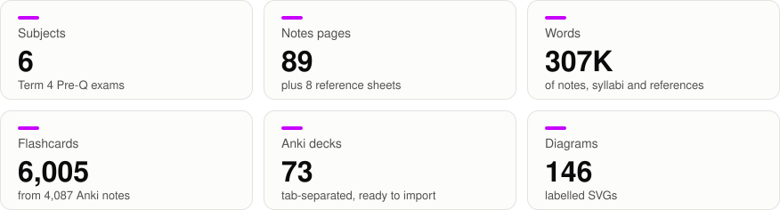

# School study notes

<!-- stats:begin: generated by `python build.py stats` -->

[](https://github.com/xeri/school-notes/wiki)


[](https://github.com/xeri/school-notes/wiki)

<picture>
  <source media="(prefers-color-scheme: dark)" srcset=".github/readme/stats-dark.svg">
  
</picture>
<!-- stats:end -->

Pre-Q syllabuses, revision notes and Anki decks for six subjects.

**📖 Read the notes in the [wiki](https://github.com/xeri/school-notes/wiki)** — that is the reading format. This repository is where the notes are authored.

**Exams start Tue 27 Oct:** [STUDY-PLAN.md](STUDY-PLAN.md) has the exams, priorities, study methods and Anki settings. Each subject's `notes/study-guide.md` is its starting page.

<!-- subjects:begin: generated by `python build.py stats` -->
| Subject | Syllabus | Reference | Notes pages | Flashcards | Diagrams | Words |
|---|---|---|---:|---:|---:|---:|
| Business | [T4-BUQ/SYLLABUS.md](T4-BUQ/SYLLABUS.md) | [CALCULATIONS](T4-BUQ/CALCULATIONS.md) · [TERMS](T4-BUQ/TERMS.md) | 11 | 867 | 13 | 39,933 |
| Economics | [T4-ECQ/SYLLABUS.md](T4-ECQ/SYLLABUS.md) | [DIAGRAMS](T4-ECQ/DIAGRAMS.md) | 13 | 964 | 24 | 59,724 |
| English | [T4-ENQ/SYLLABUS.md](T4-ENQ/SYLLABUS.md) | [TERMS](T4-ENQ/TERMS.md) | 10 | 465 | 0 | 59,319 |
| Geography | [T4-GEQ/SYLLABUS.md](T4-GEQ/SYLLABUS.md) | [CASE-STUDIES](T4-GEQ/CASE-STUDIES.md) · [TERMS](T4-GEQ/TERMS.md) | 31 | 2,350 | 73 | 88,781 |
| Mathematics | [T4-MAQ/SYLLABUS.md](T4-MAQ/SYLLABUS.md) | [FORMULAS](T4-MAQ/FORMULAS.md) | 12 | 558 | 11 | 28,220 |
| Physics | [T4-PHQ/SYLLABUS.md](T4-PHQ/SYLLABUS.md) | [FORMULAS](T4-PHQ/FORMULAS.md) | 12 | 801 | 25 | 30,851 |
| **Total** | | | **89** | **6,005** | **146** | **306,828** |
<!-- subjects:end -->

## Layout

```
T4-<CODE>/
  SYLLABUS.md       exam format, then every assessed objective
  notes/            one page per topic — the explanations and worked examples
  anki/             one tab-separated deck per topic — the rote learning
  <REFERENCE>.md    subject-specific: formulas, glossary, diagrams, case studies
```

`SYLLABUS.md` defines the reading order. Everything else — the wiki sidebar, the
PDF section order — is generated from the links in it, so adding a topic means
adding one row there.

School material (teaching decks, specifications, text extracts, backups and the
Pandoc/Typst binaries) lives in `local/` and is gitignored. None of it is
published; the notes here are written from it.

## Flashcards

Decks are plain tab-separated files with Anki's own header lines, so they carry
their own deck name and note type.

Each line has four columns: note type, then `Front · Back · Hint` for
**Pre-Q Basic** or `Text · Extra · Hint` for **Pre-Q Cloze**. The hint is
optional and shows as a tap-to-reveal link on the front, used on the harder
cards. Both note types need the `Hint` field before a hand import.

Cards follow one rule set: each makes sense shuffled with every other subject,
holds one fact, leads with key terms, and tests formulas and methods rather
than worked numbers.

**Card colour.** The project's accent is electro purple, `#c800ff`. To show
clozes in it, open *Tools → Manage Note Types → Pre-Q Cloze → Cards → Styling*
and set:

```css
.cloze { font-weight: bold; color: #c800ff; }
.nightMode .cloze { color: #c800ff; }
```

**Import by hand** — Anki → *File → Import*, pick a `.txt`, and the header sets
the rest. Re-importing an updated file updates the existing notes rather than
duplicating them.

**Or let Claude do it** — with [AnkiMCP](https://ankimcp.ai) the decks can be
created and kept in sync without leaving the editor:

1. Anki 25.07 or newer, running.
2. Install add-on code `124672614` (Anki → *Tools → Add-ons → Get Add-ons*), then restart Anki.
3. Register the server once:
   ```bash
   claude mcp add --transport http anki-mcp http://127.0.0.1:3141/
   ```
4. Ask for what you want — "import every deck under T4-PHQ/anki", "add 10 cards
   on half-life to Physics::8", "which Physics cards are due".

Anki has to stay open; the server only reaches the collection while the app is
running.

## Study with Claude

[`tools/studymcp`](tools/studymcp/README.md) is a local MCP server that Claude Code starts
from `.mcp.json`. It indexes the notes, decks, syllabi and the local school material, links
every topic to its exam objectives, priority and traps, and keeps a private study record in
`local/progress/`. The `/study` skill runs the sessions: one command, then plain talk. A quick
true/false sweep wakes a topic up, then tasks climb from fixing errors to explaining from memory
(see [STUDY-PLAN.md](STUDY-PLAN.md)).

One-time setup: install [uv](https://docs.astral.sh/uv/), run
`uv sync --project tools/studymcp`, then approve the `study` server when Claude Code asks.

## Build

```bash
python build.py wiki         # regenerate wiki/ from the subject folders
python build.py push-wiki    # regenerate, then push to the GitHub wiki
python build.py pdf          # pdf/<CODE>.pdf for every subject
python build.py pdf PHQ MAQ  # just those two
python build.py stats        # refresh the counts at the top of this README
```

The PDF build needs Pandoc and Typst. Both are already under
`local/toolchain/`; override with `STUDY_PANDOC` and `STUDY_TYPST` if you move
them. Each PDF is one file per subject — syllabus, reference sheets, then every
topic in reading order.
