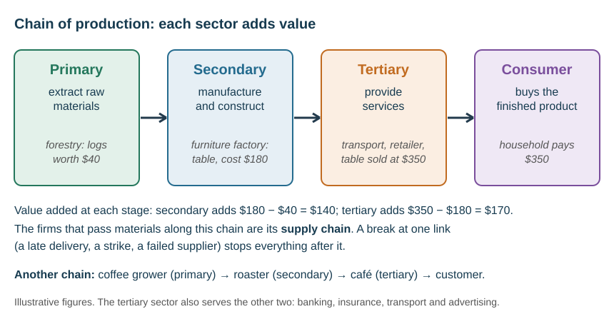
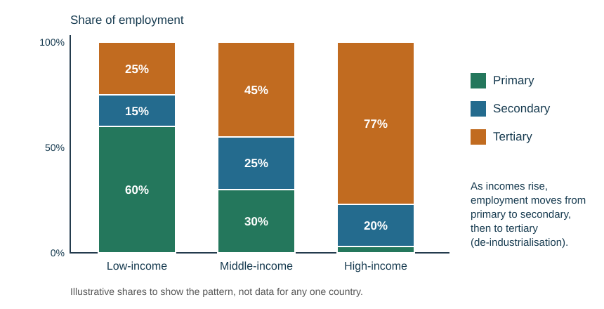
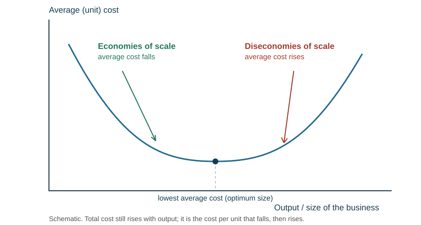
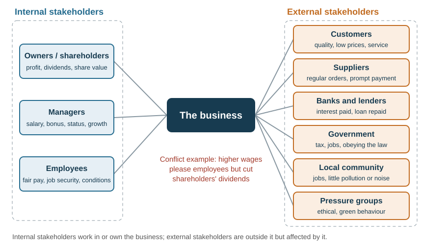

# Understanding business activity

## Purpose of business

**Scarcity** is the basic economic problem: **limited means** (time, money, skills) against **unlimited wants**. A **need** is a good or service essential for living (food, clean water, shelter, clothing); a **want** makes life better but is not essential. Every choice therefore carries an **opportunity cost** — the next best alternative given up.

Goods are **tangible**; services are **intangible**. They are produced with the four **factors of production**: land (natural resources), labour (people's effort), capital (finance, machinery and equipment) and enterprise (the skill and risk-taking of the **entrepreneur** who brings the others together).

A business **adds value**: the difference between the selling price of the finished item and the cost of the bought-in materials and components. A café buying coffee beans for \$0.40 and selling a cup at \$4.50 adds \$4.10 of value through grinding, brewing, service and atmosphere. Added value is **not** profit — profit includes **all** costs, so wages, rent and power still have to be paid from it.

Ways to add value: building a brand, excellent service, extra product features, convenience, attractive packaging and design.

**Specialisation** — people, machines and firms concentrating on the task they do best — raises efficiency and output, but repetitive work can bore workers, and one absent worker or unreliable firm in the chain of production can halt output.

**How to increase added value.** Either raise the price customers will pay (branding, quality, service, convenience, features, packaging) or cut the cost of bought-in materials (cheaper suppliers, bulk buying, less waste). *It depends on* the market: a higher price only adds value if customers see enough extra benefit to keep buying, and cheaper materials only help if quality does not fall.

## Enterprise and entrepreneurs

An **entrepreneur** is a person who organises, operates and takes the risk for a new business venture, bringing the factors of production together.

| Characteristic | Why it matters |
|---|---|
| Risk-taker | risks their own savings and a secure income on an idea that may fail |
| Creative / innovative | spots a gap in the market and a new way to fill it |
| Hard-working and determined | works long hours and keeps going through setbacks |
| Self-confident and independent | backs their own judgement and makes decisions alone |
| Good communicator and organiser | persuades lenders, customers and staff; plans the use of resources |

**In an answer**, link the trait to something the person in the case has actually done — "a risk-taker, because she left a stable job and invested her own savings in the drone business" — not just the trait.

**Why governments support start-ups:** new firms create jobs (lower unemployment), add competition (lower prices, more choice), may grow into large firms that pay tax and export, and bring innovation. **How:** grants and low-interest loans, advice and training schemes for owners, cheap premises in business parks or incubators, and lower taxes or fewer regulations for small firms. *Evaluation:* support costs taxpayers' money, some supported firms would have started anyway, and others fail regardless.

## Classification of business

| Sector | Activity | Examples |
|---|---|---|
| **Primary** | extracting natural resources | farming, fishing, mining, forestry |
| **Secondary** | manufacturing and construction, using the primary sector's raw materials | car assembly, baking, housebuilding |
| **Tertiary** | providing services to consumers and other businesses | retail, banking, hotels, barbers |

The sectors are linked in a **chain of production**: the primary sector supplies raw materials to the secondary sector, whose products reach consumers through the tertiary sector. Each stage adds value. The businesses that pass materials and products along the chain make up its **supply chain**.

Developing countries tend to have more employment in the primary sector. As an economy develops, employment shifts to the secondary and then the tertiary sector — **de-industrialisation** is the decline in the importance of the secondary (manufacturing) sector.

**Why the balance changes.** Primary jobs fall as farming and mining are mechanised and as natural resources run down. Manufacturing grows as a country industrialises, then shrinks in developed countries because labour is cheaper abroad and goods are imported. Services grow because richer people spend more of their income on services (tourism, finance, health, leisure). The shift matters to a business because it decides where demand, workers and competitors will be.

**Private sector** businesses are owned and run by private individuals and firms; the main aim is usually profit. **Public sector** organisations are owned and controlled by government; the main aim is to provide services.

**Economic systems:**

| System | Features | For | Against |
|---|---|---|---|
| **Free-market** | resources privately owned, no government control, prices set by supply and demand | consumer and business choice, competition keeps prices low, incentive to work | no public services, uncontrolled booms and recessions, monopolies |
| **Command (planned)** | government owns and plans all resources | basic needs met for all, less waste | little choice or freedom, little incentive to work harder |
| **Mixed** | both a private and a public sector | combines the two | depends on the balance |

Almost every country is a mixed economy. **Privatisation** is selling government-owned businesses to the private sector — for efficiency, competition and money for the government; against: loss-making services may close, jobs may be cut, and a private monopoly may raise prices. **Nationalisation** is the reverse.

## Business plans and failure

A **business plan** is a formal statement of the business's goals, why they are attainable, and the plans for reaching them, from a marketing, financial and operational viewpoint. It covers the idea and target market, the aims and objectives, market potential and competitors, how and where production will take place, the resources needed, and a financial plan with sources of finance. Owners, lenders (banks, government) and investors use it; one that is too brief may fail to win finance.

Common causes of **business failure**:

- no real differentiation — no unique selling point (USP)
- insufficient cash flow and poor financial management
- poor planning and management — no systems or procedures
- changes in the environment: new laws, new competitors, social trends, economic problems, technology
- overexpansion

New businesses are most vulnerable because they lack a reputation, reserves and established customers.

## Measuring business size

| Measure | Strength | Weakness |
|---|---|---|
| Number of employees | quick and easy | a capital-intensive firm may be huge with few staff |
| Sales revenue | compares firms in the same industry and tracks progress | misleading across industries (high-value vs low-value products) |
| Output | the amount produced | a few staff can make a small output of very valuable products |
| Capital employed | the long-term finance invested | labour-intensive firms use little capital — compare within an industry |
| Market share / market capitalisation | share of the customer base; market capitalisation = share price × number of shares | market capitalisation applies only to a public limited company |

**Profit is not a measure of size** — it measures performance and efficiency. There is no single best measure: use at least two or three. **The measures do not always agree** — an online retailer may be large by revenue but small by employees — so always say which measure you are using.

Owners, banks, investors, government and employees all want to know a firm's size.

| | Small businesses | Large businesses |
|---|---|---|
| ✓ | easily managed, adapt quickly, personal service, informal culture | specialist managers, economies of scale, lower prices, more finance, risk spread across products |
| ✗ | limited finance, owner does every job, risk not spread, few economies of scale | hard to manage, slow decisions, owner–manager conflict |

## Business growth

**Internal (organic) growth** expands the firm from within, usually funded by retained profit: a new branch, more capacity, new products, new markets.

**External growth** is by **merger** (two or more businesses mutually join to form one) or **takeover** (one business buys another, which comes under its name and control).

| Integration | Meaning | Main advantage |
|---|---|---|
| **Horizontal** | same industry, same stage of production | less competition, more market share, economies of scale |
| **Backward vertical** | a firm at an earlier stage, closer to raw materials | guaranteed supply; can stop supplying rivals |
| **Forward vertical** | a firm at a later stage, closer to the consumer | guaranteed outlet; can keep rivals off its shelves |
| **Conglomerate** | an unrelated industry | spreads risk; new skills and ideas |

**Why owners want to expand:** higher sales and profit, economies of scale (lower average cost), a bigger market share and more power over suppliers and prices, spreading risk across more products or markets, and the owners' status and ambition.

| Problem of growth | How it might be overcome |
|---|---|
| Finding the finance | choose the source carefully; grow organically from retained profit |
| Cash-flow strain (overtrading) | cash-flow forecasts, an overdraft facility, growing in stages |
| Diseconomies: slow communication, weak coordination | decentralise, delegate, set clear objectives, better IT |
| Losing personal service and quality | train staff, quality assurance, protect the brand promise |
| Culture clash after a merger or takeover | plan the integration and explain the change to staff |

| Merger or takeover | For | Against |
|---|---|---|
| The business | fast growth, economies of scale, new markets or skills | expensive, risky, clashing cultures, diseconomies |
| Employees | new opportunities | redundancies where jobs are duplicated |
| Customers | lower prices from scale; a wider range | less competition, so possibly higher prices and less choice |

Some firms **stay small** because of the type of industry (personal services such as barbers), a small market (a niche or a rural area), the owners' wish to keep control and avoid stress, or a lack of finance.

## Economies and diseconomies of scale

**Economies of scale** are the lower **average costs of production** a firm gains as it grows.

| Type | Mechanism |
|---|---|
| Purchasing | buying materials and stock in bulk earns cheaper or discounted rates |
| Marketing | bigger campaigns reach a wider audience; the cost is spread over more output |
| Financial | banks see large firms as less risky, so lend at cheaper interest rates |
| Risk-bearing | a wider product range, more customers and more locations spread the risk of failure |
| Technical | the budget to invest in the latest specialised equipment raises efficiency and productivity |
| Managerial | the firm can afford specialist managers (finance, marketing, HR), who decide better than one owner doing everything |

*Numerical illustration.* A \$6000 advertising campaign costs \$3 per unit over 2000 sales but \$1 per unit over 6000 sales — assuming the same campaign supports both volumes. **Total cost and cost per unit are different things.**

**Diseconomies of scale** are when growth makes a firm **less efficient**, so average costs **rise**:

- **labour** — workers on repetitive machine tasks get bored, so motivation and productivity fall
- **communication** — sites across a city, country or world bring language, culture and time-zone barriers
- **management** — many managers at many sites, each with their own style, may conflict over the firm's direction
- **agglomeration** — taking over too many businesses with different methods or stages of production makes the whole hard to understand, run and coordinate

A bigger firm is therefore not automatically safer, more profitable or more efficient.

## Forms of ownership

Choose the form by comparing **control, finance, risk** and the owner's **objectives**.

| Form | Owners | Liability | Finance | Notes |
|---|---|---|---|---|
| **Sole trader** | one | **unlimited** | own savings, loans, retained profit | total control, keeps all profit, easy to set up, secrecy; hard to raise capital, does every job, no continuity |
| **Partnership** | two or more | **unlimited** | partners' capital | more finance, skills and shared decisions; profits shared, disagreements, no continuity, cannot sell shares |
| **Private limited (Ltd)** | shareholders | **limited** | shares sold privately | separate legal identity, continuity; shares cannot be advertised and every shareholder must agree to a sale; accounts must be filed |
| **Public limited (plc)** | shareholders | **limited** | shares sold openly on the stock market | can raise very large sums; very expensive to set up, financial information is public, easy to lose control |

| | Unincorporated (sole trader, partnership) | Incorporated (Ltd, plc) |
|---|---|---|
| Legal identity | the owner **is** the business | the company is a separate legal person |
| Liability | unlimited — personal assets at risk | limited to the amount invested |
| Continuity | ends if the owner dies or a partner leaves | continues when shareholders change |
| Set-up and privacy | cheap, simple, accounts private | registration costs; accounts must be filed |
| Finance | owners' savings and loans | can also sell shares |

**Recommending a form of ownership.** Compare the options on **risk** (how much could the owners lose?), **finance** (how much capital is needed?), **control** (will the owners share decisions?) and **cost and paperwork**. A one-person stall with little capital at risk suits a sole trader; a growing business that borrows heavily or could face large claims suits a private limited company. *It depends on* how much is at stake and whether the owners will share control.

A **deed of partnership** sets out voting rights, each partner's responsibilities and how profit and loss are split. It is not a legal requirement; without one, everything is shared equally.

**Limited liability** means a shareholder can lose no more than the amount invested. It exists because the company is a **separate legal identity** from its owners. Note that a bank may still demand a personal guarantee, which reintroduces personal exposure.

**Shareholders own** a company; **directors run** it on their behalf and are elected at the Annual General Meeting (AGM). A company registers with the Companies Office and needs a **Memorandum of Association** (name, objectives, shareholders' liability, number of shares) and **Articles of Association** (internal rules). A **dividend** is the share of profit paid to shareholders, after tax; it is not compulsory. In a large company the **divorce of ownership from control** means managers may run the business differently from how shareholders would like.

**A public limited company is a private-sector business.** "Public" refers to the sale of shares to the public, not to government ownership — a very common confusion.

**Franchise.** The **franchisor** (the **o**riginal business) sells the **franchisee** (the new, **e**xpanding business) the right to use its name, logo, products and methods in another location, in return for a **start-up fee** and a **percentage of sales revenue**. The franchisor provides training, marketing help and a tried and trusted business model.

| For the franchisee | For the franchisor |
|---|---|
| ✓ lower-risk start with a trusted brand, predictable costs, ongoing support | ✓ quick, cheap expansion without borrowing — franchisees pay to grow the brand |
| ✗ start-up fee and a share of revenue reduce profit; must do things the franchisor's way | ✗ less control — a poor franchisee can damage the brand's reputation |

**Joint venture.** Two or more parties agree to **pool their resources** to accomplish a **specific task**, each responsible for the profits, losses and costs of the project. It can take any legal structure, cross countries, or join the private and public sectors. Reasons: access to new markets and distribution, more capacity, shared risks and costs, specialist staff, technology and finance. Problems: unclear or differing objectives, unequal expertise or assets, and clashing cultures and management styles.

**Co-operative.** Owned and **democratically controlled by its members**, who share equally in decisions. It is run for the **mutual benefit of its members** — for example goods or services at a favourable rate — rather than to earn profit for investors. Types: retail, trading (small firms joining for bargaining power and economies of scale), worker and housing co-operatives.

## Social enterprise and the public sector

**Social enterprise.** Part of the private sector: a business with primarily **social objectives** whose surpluses are **reinvested** in the business rather than used to maximise profit for owners. It produces goods or services, has social and ethical aims, is self-sustaining (not a charity relying on donations), and works to the **triple bottom line** — people, planet, profit.

**Public sector** organisations include public hospitals, schools, the police, the military and government departments. **Public corporations** are wholly owned by the government — often after **nationalisation** (bought from private owners, the opposite of privatisation) — and run by a board of directors the government appoints. Their main aim is to provide key services; others include employment, fair prices, lower costs and environmental targets.

| | Private sector | Public sector |
|---|---|---|
| Main objective | profit, survival, growth, market share | provide an essential service for everyone |
| Success measured by | profit, sales, market share | service quality: waiting times, coverage, cost per user |
| Other objectives | shareholder value, brand image | keep jobs, keep prices fair, break even rather than profit, meet environmental targets |

**Social enterprise objectives** are usually three: **social** (jobs or support for disadvantaged people), **environmental** (protecting the environment) and **financial** (a surplus to reinvest, so the enterprise survives without donations).

## Aims and objectives

An **aim** is where the business wants to go — a statement of purpose. An **objective** is a stated, measurable target for achieving an aim. Objectives give direction, motivation, accountability and a way to assess performance. A **mission statement** condenses the business's core aims in a motivating way; it is quick to communicate but often vague and can look like public relations.

Objectives should be **SMART** — specific, measurable, achievable, realistic, time specific.

| Objective | Typical reason |
|---|---|
| Survival | the first objective of every firm, especially a new one or in a recession |
| Profit maximisation / satisficing | maximising profit, or making enough profit without it being the only focus |
| Growth | economies of scale, market power, owner ambition — but too fast risks diseconomies |
| Market share | being market leader gives room to negotiate margins |
| Maximising sales revenue or shareholder value | sales targets; shareholder value applies to limited companies |
| CSR | ethics, sustainability, environment |
| High-quality service | brand image, loyalty and a premium price |

What sets a firm's objectives: its corporate culture, legal structure, sector (public-sector bodies measure service, such as waiting times) and age. Objectives **change over time**: a start-up aims to survive, then to grow. Objectives can **conflict**: growth may require cutting prices and therefore short-run profit. Any change in objective requires a change in strategy.

**Māori business concepts.** NZ businesses may build these into their model to create a USP, encourage inclusiveness and show cultural responsiveness — differentiating the business, improving its brand image and possibly raising sales.

| Concept | Meaning | In a business |
|---|---|---|
| **Pūtake** | the origin or reason for being | a multiple bottom line — CSR and culture alongside profit |
| **Tikanga** | Māori values | following those values in the way the business operates |
| **Kaitiakitanga** | guardianship of natural resources | sustainability initiatives, succession planning |
| **Manaakitanga** | the ethic of caring and hospitality | a safe, welcoming workplace; looking after guests and customers |
| **Tino rangatiratanga** | self-determination, ownership and control | responsibility for one's own area, targets and mistakes |

## CSR and ethics

**Corporate social responsibility** is a business operating ethically in three areas — the **triple bottom line**: **people** (treated fairly, positive contribution to society), **planet** (environmentally friendly operation) and **profit**. Examples: treating workers fairly, including abroad; sound energy, waste and recycling practices; obeying laws and avoiding bribery; paying bills on time.

| Arguments for | Arguments against |
|---|---|
| better brand image and sales | extra initiatives raise costs, cutting profit |
| can form a USP | can slow or limit expansion |
| easier recruitment and lower staff turnover | shareholders may prefer dividends |
| avoids fines, boycotts and bad publicity | benefits are long-term and hard to measure |

**Ethics** is the idea that businesses should consider the interests of society beyond their legal obligations — deciding what is right and wrong, not just what the law requires. Ethical decisions are **subjective**. Paying the legal minimum wage can be legal but criticised as unethical. Do not assume every ethical change increases profit — judge the specific case.

## Stakeholders

A **stakeholder** is anyone who has a direct interest in the performance of a business. **Internal stakeholders** are inside the business: owners and shareholders, managers and employees. **External stakeholders** are outside it but affected by it: customers, suppliers, banks and lenders, government, the local community and pressure groups.

| Stakeholder | Main aim |
|---|---|
| Owners / shareholders | profit, dividends, rising share value |
| Employees | fair pay, job security, good conditions |
| Customers | quality, low prices, choice, service |
| Banks / lenders | interest paid, loan repaid |
| Government | tax revenue, employment, legal compliance |
| Competitors | their own sales, market share and profit |
| Suppliers | regular orders, prompt payment |
| Community | jobs, choice, little pollution |

**Conflicts** are the examinable point. Raising wages pleases employees but reduces shareholders' dividends. Cutting costs by relocating pleases shareholders but harms employees and the old community. Lowering prices pleases customers but cuts owners' profit. Always name **both** sides and say which stakeholder has the most influence and why.

**Influence** depends on power: shareholders vote and can replace directors; banks can refuse or recall loans; government passes laws and sets taxes; employees can strike; customers can stop buying. A firm usually cannot satisfy everyone, so it **prioritises** — and the best answers say which group wins in *this* case and why.

## Technology and business

Technology can be a source of competitive advantage until rivals copy it. It works through **new processes** (quicker, cheaper, better quality), **solving problems** competitors cannot, **new products**, and **rewriting the rules** so older products become redundant (streaming replacing DVDs).

| Area | Effect |
|---|---|
| Operations | automation and robotics cut unit costs and raise consistency, but need capital and may cut jobs |
| Marketing | e-commerce, social media and targeted advertising reach a wider market at lower cost |
| Communication | email, video calls and shared systems speed up decisions and support remote working |
| Stock control | computerised reordering and barcoding reduce holding costs and stock-outs |
| Employment | demand shifts from unskilled to skilled work; retraining and redundancy costs arise |

Developing new technology is very expensive, and the return depends on how fast the market adopts it. Technology also brings continuing costs: maintenance, training, and the risk of obsolescence or system failure.
