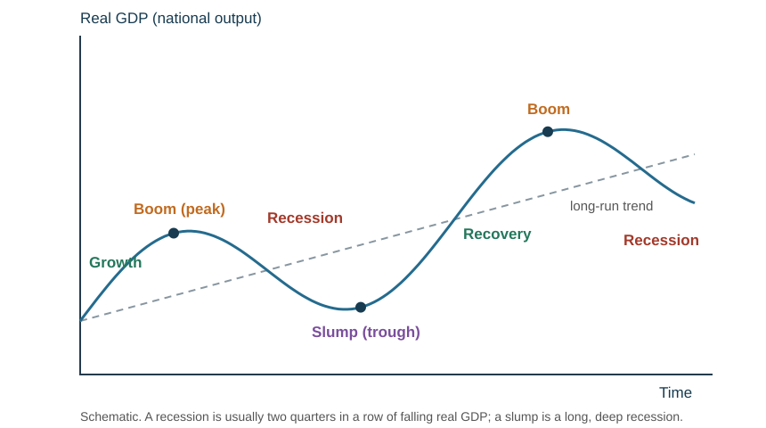

# External influences on business activity

## Government economic objectives

| Objective | Meaning | Problem if missed |
|---|---|---|
| Low and stable inflation | the average price level rises only slowly — most economies aim for about 1–3% a year | real incomes fall, business costs and wage demands rise, buyers turn to imports, sales and jobs fall |
| High and stable employment | as many people as possible in work and staying in work | less income and spending, lower output, higher welfare costs paid for by taxes or cuts elsewhere |
| Economic growth | a rising total output of goods and services — gross domestic product (GDP) | negative growth means less output, fewer jobs, lower incomes and spending, business closures |
| A favourable balance of international trade and payments | exporting more than importing, or reducing a deficit | a deficit can mean borrowing from abroad and a falling exchange rate |

**Unemployment** is people willing and able to work who cannot find paid employment. Imports are paid for in foreign currency, so money flows out; exports bring money in. Many countries run a trade deficit without serious harm if it is managed well.

These objectives can **conflict** in the short run. Stimulating growth may pull in imports and push up inflation; raising interest rates to curb inflation slows growth and raises unemployment.

## Government policies

**Fiscal policy** — changes to government **spending and taxation**.

| Change | Effect on a business |
|---|---|
| Higher income tax (a % of income, rising with income — progressive) | less disposable income → sales fall, output and jobs may be cut; luxury goods suffer most, essentials least |
| Higher corporate tax (a tax on profits — a flat 28% in NZ) | lower profit after tax, less to reinvest, expansion harder, fewer people start businesses |
| Higher indirect tax (GST) | higher prices → demand may fall, especially for elastic goods; workers' real incomes fall, so wage demands rise |
| Import tariffs and quotas | firms competing with imports gain sales; firms importing materials face higher costs; other countries may retaliate against exporters |
| More government spending | more demand, and more contracts for suppliers |
| Subsidies and grants | lower costs for the industries targeted |

**Monetary policy** — influencing monetary conditions, usually through **interest rates**.

| Interest rates rise | Effect |
|---|---|
| Cost of borrowing | repayments on variable-rate loans and overdrafts rise, so profit falls |
| Investment | expansion plans become less attractive and may be postponed |
| Consumer demand | credit-financed purchases (cars, houses, appliances) fall sharply |
| Saving | consumers save rather than spend |
| Exchange rate | foreign savers deposit money to earn the higher interest, so the currency **appreciates** — exports dearer abroad, imports cheaper |

*Example:* on a loan of 100,000 dollars, a year's interest is 10,000 at 10%, 12,500 at 12.5% and 7,500 at 7.5%.

**Supply-side policies** aim to make industries more efficient and competitive: **privatisation** (using the profit motive to raise efficiency), **training and education** to improve workers' skills, and **promoting competition** by reducing government control over industries and acting against monopolies.

**How businesses might respond to government changes:**

| Change | Likely effect | Possible responses |
|---|---|---|
| Income tax rises | customers' disposable income falls, sales of non-essentials fall | cut prices or launch cheaper ranges; promote value; cut costs |
| Corporate (profit) tax rises | less profit after tax to reinvest or pay as dividends | delay expansion; look for cost savings; seek other finance |
| GST (indirect tax) rises | prices rise or margins are squeezed | absorb part of the rise if demand is elastic; pass it on if inelastic |
| Government spending rises | more demand and contracts (schools, roads, hospitals) | bid for contracts; expand capacity; recruit |
| Interest rates rise | borrowing costs up; credit-bought goods sell less | repay or avoid loans; use retained profit; delay investment; offer interest-free credit |
| Interest rates fall | cheaper borrowing; consumers spend more | borrow to expand; invest; increase stock for higher demand |

**Explain the mechanism for the business in the case.** Do not claim one policy helps every firm — a firm with no borrowing and inelastic demand barely notices a rate rise.

## The business cycle

The **business cycle** is the recurring pattern of ups and downs in real GDP over time. There are five stages:

| Stage | Conditions | Typical business response |
|---|---|---|
| **Growth** | rising sales, profits, output, incomes and employment; new businesses form | expand, recruit |
| **Boom** | high demand but the economy "overheats": low unemployment, rising wages, inflation; government may raise interest rates | raise prices, expand capacity — but watch overtrading and rising costs |
| **Recession** | demand, sales and output (GDP) fall; redundancies; firms buy fewer materials. A recession is usually defined as two quarters in a row of falling GDP | cut costs, reduce stock, discount, delay investment |
| **Slump** | a prolonged recession: high unemployment, wage cuts; government spends more, cuts taxes and interest rates | focus on survival and cash |
| **Recovery** | confidence returns, spending, sales and employment rise | rebuild stock and staffing, invest ahead of the upturn |

**Drawing it in the exam:** label the axes **real GDP** (vertical) and **time** (horizontal), draw a wave rising around an upward trend line, and label growth, boom (the peak), recession, slump (the trough) and recovery.

**Firms are affected unequally.** Luxury goods, construction and travel are highly sensitive to the cycle; basic food, utilities and discount retail are far less so, and some discounters grow in a recession.

## Economic influences on a firm

**Inflation** — a sustained rise in the general price level. It raises input costs, erodes customers' real purchasing power, prompts wage demands, and makes planning and pricing harder. It can reduce the real value of existing debt, which helps a borrower.

**Unemployment** — reduces household incomes and total demand, but enlarges the pool of available workers and may hold wages down.

| Change | Impact on businesses |
|---|---|
| Employment rises | more income and spending, so sales rise; but harder and dearer to recruit, wages rise |
| Employment falls | less spending, sales fall (especially luxuries); easier to recruit, less pressure on wages |
| Inflation rises | costs rise; customers' real incomes fall; workers demand pay rises; exports less competitive; harder to plan prices |
| GDP rises | more demand and confidence; good time to expand — but watch capacity and rising costs |
| GDP falls | lower sales and profit; redundancies, closures; cut costs and focus on cash |

**Economic growth** — generally raises incomes and demand, but different sectors benefit by different amounts, and growth can raise costs through labour and material shortages.

**Exchange rates.** Use **SPICED** — Strong Pound (read: a strong currency, such as the NZ dollar), Imports Cheap, Exports Dear.

| Currency weakens (depreciation) | Effect |
|---|---|
| Exports | cheaper to foreign buyers → export volume tends to rise |
| Export revenue in domestic currency | more domestic currency for the same foreign receipt |
| Imported raw materials | **more expensive** in domestic currency → costs rise |
| Net effect | depends on invoicing currency, demand elasticity and the **share of imported costs** |

An exporter that buys most of its inputs abroad may gain little from a weaker currency.

| Currency strengthens (appreciation) | Effect |
|---|---|
| Exports | dearer to foreign buyers → export sales tend to fall, or the exporter cuts its price and its margin |
| Imported materials and goods | cheaper in domestic currency → costs fall for importers |
| Domestic sellers | imported competitors become cheaper, so they lose sales at home |

**Appreciation** is a rise in the value of a currency against another; **depreciation** is a fall. Constant changes make it hard to set prices, plan and budget.

*Worked example (for understanding — the IGCSE syllabus does not examine exchange-rate calculations).* A New Zealand winery sells a bottle for NZ\$20. At NZ\$1 = US\$0.60 the US price is 20 × 0.60 = US\$12. If the NZ dollar **appreciates** to US\$0.70, the same bottle costs 20 × 0.70 = US\$14 in the US, so US sales may fall. If the winery holds the US price at US\$12 instead, it receives 12 ÷ 0.70 = NZ\$17.14 a bottle, so its margin falls. The same appreciation helps an importer: a machine priced at US\$6000 cost 6000 ÷ 0.60 = NZ\$10 000 before, but 6000 ÷ 0.70 = NZ\$8571 after.

## Legal controls

| Area | Typical requirement | Cost of compliance | Cost of non-compliance |
|---|---|---|---|
| Employment | contracts, minimum wage, maximum hours, no discrimination | higher wage bill, admin | tribunal claims, compensation, bad publicity |
| Consumer protection | goods fit for purpose, as described, honest advertising | better materials, accurate labelling | refunds, fines, lost trust |
| Health and safety | safe equipment, training, protective gear | equipment and training cost | accidents, prosecution, compensation, lost output |
| Environment | emission limits, waste disposal rules, planning controls | cleaner processes, treatment plant | fines, clean-up orders, closure |

Compliance raises costs but can be marketed as a strength; non-compliance is almost always more expensive once discovered.

## External influences and constraints

Businesses must react to political, environmental, social, technological, ethical, legal and government influences. Internal factors (company policies, culture, managers, employees) are within the firm's control; external ones (customers, suppliers, competitors, interest groups, the wider economy) are not. An **external constraint** is a limit on business activity that the firm has no direct control over. For example, new technology can make existing products and production methods look old-fashioned and costly, costing jobs in firms that do not adapt, while creating new opportunities for those that do; new competitors reduce sales but can force firms to become more efficient.

## Environmental and ethical influences

An **external cost** (negative externality) is a negative effect on an unrelated third party — air, water or noise pollution. An **external benefit** (positive externality) is a positive effect on a third party — a beekeeper's bees pollinating nearby crops.

A **private cost** or **private benefit** falls on the firm or individual directly involved in a transaction (for a firm, its expenses and its profit). So:

$$\text{social cost} = \text{private cost} + \text{external cost} \qquad \text{social benefit} = \text{private benefit} + \text{external benefit}$$

If social costs exceed social benefits, the government may step in with fines or taxes such as a carbon tax. A **cost-benefit analysis** weighs all the costs and benefits — private and external — before a decision, such as whether to build a new motorway.

*Worked example.* A firm plans a new factory near a town (figures per year, illustrative).

| | Private (to the firm) | External (to others) | Social (total) |
|---|---:|---:|---:|
| Benefits | profit-making revenue 900k | jobs and spending in the town 200k | 1100k |
| Costs | building and running costs 700k | pollution, noise, traffic 500k | 1200k |
| **Net** | **+200k** | **−300k** | **−100k** |

The firm alone would build (private benefit exceeds private cost by 200k), but society loses 100k a year. Government might refuse planning permission, require cleaner equipment, or tax the pollution so the firm pays the external cost. *Limitations of CBA:* external costs such as noise or lost scenery are hard to put a money value on, and different groups value them differently.

**Environmental impact of business activity.** Burning fossil fuels in factories and transport adds to **global warming** and climate change; businesses also cause air, water and noise pollution, waste and landfill, deforestation and loss of habitats, and use up non-renewable resources. **Legal controls** include emission limits, pollution fines, waste-disposal and recycling rules, planning controls and carbon pricing (New Zealand runs an Emissions Trading Scheme).

**How a business can contribute to sustainable development:** renewable energy, recycling and less packaging, cleaner production methods, sustainable sourcing of materials, efficient transport and fewer journeys, and designing products to last or be reused.

**Sustainability** means meeting our needs without compromising the ability of future generations to meet theirs. A sustainable business can attract customers, cut costs (an energy-efficient office spends less on power), gain a USP, and avoid reputational risk — but many measures need investment first.

**Pressure groups** are organisations that aim to change the behaviour of a business that fails to act in a socially or environmentally responsible way, through publicity and protest (Greenpeace). They can organise boycotts and campaigns. Their influence depends on their size, media attention and how exposed the brand is. Government also applies pressure through anti-pollution laws, building regulations and financial penalties.

**Ethical issues a business may face:** **child labour** in its own or its suppliers' factories, **paying fair prices to suppliers** (especially small farmers in poorer countries — Fairtrade), low wages and unsafe conditions, bribery and corruption, misleading advertising, and testing on animals. **Responses:** check and audit suppliers, sign up to Fairtrade or similar schemes, pay at least a living wage, set an ethical code and train staff. Ethical choices often **conflict with profit** in the short run (higher costs), but may pay back through brand image, loyal customers and easier recruitment — or may not, if customers will not pay more.

**Stakeholder conflict** is the heart of most evaluation questions: owners seek returns, employees seek pay and security, customers seek value, and the community may seek less pollution. A cleaner process may cost more initially but reduce waste, reputational damage and future disruption. **Do not assume every ethical change increases profit** — judge the specific case and say what it depends on.

## Business and the international economy

**Globalisation** — the process by which the world is becoming increasingly interconnected through massively increased trade and cultural exchange. It has been driven by cheaper, faster transport, free-trade organisations such as the WTO, the internet and mobile communications, and cheap skilled labour in countries such as India. For a business it means larger potential markets, cheaper sourcing, and far more competition at home. Firms are drawn abroad by cheap materials and labour, good transport, access to markets and friendly government policies.

| Opportunities of globalisation | Threats of globalisation |
|---|---|
| sell to much larger markets abroad (exports) | foreign competitors enter the home market |
| import cheaper materials and components | domestic firms that cannot compete may close |
| set up factories in lower-cost countries | skilled staff may be attracted away by multinationals |
| economies of scale from larger output | exposure to exchange-rate changes and to problems abroad |

**Why governments introduce import tariffs and quotas:** to protect domestic firms and jobs from cheaper imports, to protect new ("infant") industries until they can compete, to raise tax revenue (tariffs), to reduce a trade deficit, and to respond to other countries' barriers or to unfair "dumping" of goods below cost.

A **multinational company (MNC)** has its headquarters in one country (the **home** country) and production or other operations in another (the **host** country). Simply exporting or selling abroad does **not** make a firm multinational.

**Why a business becomes multinational:** lower costs (cheaper labour, materials and land), nearness to new markets and lower transport costs, getting round tariffs and quotas by producing inside the market, access to raw materials, spreading risk across several economies, and economies of scale from global output. *For its stakeholders:* shareholders may gain higher profit; home-country employees may lose jobs; customers may gain lower prices.

| Benefits to the host country | Drawbacks to the host country |
|---|---|
| jobs and training | jobs created are often low-skilled |
| tax revenue | profits taken back home, so little tax may be paid |
| technology and skills transfer | local firms may suffer losses |
| more choice and often lower prices | scarce resources depleted; the MNC may demand grants and influence government |

For the **home** country an MNC can mean higher dividends, overseas opportunities for staff and more tax if profits return home — but jobs, finance and technology may move overseas.

**Protectionism** puts trade barriers in place to protect domestic firms:

- **Tariffs** — a tax on imports. Raises the price of imported goods, protecting domestic producers but **raising costs for firms using imported materials**.
- **Quotas** — a physical limit on the quantity imported, creating shortages and higher prices.
- **Subsidies** — government payments to domestic producers.
- **Embargoes** — a ban on trading certain goods or with certain countries.

| For protectionism | Against |
|---|---|
| protects small, new and local firms; helps declining industries | restricts consumer choice |
| avoids over-specialisation; improves the trade balance | protects inefficient firms; may limit business and job opportunities |
| a response to other countries' barriers | risks retaliation by other countries |

**Free trade** gives access to larger markets, specialisation and economies of scale, cheaper inputs and more consumer choice — against the exposure of domestic firms to stronger foreign competitors.

*Applied example.* A furniture maker imports timber and sells locally. A weaker domestic currency raises timber costs. It could change suppliers, reduce waste, absorb a lower margin, or raise prices. Raising prices is least attractive if customers have many substitutes. A justified recommendation uses the firm's own **cost structure** and **likely customer response**, and names a contingency if the assumption proves wrong.
