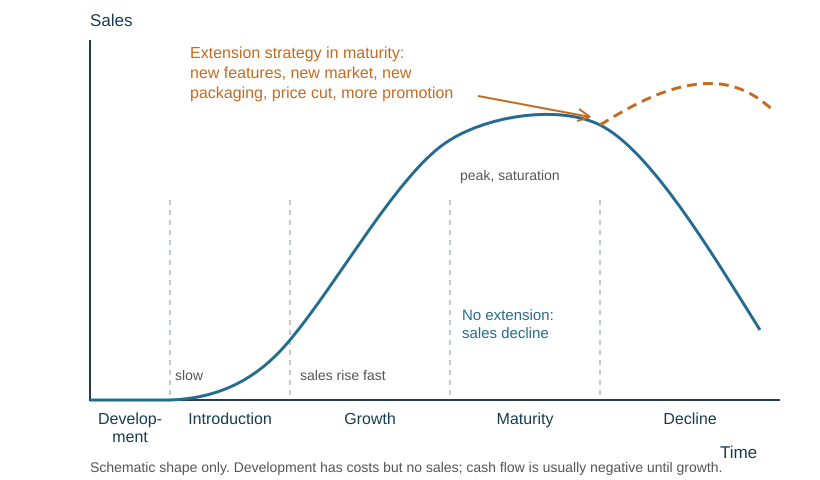

# Marketing

## The role of marketing

**Marketing** is the management process of anticipating, understanding and satisfying customer needs at a profit. A **market** is not a physical place: it exists wherever enough consumers are willing and able to buy and enough producers are willing and able to supply. Market size is the total consumer spending on the product per year.

The role of marketing: identify customer needs, satisfy them, maintain customer loyalty, **build customer relationships**, gain information about customers, and anticipate changes in their needs. Building relationships — loyalty schemes, personal service, follow-up after a sale, social media contact — matters because keeping an existing customer is cheaper than winning a new one, and loyal customers recommend the business. Successful marketing raises awareness, improves brand image, maintains or increases market share and sales, enters new markets and keeps customers.

A **market-oriented** business uses market research to find what its target market wants and adapts its products to that. A **product-oriented** business concentrates on its production processes and products, without market research.

Firms compete on **price** (cuts, discounts, free delivery, special offers) and on **non-price** factors (features, image, packaging, customer and after-sales service, advertising). A **market trend** is the general direction of change in sales over time; demand changes with price, incomes, population, tastes, culture, seasons and technology.

**Why spending patterns change:** changes in income (a recession or a pay rise), tastes and fashion, the age structure of the population, technology (streaming replacing DVDs), awareness of health and the environment, and the price and availability of substitutes.

**Why many markets have become more competitive:** globalisation and lower trade barriers let foreign firms in; the internet lets customers compare prices instantly and buy from anywhere; new technology lowers the cost of entering a market.

**How businesses respond:** market research to spot changes early; new or improved products; adapting the marketing mix (prices, promotion, online channels); better customer service and loyalty schemes; cutting costs to compete on price; or moving into a niche. A business that ignores the change loses sales to those that adapt.

**Market segmentation** groups consumers with similar characteristics, preferences and buying habits — by income, age, lifestyle, gender, location or socio-economic group. It makes marketing more effective and reveals gaps in the market, but data may be lacking, behaviour is hard to predict, and a segment can be hard to reach. The **target market** is the group of consumers a business designs its products and marketing to appeal to.

| | Mass market | Niche market |
|---|---|---|
| Size | large, broad appeal | small, specific needs |
| Competition | intense | often fewer direct rivals |
| Unit cost | low — economies of scale | higher |
| Price | competitive | often premium |
| Risk | heavy investment | vulnerable to a single change in taste |

**Market share** compares one firm's sales with the total market's, using the **same period and the same measurement basis**:

$$\text{market share} = \frac{\text{firm's sales}}{\text{total market sales}}\times100$$

**Market growth** is the percentage increase in the size of the whole market.

## Market research

Good market research reduces the risk of launching something consumers will not buy.

A **market-oriented** business uses research to decide what to make, at what price, where to sell it and how to promote it — and to find the size of the market and the strength of competitors.

**Primary (field) research** collects new data for the present purpose. Specific, up to date and not available to competitors, but slow and expensive. Questionnaires should be short and easy to understand, using **closed** questions (yes/no, fixed choices) for countable answers and **open** questions for opinions.

| Method | Benefits | Limitations |
|---|---|---|
| Postal questionnaire | reaches a wide area cheaply; time to answer | very low response rate; slow; no chance to explain a question |
| Online survey | cheap, fast, easy to analyse; large samples | only reaches people online; respondents may not be the target market; no follow-up questions |
| Face-to-face or phone interview | can explain and probe; high response | expensive and slow; interviewer can bias answers |
| Focus group (consumer panel) | detailed opinions, discussion, follow-up questions | small sample; costly and time-consuming; one strong voice can sway the group |
| Observation | shows what people actually do | does not show why |
| Test marketing | real sales data before a full launch | costly; tells competitors what you are planning |

**Secondary (desk) research** uses data that already exists: internal sales records, government statistics (population, incomes), newspapers and trade journals, competitors' published accounts and websites, internet sources, and **commercial market research reports** bought from specialist agencies. Cheap and quick, but may be out of date, too general, collected for a different purpose, and equally available to competitors. Commercial reports are detailed but expensive.

*Choosing a method — it depends on* the budget, the time available, how detailed the information must be, and what already exists. A new small firm with little money often starts with secondary data and a cheap online survey; a large firm launching a costly product can afford focus groups and test marketing.

**Qualitative** data explains *why* customers behave as they do (opinions, motives); **quantitative** data gives numbers that can be measured and compared.

**Presenting data.** Use a table for exact figures, a pie chart for shares of a whole (such as market share), a bar chart to compare categories, and a line graph to show a trend over time.

**The need for sampling.** A sample stands in for the whole target market because asking everyone is impossible. A **random** sample gives each person an equal chance and avoids sampling bias; a **quota** sample chooses set numbers from each segment (age, sex, income) — well targeted, but slower and not representative of everyone. A bigger sample gives better data but takes longer.

**Bias** makes results unrepresentative: **sampling bias** (some people less likely to be included), **questionnaire bias** (misleading or badly worded questions) and **response bias** (people answering untruthfully, for example to seem socially acceptable). Data may also be out of date or deliberately presented in a biased way.

**Judging reliability** — check:

- **how the sample was selected** — surveying only current customers misses everyone who rejected the product
- **sample size** — too small and the result is chance
- **question wording** — leading questions produce the answer you wanted
- **date** — tastes and competitors change
- **who paid for it** and why

An expensive survey can still be biased. Say *what is wrong with the method*, not just "the sample was small".

## Product

The **marketing mix** is the combination of the four Ps — product, price, promotion, place — which must work together.

A **product** is anything capable of satisfying customer needs: a tangible good or an intangible service. It has **core benefits** (what it does), **tangible attributes** (what it is made of and looks like) and **augmented benefits** (extras that add perceived value, such as the brand name or after-sales service). It must be **fit for purpose**, and its quality must match its price.

**Invention** is discovering a totally new product or method; **innovation** is turning an invention into something customers will buy. New products cost market research, development time and money, and reputation if they fail; they can fill a gap in the market, give a competitive advantage and spread risk.

A **unique selling point (USP)** is a feature or benefit that differentiates a product from its competitors — a lower price, extra functions, a range of colours — and often allows a higher price. **Differentiation** makes the product distinguishable from rivals' by design, quality, brand image or service.

**Branding** creates distinctive, durable perceptions of a product in consumers' minds. It promises that the next purchase will match the last, encouraging repeat purchase and **brand loyalty**, and allows a premium price — but one scandal damages the whole range. **Brand image** is how customers perceive the brand.

**Packaging** protects the contents, helps distribution, sells the product through design and information, adds customer convenience, promotes the brand, encourages impulse buying, and must appeal to retailers.

**New products.** Benefits: fill a gap in the market, attract new customers, extend the product range so that risk is spread, keep up with competitors, and command a higher price while new. Limitations: research and development is expensive and slow, many new products fail, and failure can damage the brand.

**Product life cycle** — the stages a product passes through, shown as **sales over time**. The four main stages are introduction, growth, maturity and decline; a development stage is sometimes shown first.

| Stage | Sales | Typical actions |
|---|---|---|
| (*Development*) | none; costs only | research, testing, no revenue |
| **Introduction** | low; spending high | build awareness: a basic model, limited outlets, high promotion, penetration or skimming price |
| **Growth** | rising fast; revenue overtakes spending | add versions, more outlets, build brand loyalty |
| **Maturity** | peak (saturation), then slowing | defend market share with competitive pricing, reminder promotion, extension strategies |
| **Decline** | falling | keep best sellers, sell only through profitable outlets, withdraw or extend |

**Extension strategies** prolong sales at the maturity or decline stage: more advertising (to remind customers or reach a new segment), a price reduction, adding value with new features, exploring new markets, and new packaging.

**How the stage shapes the rest of the mix:**

| Stage | Price | Promotion | Place |
|---|---|---|---|
| Introduction | skimming (new, unique) or penetration (to win share) | heavy, informative: build awareness | limited outlets |
| Growth | hold or lower slightly as rivals arrive | persuasive: build brand loyalty | more outlets |
| Maturity | competitive; discounts | reminder advertising, sales promotions | widest distribution |
| Decline | cut to clear stock, or keep high for loyal buyers | little or none | only profitable outlets |

*Evaluating an extension strategy:* it costs money, so it is worth it only if the extra sales outweigh the cost, and it may only delay decline. Sometimes launching a new product is the better choice.

A **product portfolio** spreads risk, so that a product in decline is balanced by one in introduction or growth, protecting revenue and cash flow.

## Price

Price is the only element of the mix that directly affects revenue rather than costs. It depends on costs and the profit required, competition, the strength of demand, whether the product is new or unique, the brand image and the marketing objectives — and it must match the perceived quality.

| Strategy | Method | Advantage / drawback |
|---|---|---|
| **Cost-plus** | add a fixed % mark-up to the unit cost | always covers costs and easy to calculate; ignores market conditions |
| **Competitor** | base the price on rivals' prices | rivals will not undercut you; may not cover costs |
| **Penetration** | low price to enter the market | wins rivals' customers; customers may leave when the price rises |
| **Skimming** | high launch price for a new, high-quality or technological product | high revenue and a premium image; lowering it later may suggest lower quality |
| **Premium** | a high price to signal high quality | higher revenue; puts some customers off |
| **Psychological** | \$199.99 rather than \$200 | looks like a good deal; may look cheap |
| **Promotional / loss leader** | a temporary cut, or a price below cost to draw customers in to buy other items | clears stock and builds traffic; some customers buy only the bargain |
| **Contribution** | price set from variable cost, contributing to fixed costs | flexible, suits several products; may not cover all fixed costs |
| **Price discrimination** | different prices based on PED and customers' incomes | maximises revenue; customers may switch if they dislike the price |

**None of these guarantees profit.** A discount can raise volume while cutting contribution per unit.

*Recommending a pricing method — it depends on:* whether the product is new and unique (skimming) or entering a crowded market (penetration or competitive), the brand image (premium), the firm's costs (cost-plus must cover them), the objective (market share or profit), and how price-sensitive the target customers are (PED).

**Price elasticity of demand (PED)** measures the responsiveness of quantity demanded to a change in price:

$$\text{PED} = \frac{\%\ \text{change in quantity demanded}}{\%\ \text{change in price}}$$

Ignore the minus sign when judging the size. (The IGCSE syllabus examines the **meaning** of elastic and inelastic demand and its use in pricing decisions; it does not examine the PED calculation itself.)

- Between 0 and 1 — **inelastic** (essentials such as petrol, few substitutes, a strong brand): a price *rise* increases total revenue; a cut reduces it.
- Greater than 1 — **elastic** (luxuries, many substitutes): a price *rise* reduces total revenue; a cut increases it.

*Numerical example.* A seller shifts 400 bottles at \$20 — revenue \$8000. Cutting the price to \$18 requires $8000/18 = 444.4$, so **445 whole bottles**, merely to match the old revenue. And matching revenue is not matching profit: the extra units carry extra variable cost and the promotion itself costs money. Compare **contribution** after variable costs, less the extra fixed cost of the campaign.

## Promotion

**Promotion** is the communication between a business and its customers: it informs them about the product and persuades them to buy. It is **not** just advertising. Its aims include raising awareness, building or correcting brand image, reminding customers, introducing new products, showing why the product beats rivals, and encouraging retailers to stock it.

**Above-the-line** promotion uses mass media (TV, radio, newspapers, posters). **Below-the-line** promotion does not use mass media and is within the firm's control (sales promotion, sponsorship, direct mail).

**Informative advertising** gives facts (timetables, menus) and builds credibility. **Persuasive advertising** aims to make consumers buy this firm's product rather than a rival's, building brand loyalty — which brings repeat purchases, protects market share, allows a higher price and makes demand less price elastic.

| Method | Purpose |
|---|---|
| **Advertising** (TV, radio, print, online, outdoor) | inform or persuade a wide audience; wide coverage and controlled message, but expensive, one-way and often ignored |
| **Sales promotion** (BOGOF, coupons, free gifts, competitions, loyalty cards) | short-term boost to volume, encourage trial |
| **Personal selling** | explain a complex or expensive product |
| **Public relations / sponsorship** | build image and goodwill |
| **Direct mail and email** | target known customers cheaply |
| **Social media** | cheap reach, interaction, shareable content — but complaints are public |

The choice of promotion depends on the stage of the product life cycle, the nature of the product, competitors' actions, the **marketing budget**, the rest of the mix and the target market. Promotion needs an **objective** and a **measure of response** — not simply a large audience. Judge cost-effectiveness: extra contribution generated against the cost of the campaign. A campaign reaching millions is poor value if almost none of them are in the target segment.

**Legal controls on marketing.** Consumer protection law (in New Zealand, the Fair Trading Act and the Consumer Guarantees Act) stops businesses making false or misleading claims in advertising, labelling or pricing, and requires goods to be of acceptable quality, fit for purpose, safe and as described — with refunds or repairs when they are not. Some advertising is restricted (tobacco, alcohol near children). *Impact on marketing strategy:* promotions must be honest and checkable, faulty or dangerous goods must be recalled, and packaging must carry accurate information. Compliance costs money but builds trust; breaking the law brings fines, recalls, compensation and lasting damage to the brand.

## Place

**Place** is the method of distribution — the **channel of distribution**, meaning every person and organisation a product passes through from producer to end consumer. The aim is the right product in the right place, at the right time, in the right quantities. An **intermediary** is a middleman: a **retailer** sells to consumers; a **wholesaler** buys and stores in bulk from producers and sells small quantities to retailers; an **agent** sells on the producer's behalf.

| Channel | Route | Comment |
|---|---|---|
| Direct | producer → consumer | full control and close customer relationships, no middleman's mark-up; producer pays all storage, delivery and promotion |
| Retailer | producer → retailer → consumer | customers can see the product, retailer holds stock and promotes; retailer takes profit and sells rivals' products |
| Wholesaler | producer → wholesaler → retailer → consumer | wholesaler buys in bulk, stores and transports; adds a mark-up, less control, slower |
| Agent | producer → agent → … → consumer | specialist market knowledge, especially overseas; even less profit and control |
| E-commerce | producer → consumer online | cheap national or global reach, no shop rent, customer data; more competition, delivery costs, returns, no personal contact, fraud risk |

**E-commerce** is buying and selling goods and services online.

| | Opportunities | Threats |
|---|---|---|
| Business | national and global reach; open 24 hours; no shop rent; lower staff costs; customer data for targeted marketing | stronger price competition (customers compare instantly); delivery and returns costs; website and security costs; no personal contact |
| Consumers | wider choice; easy price comparison; convenience; home delivery | cannot see or try the product; delivery delays; fraud and data theft; returns are a hassle |

**Social media and the internet for promotion:** cheap or free reach, targeting by age and interests, two-way contact, content that customers share (word of mouth), and measurable responses (clicks, sales). But negative comments are public and spread fast, accounts need constant updating, and a campaign can be lost among competitors' posts.

Choose the channel by the product, the cost, the business, the market, the speed needed, distance and security. Some firms use several channels (**multi-channel distribution**). A key problem is cutting **delivery lead time** — faster delivery usually costs more.

## Marketing strategy

The four elements must **support each other** and the target segment. A premium handmade product needs a high price, quality packaging, selective promotion in the right media, and an exclusive channel that reaches customers willing to pay. Selling it cheaply in a discount store destroys the brand that justified the price.

When a question asks you to evaluate a mix, check each element for **consistency with the others and with the segment** — that is where the marks are.

A **marketing strategy** is a plan setting out the marketing objectives and the actions and resources needed to achieve them. It identifies the target market, combines the four Ps, and must be cost-effective. Common strategies: grow sales of an existing product, grow sales with new products, grow market share (taking sales from rivals), gain sales in a niche, maintain the status quo in maturity, or exit a declining market.

**SWOT analysis** reviews the business's **internal** strengths and weaknesses and its **external** opportunities and threats.

| | Marketing examples |
|---|---|
| **Strengths** | an innovative product, a convenient location, a trusted brand |
| **Weaknesses** | little differentiation, weak distribution, poor online presence |
| **Opportunities** | new technology, growing overseas demand, social media |
| **Threats** | better or cheaper rival products, an economic downturn, changing tastes |

## Entering new markets

Reasons to expand into another country: a saturated home market, a larger customer base, spreading risk across economies, lower production costs, extending a product's life cycle.

Risks and requirements:

- research into customer tastes, incomes and buying habits
- language, culture and brand-name translation
- legal differences: labelling, safety standards, advertising rules
- distribution and delivery infrastructure
- exchange-rate movements affecting revenue and costs
- tariffs and quotas raising cost or limiting volume

A successful domestic mix usually needs **adapting**, not copying — McDonald's in India sells no beef. Ways to overcome the problems: use local contacts for distribution and marketing, set up assembly or sales-only units overseas, license or franchise to an overseas firm, form a joint venture with an overseas business, merge with or take over an overseas business, and research the market properly first — each trading control against risk and cost.

A **new market** (as opposed to an existing one) is where there is no existing demand and no comparable competitor — Airbnb, Uber and plant-based meat created them. The rewards (sales, brand recognition, market leadership) come with high costs and risk of failure.
