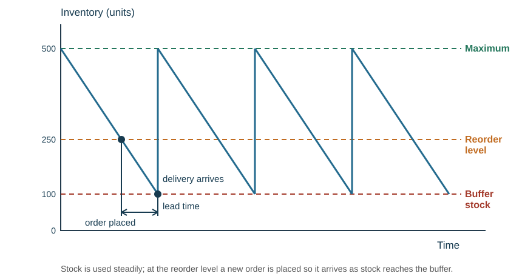
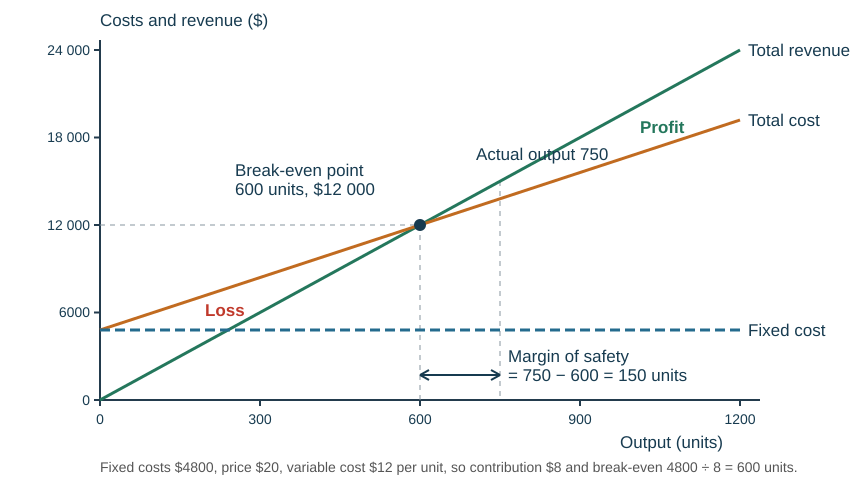

# Operations management

## Production and productivity

**Operations management** is how a business turns its factors of production (**inputs**) into **outputs** — producing the required quality, in the required quantity, at the time needed, in the most cost-effective way. It is concerned with efficiency, quality, and flexibility and innovation.

**Production** turns raw materials into goods and services; it is an **absolute** measure of the amount produced in a period. **Productivity** is the ratio of outputs to inputs — how **efficient** the business is. (Of four farms, the one with most milk has the highest production; the one with most milk per cow has the highest productivity.)

$$\text{labour productivity} = \frac{\text{total output in a period}}{\text{number of employees}}$$
$$\text{revenue productivity of labour} = \frac{\text{total revenue}}{\text{number of employees}}$$

Higher productivity lowers **unit labour cost** — provided pay and quality are unchanged. Ways to raise it: training, performance-related pay, a better working environment, cutting waste, managing inventory well, lean production, and new technology and automation. The benefits: more output and revenue, lower average cost, fewer resources used, more competitive prices, higher wages and higher profit.

**Capital-intensive** production uses more capital than labour (car manufacturing, oil extraction, telecommunications): expensive to buy, but machines run 24 hours without breaks, giving low unit cost at volume and consistent quality; inflexible. **Labour-intensive** production uses more labour than capital (retail, nursing, teaching, fruit picking): lower set-up cost, flexible and personal, a possible USP, but higher unit cost and ongoing training and motivation costs. Which a firm uses depends on its size, the type of business, relative costs and the state of the economy (it is easier to lay off staff than sell machines in a recession).

## Methods of production

| Method | What it is | Suits | Advantages | Drawbacks |
|---|---|---|---|---|
| **Job** | one distinct product at a time to order | bespoke tailoring, wedding cakes, construction | fully customised, premium price, motivating skilled work | high unit cost, slow, skilled labour needed |
| **Batch** | groups of identical items, then a change of task | bakery, paint, clothing sizes | some variety, some economies of scale | downtime between batches, stocks of part-finished goods |
| **Flow** | continuous mass production along a line | cars, bottled drinks, newspapers | very low unit cost, consistent, automated | huge capital cost, inflexible, repetitive and demotivating work, a breakdown halts everything |

Customisation favours job production; stable high demand supports specialised flow equipment. The choice depends on the nature of the product (niche or mass), the size of the market, the nature of demand and the firm's productive capacity.

*Recommending a method:* a café making each drink to order uses job production; a bakery making trays of one loaf, then another, uses batch; a soft-drink bottler with steady national demand uses flow. A growing firm often moves from job to batch to flow as demand rises and becomes predictable.

## Technology in production

| Technology | What it does |
|---|---|
| **CAD** (computer-aided design) | designs and tests products on screen; quick to change; designs sent straight to machines |
| **CAM** (computer-aided manufacture) | computers control the machines and robots that make the product |
| **CIM** (computer-integrated manufacturing) | CAD and CAM linked, with stock control and ordering, in one system |
| Robots and automation | repetitive, heavy or dangerous work done fast and consistently, 24 hours |
| EPOS, barcodes, contactless payment | faster checkouts, automatic stock records and reordering |
| Online ordering and banking | customers order and pay remotely; lower staff and branch costs |

**Benefits:** higher productivity and lower unit cost, consistent quality, less waste, faster response to customers, safer work. **Limitations:** high capital cost, training, maintenance and breakdowns, rapid obsolescence, and redundancies that can hurt morale and reputation. *It depends on* the scale of output — automation pays only when volume is high enough to spread the cost.

## Inventory

**Inventory** (stock) is the goods and materials a business holds: **raw materials**, **work in progress** (semi-finished goods) and **finished goods**. For a bakery, flour is a raw material, dough is work in progress and a packaged loaf is a finished good.

**Why hold inventory:** to keep production running if a delivery is late, to meet sudden or seasonal demand without losing customers, to win bulk-buying discounts, and to have products on display.

The **costs of holding inventory**: storage, handling, shrinkage (damaged, lost or stolen stock), insurance, obsolescence, and the opportunity cost of working capital tied up in stock.

**Delivery lead time** is the time between placing an order and receiving it. The longer it is, the larger the **buffer** stock needed to keep production running. Too much inventory means storage costs and tied-up cash; too little means production stops and there is nothing to sell.

**Reading the chart.** The **maximum** level is the most the firm wants to store. Stock falls as it is used. When it reaches the **reorder level**, an order is placed; it arrives after the **lead time**, just as stock reaches the **buffer stock** (the minimum kept for emergencies). A longer lead time or faster usage needs a higher reorder level. JIT aims to shrink this whole chart towards zero.

## Lean production and JIT

**Lean production** is producing goods and services with the minimum of wasted resources while maintaining high quality. The wastes: excess transport, excess inventory, unnecessary movement by workers, waiting time, overproduction (producing ahead of demand), over-processing, and defects. The benefits — less storage, quicker production, better use of equipment — cut costs, allowing lower prices and greater competitiveness.

**Kaizen** is the Japanese term for **continuous improvement**: a series of small improvements suggested by the employees who do the job every day, rather than one large investment. It reduces waste and work-in-progress stock, improves quality, and raises motivation through teamwork and involvement in decisions.

**Just-in-time (JIT)** keeps stock to a minimum: materials arrive just in time to be used, and goods are not produced until a customer has ordered them. It relies on reliable suppliers, good quality control and a skilled workforce.

| Benefits | Risks |
|---|---|
| less capital tied up in stock | a single late delivery halts production |
| lower storage and insurance cost | no buffer against a demand surge |
| less waste from obsolete or damaged stock | loses bulk-buying discounts |
| problems surface immediately | needs utterly reliable suppliers and good IT |

## Break-even analysis

Let $F$ be total fixed costs, $p$ the selling price per unit and $v$ the variable cost per unit.

$$\text{contribution per unit} = p - v$$
$$\text{break-even output} = \frac{F}{p-v}$$
$$\text{profit} = q(p-v) - F$$
$$\text{margin of safety} = \text{actual output} - \text{break-even output}$$

**Break-even analysis** uses charts or calculations to find the output at which a business covers its costs. The **break-even point** is where total cost = total revenue, so profit is zero.

**Using cost data to decide.** Cost information helps set prices, decide whether to continue or stop making a product, choose a location or supplier, and set budgets. *Example:* a product sells for \$10 with a variable cost of \$7, so each unit still contributes \$3 towards fixed costs. Stopping it would not remove the shared fixed costs, so in the short run the firm is better off continuing — unless the resources could earn more contribution making something else.

**Fixed costs** (overheads) do not change with output and must be paid even with no sales (rent, insurance, salaries). **Variable costs** (direct costs) change with output (materials, piece-rate wages, power used in production). **Total cost** $= F + vq$. **Total revenue** $=$ price × quantity sold. **Average cost** $=$ total cost ÷ output. Each unit's **contribution** goes first towards the fixed costs, then to profit.

**Worked example.** $F = \$4800$, $p = \$20$, $v = \$12$.

- Contribution $= 20 - 12 = \$8$ per unit
- Break-even $= 4800/8 = 600$ units
- At 750 units: margin of safety $= 150$ units
- Profit $= 750(8) - 4800 = \$1200$
- Check: revenue $750\times20 = \$15\,000$; total cost $4800 + 750(12) = \$13\,800$; profit $\$1200$ ✓

**Break-even chart.** Output on the horizontal axis, costs and revenue in dollars on the vertical. Plot fixed cost as a horizontal line, total cost rising from the fixed-cost intercept, and total revenue rising from the origin. Break-even is where total revenue crosses total cost; the vertical gap between them to the right is profit, to the left is loss.

**Drawing one in the exam:**

1. Label both axes, with units: "Output (units)" and "Costs and revenue (\$)".
2. Work out each line at zero output and at the maximum output in a small table. Two points make each straight line.
3. Draw fixed cost (horizontal), total cost (starting at the fixed-cost level) and total revenue (starting at zero). Label every line.
4. Mark the break-even point, drop a line to the output axis, and read it off.
5. Mark the margin of safety between break-even and actual output, and shade or label profit and loss.

For the example: at 0 units, FC = TC = 4800 and TR = 0; at 1200 units, TC = 4800 + 1200 × 12 = 19 200 and TR = 1200 × 20 = 24 000.

**Amending the chart:**

| Change | What moves | Effect on break-even |
|---|---|---|
| Price rises | total revenue line becomes steeper | falls (fewer units needed) — if sales hold up |
| Variable cost per unit rises | total cost line becomes steeper | rises |
| Fixed costs rise (new premises) | fixed and total cost lines shift up | rises |
| Fixed costs fall | fixed and total cost lines shift down | falls |

*Example:* raising the price to \$22 makes contribution \$10, so break-even falls to 4800 ÷ 10 = 480 units. But if the higher price cuts sales below 480 units, the firm makes a loss. **Margin of safety** can also be given as a percentage of actual output: 150 ÷ 750 × 100 = 20%; the bigger it is, the further sales can fall before a loss.

**Uses.** Break-even information shows the profit or loss at different outputs, the **margin of safety**, and what happens if costs or prices change; it helps planning and applying for finance.

**Limitations.** The model assumes a constant price (in reality the price may have to fall to sell more), constant variable cost per unit (bulk buying makes it cheaper), fixed costs unchanged (a move to larger premises raises them), and that **everything produced is sold**. Most businesses sell more than one product, and shared overheads are hard to allocate between them. If contribution is zero or negative, there is no viable positive break-even volume at all.

## Quality

**Quality** means a good or service that meets or exceeds customer expectations — it is **fit for purpose**. It is subjective and relative to price and the type of product; market research finds what customers expect. Good quality builds reputation, brand image, competitive advantage, loyalty and long-term profit; poor quality brings refunds, repairs, lost sales and a damaged image.

**Quality control** — inspectors check the good or service at the **end** of production to detect faults. Less training is needed and defective products are stopped, but the waste has already been created, it is hard to find where the fault occurred, and workers take no responsibility for it.

**Quality assurance** — checking for faults at **each stage** of production, putting prevention before inspection ("getting it right first time"). Fewer defects and lower costs as errors are found at source, but training workers to check is expensive.

**Total quality management (TQM)** is a philosophy rather than a process: quality is **every employee's responsibility**, with prevention rather than solution and an aim of **zero defects**. It applies kaizen to each individual, motivates through responsibility and fits with lean production, but relies on employees believing in it and is expensive to train for.

| | Quality control | Quality assurance | TQM |
|---|---|---|---|
| When checked | at the end of production | at every stage | constantly, by everyone |
| Who checks | specialist inspectors | workers check their own stage | every employee, every department |
| Aim | find and remove faulty products | prevent faults happening | zero defects, a culture of quality |
| Main drawback | waste already made; no one owns the fault | training cost; relies on workers | expensive; needs full staff commitment |

*Recommending an approach:* quality control suits a small firm with simple products; quality assurance suits a firm whose customers need guaranteed standards (food, medicines, car parts); TQM suits a firm committed to lean production. Many firms combine assurance during production with a final check.

**Quality circles** are small groups of workers who meet regularly to identify and solve problems in their production process. **Benchmarking** compares the firm's performance and quality standards with the best firms in the industry.

| Costs of poor quality | Costs of improving quality |
|---|---|
| scrap and rework | training |
| warranty claims and refunds | inspection and monitoring time |
| lost customers and bad reviews | better materials and equipment |
| damaged brand reputation | slower output during the change |

Reducing defects cuts rework and complaints — but say in your answer that the training and monitoring have a cost, then judge whether the saving exceeds it.

## Location

**Location** is the place where a firm decides to site its operations. It has a direct effect on both **costs and revenues** and is a key operations decision. Choose premises from the firm's **actual needs**, not a general list.

| Factor | Why it matters |
|---|---|
| Scale of production | a large plant needs a large, affordable site |
| Main customer markets | essential for retail and perishable goods — bread and dairy producers locate near major retailers |
| Access to materials and components | matters where suppliers are located and inputs are bulky |
| Ports or airports | needed if supplies are imported |
| Labour | skilled staff may only be found in certain areas; low-skilled work (a supermarket) can locate almost anywhere |
| Availability and cost of premises | rent and set-up costs are major fixed costs |
| Infrastructure | roads, rail, sea and air links, reliable power and internet |
| Being near other businesses | rivals compete directly but together draw more customers, and can share **ancillary firms** (distribution, warehousing, specialists) |
| Climate | a warmer climate can lower heating costs |
| Security | low-crime areas need less security equipment |
| Owners' personal preferences | near family, friends or schools |
| Government influence | grants, low-interest loans and tax breaks in areas of high unemployment; planning laws can also forbid some sites |
| Room to expand | avoids a costly second move |

**Optimal location** gives the best combination of **quantitative** factors (rent, labour and transport costs, set-up costs, sales potential) and **qualitative** factors (safety, room to expand, personal preference, ethical and environmental concerns), so that the business can achieve maximum profit. It usually means a compromise: a high-street store gets foot traffic but pays high rent; a remote factory has low rent but high transport costs.

A **non-optimal location** brings high fixed site costs (a high break-even level and low profit if capacity is under-used), high variable costs (low contribution per unit), recruitment problems where unemployment is low, and weak demand where unemployment is high.

**Infrastructure** — the facilities that support everyday economic activity, such as roads, railways, water, power and telecommunications. An efficient transport network lets staff get to work and moves supplies and products cheaply and quickly. Its importance **depends on the type of business**: a delivery-only restaurant need not be convenient for customers, but wants cheap premises near good transport links.

**Manufacturing versus service location.** A manufacturer weighs the cost and nearness of raw materials (especially if bulky or heavy), transport links to customers, a large affordable site, a supply of suitable labour, power and water, and government grants. A service business (shop, café, bank, hairdresser) cares most about being close to its customers — foot traffic, parking, visibility and nearness to complementary businesses — and about rent; some online services can locate almost anywhere with good internet.

**Legal controls on location:** planning permission and zoning (industry may be banned from residential areas), environmental rules on noise, pollution and waste, health and safety rules, and restrictions on opening hours. Governments also encourage location in some areas with grants and tax breaks. A site that looks cheap may be unusable once these controls are checked.

**Lowest rent need not mean lowest total cost** — cheap premises far from customers add transport cost and lose sales.

*Contrast.* A bakery delivering fresh products needs quick access to its customers and so pays for a central location. An online service values skilled staff and reliable communications far above passing foot traffic, and can locate cheaply.

**Multi-site locations.** Most large retailers and service providers operate in more than one place.

| Advantages | Disadvantages |
|---|---|
| greater convenience for customers | coordination problems between sites |
| lower transport costs with regional suppliers | less control if a site goes its own way |
| another site can cover during industrial action | hard to standardise, especially across countries |
| decentralised, faster decisions; cost advantages abroad | **cannibalism** — sites too close together take each other's customers |

**Locating in another country.** **Offshoring** is relocating a business process from one country to another (a call centre moved overseas). A **multinational** has its headquarters in one country and operations or production bases in another.

| Why locate abroad | Why not |
|---|---|
| reduce costs — cheaper materials and labour | language and communication barriers, and time differences |
| access wider markets, including the surrounding region | cultural differences and misunderstandings |
| avoid trade barriers by producing inside them | different ideas of a good level of service |
| government incentives and a supply of specialist labour | supply-chain problems — less control over quality and reliability |
| | ethics — job losses at home can hurt reputation and finances |
