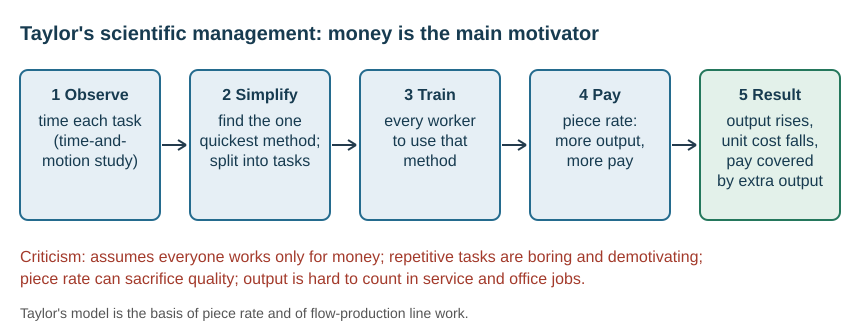
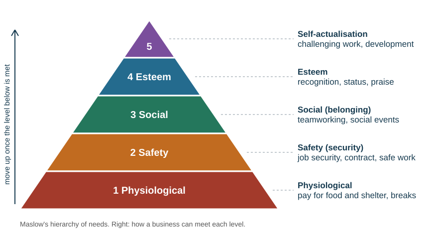
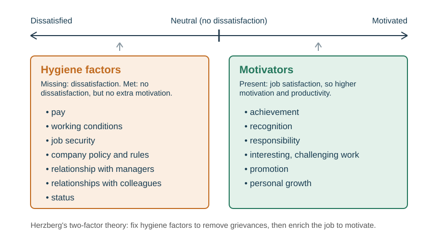
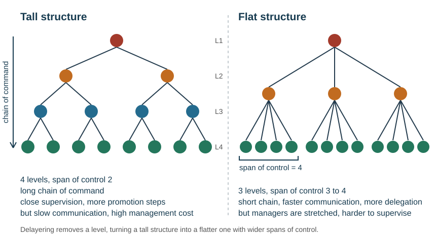
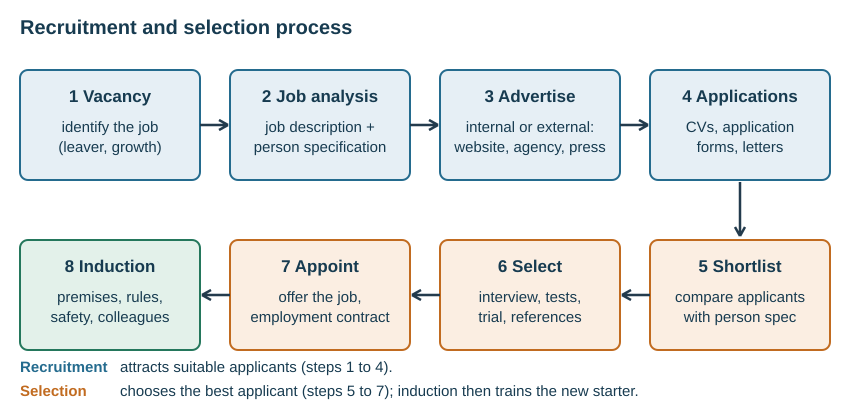

# People in business

## Why motivation matters

**Motivation** is the driving force behind human behaviour — why we do what we do. At work it is the desire an employee has to work hard and do a good job. People work for money, to feel useful, to learn new skills and to meet people. A well-motivated, satisfied workforce gives higher productivity, better quality, lower absenteeism, lower staff turnover (and so lower recruitment and training costs), better co-operation and a better corporate image.

Pay matters, but so do recognition, security, responsibility and conditions. A pay rise will not fix high turnover caused by poor supervision — diagnose the actual cause before recommending a remedy.

## Motivation theories

**Taylor — scientific management.** Money is the main motivator. Organise each job so every worker does it the same, most time-efficient way, specialising in one task, and pay **piece rate** so the more output, the more pay — the extra pay is covered by the extra productivity. *Criticism:* assumes everyone is motivated only by money; repetitive tasks demotivate; productivity is hard to measure in office jobs.

*Where Taylor still fits:* simple, countable, repetitive work such as fruit picking or a production line. *Where it fails:* skilled, creative or service work, where quality and teamwork matter more than speed.

**Maslow — hierarchy of needs.** Needs form five levels; a person moves up only once each level is satisfied.

| Level | Need | How a business meets it |
|---|---|---|
| 5 | Self-actualisation | challenging work, promotion, personal development |
| 4 | Esteem | recognition, status, job titles, praise |
| 3 | Social (belonging) | teamworking, social events, communication |
| 2 | Safety | job security, safe conditions, a contract |
| 1 | Physiological | pay sufficient for food and shelter, breaks |

*Using Maslow in an answer:* first identify which level the workers have already reached, then offer the **next** level up. Low-paid workers worried about rent need secure pay and contracts (levels 1–2); well-paid, secure professionals need recognition and challenge (levels 4–5).

*Criticism:* it assumes everyone is the same — an older worker near retirement may work for enjoyment and company, while some people are motivated purely by money and status.

**Herzberg — two-factor theory.**

- **Hygiene factors** (pay, working conditions, job security, status, relationships with managers, rules) do not motivate, but must be satisfied or job satisfaction and productivity fall.
- **Motivators** (achievement, recognition, responsibility, interesting work, promotion, personal development) increase motivation and productivity.

Herzberg's conclusion: improve pay and you remove a grievance; **enrich the job** and you create motivation. *Criticism:* can a person's wants ever be fully satisfied, and everyone is different.

**McGregor — Theory X and Theory Y.** Two views managers hold of their workers.

| | Theory X manager ("work-centred") | Theory Y manager ("people-centred") |
|---|---|---|
| Believes employees | dislike work and responsibility, have little ambition, dislike change, are motivated only by money or the threat of losing their job | like work and responsibility, care about the organisation, need little supervision, want variety and to develop their full potential |
| So manages by | close supervision, with higher wages and job security | support, development opportunities and positive feedback |

Treat all four as models to apply critically, not as promises that everyone responds identically.

## Financial motivators

| Method | How it works | Risk |
|---|---|---|
| **Wage** (time rate) | paid per hour worked, usually weekly; overtime at 1.5–2 times the rate | easy to calculate, but does not reward the more productive worker |
| **Piece rate** | paid per unit produced | encourages speed; **quality may fall**, so costly quality control is needed |
| **Salary** | fixed annual amount, paid fortnightly or monthly | security, but extra work is not usually paid |
| **Commission** | a percentage of the sales the employee makes | drives selling; pressure selling can harm reputation, and pay drops in a bad month |
| **Bonus** | a lump sum, usually at the end of the year | a good motivator; resentment from those who miss out |
| **Profit sharing** | a small share of profit on top of pay | builds loyalty; less profit is left to reinvest |
| **Performance-related pay** | pay linked to an appraisal of how effective the work is | used where output cannot be counted; appraisal is subjective and needs trained staff |
| **Share ownership** | employees are given shares, earning dividends | encourages efficiency and loyalty; reduces other shareholders' dividends |
| **Fringe benefits** | company car, discounts, health insurance, gym membership | make the job more attractive and retain staff; can cost the business less than an equal pay rise |

## Non-financial motivators

- **Job rotation** — moving between tasks of similar difficulty. Reduces boredom and builds flexible cover; does not add responsibility.
- **Job enlargement** — more tasks at the same level. Can feel like more work for the same pay.
- **Job enrichment** — more challenging tasks and genuine responsibility, with the training to handle them. Herzberg's recommended route.
- **Teamworking** — meets social needs, allows mutual support and shared problem-solving.
- **Training** — raises skill and confidence, and signals that the employer values the worker. Costs time and money before benefits appear.
- **Opportunities for promotion** — a visible route rewards effort and retains ambitious staff.

## Organisational structure

| Term | Meaning |
|---|---|
| **Hierarchy** | the levels of authority in the organisation |
| **Chain of command** | the route down which instructions pass |
| **Span of control** | the number of subordinates a manager directly supervises |
| **Delegation** | entrusting tasks and responsibilities from senior managers to junior managers or employees |
| **Accountability** | the manager remains answerable even after delegating |
| **De-layering** | removing a level of management |
| **Levels of hierarchy** | the number of layers of authority from top to bottom |

An **organisational chart** shows these relationships. Departments may be organised by function, product, customer group or region.

**Reading a chart.** Count the **levels of hierarchy** (rows of boxes), the **span of control** of a manager (the boxes directly below them) and the **chain of command** (the line from the top to a given worker). The longer the chain, the slower and more distorted the messages.

| Role | Responsibility |
|---|---|
| **Directors** | elected by shareholders; set the long-term objectives and strategy; answer to shareholders |
| **Managers** | turn the objectives into plans for a department; organise resources and staff; answer to directors |
| **Supervisors** | oversee the daily work of a team on the shop floor; report problems up to managers |
| **Other employees (workers)** | carry out the tasks; report to supervisors |

Authority and responsibility flow **down**; information and accountability flow **up**. Each level depends on the one above for direction and the one below for results.

**De-layering** — removing a management level — cuts salary costs, shortens the chain of command (faster communication and decisions) and widens spans, giving staff more responsibility (Herzberg). But it brings redundancy costs, may lower the morale of the remaining managers, overloads them with wider spans, and leaves fewer promotion steps. *It depends on* whether the staff are skilled enough to work with less supervision.

**Tall structure** — many levels, long chain of command, narrow spans, little delegation. Easier supervision, managers can specialise, and delegation prepares staff for promotion; but high management cost and slow decision-making.

**Flat structure** — few levels, short chain of command, wide spans, more delegation. Lower management cost and more freedom, which can raise motivation; but staff are harder to supervise and communicate with, may lack the skills needed, and objectives may be unclear.

**Centralised** organisations keep authority and decision-making at the top (usually tall structures). **Decentralised** organisations delegate most decisions down the chain of command (usually flat structures).

A **wider span of control** needs experienced, capable staff and work that is similar and low-risk. **Delegation** motivates (it adds responsibility — Herzberg) and frees the manager's time, but requires trust and training, and the manager keeps the accountability.

**Trust versus control.** Delegating means trusting the subordinate and giving up some control. Too little delegation overloads the manager and demotivates staff; too much, to untrained staff, risks mistakes the manager is still accountable for. Managers delegate less when the task is high-risk, the staff are inexperienced, or the manager is insecure.

## Management and leadership

The functions of management: **planning, organising, coordinating, commanding (directing) and controlling.**

| Style | How decisions are made | Suits |
|---|---|---|
| **Autocratic** | the leader decides and instructs | emergencies, inexperienced staff, safety-critical work |
| **Democratic** | the leader consults and involves staff | skilled, experienced teams; decisions needing buy-in |
| **Laissez-faire** | the leader sets the goal and leaves staff to it | creative, highly expert professionals |

The suitable style depends on **urgency, the experience of the staff, and the risk** involved. Democratic leadership uses employee expertise and raises motivation, but consultation takes time.

| Style | Advantages | Disadvantages |
|---|---|---|
| Autocratic | quick decisions; clear control; suits a crisis | staff feel unvalued, little two-way communication, ideas lost, low motivation |
| Democratic | uses staff ideas; higher motivation and commitment (esteem needs) | slow; the leader may still have to overrule; not for urgent decisions |
| Laissez-faire | freedom motivates experts; encourages creativity | little direction; poor coordination; disastrous with inexperienced staff |

*Recommending a style:* an autocratic style suits a new team in a safety-critical factory, or an emergency; democratic suits skilled staff whose support is needed for a change; laissez-faire suits a small team of designers or researchers. A manager may switch style as the situation changes.

## Communication

Effective communication is clear, easy to understand and allows for feedback. The process requires a **sender**, a **clear message**, a suitable **channel (medium)**, a **receiver**, and **feedback** confirming understanding. Communication is **internal** (within the business — vertical between manager and employee, horizontal between colleagues) or **external** (with customers, suppliers, government).

| Type | Examples |
|---|---|
| Verbal | meetings, briefings, telephone, video call |
| Written | email, notice, report, letter, route sheet |
| Visual | chart, diagram, video, demonstration |

**One-way** communication gives no feedback and so no confirmation of understanding. **Two-way** allows questions and correction. **Formal** channels follow the hierarchy; the **informal** "grapevine" is fast but unreliable and can spread rumour.

**Choosing a method.**

| Method | Benefits | Limitations |
|---|---|---|
| Face-to-face meeting or briefing | immediate feedback, body language, suits sensitive news | no permanent record; hard to gather everyone |
| Phone call | quick, personal, two-way, confirms the message arrived | no record; the receiver may not answer |
| Letter or written report | permanent record, detailed, can be checked later | slow; no immediate feedback |
| Email | fast, cheap, a record, one message to many people | may be ignored or not read; impersonal; relies on internet access |
| Video conference | face-to-face across sites and countries, saves travel | needs reliable technology; time zones; less personal than meeting |
| Text and messaging apps | instant, read quickly | short only; informal; may be missed or misread |
| Intranet and notice boards | one place for information for all staff | staff may not check; one-way |
| Social media and website (external) | cheap reach to customers; two-way | public complaints; must be monitored |

*Recommending a method:* match it to **urgency** (phone, message), **the need for a record** (email, letter), **the need for feedback** (face-to-face, phone), **the number of receivers** (email, intranet) and **sensitivity** (face-to-face). Urgent news that must definitely reach one person is best given by phone, with a written follow-up.

**Why communication fails:** a long chain of command distorts messages, the wrong medium is chosen, the sender uses jargon, the receiver is not listening or does not trust the sender, or there is no feedback. Ineffective communication brings mistakes, wasted time, lower motivation and lost customers.

**Barriers and remedies:**

| Barrier | Remedy |
|---|---|
| Language barriers | use different methods; keep records so messages can be re-sent |
| Technical jargon the receiver does not understand | short, to-the-point, jargon-free messages |
| Receiver hears only the parts they want | ask for feedback — the receiver confirms or repeats back |
| Wrong channel for the message | choose the method for the audience: written for detail, face-to-face for sensitive news |
| Too long a chain of command | de-layer, or go direct |
| Staff who communicate poorly | train employees in effective communication |

*Application example.* A delivery firm changing routes should issue an **accurate written route sheet** (detail, reference), give a **face-to-face briefing** (questions), and **confirm understanding** before the first run. The mechanism is fewer misunderstood instructions → fewer missed deliveries → lower redelivery costs. Naming the firm without this chain of reasoning earns little application credit.

## Trade unions

Businesses want to keep costs down; employees want higher pay, better conditions and job security — which are costs. A **trade union** is an organisation with the objective of improving the conditions of its members and providing support and legal services when required. Membership is a choice and usually costs a fee.

Functions: negotiating pay and conditions on behalf of all members (**collective bargaining**), improving health and safety, supporting members who are dismissed or made redundant, providing training and legal advice, and pressuring government to pass laws that favour workers.

| Benefits to employees | Benefits to the business |
|---|---|
| stronger bargaining position than an individual | negotiates with one body rather than many individuals |
| protection in disputes and dismissals | union can help communicate change |
| improved safety and conditions | can improve morale and reduce turnover |

**Effects of being a union member.** For employees: stronger bargaining power, better pay and conditions, legal support — but a membership fee, and possible loss of pay during strikes. For the business: one body to negotiate with and help in communicating change — but higher wage costs and the risk of industrial action.

**Industrial action**, from most to least severe:

| Action | What members do | Effect |
|---|---|---|
| **Strike** | refuse to work | output stops and sales may fall; workers are not paid |
| **Sit-in** | occupy the premises but do not do their normal work | output stops; workers may not be paid |
| **Go-slow** | work very slowly | productivity falls; morale falls further |
| **Work to rule** | do only what the contract requires — no overtime or goodwill | lower service quality; workers cannot be disciplined |

An **overtime ban** (refusing to work overtime) is another form. Analyse the effects on **workers and the business separately**.

**Employees have more power** when the public supports them and action quickly costs the employer a lot of output and profit. **Employers have more power** when profits are low and closure threats are taken seriously, or the business can relocate to a low-cost country.

## Human resource management

**Human resource management** is the effective management of employees — selecting, using and developing them — so they help the business gain a competitive advantage.

**Workforce planning** forecasts how many staff with which skills will be needed to meet long-term objectives. **Downsizing** cuts the total number of jobs to reduce costs; **rightsizing** restructures the size and mix of the workforce.

Businesses recruit because staff leave, retire, are promoted or take leave, or because production increases.

**Recruitment** is the process of finding and attracting suitable applicants; **selection** is choosing the best of them.

1. Identify the vacancy (someone leaving, growth, a new skill needed).
2. Job analysis: prepare a **job description** (title, duties, responsibilities, who the job reports to) and a **person specification** (the qualifications, skills, experience and qualities needed).
3. Advertise internally (notice board, intranet, email) or externally (company website, job websites, social media, newspapers, recruitment agencies, job centres).
4. Receive applications: application forms, CVs and letters.
5. Shortlist the applicants who best match the person specification.
6. Select by interview, aptitude or skills tests, personality tests, a trial or work sample, and references from previous employers.
7. Appoint: offer the job and agree the employment contract.
8. **Induction** — introduce the new employee to the premises, procedures, safety rules and colleagues.

*Recommending who to employ:* compare each applicant with the **person specification** and the **business's needs** — experience against training cost, qualifications against expected pay, and how long they are likely to stay. The best-qualified applicant is not always the best choice if the job will not challenge them.

**Full-time and part-time employees.**

| | Full-time (about 35+ hours a week) | Part-time (fewer hours) |
|---|---|---|
| For the business: benefits | continuity and commitment; easier to train and communicate with; more loyalty | flexible cover for busy times (weekends, seasons); lower total wage bill; wider pool of applicants (students, parents) |
| For the business: limitations | higher wage bill even in quiet periods; less flexible | harder to communicate with and train; quality and consistency may vary; may be less committed |
| For the employee | security and higher income | flexibility to fit study or family; lower pay |

*It depends on* how steady the workload is and how much skill and consistency the job needs.

| Internal recruitment | External recruitment |
|---|---|
| ✓ cheaper and quicker, candidate already known, motivates existing staff | ✓ wider pool, new skills and fresh ideas, no internal jealousy |
| ✗ narrower pool, no new ideas, leaves another vacancy | ✗ costly and slow, longer induction, more uncertainty |

**Training** raises skills and productivity, improves quality and customer service, prepares staff for new technology or promotion, and motivates them (it meets esteem and self-actualisation needs). For employees it brings new skills, confidence and better pay prospects. The cost is time and money, and a trained worker may be poached by a rival.

| Type | Meaning | Trade-off |
|---|---|---|
| **Induction** | introduction for new starters | essential but non-productive time |
| **On-the-job** | learning while doing, beside an experienced worker | cheap and relevant; bad habits can pass on, trainer's output falls |
| **Off-the-job** | external course or college | broader, higher-quality skills; expensive, time away, the trained worker may leave |

**Why downsizing may be needed:** automation (machines replacing workers), falling demand or changing tastes, a site or branch closing, relocation (including overseas), a merger that duplicates jobs, or the need to cut costs to survive.

**Choosing who is made redundant.** Possible criteria: length of service (last in, first out), skills and qualifications the business still needs, performance and attendance records, disciplinary record, and who volunteers. A fair, transparent method avoids legal claims and protects the morale of those who stay; keeping the most skilled staff protects the business's future.

**Reducing the workforce.** **Dismissal** is ending employment because of the employee's conduct or performance — gross misconduct (theft, fraud, drugs, harassment), incompetence, or a legal bar such as a courier losing a driving licence. A disciplinary procedure usually runs from verbal warnings to a written warning before dismissal; serious breaches can mean instant dismissal. **Unfair dismissal** happens where there is no adequate reason or the correct procedure was not followed. **Redundancy** is ending employment because the job itself is no longer needed: **voluntary** (the employee chooses to leave for compensation) or **compulsory** (the employee is forced to leave, with compensation). It costs redundancy pay and hurts the morale of those remaining.

An **employment contract** sets out the employer and employee, start date, job title, pay and how often it is paid, holidays, notice period and disciplinary rules. Contracts may be permanent full-time (35 hours or more), permanent part-time, or fixed-term.

**Employment law** requires a written statement of terms and conditions, protection from unfair dismissal and from discrimination (direct or indirect, on grounds such as age, sex, religion or disability), a safe and healthy workplace, and wage protection including a minimum wage. Compliance raises costs; non-compliance risks tribunal claims, compensation and reputational damage.

**Labour turnover** is the proportion of the workforce leaving in a year:

$$\text{labour turnover} = \frac{\text{number of employees leaving in a year}}{\text{number of people employed}}\times100$$

High turnover brings recruitment and training costs, lower output, and weak loyalty and team spirit — but also fresh ideas, a chance to hire better staff, and a natural way to cut labour costs. Modern firms also support **work–life balance** through flexible hours, working from home, job sharing and sabbaticals.
