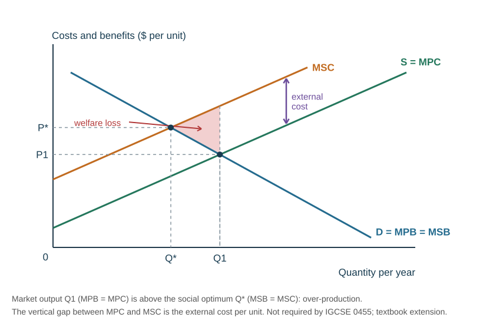
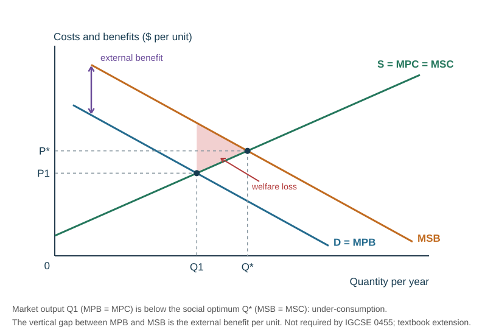
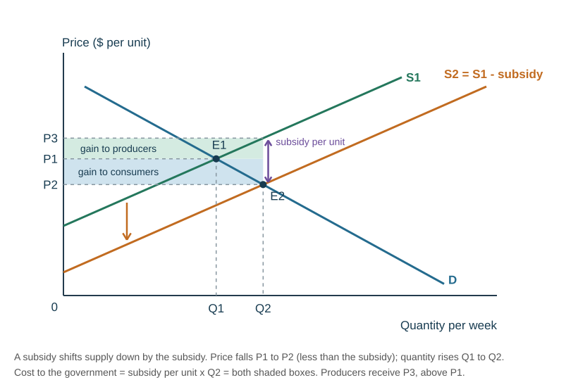
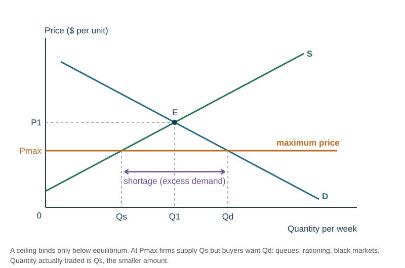
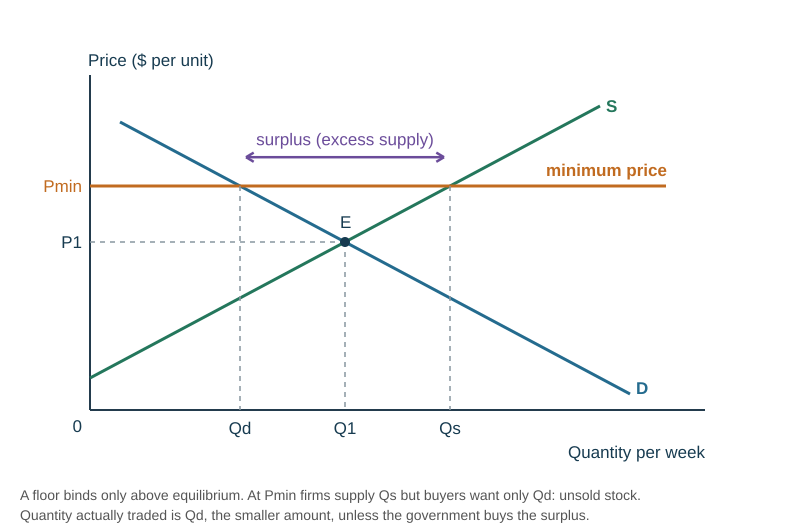

# Elasticity, market failure and market structures

## Price elasticity of demand

**Price elasticity of demand (PED)** is the **responsiveness of quantity demanded to a change in price**. Everyone knows quantity demanded falls when price rises; PED tells a firm **by how much**. A train company raising fares wants to know whether peak-hour commuters, who rely on the train, will cut back as much as weekend travellers.

$$\text{PED} = \frac{\%\ \text{change in quantity demanded}}{\%\ \text{change in price}}$$

$$\%\ \text{change} = \frac{\text{new} - \text{original}}{\text{original}}\times100$$

Because price and quantity move in opposite directions, the answer is negative. The teaching material reports the **size** of the number and ignores the minus sign — that is the convention used below. Write the sign if a question asks for it.

| Value (ignoring the sign) | Name | Meaning |
|---|---|---|
| greater than 1 | **elastic** | quantity changes by a **bigger** percentage than price |
| less than 1 | **inelastic** | quantity changes by a **smaller** percentage than price |
| equal to 1 | **unitary elasticity** | the same percentage change; total spending stays the same |
| 0 | **perfectly inelastic** | quantity does not change at all — a vertical curve |
| infinity | **perfectly elastic** | any price rise makes quantity demanded fall to zero — a horizontal curve |

*Worked example 1.* Price falls from \$5 to \$4; quantity demanded rises from 100 to 110.

- % change in price $= -1/5\times100 = -20\%$
- % change in quantity $= +10/100\times100 = +10\%$
- PED $= 10 / 20 = 0.5$ → **inelastic**. Revenue falls from $5\times100 = \$500$ to $4\times110 = \$440$.

*Worked example 2.* Price falls from \$40 to \$30; quantity demanded rises from 1000 to 1500.

- % change in price $= -10/40\times100 = -25\%$
- % change in quantity $= +500/1000\times100 = +50\%$
- PED $= 50 / 25 = 2$ → **elastic**, a relatively flat demand curve. Revenue rises from $40\times1000 = \$40\,000$ to $30\times1500 = \$45\,000$.

*Worked example 3.* Price rises from \$10 to \$12; quantity falls from 100 to 70: $30\% / 20\% = 1.5$ → **elastic**. Revenue falls from $\$1000$ to $12\times70 = \$840$.

Always divide by the **original** value. Getting the formula upside down (price over quantity) is the most common slip.

## PED and total revenue

$$\text{total revenue} = \text{price} \times \text{quantity sold}$$

| Demand | Price rises | Price falls |
|---|---|---|
| **Elastic** | revenue **falls** | revenue **rises** |
| **Inelastic** | revenue **rises** | revenue **falls** |
| **Unitary** | unchanged | unchanged |

So a firm with **elastic** demand can **lower** its price to raise revenue — quantity rises by a bigger percentage. A firm with **inelastic** demand can **raise** its price — quantity barely falls. This is **revenue, not profit**: profit also depends on costs, and selling fewer units cuts total variable cost.

Draw PED by applying the **same** price change to a **steep** curve (inelastic) and a **flat** curve (elastic), then compare the revenue gained on units still sold with the revenue lost on units no longer sold. A **vertical** demand curve is perfectly inelastic (PED = 0); a **horizontal** one is perfectly elastic.

*Worked example — revenue both ways.* A café sells 400 coffees a day at \$5 (revenue \$2000). It raises the price to \$5.50 (+10%) and sales fall to 380 (−5%): PED $= 5/10 = 0.5$, inelastic, and revenue rises to $5.50 \times 380 = \$2090$. Had sales fallen to 320 (−20%), PED $= 2$, elastic, and revenue would have fallen to $5.50 \times 320 = \$1760$.

**Why PED matters to each decision maker.**

| Decision maker | Use of PED |
|---|---|
| **Consumers** | goods with inelastic demand (petrol, power) take a bigger bite out of income when their price rises, because consumption cannot easily be cut |
| **Producers** | set prices: raise them for inelastic products, cut them for elastic ones; judge whether a cost rise can be passed on |
| **Government** | choose what to tax: inelastic goods raise more revenue, elastic goods change behaviour more; predict how far a tax will raise prices; judge the effect of an exchange-rate change on exports and imports |

## Determinants of PED

| Factor | Effect |
|---|---|
| **Number and closeness of substitutes** | many substitutes → **elastic** (one brand of bottled water, a soft drink, a breakfast cereal) |
| **Necessity** | essentials are **inelastic** (petrol, basic food, electricity, hay-fever medication); luxuries are elastic (holidays, cars, designer clothes) |
| **Addiction or habit** | **inelastic** (cigarettes) |
| **Proportion of income spent** | a cheap item (matches, a newspaper) is **inelastic** — a price rise is barely felt |
| **Cost of switching** | if changing product is costly, demand is **less elastic** |
| **Brand loyalty** | strong loyalty makes demand **inelastic** |
| **Time** | the longer consumers have to find alternatives, the **more elastic** demand becomes |
| **Whether the purchase can be put off** | if it cannot be postponed, demand is inelastic |

## Price elasticity of supply

**PES** is the **responsiveness of quantity supplied to a change in price**. Supply is about producers, so PES matters to firms' revenue, costs and output decisions.

$$\text{PES} = \frac{\%\ \text{change in quantity supplied}}{\%\ \text{change in price}}$$

PES is positive. Greater than 1 is **elastic** (Qs changes by a larger percentage than price); less than 1 is **inelastic**; 0 is **perfectly inelastic** (a vertical supply curve — a fixed stock); infinity is **perfectly elastic** (horizontal).

*Worked example.* The price of a bunch of carnations rises from 100 cents to 200 cents (+100%) and quantity supplied rises from 10 000 to 12 000 a month (+20%). PES $= 20/100 = 0.2$ → **inelastic**.

*Quick checks.* Price +10%, Qs +20% → PES $= 2$, elastic. Price −12%, Qs −2% → PES $= 2/12 \approx 0.17$, inelastic.

**Inelastic supply is not the same as perfectly inelastic supply.** Inelastic: a price change causes a **smaller** percentage change in quantity supplied (PES < 1). Perfectly inelastic: **no** change at all (PES = 0, vertical curve).

A straight-line supply curve that starts on the **price** axis is elastic, one that starts on the **quantity** axis is inelastic, and one through the **origin** has PES = 1 — whatever its slope.

| Determinant | Effect |
|---|---|
| **Time** | at any one moment supply is fixed (the drinks already in the fridge), so the curve is very steep or vertical; in the short run output can rise only a little; in the **long run** firms obtain more factors and supply becomes **elastic** |
| **Availability of resources / spare capacity** | large unused resources → **elastic**; near full employment, few spare resources → **inelastic** |
| **Stocks and storage** | easy storage lets firms release or withhold stock → **elastic** |
| **Length of the production period** | a crop takes a season, so farm supply is inelastic in the short run; technology that shortens production makes supply more elastic |
| **Mobility of factors of production** | factors that switch easily between products → **elastic** |
| **New sources of raw materials** | give more flexibility → more elastic |
| **Barriers to entry** | few barriers let new firms enter → supply more **elastic** |

## Why elasticity matters

**To firms** — whether a price change will raise or lower revenue (and so which pricing strategy to use), and whether a cost increase can be passed on to customers.

**To government** — an indirect tax raises most **revenue** when demand is **inelastic** (fuel, tobacco, alcohol), but cuts **consumption** most when demand is **elastic**. Those two aims pull in opposite directions, which is the standard evaluation point.

**On a diagram** — when supply is **inelastic**, an increase in demand raises price a lot and quantity only a little.

## Income elasticity of demand (extension)

The Cambridge IGCSE syllabus does not require **income elasticity of demand (YED)**, but it explains the normal, inferior and luxury goods met in [Demand, supply and the market](../notes/markets.md).

$$\text{YED} = \frac{\%\ \text{change in quantity demanded}}{\%\ \text{change in income}}$$

| YED | Type of good | Example |
|---|---|---|
| positive (above 0) | **normal** good | clothing, restaurant meals |
| above 1 | **luxury** (income-elastic) normal good | overseas holidays |
| negative (below 0) | **inferior** good | bus travel, own-brand groceries |

Unlike PED, **the sign matters**. *Worked example:* incomes rise 10% and demand for bus trips falls 4%: YED $= -4/10 = -0.4$, an inferior good.

## Market failure

**Market failure** happens when the forces of supply and demand **fail to allocate resources in the way that is best for society** — goods are over- or under-produced, causing a loss of social welfare.

- **Complete market failure** — the market does not supply the product at all.
- **Partial market failure** — the market works, but produces the wrong quantity or charges the wrong price.

**Causes of market failure:**

| Cause | Why the market gets it wrong |
|---|---|
| **Public goods** | non-excludable, so nobody can be charged; private firms will not provide them, so the state must |
| **Information failure** | consumers misunderstand or misvalue costs and benefits, so merit goods are under-consumed and demerit goods over-consumed |
| **Imperfect market structures** | a dominant firm restricts output and raises prices, exploiting consumers |
| **Factor immobility** | workers cannot move to where the jobs are, or lack the skills, causing unemployment and lost efficiency (fruit picking in season) |
| **Externalities** | costs or benefits to third parties are ignored by buyers and sellers |
| **Inequity** | the price mechanism allocates by ability to pay, so some cannot afford essentials such as education and healthcare |

**Information failure** has several sources: lack of knowledge; misvaluing the future (underestimating what education will be worth); "it won't happen to me" (lung cancer from smoking); and misleading advertising (a cosmetics firm claiming a harmful product is healthy).

**Merit goods** are goods consumers **undervalue**, so they are **under-consumed** in a free market (education, healthcare). **Demerit goods** are goods consumers **overvalue**, so they are **over-consumed** (cigarettes, alcohol). Which goods count is a matter of judgement, usually the government's. Merit goods often carry external benefits and demerit goods external costs, which adds to the under- or over-consumption.

**Public goods** are **non-rival** and **non-excludable** — street lighting, lighthouses, police, national defence. Non-excludability creates the **free-rider problem**: people can enjoy the good without paying, so no firm can charge for it and the market provides none.

## Externalities

An **externality** is a cost or benefit that falls on a **third party** — someone outside the transaction. Either production or consumption can cause one.

| | Of production | Of consumption |
|---|---|---|
| **Negative** (external cost) | factory air pollution; aircraft noise; fertiliser run-off; industrial waste; collapsing fish stocks; deforestation for beef farms; methane emissions | smokers' air pollution; household waste; traffic congestion and car fumes; tourists' litter; costs of obesity; alcohol-related disorder and accidents |
| **Positive** (external benefit) | a beekeeper's bees pollinate nearby fruit trees; new technology other firms can adopt; first-aid training staff use outside work | vaccination protects others; education creates a better-informed, more productive society with less crime; cycling instead of driving cuts congestion and pollution |

| Term | Meaning |
|---|---|
| **Private cost** | the cost to the firm (materials, wages) or consumer (car, petrol, insurance) making the decision |
| **External cost** | the harmful side-effect on third parties, which the decision-maker does not pay for |
| **Social cost** | private cost + external cost |
| **Private benefit** | the benefit to the firm (sale revenue) or consumer (the freedom a car gives) |
| **External benefit** | the positive side-effect enjoyed by third parties |
| **Social benefit** | private benefit + external benefit |

$$\text{social cost} = \text{private cost} + \text{external cost} \qquad \text{social benefit} = \text{private benefit} + \text{external benefit}$$

**Why this is market failure.** Decisions are made on **private** costs and benefits only. A driver pays for the car and petrol but not for the pollution and congestion inflicted on others, so the social cost exceeds the private cost and the activity is **over-produced**. With education, the social benefit exceeds the private benefit, so it is **under-consumed** relative to the social optimum.

**Consequences of market failure.** Resources are **misallocated**: goods with external costs and demerit goods are **over-consumed** (too much pollution, smoking, congestion); goods with external benefits and merit goods are **under-consumed** (too little education, vaccination, public transport); public goods are not provided at all; a monopoly restricts output and raises prices; immobile factors leave workers unemployed while vacancies go unfilled.

**Which diagram to use.** The Cambridge IGCSE syllabus states that demand and supply diagrams of market failure itself are **not required**. The teaching material explains market failure in words and then shows each **policy** on an ordinary demand and supply diagram (below). The marginal social cost and benefit diagrams are the standard textbook extension — use them only if a question asks for social and private costs on a diagram.

## Government microeconomic intervention

The government intervenes in markets to correct market failure and to make outcomes fairer. The Cambridge IGCSE syllabus requires **diagrams** for three measures — **maximum and minimum prices**, **indirect taxes** and **subsidies** — and the implications, without a diagram, of **regulation**, **privatisation and nationalisation** and **direct provision**.

### Indirect taxes and their incidence

An **indirect tax** is a tax on spending, collected from the producer, such as GST or excise duty on tobacco. A **specific** tax is a fixed amount per unit (so many dollars a litre); an **ad valorem** tax is a percentage of the price (GST at 15%). Because the firm pays the tax, it acts as a **cost**: the supply curve shifts **up (left)** by the amount of the tax.

The **incidence** of a tax is who actually bears it. The price rises by **less** than the tax, so the burden is shared.

*Worked example — a \$2 tax per unit.* Before the tax the price is \$5.00 and 1000 units are sold. After the tax the price is \$6.20 and 800 units are sold.

| Item | Calculation | Value |
|---|---|---|
| Price the producer keeps | \$6.20 − \$2.00 | \$4.20 |
| Consumers' share per unit | \$6.20 − \$5.00 | \$1.20 (60% of the tax) |
| Producers' share per unit | \$5.00 − \$4.20 | \$0.80 (40%) |
| Total tax revenue | \$2 × 800 | \$1600 = \$960 from consumers + \$640 from producers |

The more **inelastic** demand is, the more of the tax falls on consumers and the less quantity falls — which is why governments tax tobacco, alcohol and fuel to raise revenue, and why such taxes do little to cut consumption.

### Subsidies

A **subsidy** is a payment by the government to producers that lowers their costs, so supply shifts **down (right)** by the subsidy per unit.

*Worked example — a \$1.50 subsidy per bus trip.* The fare falls from \$6.00 to \$5.00 and trips rise from 500 to 600 a day. The operator receives \$5.00 + \$1.50 = \$6.50 a trip. The government pays \$1.50 × 600 = \$900 a day: consumers gain \$1.00 × 600 = \$600 through the lower fare and producers \$0.50 × 600 = \$300.

### Maximum and minimum prices

A **maximum price** (price ceiling) is a legal upper limit, set **below** equilibrium to make a necessity affordable — rent controls, basic foods in a crisis. A **minimum price** (price floor) is a legal lower limit, set **above** equilibrium to raise producers' incomes or to discourage consumption — guaranteed farm prices, minimum alcohol pricing.

| | Maximum price | Minimum price |
|---|---|---|
| Set | below equilibrium | above equilibrium |
| Result | **shortage** — $Q_d > Q_s$ | **surplus** — $Q_s > Q_d$ |
| Quantity actually traded | $Q_s$ | $Q_d$ (unless the state buys the surplus) |
| Who gains | buyers who still get the good, at a lower price | producers who still sell, at a higher price |
| Side effects | queues, waiting lists, rationing, **black markets** at prices above the ceiling, less investment and lower quality | unsold stock that may have to be bought, stored or destroyed; wasted resources; in a labour market, **unemployment** |

The same tool appears in two other markets, as the Cambridge syllabus specifies:

- **Labour market** — a **national minimum wage** is a minimum price for labour; set above the equilibrium wage it creates an excess supply of labour (unemployment). See [Firms, costs and labour markets](../notes/firms-labour.md).
- **Foreign exchange market** — a government that **fixes** its exchange rate **above** equilibrium has set a minimum price for its currency: there is an excess supply of the currency, which the central bank must buy with its foreign reserves (or raise interest rates) to hold the rate. Fixed **below** equilibrium it is a maximum price, and the central bank sells its own currency to meet the excess demand. See [International trade and exchange rates](../notes/trade.md).

### Regulation, provision and ownership

The teaching material's own summary of the policy options, with the school's diagram for each:

| Policy | How it works | For | Against |
|---|---|---|---|
| **Indirect tax** on a demerit good (cigarettes) | the tax raises the firm's costs, so **supply shifts left**; equilibrium price rises and quantity falls | consumption falls; tax revenue can fund hospitals, anti-smoking campaigns and doctors | demand is **inelastic**, so consumption falls only a little; indirect taxes are **regressive** — they hit the poor hardest |
| **Rules and regulations** (a minimum legal age for buying cigarettes; alcohol laws; noise controls; learner-driver limits; helmets; car seats; no phones while driving) | fewer people are willing and able to buy, so **demand shifts left** from $D_1$ to $D_2$ and quantity falls from $Q_1$ to $Q_2$ | demerit consumption falls and merit consumption rises; awareness grows and social norms change | black markets; people break rules; enforcement is expensive and slow |
| **Education and advertising** (smokefree campaigns, drink-driving campaigns, "5+ a day") | changes tastes and corrects information failure | fewer negative externalities (sick days, accidents, obesity), more positive ones | opportunity cost; may be ignored; ingrained habits change slowly |
| **Subsidy** for a good with external benefits (public transport) | a payment cuts the firm's costs, so **supply shifts right** from $S_1$ to $S_2$; quantity rises from $Q_1$ to $Q_2$ | more use of buses means less congestion and pollution from cars | opportunity cost of government spending; firms may rely on the subsidy and stop seeking efficiency |
| **Direct provision**, funded by taxation (schools, libraries, parks, roads) | the state supplies goods with strong external benefits | goods that would be under-consumed are widely used | free riders benefit without paying tax; free provision can cause excess demand, leaving the state to decide who gets it |
| **Tradable permits** | cap total pollution and let firms trade allowances | sets a firm limit on the harm | needs accurate measurement and a well-set cap |

**Privatisation and nationalisation.** **Privatisation** transfers a firm or industry from the public to the private sector (selling shares in a state-owned enterprise); **nationalisation** is the reverse — the state takes ownership (or majority ownership) of a private firm.

| | For | Against |
|---|---|---|
| **Privatisation** | the profit motive and competition push for efficiency, lower costs and innovation; raises one-off revenue for the government; frees the state from funding investment; shareholders monitor managers | a public monopoly may simply become a private one that raises prices; unprofitable but socially valuable services (rural routes) may be cut; the state loses future profits; external costs may be ignored |
| **Nationalisation** | the state can run the industry for the public good, including loss-making services with external benefits; can protect strategic industries and jobs; avoids wasteful duplication in a natural monopoly | weak incentives to cut costs (no profit motive); losses fall on taxpayers; political interference in decisions; may need compensation to owners |

NZ has done both: many state trading activities were corporatised and some privatised from the late 1980s (Telecom in 1990), while the government took back a majority stake in Air New Zealand in 2001 and in the rail network in 2008 (now KiwiRail).

Evaluate by comparing the **scale of the problem** with the **likely effect** of the policy, and name the **unintended consequences**.

*Case — the Auckland housing market.* For years housing supply failed to keep up with demand: immigration-fuelled population growth raised demand, while council land-use restrictions and a shortage of skilled tradespeople held back building. Prices rose until many people on good incomes could not afford a home — the market was not supplying enough at a price people could pay.

## Market structures

**Market structure** describes the supply side of a market: how many firms compete, how strong the competition is, how much they collude, how differentiated their products are, and how easily new firms can enter.

Firms compete to increase their customer base, sales and market share, improve their brand image and products, and ultimately raise profits. **Competition** pushes firms to innovate and to use scarce resources efficiently, giving consumers more choice, higher quality and lower prices. Restricted competition means higher costs and prices, less innovation, lower quality and less choice — so governments watch market structures and may step in.

Firms compete on **price** or through **non-price competition**: location, convenience, quality, features, new products, after-sales care and advertising.

| | Perfect competition | Monopolistic competition | Oligopoly | Monopoly |
|---|---|---|---|---|
| Number and size of firms | very many small firms | a large number of smaller firms | a few large firms (a **duopoly** has only two) | one seller |
| Product | identical (homogeneous), perfect substitutes | close substitutes, differentiated | close substitutes, differentiated by branding | no direct substitute |
| Barriers to entry | **none** | weak | strong — high capital and technical requirements, legal barriers | significant |
| Control over price | **price takers** — raise your price and you lose every customer; each firm faces elastic demand | some: they compete on location, convenience, service and goodwill as well as price | **price makers**, competing on both price and non-price factors | **price maker**, with complete control of supply |
| Examples | closest are commodities: wheat, corn, crude oil, foreign exchange | dairies, hairdressers, tradespeople — very common in NZ | petrol stations; hardware chains; two airlines on some routes; two telecoms providers in the past | the national rail operator, a city's water supplier |

Perfect competition also assumes free entry and exit, many buyers and sellers, and perfect information. No real market is perfectly competitive.

A **monopsony** is the reverse of a monopoly: many sellers but **only one buyer**, which can control the price it pays. A single exporter that buys a country's entire kiwifruit crop, or the only large employer in a small town (the only buyer of labour), are monopsonists.

**Barriers to entry** are factors that prevent or impede new firms from entering a market.

| Natural barriers (arise without anyone acting) | Artificial barriers (actively created) |
|---|---|
| **economies of scale** let an established firm produce more cheaply than several small rivals | **restricting supplies** — threatening suppliers who also supply rivals |
| **capital size** — the investment needed is too large for newcomers | **predatory pricing** — selling cheaply, even at a loss, to force rivals out |
| **history** — being first creates brand loyalty | **exclusive dealing** — agreements stopping retailers from stocking rivals |
| **legal requirements** — long, complex regulation, as for medicines | **full-line forcing** — refusing to supply a retailer unless it stocks the full range |

**Does monopoly harm consumers?**

| It may benefit them | It may harm them |
|---|---|
| economies of scale lower average cost, which can mean lower prices | it can **restrict supply** to force prices up, earning abnormal profits |
| it avoids **wasteful duplication** of resources (one set of water pipes) — a natural monopoly | less choice, and less innovation without competitive pressure, so lower quality |
| excess profits fund research and innovation, giving better products | **X-inefficiency** — without competition resources are used and managed wastefully |
| security of supply if the government runs or regulates it | it may grow into diseconomies of scale, raising average cost |
| it may be big enough to compete internationally | it needs regulation, which itself costs money |

The answer depends on the type of product, the state of the economy, how far the government regulates the firm — and how "the market" is defined. A strong answer distinguishes a **pure monopoly** from a **dominant firm** with monopoly power.

## Practice

1. Analyse the social costs created by car production and car use. *Model points:* social cost = private cost + external cost; private costs to the firm (wages, steel) and buyer (price, fuel); external costs fall on third parties and are ignored by firms and buyers — air and noise pollution, congestion; refer to cars throughout.
2. Explain the difference between inelastic supply and perfectly inelastic supply. *Model points:* PES < 1, quantity supplied changes by a smaller percentage than price; PES = 0, no change at all, vertical curve.
3. A \$3 tax per unit raises the price of a good from \$10 to \$12, and sales fall from 500 to 450. Calculate the tax revenue and the share paid by consumers. *Answer:* revenue = \$3 × 450 = \$1350; consumers pay \$2 of each \$3 (two-thirds), \$900 in total; producers \$450.
4. Analyse, using a diagram, the effect of a maximum price on the market for rental housing. *Model points:* labelled diagram with the ceiling below equilibrium; Qs falls, Qd rises, shortage Qd − Qs; queues, waiting lists, black-market rents, landlords leave the market or cut maintenance; tenants who find a home gain.
5. Discuss whether consumers would benefit if a firm became a monopoly. *Model points:* use both columns of the table above, then conclude on the conditions — economies of scale and innovation against restricted supply and higher prices, and the role of regulation.
