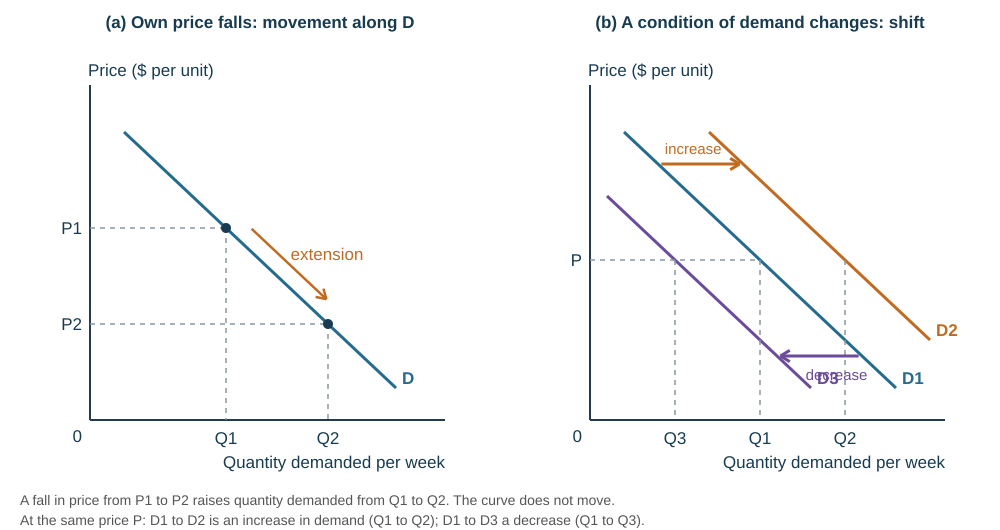
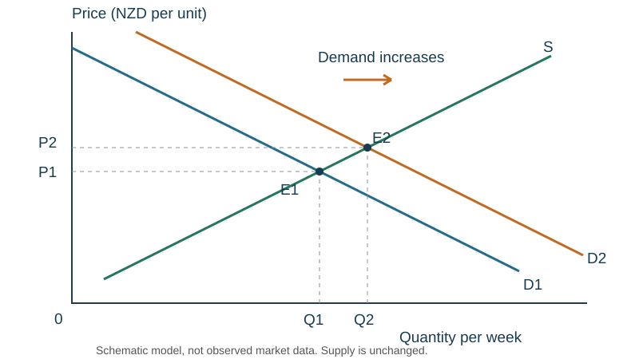
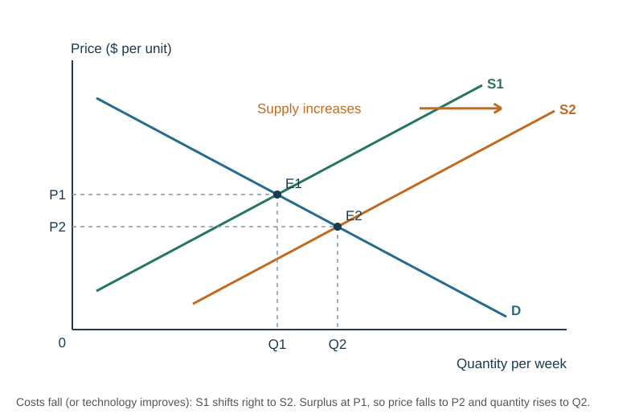

# Demand, supply and the market

## Demand

**Demand** is the quantity of a good or service that consumers are both **willing and able** to buy **at a range of prices** over a period. Both words matter — wanting a Ferrari you cannot afford is not demand.

**Quantity demanded (Qd)** is a different term: the amount consumers are willing and able to buy **at one particular price**. Keep the two apart — the whole of this topic depends on it.

**Market demand** is the sum of every individual's demand for the product at each price.

A **demand schedule** is a table relating price to quantity demanded. It assumes **ceteris paribus** — all other factors stay the same.

**The law of demand:** as price rises, quantity demanded falls, ceteris paribus (and vice versa), so the demand curve slopes **downward**. At a lower price consumers are more **able** to buy, because their limited income stretches further, and more **willing**, because the good is cheaper relative to alternatives.

*Worked example.* A consumer buys crayfish at the roadside: 11 at \$30 each, 3 at \$90. At \$30 she spends \$30 × 11 = \$330; at \$90 she spends \$90 × 3 = \$270. The price rise is a **movement along** her demand curve, and her quantity demanded falls from 11 to 3.

## Conditions of demand — what shifts the curve

A change in the good's **own price** causes a **movement along** the curve: a change in **quantity demanded**. Anything else — a **non-price factor**, or **condition of demand** — causes the whole curve to **shift**: a change in **demand**.

| Shift | Meaning |
|---|---|
| **Right (outward)** | an **increase in demand** — more is demanded at each and every price |
| **Left (inward)** | a **decrease in demand** — less is demanded at each and every price |

| Condition of demand | Causes an increase (shift right) when… |
|---|---|
| **Tastes, preferences, fashion and trends** | a trend moves towards the good (a healthy-living trend raises demand for bottled water) |
| **Income** | **disposable income** — income after tax and transfers — rises, through a pay rise or a cut in direct tax (for a normal good) |
| **Price of a substitute** | the substitute's price **rises**, so this good is relatively cheaper (juice dearer → more bottled water) |
| **Price of a complement** | the complement's price **falls**, so more of both are bought (cheaper sports events → more bottled water) |
| **Population** | there are more consumers, or the population's composition changes in the good's favour (higher net migration) |
| **Advertising and events** | a successful campaign raises awareness; an event such as an earthquake raises concern about tap-water safety |
| **Expectations** | consumers expect the price to rise soon, so they buy now |
| **Interest rates and credit** | cheaper borrowing raises demand for goods bought on credit |

For a **decrease** in demand, reverse each one: tastes move away, income falls, a substitute gets cheaper, a complement gets dearer, population falls, negative publicity.

| Type of good | Meaning | Examples |
|---|---|---|
| **Normal** | demand rises as income rises | restaurant meals, clothing |
| **Inferior** | demand **falls** as income rises, because consumers switch to better alternatives | bus travel, supermarket own-brand goods |
| **Luxury** | demand rises **more than proportionately** as income rises | designer clothes, overseas holidays |
| **Substitutes** | can be used instead of each other; one's price and the other's demand move in the **same** direction | Coke and Pepsi, tea and coffee, Vegemite and Marmite |
| **Complements** | used together; one's price and the other's demand move in **opposite** directions | bread and butter, cars and warrants of fitness, strawberries and cream |

**"An increase in price causes a decrease in demand" is wrong.** A price rise causes a **decrease in quantity demanded** — a movement along the curve. A decrease in demand is a leftward shift caused by a condition of demand, such as a fall in income.

## Supply

**Supply** is the quantity of a good or service that **producers** are willing and able to provide **at a range of prices** over a period. **Quantity supplied (Qs)** is the amount at **one particular price**. **Market supply** is the sum of all firms' supply in the market.

A **supply schedule** has a title naming the producer, the product and the time period, a left column for price and a right column for quantity supplied, each with units.

**The law of supply:** as price rises, quantity supplied rises, ceteris paribus (and vice versa), so the supply curve slopes **upward**. A higher price gives the firm more revenue, so it is better able to cover its costs and the product is more **profitable** to supply. As price falls, the firm supplies less, may switch its resources to something else, or may close.

**Related goods** are goods that can be made with the **same inputs**. A baker makes both bread rolls and loaves from the same flour, ovens and workers; if the price of rolls rises, the baker switches production towards rolls and the supply of loaves falls.

**Price and cost are different things.** **Price** is what the customer pays and the firm receives for each sale, set by the market. **Cost** is what it takes the firm to produce the good — materials, power, wages, rent.

*Worked example.* A publisher's schedule shows 1000 books supplied at \$4 and 4000 at \$10. Revenue rises from \$4 × 1000 = \$4000 to \$10 × 4000 = \$40 000, an increase of \$36 000, so the firm is better able to cover its costs and may switch resources into books.

## Conditions of supply — what shifts the curve

A change in the good's own price is a **movement along** the supply curve (a change in **quantity supplied**). A change in a **condition of supply** shifts the whole curve: **right** is an **increase in supply** (more at each and every price), **left** a **decrease**.

| Condition of supply | Effect |
|---|---|
| **Costs of production** — wages, raw materials, power, transport | usually the biggest influence; lower costs make each unit more profitable, so supply shifts **right**; higher costs shift it **left** |
| **Productivity and technology** | more efficient production cuts costs, so supply shifts right |
| **Indirect taxes** (such as GST) | act like a cost and cut profitability, so supply shifts left |
| **Subsidies** | reduce the cost of production, so supply shifts right; removing a subsidy shifts it left |
| **Tariffs** on imported inputs | raise costs, so supply shifts left |
| **Number of firms** | more firms raise total capacity, so supply shifts right |
| **Good or bad season** | an excellent banana season shifts supply right; prolonged poor conditions shift it left |
| **Price of a related good** | if a related good becomes more profitable, resources move to it and supply of this good shifts left |

**External influences** work through costs. **Environmental** objectives (better materials, cleaner methods) and **legal** requirements (pay, hours, pollution limits) raise costs and reduce supply. **Political** decisions — a tax to discourage tobacco and alcohol, or a new subsidy — reduce or increase it. **Cultural** sensitivities shape what firms are willing to supply at all (alcohol, tobacco, certain meats).

**What a shift means for the firm.** An increase in supply may require hiring and training more workers or buying machinery and premises. A decrease may mean laying workers off or finding other ways to cut costs.

*Worked example.* A bakery makes muffins and cupcakes. Muffin production costs fall, so muffins are cheaper to make and more profitable: the **supply of muffins increases** (shifts right). Because cupcakes are a related good using the same inputs, resources move away from them and the **supply of cupcakes decreases**.

## Movement vs shift — the summary

| Cause | Demand | Supply |
|---|---|---|
| the good's **own price** changes | movement along: **change in quantity demanded** (also called an extension or contraction of demand) | movement along: **change in quantity supplied** |
| **anything else** changes | the curve shifts: **increase or decrease in demand** | the curve shifts: **increase or decrease in supply** |

When drawing a price change, label the original price and quantity **P1** and **Q1** and the new ones **P2** and **Q2**, use **dotted lines** to the axes and an **arrow** to show the direction.

**Individual and market demand.** Market demand is found by **adding** the quantities every consumer demands at each price (horizontal summation). If Ana buys 3 coffees a week at \$5 and Ben buys 2, the market demand at \$5 is 5; the same is done at every price. Market supply is built the same way from every firm's supply.

## Equilibrium

**Equilibrium** is the balance of the market forces of supply and demand: the price at which **quantity demanded equals quantity supplied**. Buyers have bought all they want and sellers have sold all they want, so there is **no surplus and no shortage**. While ceteris paribus holds, equilibrium stays put.

| Price | Situation | What happens |
|---|---|---|
| **Below** equilibrium | **excess demand (shortage)**: Qd > Qs | consumers bid the price **up**; as it rises, Qs increases and Qd decreases until the market clears |
| **Above** equilibrium | **excess supply (surplus)**: Qs > Qd | producers accept lower prices to clear unsold stock; as price falls, Qd increases and Qs decreases until the market clears |

*Worked example.* Equilibrium price is \$8. At \$4, Qs is 2000 and Qd is 10 000 — a **shortage of 8000**, so the price is pushed up towards \$8. At \$10, Qd is 4000 and Qs is 8000 — a **surplus of 4000**, so the price is pushed down towards \$8.

A **market** is anywhere buyers and sellers come together to exchange goods and services — a farmers' market is the simplest example.

Equilibrium is a point of balance, not of fairness. It does **not** mean everyone can afford the product, or that the outcome is good for society.

Reading the diagram: price is on the vertical axis, quantity per week on the horizontal. $D_1$ shifts right to $D_2$ when demand increases. At the old price $P_1$ buyers now want more than producers supply — a shortage. The price rises, quantity supplied **increases along** $S$, and the market settles at the new intersection $E_2$. Both equilibrium price and quantity rise.

**Two separate steps:** the *shift* of one curve, then the *movement along* the other. Describe both.

## A new equilibrium

Equilibrium changes only when ceteris paribus is broken — a condition of demand or supply changes and a curve **shifts**, creating a shortage or surplus at the old price.

| Change | At the old price | Equilibrium price | Equilibrium quantity |
|---|---|---|---|
| Demand increases | shortage | rises | rises |
| Demand decreases | surplus | falls | falls |
| Supply increases | surplus | falls | rises |
| Supply decreases | shortage | rises | falls |

*Worked example.* A medical journal reports that mussels are healthy. A condition of demand (tastes) has changed, so **demand for mussels increases** — the market demand curve shifts right. At the old price there is a shortage, so the price rises; producers, now better able to cover costs, **increase the quantity supplied** and may move more resources into mussels. Consumers eat more mussels at a higher price; society may gain from better health and less pressure on the health system.

*Worked example — supply increases.* An excellent kiwifruit season (a condition of supply) shifts supply right from $S_1$ to $S_2$. At the old price $P_1$ there is now a **surplus**, so sellers cut prices; as the price falls, quantity demanded **extends along** $D$ until the new equilibrium $E_2$: a **lower price** $P_2$ and a **higher quantity** $Q_2$.

**When both curves shift, one outcome becomes ambiguous.** If demand and supply both increase, quantity definitely rises but price depends on which shift is larger. Say so, and state what it depends on — that is the evaluation mark.

## Numerical equilibrium

Let $Q_d = 100 - 2P$ and $Q_s = 20 + 2P$.

Set them equal: $100 - 2P = 20 + 2P \Rightarrow 80 = 4P \Rightarrow P = 20$, and $Q = 100 - 40 = 60$.

If demand rises to $Q_d = 120 - 2P$: $120 - 2P = 20 + 2P \Rightarrow 100 = 4P \Rightarrow P = 25$, and $Q = 120 - 50 = 70$.

Always substitute back into **both** equations to check ($20 + 2\times25 = 70$).

## Price controls

Maximum and minimum prices are a form of government intervention, so they are taught with their diagrams in [Elasticity, market failure and market structures](../notes/elasticity-failure.md), alongside indirect taxes and subsidies. In one line: a **maximum price** is set **below** equilibrium and causes a **shortage**; a **minimum price** is set **above** equilibrium and causes a **surplus**.

## Pricing strategies

**Price** is the amount the customer pays. It is one of the biggest influences on demand, and firms set it deliberately. Before choosing a strategy a firm considers:

- **price elasticity of demand** — will a higher price cut sales so much that revenue falls? (see [Elasticity](../notes/elasticity-failure.md))
- **the type of product** — specialised, technological, rare, high- or low-value, with or without close substitutes
- **the customers** — an individual shopper has little bargaining power over a supermarket; a large industrial buyer can negotiate a lower price
- **the rest of the marketing mix** — the distribution channel, and the product's life-cycle stage (a product in decline needs a lower price than at launch)
- **brand image and reputation** — a market leader with a loyal following can charge more

| Strategy | Method | Advantages | Disadvantages |
|---|---|---|---|
| **Cost-plus** | work out unit cost, add a fixed percentage mark-up | costs are covered; easy to calculate | inflexible; ignores market conditions |
| **Competitor pricing** (price leadership) | set price around rivals' prices | flexible; shows whether rivals undercut you; pricing slightly above can signal quality | may not cover costs; must keep adjusting; pricing below can signal low quality |
| **Price discrimination** | different prices for different groups, based on what each will pay (students, the elderly) | can maximise revenue | customers may leave if rivals do not do it |
| **Contribution pricing** | cover variable cost, then add a contribution towards fixed costs | suits a range of products; flexible | may not cover all fixed costs; frequent changes annoy customers |
| **Penetration** | low price to enter the market, raised later | attracts new customers and steals rivals'; builds loyalty | unsustainable long term; customers may leave when it rises |
| **Skimming** | high launch price, lowered over time | reputation for quality; maximises revenue from early buyers | too high and nothing sells; later cuts can look like a "rip-off" or signal lower quality |
| **Psychological** | prices such as 99c or \$199.99 that feel cheaper | attracts sales without cutting revenue | can look cheap |
| **Predatory (destructive)** | temporarily very low, even below cost, to force rivals out | gains sales and loyalty | linked with low quality; customers may leave when the price rises; can be anti-competitive |

A **price war** is rival firms repeatedly cutting prices to win market share. Consumers gain lower prices and more to spend elsewhere; firms lose margin, may cut quality or innovation, and some may fail; competition can rise in the short run but fall if weaker firms are forced out and a dominant firm emerges; and the wider economy may suffer redundancies and lower tax revenue.

## Practice

1. Analyse, using a demand and supply diagram, the effect on the market for tomatoes of a report that tomatoes are good for health. *Model points:* diagram with labelled axes, $D$ and $S$, demand shifted right, $E_1$ and $E_2$ marked; the report changes tastes, so demand increases; a shortage at the old price pushes price up and output rises; if tomato supply is **inelastic** in the short run, the effect falls more on price than on quantity.
2. Explain why an increase in price does **not** cause a decrease in demand. *Model points:* law of demand; a price rise reduces **quantity demanded**, a movement along the curve; a decrease in demand is a leftward shift caused by a condition of demand such as falling income.
3. A long-answer prompt — *discuss whether demand for cars is likely to increase in the future* — is worked through in the exam-technique section of the [syllabus](../SYLLABUS.md).
