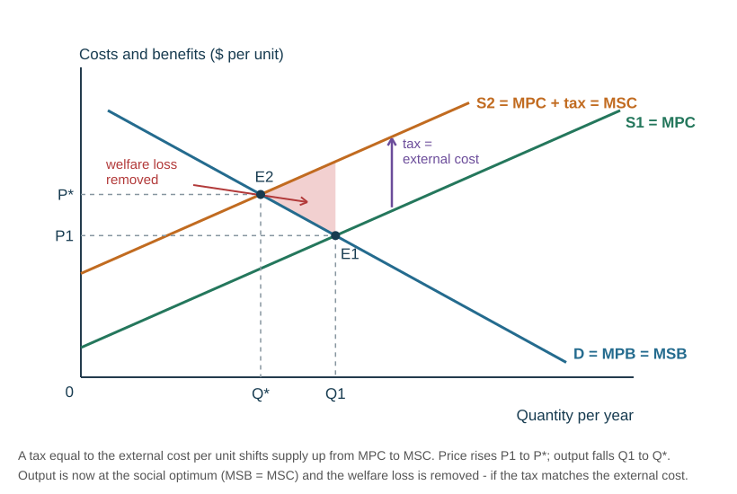
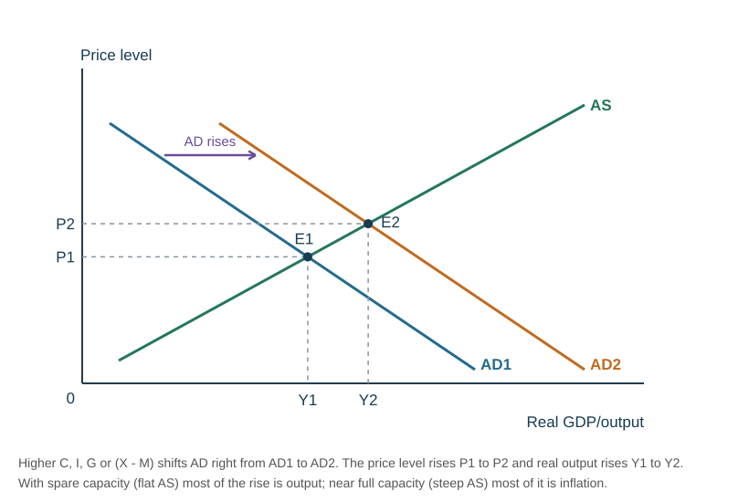

# Government policy chains: which tool, how it works, when it fails

This page pulls every government policy in the course into one place, written as **chains** — the step-by-step cause and effect that an *analyse* answer needs — followed by **"works if"** and **"fails because"**, which are the two sides of a *discuss* answer. Learn a chain, close the page, and write it out from memory.

How the chains earn marks:

- **(c) Analyse [6]** — one mark per explained link, usually with a diagram. The 0455 mark schemes cap a **list** of unexplained points at 3 of 6, so write the links in full: "because… which leads to… so…".
- **(d) Discuss [8]** — "works if" is one side, "fails because" is the other, and the [evaluation toolkit](#g-evaluation-toolkit-it-depends) gives the conclusion. See the [worked answers](#h-two-worked-discuss-answers) at the end.

Diagrams for every chain: [DIAGRAMS.md](../DIAGRAMS.md). The background theory is in [Elasticity, market failure and market structures](../notes/elasticity-failure.md), [Macroeconomics and policy](../notes/macroeconomics.md) and [International trade and exchange rates](../notes/trade.md).

---

## (a) Which failure → which tool

| Market failure | What goes wrong in a free market | Main tools | Example |
|---|---|---|---|
| **Negative externality** (external cost) | social cost > private cost, so the good is **over-produced / over-consumed** | indirect tax; regulation or ban; tradable permits; information campaigns | petrol and car use; factory pollution; noise and traffic around concerts at Eden Park |
| **Positive externality** (external benefit) | social benefit > private benefit, so the good is **under-consumed** | subsidy; direct (state) provision; information campaigns | public transport; vaccination; education |
| **Merit good** | consumers **undervalue** it (information failure), so it is under-consumed | subsidy; free or cheap state provision; information; compulsion by law | education, healthcare, car seats for babies |
| **Demerit good** | consumers **overvalue** it, so it is over-consumed | indirect tax; regulation (age limits, licensing); minimum price; information | cigarettes, alcohol, sugary drinks |
| **Public good** | non-excludable, so free riders will not pay and **no firm supplies it** (complete market failure) | direct provision funded by taxation | street lighting, defence, police |
| **Monopoly / market power** | output restricted and price raised; less choice and innovation | competition policy (in NZ, the Commerce Commission); price regulation (a maximum price); removing barriers to entry and trade barriers; nationalisation | a city's water supplier; national rail |
| **Information failure** | people misjudge costs and benefits ("it won't happen to me", misleading advertising) | education and advertising campaigns; labelling laws; rules against misleading advertising | Smokefree, "5+ a day", drink-driving campaigns |
| **Inequality (inequity)** | the price mechanism allocates by **ability to pay**, so some cannot afford essentials | progressive income tax; transfer payments (benefits, pensions); free merit goods; minimum wage; maximum prices on necessities | jobseeker support; free schooling |
| **Factor immobility** | workers cannot move to the jobs or lack the skills | training and retraining; help to relocate | seasonal fruit picking; a declining industry |

**One rule for choosing:** a **tax, regulation or minimum price** cuts consumption of something that is over-consumed; a **subsidy, state provision or maximum price** raises access to something that is under-consumed. Information campaigns work in both directions.

---

## (b) Micro intervention chains

Each chain below is the order to write it in an exam. Arrows mean "which causes".

### 1. Indirect tax (on a demerit good or a good with external costs)

**Chain.**

1. The government places a tax per unit on the good (cigarettes, petrol, sugary drinks). The **producer** pays it to the government.
2. The tax raises the firm's **costs of production**.
3. **Supply shifts left (up)** by the tax, from $S_1$ to $S_2$.
4. The equilibrium **price rises** from $P_1$ to $P_2$ — by **less** than the tax, because producers absorb part of it.
5. **Quantity demanded contracts** from $Q_1$ to $Q_2$ (a movement along demand, not a shift).
6. Less is produced and consumed, so the **external cost falls** (less second-hand smoke, pollution, health-system cost).
7. The government earns **revenue** (tax × $Q_2$), which it can spend on the harm — hospitals, anti-smoking campaigns, public transport.

In the textbook ideal, the tax equals the **external cost per unit**, so supply rises from $MPC$ to $MSC$ and output falls exactly to the social optimum $Q^*$:

Diagrams: [Indirect tax and its incidence](../DIAGRAMS.md#indirect-tax-and-its-incidence), [Government intervention in market failure](../DIAGRAMS.md#government-intervention-in-market-failure), [External costs and external benefits](../DIAGRAMS.md#external-costs-and-external-benefits).

| Works if | Fails because |
|---|---|
| demand is **price elastic** — there are close substitutes, so a higher price makes people switch | demand is **price inelastic** (addictive or necessary goods: cigarettes, petrol), so consumption falls only a little — the tax mainly raises revenue |
| the tax is set close to the **external cost** | the external cost is **hard to measure**, so the tax is set too high or too low (government failure) |
| the revenue is spent on the problem (health care, campaigns, alternatives) | indirect taxes are **regressive** — they take a larger share of a low earner's income |
| it is hard to avoid | it encourages **black markets and smuggling**, and cross-border buying |
| | it raises prices (cost-push inflation) and can cost jobs in the taxed industry |

### 2. Subsidy (for a merit good or a good with external benefits)

**Chain.**

1. The government pays producers a sum per unit (bus operators, vaccine suppliers).
2. The subsidy **lowers the firm's costs**.
3. **Supply shifts right (down)** by the subsidy, from $S_1$ to $S_2$.
4. The **price falls** from $P_1$ to $P_2$ — by less than the subsidy, because producers keep part of it.
5. **Quantity demanded extends** from $Q_1$ to $Q_2$.
6. More is consumed, so the **external benefit rises** (fewer cars on the road, less congestion and pollution; fewer people catch a disease).

In the ideal, the subsidy equals the **external benefit per unit**, so output rises to the social optimum $Q^*$:

Diagrams: [Subsidy](../DIAGRAMS.md#subsidy), [Government intervention in market failure](../DIAGRAMS.md#government-intervention-in-market-failure).

| Works if | Fails because |
|---|---|
| demand is **price elastic**, so a lower price brings a big rise in use | demand is **inelastic**, so most of the subsidy becomes extra producer revenue rather than extra consumption |
| the subsidy is passed on to consumers as a lower price | **opportunity cost** — the money could fund hospitals or schools, or must be raised through higher taxes or borrowing |
| it is targeted at the people who would otherwise not consume | firms may **rely on the subsidy** and stop looking for ways to cut costs or improve the service |
| | the external benefit is hard to measure, and once given a subsidy is politically hard to remove |

### 3. Maximum price (price ceiling)

**Chain.**

1. The government sets a legal maximum **below** the equilibrium price — rent controls, basic food in a crisis, or to stop a monopoly overcharging.
2. The price falls to $P_{max}$.
3. **Quantity demanded extends** (more people can afford it) while **quantity supplied contracts** (producers earn less per unit).
4. A **shortage** (excess demand) of $Q_d - Q_s$ appears.
5. Only $Q_s$ is actually traded, so the good must be **rationed** — by queues, waiting lists, ballots or favouritism.

Diagram: [Maximum price](../DIAGRAMS.md#maximum-price-price-ceiling).

| Works if | Fails because |
|---|---|
| it is set only slightly below equilibrium, so the shortage is small | **shortages** — queues and waiting lists; some people get nothing at all |
| supply is **inelastic** in the short run, so producers cannot cut output much | **black markets** appear, selling above the ceiling |
| the government adds its own supply or a subsidy to producers to close the gap | quality and maintenance fall (landlords stop repairing rental housing); in the long run supply becomes more elastic and falls further |
| | enforcement is costly |

### 4. Minimum price (price floor), including the minimum wage

**Chain — product market.**

1. The government sets a legal minimum **above** equilibrium — to raise farmers' incomes, or to discourage a demerit good (a minimum price per unit of alcohol).
2. **Quantity supplied extends** while **quantity demanded contracts**.
3. A **surplus** (excess supply) of $Q_s - Q_d$ appears.
4. Only $Q_d$ is sold unless the government buys, stores or destroys the surplus.

**Chain — minimum wage (a minimum price for labour).**

1. The minimum wage $W_2$ is set above the equilibrium wage $W_1$.
2. Firms find labour dearer, so **employment contracts** to $N_3$ (read off the demand for labour).
3. More people want to work at the higher wage, so labour supplied **extends** to $N_2$.
4. The gap $N_2 - N_3$ is an **excess supply of labour — unemployment**.
5. Those who keep their jobs earn more, which reduces in-work poverty.

Diagrams: [Minimum price](../DIAGRAMS.md#minimum-price-price-floor), [The labour market](../DIAGRAMS.md#the-labour-market). More detail in [Firms, costs and labour markets](../notes/firms-labour.md).

| Works if | Fails because |
|---|---|
| it is set only a little above equilibrium | the **surplus** must be bought and stored at taxpayers' expense, or wasted |
| the demand for labour is **inelastic**, so few jobs are lost | job losses fall on the young and low-skilled, especially where demand for labour is **elastic** |
| higher pay raises workers' **productivity** and motivation, shifting the demand for labour right | firms respond by raising prices (cost-push inflation), cutting hours, or switching to **capital-intensive** methods |
| (alcohol) heavy drinkers buy the cheapest drinks, so a floor targets them | people work illegally below the minimum; (alcohol) the extra revenue goes to sellers, not the government, unlike a tax |

### 5. Regulation and bans

**Chain — on consumers** (the school's example: a minimum legal age for buying cigarettes).

1. The law limits **who may buy** the good, or how it may be used.
2. Fewer people are **willing and able to buy** at every price.
3. **Demand shifts left** from $D_1$ to $D_2$.
4. Quantity falls from $Q_1$ to $Q_2$, so the external cost falls.

**Chain — on producers** (emission limits, noise controls, limits on the number and finishing time of concerts).

1. The law caps the harm directly or requires cleaner methods.
2. Firms must install equipment or cut output, which **raises their costs** — supply shifts left.
3. The pollution or noise falls **regardless of price elasticity**.

| Works if | Fails because |
|---|---|
| the harm is clear and easy to **monitor** | **black markets** develop; people break the rules |
| penalties are large enough to deter | **enforcement is expensive and slow** |
| it works directly — unlike a tax, it does not depend on PED | it raises firms' costs and prices and raises **no revenue** |
| social norms change over time (attitudes to smoking and drink-driving) | one rule for everyone ignores that some firms can cut pollution far more cheaply than others; firms may move abroad |

Diagram: [Government intervention in market failure](../DIAGRAMS.md#government-intervention-in-market-failure) — regulation shifts **demand**, not supply, when it limits who can buy.

### 6. Tradable pollution permits (extension)

The school's slides do not teach this; the existing notes and the syllabus list mention it. NZ's own version is the **Emissions Trading Scheme**.

**Chain.**

1. The government sets a **cap** on total pollution and issues permits adding up to it.
2. Each firm must hold a permit for every unit it emits.
3. Firms that can cut pollution **cheaply** do so and **sell** their spare permits; firms for which cutting is expensive **buy** them.
4. Total pollution falls to the cap at the **lowest total cost**, and the permit price rewards clean firms.
5. The cap is lowered over time.

| Works if | Fails because |
|---|---|
| emissions can be measured accurately | monitoring is costly; firms may under-report |
| the cap is tight enough that permits have a real price | too many permits (or free permits) make them cheap, so little changes |
| | firms may move production to countries without a cap |

### 7. Direct (state) provision

**Chain.**

1. The government supplies the good itself, paid for out of **taxation** — schools, libraries, parks, public roads, street lighting.
2. The price to the user is zero or low, so consumption rises.
3. Public goods are provided **at all**, and merit goods reach people who could not otherwise afford them, so the **external benefits** are gained and inequality falls.

| Works if | Fails because |
|---|---|
| the good has large external benefits or is a public good | **free riders** benefit without contributing through tax |
| the service is run efficiently | a free good creates **excess demand** — waiting lists — and the government must decide who gets it |
| | **opportunity cost** of the tax revenue; no profit motive, so costs may not be kept down |

### 8. Information: education and advertising campaigns

**Chain.**

1. The government funds a campaign (Smokefree NZ, drink-driving advertising, "5+ a day").
2. People learn the true costs or benefits, correcting **information failure**.
3. Tastes change, so **demand shifts** — left for a demerit good, right for a merit good.
4. Consumption moves towards the social optimum: fewer negative externalities (sick days, accidents, obesity) and more positive ones (healthy, productive workers).

| Works if | Fails because |
|---|---|
| the message is credible and targeted | it may simply be **ignored** |
| it is combined with a tax or regulation | ingrained habits and addiction change **slowly** |
| | **opportunity cost** — the money could be used elsewhere; the effect is hard to measure |

### 9. Privatisation and nationalisation

**Privatisation chain.** The government sells a state-owned enterprise (or shares in it) to the private sector → the firm now seeks **profit** and may face **competition** → it has an incentive to cut costs and innovate → lower prices and better quality; the government also gets **one-off revenue**.

**Fails because:** a public monopoly may simply become a **private monopoly** that raises prices; unprofitable but valuable services (rural routes) may be cut; external costs may be ignored; the state loses future profits and must now regulate the firm.

**Nationalisation chain.** The state takes ownership → it can run the industry for the **public good**, not just profit → it keeps loss-making services with external benefits running, protects strategic industries and jobs, and avoids wasteful duplication in a natural monopoly. NZ examples: Air New Zealand (2001), the rail network (2008, now KiwiRail).

**Fails because:** weak incentive to cut costs; losses fall on **taxpayers**; political interference; owners may have to be compensated.

### 10. Competition policy (for monopoly)

**Chain.** A regulator (the Commerce Commission in NZ) blocks mergers that would create market power, fines collusion and can regulate prices → firms face competition → prices fall towards costs, choice and innovation rise.

**Fails because:** a natural monopoly may genuinely be cheaper as one firm (economies of scale); investigations are slow and costly; the regulator may lack information about the firm's real costs.

---

## (c) Government failure

**Government failure** happens when government intervention to correct a market failure makes the allocation of resources **worse**, or creates a new inefficiency — the intervention costs society more than the problem it was meant to fix.

This term is not in the school's slides, but it is the standard name for the "fails because" column, and using it in a *discuss* answer signals evaluation: *"However, the tax may lead to government failure, because…"*

| Cause | What happens | Example |
|---|---|---|
| **Imperfect information** | the government cannot measure external costs or benefits, so it sets a tax or subsidy at the wrong size | a sugar tax set with no reliable figure for the health cost per drink |
| **Unintended consequences** | people change behaviour in ways the policy did not intend | high tobacco taxes encourage smuggling and illegal sales; a minimum wage cuts jobs for the young |
| **Distorted price signals** | a price fixed by law stops price rationing and signalling | rent controls → shortages and poorer housing; guaranteed farm prices → unsold surpluses |
| **Administrative and enforcement costs** | policing the rule costs more than the harm it prevents | bans and age limits that need constant inspection |
| **Political self-interest and short-termism** | decisions chase votes or the next election rather than the best use of resources | popular projects funded over better ones; subsidies kept long after they are needed |
| **Dependency and weaker incentives** | support removes the pressure to be efficient or to work | subsidised firms stop cutting costs; free services are over-used |
| **Time lags** | by the time a policy takes effect the problem has changed | an infrastructure project finished after the recession it was meant to fight |
| **Opportunity cost of the funds** | taxes raised to pay for the policy reduce spending and incentives elsewhere | money for one subsidy is money not spent on hospitals |

**Use it in a conclusion:** "Intervention is justified only if the market failure is larger than the likely government failure — so a small, well-targeted tax is better than an outright ban that creates a black market."

---

## (d) Macroeconomic policy chains

### The AD/AS framework

The school's *Macroeconomic Policy* slides frame every policy as acting on **aggregate demand (AD)** or **aggregate supply (AS)**: "the conditions of aggregate demand and aggregate supply determine the equilibrium of prices and the total level of output and employment." The Cambridge syllabus does not require an AD/AS diagram, so it is optional — but it makes every chain quicker to explain. Always explain in words as well.

$$AD = C + I + G + (X - M)$$

| What shifts **AD** right | What shifts **AD** left |
|---|---|
| lower interest rates; tax cuts; more government spending; higher confidence; rising house prices (wealth); a lower exchange rate (more exports, fewer imports); faster growth in trading partners | the opposites: higher interest rates, tax rises, spending cuts, falling confidence, a higher exchange rate, a world recession |

| What shifts **AS** right (more capacity, lower costs) | What shifts **AS** left (cost shock) |
|---|---|
| better education and training; new technology; more investment in capital; deregulation; better infrastructure; more workers (immigration) | higher oil and import prices (or a depreciation that raises them); wage rises above productivity; higher indirect taxes; natural disasters, drought |

**Reading the diagram:** AD right → price level **and** output rise (growth, fewer unemployed, but inflation). AD left → both fall. AS right → output rises **and** the price level falls — the only "win–win" shift. AS left → output falls while prices rise (cost-push inflation and unemployment together).

### Fiscal policy — government spending (G)

**Expansionary chain** (the school's example: the Hamilton–Auckland rail link).

1. The government raises spending on infrastructure, schools or hospitals.
2. Firms receive orders and **hire workers** to build and run them.
3. Those workers' **incomes rise**, and they spend part of them in shops, cafés and on services.
4. Other firms' sales rise, so they hire too — the first spending is re-spent (the **multiplier** effect).
5. **AD shifts right**: real output rises (**growth**) and **cyclical unemployment falls**.
6. Side effects: if the economy is near capacity, the **price level rises** (demand-pull); part of the extra income is spent on **imports** (current account worsens); spending above revenue means a **budget deficit** and more **debt**.

**Contractionary chain.** The government cuts spending → orders and jobs fall → incomes and spending fall → AD shifts left → **inflation slows** and the deficit shrinks — at the cost of **slower growth and higher unemployment**.

### Fiscal policy — taxation (T)

**Income tax cut:** disposable income rises → households spend more ($C$ rises) → AD shifts right → output and jobs rise; may also raise the incentive to work (an AS effect).

**Company tax cut:** firms keep more profit → more funds and a higher return on **investment** → $I$ rises → AD right now, and more capital raises **AS** later.

**Tax rise (contractionary):** disposable income or profit falls → $C$ and $I$ fall → AD left → inflation falls, growth slows.

**Redistribution chain:** a more progressive tax system (lower rates for the poor, higher for the rich) plus transfer payments → incomes of low earners rise → **inequality and poverty fall**; low earners spend more of each extra dollar, so AD may rise too. **Fails because:** high top rates may weaken incentives to work and invest, and encourage avoidance or emigration.

### Monetary policy — the Official Cash Rate (OCR)

In NZ the **Reserve Bank** sets the OCR to keep inflation within its **1–3% target, aiming at 2%** (see [Macroeconomics and policy](../notes/macroeconomics.md)).

**Contractionary chain — raising the OCR to cut inflation.**

1. The Reserve Bank **raises the OCR**.
2. Commercial banks raise **mortgage and loan rates** and pay more on deposits.
3. **Borrowing becomes dearer and saving more attractive.**
4. Households with mortgages have **less disposable income** once repayments rise, and buy less on credit → **consumption ($C$) falls**.
5. Firms find borrowing dearer and expected returns lower → **investment ($I$) falls**.
6. House prices cool, so homeowners feel less wealthy and spend less.
7. **AD shifts left** → firms face weaker demand and raise prices less → **demand-pull inflation falls**.
8. **Exchange-rate route:** higher NZ interest rates attract foreign savings → demand for NZ dollars rises → the **NZ dollar appreciates** → imports become cheaper (**imported inflation falls**) and exports dearer ($X - M$ falls, AD falls further).
9. Costs: **slower growth, higher unemployment**, exporters lose competitiveness, mortgage holders are squeezed.

**Expansionary chain — cutting the OCR** in a recession: cheaper borrowing and less reward for saving → $C$ and $I$ rise → AD right → output and jobs rise; the NZ dollar tends to **depreciate**, helping exporters but raising import prices.

### Monetary policy — the money supply and exchange-rate routes

**Money supply (quantitative easing).** The central bank creates new money to **buy bonds from banks** → banks have more to lend → credit is easier and cheaper → $C$ and $I$ rise → AD shifts right. **Risk:** "too much money chasing too few goods" — inflation and house-price bubbles. **Contractionary version:** selling bonds to banks at attractive rates so they have less to lend.

**Exchange rate.** The slides' example: if the NZ dollar falls and imports from the UK get dearer, the Reserve Bank can **raise interest rates** to attract overseas savers → more demand for NZD → NZD rises. Cutting rates does the opposite. See the [exchange-rate chains](#e-exchange-rate-and-protection-chains) below.

### Supply-side policy

All supply-side chains end the same way: **AS shifts right** → more output at a **lower** price level → **growth with lower inflation**, more competitive exports (current account improves), and less **structural** unemployment. The difference is the first few links.

| Policy | Chain to AS | Fails because |
|---|---|---|
| **Education and training** | workers gain skills → **labour productivity** rises → output per worker up, unit costs down; structurally unemployed workers fit the new jobs | slow — years before it pays off; costly (opportunity cost); may train for the wrong skills; trained workers may emigrate (to Australia) |
| **Deregulation** | fewer rules and compliance costs → cheaper and easier to start and run a business → more firms, competition and investment | weaker protection can raise external costs (pollution, safety); may let market power grow |
| **Tax incentives** (lower company tax, tax relief for R&D or for locating in a region) | higher after-tax return → more investment and research → more capital and better technology | firms may pay dividends instead of investing; lost tax revenue; may widen inequality |
| **Infrastructure** (roads, rail, broadband, ports) | lower transport costs and time → higher productivity; building it also raises AD in the short run | very expensive; cost over-runs; long time lags; opportunity cost |
| **Competition policy, privatisation, removing trade barriers** | competition pushes firms to cut costs and innovate | private monopolies; job losses in exposed industries |
| **Lower unemployment benefits, laws reducing union power** | stronger incentive to take work; more flexible wages | may increase poverty and inequality |

### Which policy helps which objective

| Policy | Growth | Unemployment | Inflation | Balance of payments (current account) | Redistribution | Environment |
|---|---|---|---|---|---|---|
| **Expansionary fiscal or monetary** (AD right) | ✔ up | ✔ down (cyclical) | ✘ up (demand-pull) | ✘ worse — more imports | ? depends who gets the spending or tax cut | ✘ more output, more pollution |
| **Contractionary fiscal or monetary** (AD left) | ✘ down | ✘ up | ✔ down | ✔ fewer imports; ✘ a higher NZD hurts exports (interest-rate route) | ? | ✔ less output and pollution |
| **Supply-side** (AS right) | ✔ up (long run) | ✔ down (structural) | ✔ down (lower costs) | ✔ more competitive exports | ? cutting benefits or top tax rates may widen inequality | ? — green investment helps, deregulation may harm |

The fuller table, including depreciation and protection, is in [Macroeconomics and policy](../notes/macroeconomics.md#which-policy-affects-which-objective).

### Evaluating macro policy

| Factor | Why it matters | Example |
|---|---|---|
| **Time lags** | it takes time to see the problem, decide, act and for the effect to arrive | an OCR change takes a year or more to have its full effect on inflation — many NZ mortgages are fixed for one to two years, so they only re-price when the term ends; fiscal changes usually wait for the May Budget; infrastructure takes years |
| **Size of the multiplier** (extension) | the more of each extra dollar of income is re-spent at home, the bigger the final rise in AD | NZ imports many consumer goods, so much extra spending leaks abroad and the multiplier is smaller |
| **Spare capacity** (where the economy is in the cycle) | with a negative output gap, more AD raises **output**; at full capacity it raises **prices** | spending in a recession creates jobs; the same spending in a boom creates inflation |
| **Confidence and expectations** | lower rates do nothing if households and firms are too worried to borrow | in a recession people may use lower repayments to pay down debt instead of spending |
| **Government debt** | an expansion financed by borrowing adds to debt and interest costs, and leaves less finance for private firms | higher debt now may mean higher taxes or spending cuts later |
| **The cause of the problem** | demand-side tools fix demand-side problems | a higher OCR tackles demand-pull inflation, not cost-push inflation from world oil prices |
| **Policies pulling against each other** | fiscal expansion while the Reserve Bank is tightening cancels out | a tax-cut Budget during high inflation makes the Reserve Bank's job harder |
| **Outside shocks** | NZ is small and open | a fall in Chinese demand for dairy or a rise in oil prices can swamp domestic policy |

---

## (e) Exchange-rate and protection chains

### Depreciation of the NZ dollar

**Chain.**

1. The NZ dollar **depreciates** (for example, after the OCR is cut and foreign savings leave, the supply of NZ dollars rises or demand falls).
2. **Exports:** NZ goods become **cheaper in foreign currency** → foreign buyers demand more → export volumes rise → **export revenue rises if demand is elastic** → jobs and incomes rise in export industries (dairy, meat, tourism).
3. **Imports:** foreign goods become **dearer in NZ dollars** → New Zealanders buy fewer imports and switch to domestic substitutes → import spending falls **if demand is elastic**.
4. **AD:** $(X - M)$ rises → AD shifts right → **growth** and lower unemployment.
5. **Current account** tends to **improve**.
6. **Inflation:** dearer imported fuel, machinery, materials and consumer goods → firms' costs rise → **imported (cost-push) inflation**; the extra export demand adds demand-pull pressure → real incomes fall.
7. Debts owed in foreign currency become dearer to repay.

Diagram: [The foreign exchange market](../DIAGRAMS.md#the-foreign-exchange-market). An **appreciation** reverses every step — remember **SPICED**: **S**trong currency, **I**mports **C**heap, **E**xports **D**ear.

| A depreciation works if | It fails because |
|---|---|
| demand for exports and imports is **price elastic** | demand is **inelastic** — NZ imports essential oil and machinery, so the import bill **rises** |
| there is **spare capacity** to make more exports | firms at full capacity cannot produce more |
| exporters do not rely on imported inputs | dearer imported inputs raise exporters' costs and eat the price advantage |
| the fall lasts long enough for contracts and habits to change | **time lags** — existing contracts are fixed in the short run, so the current account may worsen first |
| trading partners' incomes are growing | foreign incomes may be falling, or partners may impose new restrictions |

### Tariff

**Chain** — follow each stakeholder in turn.

1. The government places a **tax on imports**, so the price of imports rises from the world price $P_w$ to $P_w + t$.
2. **Domestic producers:** the domestic price rises, so they supply more ($Q_1$ to $Q_2$) → higher revenue, profit and **jobs** in the protected industry.
3. **Consumers:** pay a **higher price** and buy less ($Q_4$ to $Q_3$); less choice; the tariff is **regressive** if it falls on necessities.
4. **Government:** collects **tariff revenue** = tariff × imports ($Q_3 - Q_2$).
5. **Imports fall** (from $Q_4 - Q_1$ to $Q_3 - Q_2$), so the current account may improve.
6. **Firms using the imported good as an input** face higher costs → cost-push inflation.
7. **Trading partners** lose sales and may **retaliate** with tariffs on NZ exports → NZ exporters lose sales and jobs — the gains in one industry are lost in another.

Diagram: [Tariff](../DIAGRAMS.md#tariff).

**Quota chain.** A limit on the **quantity** of imports → import supply is restricted → price rises → domestic producers gain as with a tariff, but the government earns **no revenue** — the higher price goes to whoever holds the right to import.

**Subsidy to domestic producers.** Lower costs → domestic supply shifts right → domestic firms undercut imports and export more → but there is an **opportunity cost** to the government, it may break trade agreements, and partners may retaliate.

**Embargo.** A ban on imports of a good → imports fall to zero → used for strategic or political reasons; consumers lose the good or pay much more.

| Protection works if | It fails because |
|---|---|
| it shelters a genuine **infant industry** that will grow to economies of scale and then stand alone | protection becomes permanent and the industry never "grows up"; protected firms become **complacent and inefficient** |
| it is temporary — to soften the job losses in a declining (sunset) industry | it delays adjustment and keeps resources in low-productivity use |
| it defends against genuine **dumping** or protects a **strategic** industry | **retaliation** — especially costly for a small, trade-dependent country like NZ that relies on free trade agreements |
| | consumers pay higher prices; firms using imported inputs face higher costs |

---

## (f) Conflicts between objectives

The school's mark scheme for *"Analyse two possible conflicts between government aims [6]"* gives **1 mark for naming the conflict and 1 for each link** in its chain, so write each conflict as a chain.

**Growth vs price stability.**
Output and spending rise → demand grows **faster than the economy's resources** → firms reach full capacity, with shortages of materials and workers → instead of more output, there are **higher prices** → demand-pull inflation.

**Low unemployment vs price stability.**
Unemployment falls → more people have **higher incomes** → total demand rises → **demand-pull inflation**. Also: less spare labour → firms compete for workers → **wage demands rise** → firms' costs rise and they raise prices → workers demand more pay → a **wage–price spiral** (cost-push). The reverse is true too: raising the OCR to cut inflation raises unemployment.

**Growth vs the environment.**
Output rises → consumption rises → more energy, resources and waste → **external costs rise** — pollution, emissions, destruction of habitats (in NZ, for example, more intensive dairy farming means more fertiliser run-off and methane).

**Growth vs the balance of payments.**
Incomes rise → spending rises, and part of it goes on **imports** (cars, fuel, electronics) → imports grow faster than exports → the **current account deficit widens**. Strong home demand may also divert goods from export to the home market.

**Full employment vs the balance of payments.**
More people in work → higher incomes → more spending on imports → the current account worsens.

**Low inflation vs exporters (via the exchange rate).**
The OCR is raised → the NZ dollar appreciates → exports become dearer abroad → export sales and jobs fall → the current account worsens.

**Redistribution vs incentives.**
Higher top tax rates and more generous benefits → inequality falls → but the reward for working, investing and starting a business falls → growth may slow.

**Fiscal expansion vs sound public finances.**
Spending more or taxing less → AD and growth rise → but the budget deficit and national debt grow, and must be repaid later through higher taxes or spending cuts.

**Why the conflicts are not certain:** they depend on the starting position. In a deep recession with spare capacity, more demand raises output and jobs **without** much inflation. Supply-side policy can deliver growth **and** lower inflation together — it just takes years.

---

## (g) Evaluation toolkit: "it depends"

Every *discuss* conclusion should name what the answer **depends on**. Pick the two or three factors that matter most for the question — do not list all of them.

| # | It depends on… | One-line example |
|---|---|---|
| 1 | **Price elasticity (PED/PES)** | A tax on cigarettes barely cuts smoking because demand is inelastic; a tax on one brand of soft drink cuts its sales a lot. |
| 2 | **The size of the change** | A 5% tax moves the price far less than a 40% one; a 0.25-point OCR rise is a nudge, not a brake. |
| 3 | **Time — short run vs long run** | Demand and supply are more elastic in the long run; training raises productivity only after years; OCR changes take a year or more. |
| 4 | **Spare capacity / the stage of the economic cycle** | Government spending in a recession raises output; at full capacity it raises prices. |
| 5 | **The cause of the problem** | A higher OCR fights demand-pull inflation but not cost-push inflation from oil prices or a drought. |
| 6 | **Confidence and expectations** | Cheap loans do nothing if households are worried about their jobs. |
| 7 | **Cost and opportunity cost — and how it is funded** | A bus subsidy means less money for hospitals, or higher taxes or debt. |
| 8 | **Information and measurement** | The government cannot measure the external cost exactly, so the "right" tax is a guess. |
| 9 | **Enforcement and unintended consequences** | Bans and high taxes create black markets and smuggling — government failure. |
| 10 | **Who gains and who loses** | GST is regressive; a depreciation helps exporters but hurts importers and consumers. |
| 11 | **Reactions abroad and outside shocks** | Tariffs invite retaliation; a world recession can swamp any domestic policy. |
| 12 | **A better alternative or combination** | The school's own example: promote public transport rather than simply discourage car use. |

**A conclusion template:**

> Overall, [the policy] is **likely** to [achieve the aim] in the [short / long] run, because [the strongest point]. However, this depends mainly on [factor 1] and [factor 2]: if [condition], the effect will be small. [A combination / an alternative] would therefore be more effective, because [reason].

Write it as a judgement, not a summary — the school's guidance says the conclusion is where the top 1–2 marks are won.

---

## (h) Two worked discuss answers

Both are written as an 8-mark (d) part. The 2026 Cambridge 0455 mark schemes mark (d) in **levels**: Level 3 (6–8 marks) needs both sides **developed**, accurate analysis and "thoughtful evaluation"; Level 2 (3–5) is relevant but lacks depth or is one-sided; Level 1 (1–2) is simple definitions. The school's own long-answer scheme gives **up to 5 marks a side** plus **2 for a detailed evaluative conclusion**. Either way: two developed sides plus a real judgement.

### Worked answer 1 — *Discuss whether a tax on sugary drinks will reduce consumption.* [8]

**Why it will reduce consumption.** A tax on sugary drinks is an indirect tax paid by the producer, so it raises the firm's costs of production and shifts the supply curve to the left. The equilibrium price rises from $P_1$ to $P_2$ and the quantity demanded contracts from $Q_1$ to $Q_2$. The fall is likely to be significant because there are many close substitutes — water, milk and diet versions of the same drinks — so demand for sugary drinks is fairly price elastic, and consumers can switch without giving up very much. Young people and low-income households, who spend a larger share of their income on such drinks, are especially sensitive to the price rise. The tax may also change what producers make: when the UK introduced a levy on soft drinks based on their sugar content, many manufacturers cut the sugar in their recipes to avoid it, which reduces sugar consumption even if the number of drinks sold does not fall. Finally, the revenue can fund campaigns that correct information failure about health risks, shifting demand to the left as well.

**Why it may not.** Sugary drinks are habit-forming and cheap, so a few cents' rise is a small proportion of income, which makes demand more price inelastic than it first appears; consumption may then fall only slightly, and the tax mainly raises revenue. The incidence of the tax is shared, so if producers absorb part of it to protect their market share, the price rises by less than the tax and consumers barely notice. Consumers may also switch to untaxed sugary products such as sweets, fruit juice or energy snacks, so total sugar intake — the real aim — may not fall at all. The tax is regressive, falling hardest on low-income households, and if it is set too low because the government cannot measure the external health cost accurately, it is an example of government failure.

**Conclusion.** A tax on sugary drinks is likely to reduce consumption of the taxed drinks, but by how much depends mainly on the size of the tax and the price elasticity of demand: a small tax on a habit-forming, low-cost product will have only a modest effect. Its biggest effect may come through producers reformulating their drinks rather than consumers drinking less. Because consumers can switch to other sugary foods, the tax is most effective when combined with education campaigns and clear labelling, rather than used on its own.

**Why this scores Level 3 / 8 out of 8:**

| What the marker looks for | Where it is |
|---|---|
| a correct chain with the curve that shifts named | "raises the firm's costs… supply curve to the left… price rises… quantity demanded contracts" |
| use of **PED** on both sides | "many close substitutes… fairly price elastic" against "habit-forming and cheap… more inelastic" |
| a real example | the UK levy and reformulation |
| developed points, not a list — each has a reason | every sentence carries a "because" or "so" |
| a judgement that says what it **depends on**, plus a better alternative | the conclusion: size of the tax, PED, combine with campaigns and labelling |

### Worked answer 2 — *Discuss whether raising interest rates will reduce inflation in New Zealand.* [8]

**Why it will.** When the Reserve Bank raises the Official Cash Rate, commercial banks raise their mortgage and lending rates. Borrowing becomes more expensive and saving more attractive, so households cut back on spending on credit, and homeowners whose mortgages are re-priced have less disposable income left after their repayments. Firms also find borrowing dearer and cut back on investment. Consumption and investment fall, so aggregate demand shifts to the left; with weaker demand, firms cannot raise prices as easily, so demand-pull inflation falls. Higher NZ interest rates also attract foreign savers, which raises demand for the New Zealand dollar and causes it to appreciate; imports such as fuel and cars become cheaper, which directly lowers imported inflation. This happened after 2021: the Reserve Bank raised the OCR from 0.25% to 5.5% by mid-2023, and annual inflation fell from a peak of around 7% in 2022 back inside the 1–3% target band by late 2024.

**Why it may not.** Higher interest rates work on demand, so they do little if inflation is cost-push — caused, for example, by a rise in world oil prices, higher shipping costs or a drought that raises food prices. There are long time lags: many New Zealand mortgages are fixed for one or two years, so households only feel the higher rate when their fixed term ends, and the full effect on inflation can take a year or more, by which time the cause of inflation may have changed. Higher rates also raise costs for firms that borrow and for landlords, who may pass the extra cost on as higher rents, which pushes some prices up in the short run. If the government is running an expansionary fiscal policy at the same time, higher spending can offset the fall in private spending. And the policy has a cost: slower growth, higher unemployment and a stronger dollar that makes exporters less competitive.

**Conclusion.** Raising interest rates is likely to reduce inflation in New Zealand over one to two years when the inflation is demand-pull, as the 2021–2024 experience suggests, because it reduces both consumer spending and investment and lowers import prices through a stronger dollar. It is far less effective against cost-push inflation from overseas, and it works slowly because of fixed-rate mortgages. Its success depends on the cause of the inflation, the size of the rise, and whether fiscal policy is pulling in the same direction — and it always comes at the cost of some growth and jobs.

**Why this scores Level 3 / 8 out of 8:** both chains are complete (OCR → borrowing costs → $C$ and $I$ → AD → inflation; OCR → exchange rate → import prices); there is NZ-specific evaluation (fixed-rate mortgages, the Reserve Bank's target band, a real episode); the "may not" side uses different reasons rather than reversing the first side (Cambridge credits a point only once); and the conclusion names the conditions — the cause of inflation, the time lag, fiscal policy — rather than repeating the paragraphs. *Check the 2021–2024 figures against the latest Stats NZ and Reserve Bank releases before quoting them in the exam; the argument does not depend on the exact numbers.*

**Practise next:** write the opposite case yourself — *Discuss whether cutting taxes will increase economic growth* [8] — using the fiscal and supply-side chains above, then mark it against the table in worked answer 1. More practice questions with model answers are in [Exam practice](../notes/exam-practice.md).
