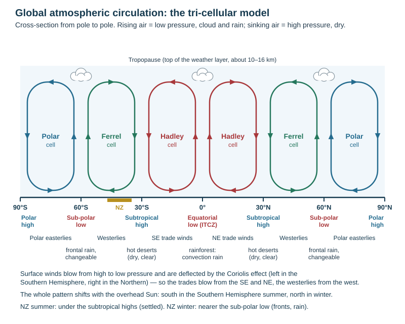
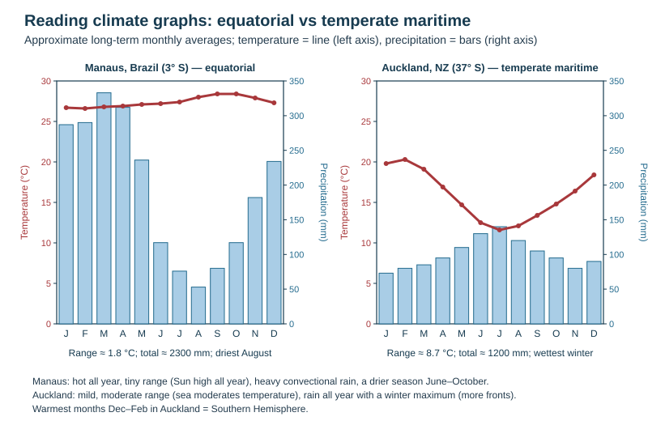

# Climate and global circulation

Theme 1, specification 1.4 (global circulation, why climate varies, New Zealand's climate). Weather processes, pressure, wind and synoptic charts are on [Weather](../notes/weather.md).

## Insolation: why the Earth is heated unevenly

**Insolation** = incoming solar radiation reaching the Earth's surface.

- **Latitude:** near the equator the Sun is high in the sky, so its rays are concentrated on a small area and pass through less atmosphere → intense heating. Towards the poles the rays strike at a low angle, spread over a larger area and pass through more atmosphere (more absorption and reflection) → weak heating.
- **Day length and seasons:** the Earth's axis is tilted 23.5°, so the overhead Sun moves between the Tropic of Cancer (June) and the Tropic of Capricorn (December), giving seasons.
- **Albedo** — the share of radiation reflected: high for ice, snow and cloud; low for forest and ocean.
- The equator has a **surplus** of energy and the poles a **deficit**; winds and ocean currents move heat polewards to balance it.

## Global atmospheric circulation: the tri-cellular model

| Latitude | Cell boundary | Surface pressure | Surface winds | Climate produced |
|---|---|---|---|---|
| 0° | rising limbs of the two **Hadley** cells — the **ITCZ** | **equatorial low** | trade winds converge | hot and wet all year; convectional rain; tropical rainforest |
| about 30° N and S | sinking limbs of the Hadley and **Ferrel** cells | **subtropical high** | trades blow towards the equator; westerlies blow polewards | dry, clear skies: most **hot deserts** |
| about 60° N and S | rising limbs of the Ferrel and **Polar** cells — the **polar front** | **sub-polar low** | westerlies meet polar easterlies | cool, changeable, **frontal rain**: temperate climates |
| 90° | sinking limb of the Polar cell | **polar high** | polar easterlies blow outwards | very cold and dry |

*Causal chain: the Hadley cell.* Intense insolation heats the equator → air rises, creating the equatorial low → it cools and condenses, giving heavy convectional rain → the now-dry air spreads polewards high up, cools, becomes denser and sinks at about 30° → sinking air warms and its RH falls, so clouds cannot form → subtropical high and deserts → surface air flows back to the equator as the **trade winds**.

- **Ferrel cell** — between about 30° and 60°; air at the surface flows polewards (the **westerlies**) and rises where it meets cold polar air at about 60°, giving frontal rain.
- **Polar cell** — cold dense air sinks at the poles and flows out as the **polar easterlies**. It is the smallest and weakest cell.
- **ITCZ (Inter-Tropical Convergence Zone)** — where the trade winds of the two hemispheres meet near the equator; rising air, cloud and heavy rain.
- **Coriolis effect** — the trades come from the **south-east** in the Southern Hemisphere and the **north-east** in the Northern; the westerlies come from the west.
- **Seasonal shift** — the whole pattern moves with the overhead Sun: south in the Southern Hemisphere summer, north in winter. This gives many tropical places a wet and a dry season.
- **Jet streams** — narrow bands of very strong west-to-east wind high in the atmosphere (near the cell boundaries) that steer depressions.

**Why the trade winds blow from the north-east between 0° and 30° N** (a 4-mark question): highest insolation at the equator → air rises → low pressure; air sinks at about 30° → high pressure → surface air moves from high to low → the Coriolis effect deflects it to the right in the Northern Hemisphere, so it arrives from the north-east. *Without Coriolis the answer is capped at 3.*

## Ocean currents

- Surface currents are driven by the prevailing winds, deflected by the Coriolis effect and shaped by the continents; deep currents are driven by differences in temperature and salinity (density).
- **Warm currents** (from the tropics) warm the coasts they pass and add moisture: the **North Atlantic Drift** keeps north-west Europe mild.
- **Cold currents** (from polar regions) cool the air above, making it stable and dry: the **Humboldt (Peru) current** helps create the **Atacama Desert**; the Benguela current the **Namib**.

## El Niño and La Niña (ENSO)

| | Normal | El Niño | La Niña |
|---|---|---|---|
| Pacific trade winds | blow east to west, piling warm water near Australia/Indonesia | weaken or reverse | strengthen |
| Warm water | western Pacific | spreads east to South America | pushed even further west |
| Rain | heavy over Indonesia and Australia; dry Peru | drought in Australia and Indonesia; floods in Peru | floods in Australia; drought in Peru |
| New Zealand | | more **south-westerly** winds: cooler, drought in the east | more **north-easterly** winds: warmer, wetter in the north and east, more ex-tropical cyclones |

ENSO = El Niño–Southern Oscillation, the linked ocean (El Niño) and atmosphere (Southern Oscillation) change; each phase recurs every 2–7 years.

## Why climate varies: the factors

| Factor | How it changes climate |
|---|---|
| **Latitude** | angle of the Sun and day length: hot near the equator, cold near the poles |
| **Altitude** | air thins with height and holds less heat; temperature falls about **6.5 °C per 1000 m** |
| **Distance from the sea (continentality)** | water heats and cools more slowly than land: coasts have cool summers, mild winters and a small range (**maritime**); interiors have hot summers, very cold winters and a large range (**continental**) |
| **Ocean currents** | warm currents warm and moisten; cold currents cool and dry |
| **Prevailing winds** | winds off the sea bring moisture and mild temperatures; winds off a continent are dry and more extreme |
| **Relief** | mountains force air to rise → wet windward slopes and a **rain shadow** to leeward |
| **Pressure belts** | rising air (lows) gives cloud and rain; sinking air (highs) gives clear, dry weather |
| **Aspect** | in NZ, north-facing slopes get more sun and are warmer |
| **Urban areas** | the **urban heat island** — cities are warmer than the countryside |

## Climate zones

| Zone (class) | Where | Character | Example |
|---|---|---|---|
| Tropical (equatorial) | within about 10° of the equator | hot and humid all year (26–28 °C), very wet, no seasons | Manaus, Singapore |
| Tropical wet-dry (savanna) | about 10–20° | hot all year; wet summer, dry winter | northern Australia |
| Arid (hot desert) | about 15–30°, west coasts with cold currents, interiors | very dry (under 250 mm), hot days, cold nights | Sahara, Atacama |
| Mediterranean | west sides of continents, about 30–40° | hot dry summers, mild wet winters | Perth, Rome |
| Temperate maritime | mid-latitudes near the sea | mild summers, cool winters, rain all year | Auckland, the UK |
| Continental | interiors of large continents | hot short summers, long very cold winters, large range | Moscow, central Canada |
| Polar / tundra | high latitudes | very cold all year, little precipitation | Antarctica |
| Mountain (alpine) | high ground anywhere | colder and often wetter than surrounding lowlands | Southern Alps |

The **Köppen classification** groups climates into A (moist tropical), B (dry), C (humid mid-latitude), D (continental) and E (cold).

## Reading a climate graph

A climate graph shows average monthly **temperature as a line** (left axis, °C) and average monthly **precipitation as bars** (right axis, mm).

| Step | What to do |
|---|---|
| 1 | Overall shape: is the temperature line flat or steep; is rain even or seasonal? |
| 2 | Quote the highest and lowest temperature and rainfall **with months and units** |
| 3 | **Annual temperature range** = highest − lowest |
| 4 | **Total annual rainfall** = sum of the 12 bars; mean monthly = total ÷ 12 |
| 5 | Name the wettest and driest **season** |
| 6 | Hemisphere: warmest in June–August = Northern; December–February = Southern |
| 7 | Do **not** give a month-by-month account |

*Worked example (Manaus, equatorial):* temperatures about 26.5–28.5 °C all year, so the range is about 2 °C; rain every month, over 2000 mm a year, driest about August (about 50 mm). Explanation: Sun overhead or nearly so all year → constant high insolation → daily convection → cumulonimbus and afternoon storms; the ITCZ keeps air rising; evapotranspiration from the forest adds moisture.

| Graph shape | Climate |
|---|---|
| high flat temperature line, tall bars every month | equatorial / tropical rainforest |
| very hot summers, almost no rain | hot desert |
| mild, small–moderate range, rain all year | temperate maritime (NZ) |
| huge range, winters below 0 °C | continental |
| very cold, little precipitation | polar |

*This loses marks:* no figures, no units, or reading temperature off the rainfall axis.

## New Zealand's climate (named example)

NZ lies between about **34° and 47° S**, is about 1600 km long and narrow, mountainous, and surrounded by ocean. Its climate grades from warm **subtropical** in the far north to cool **temperate** in the far south, with **alpine** conditions in the mountains.

| Influence | Pattern produced |
|---|---|
| **Seasonal shift of the cells** | **Summer:** the belts move south and NZ lies under the sinking air where the Hadley and Ferrel cells meet → many **anticyclones**, settled weather. **Winter:** the belts move north and NZ is nearer the meeting of the Ferrel and Polar cells → cold southern air meets warm northern air → frequent **fronts and frontal rain** |
| **Prevailing westerlies and relief** | most wind arrives from the west and south-west; the main ranges block it, funnelling air through gaps such as **Cook Strait** and **Foveaux Strait** — Wellington is very windy |
| **Orographic effect** | air forced over the ranges → **wet west, dry east**, strongest in the South Island where the Southern Alps are high and continuous. Milford Sound about 6700 mm a year; Hokitika about 2900 mm; Christchurch about 600–650 mm; Central Otago (Alexandra) under 400 mm. The hot dry **nor'wester** across Canterbury is a föhn wind |
| **Sunshine** | cloud from forced uplift keeps the west dull; the sheltered north and east are sunniest — **Nelson, Marlborough (Blenheim), Hawke's Bay, Gisborne, Bay of Plenty**, over 2400 hours a year at Nelson and Blenheim |
| **Latitude** | the north is warmer than the south (mean annual temperature about 16 °C in Northland, about 10 °C in Southland) |
| **Altitude** | about three-quarters of NZ is hill or mountain, so temperature falls sharply inland and upward; the temperature map follows the relief |
| **The ocean** | slow heating and cooling give the whole country a small seasonal range; the range increases inland — **Central Otago** has the most continental climate (hot summers, frosty winters) |
| **ENSO** | El Niño → cooler south-westerlies, drought in the east; La Niña → warmer north-easterlies, wetter north and east |

*This loses marks:* "the west is wetter because of the mountains" — the marks need the chain: prevailing westerly → forced to rise → cools to dew point → condensation → rain on the windward side → descending air warms and dries → rain shadow in the east.

## This loses marks

- Forgetting the Coriolis effect when explaining wind direction.
- Putting deserts at the equator or rainforests at 30°.
- A climate-zone answer that lists factors without linking each to a place.
