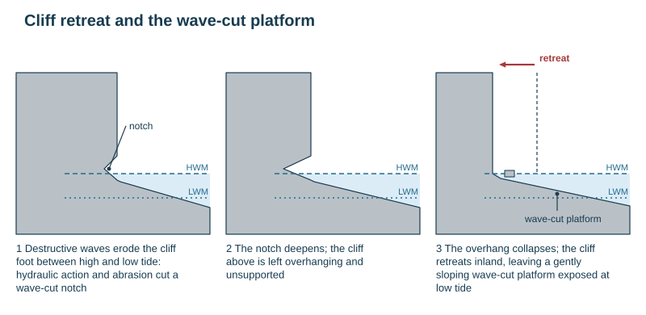
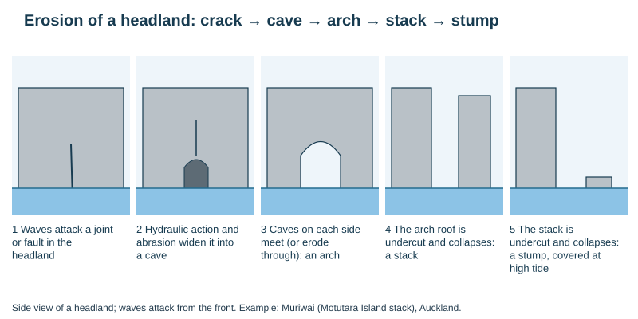
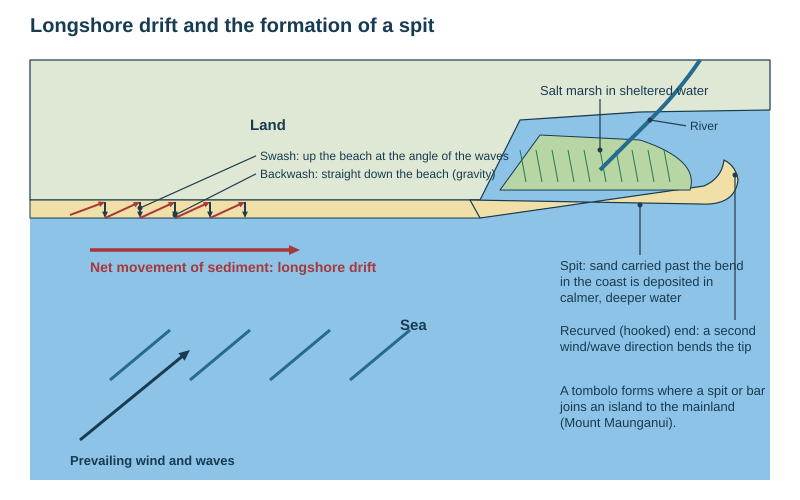

# Coasts

Theme 1, specification 1.6. Coral reefs are not examined. Named examples: Muriwai (erosion, hazards), Mangawhai Heads (spit, management), Mount Maunganui (tombolo).

## Waves

**Wave** = energy transferred through water by wind blowing over the sea surface. The water mostly moves in circles; the energy moves forward.

- **Fetch** = the distance of open water over which the wind blows. Longer fetch + stronger, longer-lasting wind = bigger waves (Auckland's west coast faces the long fetch of the Tasman Sea).
- As a wave reaches shallow water, friction with the sea bed slows its base, the top topples forward and it **breaks**.
- **Swash** = water rushing up the beach after a wave breaks. **Backwash** = water draining back down under gravity.

| | Constructive waves | Destructive waves |
|---|---|---|
| Shape | low, flat, long wavelength | high, steep, short wavelength |
| Frequency | 6–8 a minute | 10–14 a minute |
| Swash vs backwash | **strong swash**, weak backwash | weak swash, **strong backwash** |
| Effect | deposit material, **build** beaches | remove material, **erode** beaches and cliffs |
| Typical conditions | calm weather, distant storms | storms, strong local winds |

## Coastal processes

| Erosion process | Mechanism |
|---|---|
| **Hydraulic action** | waves force water and air into cracks; the compressed air expands as the wave retreats, weakening and breaking the rock |
| **Abrasion (corrasion)** | waves hurl sand, pebbles and boulders at the cliff — a sandpaper effect |
| **Attrition** | rocks carried by waves knock against each other, becoming smaller and rounder |
| **Corrosion (solution)** | weak acids in sea water dissolve rock such as limestone and chalk |

Sub-aerial processes (weathering and mass movement on the cliff face, rain wash, slumping) also wear cliffs back.

| Transport process | Meaning |
|---|---|
| Solution, suspension, saltation, traction | as in rivers |
| **Longshore drift** | waves approach at an angle (the prevailing wind) → swash carries sediment up the beach at that angle → backwash drags it straight back down → net zigzag movement **along** the coast |
| **Saltation by wind** | dry sand bounces inland off the beach |
| **Sand trapping** | vegetation (marram, spinifex, pīngao) or obstacles slow the wind so sand is dropped and dunes grow |

**Deposition** happens where waves lose energy: sheltered bays, behind headlands and islands, where the coastline changes direction, in estuaries, and where constructive waves dominate.

**Wave refraction** — waves slow and bend as they approach an irregular coast: they slow first in the shallow water off a **headland**, so their crests bend and **wave energy converges on the headland** (erosion) and **diverges in the bay** (deposition, beaches).

**Sea-level change**
- **Rise** (end of the ice age, global warming) → **submergent** coast: drowned river valleys (**rias**, e.g. Auckland's Waitematā Harbour), drowned glacial troughs (**fiords**, e.g. Milford Sound).
- **Fall** or land uplift → **emergent** coast: **raised beaches** and wave-cut platforms left above the shore (Turakirae Head near Wellington, uplifted in the 1855 earthquake).

**Concordant coast** = rock bands run parallel to the coast (few bays). **Discordant coast** = rock bands run at right angles to the coast → headlands and bays.

## Erosional landforms

| Landform | Formation |
|---|---|
| **Headland and bay** | alternating bands of hard and soft rock at right angles to the coast (discordant); **differential erosion** cuts the soft rock back into bays while the resistant rock stands out as headlands; refraction then focuses erosion on the headlands and deposition in the bays |
| **Cliff and wave-cut platform** | destructive waves erode the cliff foot between high and low tide by hydraulic action and abrasion → a **wave-cut notch** → the overhang above becomes unsupported and **collapses** → the cliff **retreats** inland, leaving a gently sloping rocky **wave-cut platform** exposed at low tide |
| **Cave → arch → stack → stump** | waves exploit a joint or fault in a headland (hydraulic action, abrasion) → it widens into a **cave** → caves on either side meet, or one erodes through → an **arch** → the arch is undercut and its roof collapses → an isolated **stack** → the stack is undercut and collapses → a low **stump**, covered at high tide |
| **Blowhole** | a cave roof is eroded upward to the cliff top; waves force spray up through the hole |

## Depositional landforms

| Landform | Formation |
|---|---|
| **Beach** | constructive waves deposit sand and shingle in sheltered bays; swash pushes material up; storm waves throw shingle to the back as **berms** (storm ridges) |
| **Spit** | longshore drift carries sediment along the coast → where the coast changes direction (or at a river mouth) the material is deposited in the calmer, deeper water → a narrow ridge of sand builds out into the sea → a second wind or wave direction curves the end (**recurved / hooked tip**) → **salt marsh** forms in the sheltered water behind |
| **Bar** | a spit grows right across a bay, trapping a **lagoon** behind it |
| **Tombolo** | a spit or bar joins an island to the mainland (Mount Maunganui / Mauao) |
| **Sand dunes** | onshore wind dries the beach and moves sand inland by **saltation** → sand is trapped by driftwood or plants → embryo dunes grow and are colonised by marram, spinifex or pīngao, whose roots bind the sand → successive ridges become older, more vegetated and stable inland (dune succession) |
| **Salt marsh** | fine silt and mud settle in sheltered water behind a spit or in an estuary; salt-tolerant plants colonise and trap more sediment |

**Link to the geomorphic cycle:** sediment deposited at the coast and on the sea floor is the start of the **recycling** stage — it is buried, compacted and cemented into new sedimentary rock and may later be uplifted.

## Coasts and people

| Opportunities | Hazards |
|---|---|
| ports, harbours, trade, fishing and aquaculture | **cliff erosion** and loss of land, homes and roads |
| tourism, recreation, surf, attractive housing | **storm surge** and coastal flooding (low pressure + onshore wind + high tide) |
| flat land for settlement and industry | **sea-level rise** from global warming |
| sand, gravel and ironsand mining | **tsunami** on tectonic coasts |
| habitats: estuaries, dunes, salt marsh, wildlife | **landslides** on unstable cliffs, especially after heavy rain |
| energy (wind, tidal, wave) | coastal pollution, sediment build-up blocking harbours |

## Managing coastal hazards

| Method | Type | How it works | Strengths | Weaknesses |
|---|---|---|---|---|
| **Sea wall** | hard | a concrete wall reflects or absorbs wave energy; curved walls throw waves back | strong, long-lasting; doubles as a promenade | very expensive; reflected energy scours the beach in front |
| **Revetment** | hard | sloping concrete or timber barrier breaks waves but lets some water through | cheaper than a wall | needs maintenance; restricts access; ugly |
| **Rip-rap (rock armour)** | hard | large boulders at the cliff foot absorb and dissipate wave energy | cheaper; effective; quick | rocks often imported; can be moved by big storms; ugly |
| **Gabions** | hard | wire cages of rocks absorb wave energy | cheap, easy to build | short-lived; ugly |
| **Groynes** | hard | timber or rock barriers across the beach trap sediment moving by longshore drift | wider beach absorbs wave energy | starve the coast **downdrift** of sediment, increasing erosion there |
| **Breakwater / offshore reef** | hard | barrier offshore makes waves break before they reach the coast | protects harbours and beaches | expensive; changes currents |
| **Cliff pinning and netting** | hard | steel bolts and mesh hold loose rock | stabilises dangerous faces | costly; visual impact |
| **Beach nourishment** | soft | sand or shingle added to replace losses | natural look; the beach absorbs energy | must be repeated; source of sand needed |
| **Dune planting and fencing** | soft | vegetation (pīngao, spinifex) traps sand; fences and boardwalks keep people off | cheap; builds habitat; community projects (Coastcare) | slow; needs people kept off |
| **Cliff drainage and regrading** | soft | removes water or lowers the slope so it is less likely to slump | cheap | does not stop wave attack at the foot |
| **Managed retreat** | soft | lets the sea erode or flood low-value land; moves buildings back | cheap; creates salt marsh that absorbs energy | land and homes lost; compensation disputes |
| **Hazard zoning and setback lines** | soft | no new building within the predicted erosion zone | cheap, long-term | existing owners lose value |

*This loses marks:* naming "sea wall" without saying how it reduces erosion — the second mark is for the mechanism (and mark schemes reject river methods in coastal answers).

## Named examples

- **Muriwai (Auckland west coast)** — a high-energy coast facing the Tasman Sea fetch: cliffs, a wave-cut platform, caves and a stack (**Motutara Island**, with its gannet colony), and long black ironsand beaches with dunes. **Hazards:** in **Cyclone Gabrielle (13 February 2023)** a landslide destroyed houses and killed two volunteer firefighters; slips and rockfalls on the unstable cliffs; rip currents. **Responses:** red- and yellow-stickered homes, geotechnical assessment, buy-outs of the highest-risk properties.
- **Mangawhai Heads (Northland)** — a depositional coast: a **sand spit** sheltering the Mangawhai estuary, home to the critically endangered **fairy tern / tara iti**. A storm **breached the spit in 1978**, letting the sea into the estuary; the community and authorities **rebuilt it** with sand and planted dunes. **Evaluation:** soft engineering protected the estuary, wildlife and the township, but it needs ongoing maintenance and a future storm could breach it again.
- **Mount Maunganui** — a classic **tombolo** joining Mauao to the mainland; a busy port, beach and tourism town exposed to storm surge.

## Coastal fieldwork

- **Beach profile:** ranging poles and a clinometer at each break of slope along a transect from the sea to the back of the beach.
- **Sediment size and shape:** sample pebbles at regular intervals along the profile; measure the long axis with a ruler or calipers; roundness with a Powers chart.
- **Longshore drift:** time a float (or measure the movement of painted pebbles) along the beach; compare sediment height on either side of groynes.
- **Wave frequency:** count waves breaking per minute.
- **Human use and management:** questionnaires, land-use mapping, field sketches and annotated photos of defences.
- Safety: tide times, never near cliff foot after rain, beware rips.

## This loses marks

- Stack and stump explained without the arch collapsing.
- Spit without the change in coastline direction and the recurved end.
- Longshore drift without swash at an angle and backwash straight down.
- Confusing constructive and destructive waves.
