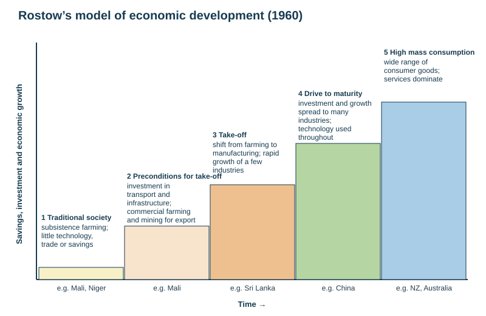
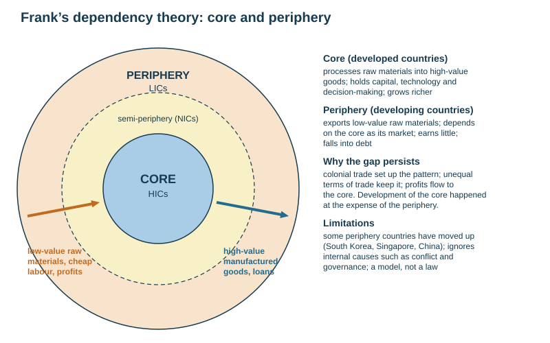

# Development and inequality

Theme 3, specification 3.1. Named examples: New Zealand (HIC) vs Niger (LIC), and regional inequality within New Zealand. Sectors of the economy, the Clark–Fisher model and globalisation are on [Sectors, economic transition and globalisation](../notes/globalisation.md).

## What development means

**Development** = an improvement in the quality of life and standard of living of a population. It is wider than wealth: a country can rise on one measure and fall on another.

| Type | Meaning (class definition) | Example indicators |
|---|---|---|
| **Economic** | the total value of goods and services produced, and the income of a country | GDP or GNI per capita, % employed in agriculture, energy use per person |
| **Social** | improvement in quality of life, social well-being, equality and social justice | life expectancy, literacy, infant mortality, doctors per 100 000, access to clean water |
| **Political** | the level of democracy and freedom of speech | political freedom score, Corruption Perceptions Index |
| **Environmental** | sustainability, pollution, resource use | Environmental Performance Index (EPI), ecological footprint |
| **Cultural** | freedom to express culture and beliefs, gender equality | Gender Inequality Index |

- **Growth is not development.** Economic growth is an increase in output or income; development is what happens to people's lives as a result. Growth whose gains go to an élite, or that destroys the environment, is growth without development.
- **Standard of living** = material wealth (income, goods, housing). **Quality of life** = wider well-being (health, freedom, safety, environment).
- **Sustainable development** = development that meets the needs of the present without compromising the ability of future generations to meet theirs.

## Measuring development

| Indicator | What it is | Strength | Limitation |
|---|---|---|---|
| **GDP per capita** | value of goods and services produced in a country in a year ÷ population | data available for almost every country | an **average**, so it hides inequality (India has many billionaires but millions in poverty, e.g. in Dharavi); excludes the informal and subsistence economy |
| **GNI (GNP) per capita** | national income including money earned abroad ÷ population | measures relative wealth (accepted in mark schemes as "most useful economic indicator") | still an average; exchange rates distort it |
| **PPP** (purchasing power parity) | income adjusted for what money buys locally (US\$ PPP) | fairer comparison of living standards | still hides inequality |
| **Life expectancy** | average years a newborn can expect to live | reflects health, diet and care | dragged down by high infant mortality |
| **Infant mortality rate** | deaths under age 1 per 1000 live births | very sensitive to health care, sanitation and mothers' education | needs reliable registration |
| **Literacy rate** | % of adults who can read and write | shows access to education | definitions differ |
| **Doctors per 100 000** | access to health care | simple, comparable | ignores distribution between city and countryside |
| **Birth rate, fertility rate** | births per 1000; children per woman | falls with development and women's education | shaped by culture and policy too |
| **% employed in agriculture** | size of the primary sector | high in LICs | can reflect a productive export sector |
| **Energy use per person** | kg of oil equivalent per year | links to industry and consumption | high in oil states regardless of social development |
| **Access to safe water / sanitation** | % of population | basic need, linked to disease | does not show quality or reliability |

**Composite indicators** combine several measures into one score.

| Index | Combines | Strength | Limitation |
|---|---|---|---|
| **HDI** (Human Development Index, UN) | income (GNI per capita PPP), education (years of schooling) and health (life expectancy) on a scale **0–1** | social and economic together, so a more accurate picture | some data missing for some countries; ignores the environment, freedom and **inequality within countries** |
| **HPI** (Happy Planet Index) | well-being and life expectancy relative to the **ecological footprint** — how efficiently a country turns resources into long, happy lives | includes sustainability and well-being | the economic dimension is absent; must be used with other indicators |
| **Gender Inequality Index** | reproductive health, empowerment and labour-market equality for women | shows gender gaps | data gaps |
| **Multidimensional Poverty Index** | deprivations in health, education and living standards in each household | shows who is poor and how | complex to collect |

**No single indicator is enough.** Name the indicator, say what it reveals and what it conceals. Essays ask you to justify a choice *and* explain why you rejected the others.

**Class data (one recent year each):**

| Country | GDP per capita (PPP) | HDI | HPI | Gender Equality Index | Political freedom | Corruption perception | EPI |
|---|---|---|---|---|---|---|---|
| United Kingdom | US\$56 000 | 0.946 (very high) | 39.8 | 0.776 | 92/100, free | 70/100 | 69.9 |
| New Zealand | US\$53 000 | 0.938 (very high) | 41.5 | 0.835 | 99/100, free | 81/100 | 83.0 |
| Brazil | US\$20 000 | 0.786 (high) | 52.4 | 0.704 | 72/100, free | 35/100 | 53.0 |
| Indonesia | US\$16 000 | 0.728 (high) | 50.1 | 0.672 | 57/100, partly free | 34/100 | 44.8 |
| Niger | US\$1 700 | 0.459 (low) | 29.1 | 0.354 | 33/100, not free | 31/100 | 28.5 |

Brazil and Indonesia score *higher* on the HPI than the UK or NZ because they reach reasonable well-being with a much smaller ecological footprint — the clearest illustration that the choice of indicator changes the ranking.

**Worked example — percentage change.** GNI per capita rises from US\$1800 to US\$2340:

$$\text{\% change} = \frac{\text{new} - \text{old}}{\text{old}}\times100 = \frac{2340-1800}{1800}\times100 = 30\%$$

## The development gap

**Development gap** = the difference in standard of living and wealth between the richest and poorest countries (and people).

- **Classification:** **HIC / MIC / LIC** (high-, middle-, low-income countries), based on GNI per capita (World Bank); **NIC** (newly industrialised country) = a country whose economy has grown rapidly through manufacturing (South Korea, Singapore, China, Malaysia). Older terms: MEDC / LEDC, developed / developing, the global North / South.
- **The Brandt Line (1980)** divided a rich "North" from a poor "South". It is a useful shorthand but out of date: Singapore and South Korea (south of it) are now HICs, and Australia and NZ were always placed in the North.
- **Global pattern:** HICs in North America, Western Europe, Japan, Australia and NZ; LICs concentrated in sub-Saharan Africa and parts of South Asia; MICs in Latin America, North Africa, most of Asia.

### Causes of uneven development (SEEP)

| | Cause | Mechanism |
|---|---|---|
| Social | poor health and disease (malaria, HIV/AIDS), low literacy, rapid population growth, gender inequality | a sick, unschooled or very young population produces less and spends more on dependants |
| Economic | dependence on a few primary exports, debt, weak infrastructure, little investment, unfair terms of trade | commodity prices swing; debt interest drains revenue; no capital to build industry |
| Environmental | drought, floods, tropical storms, poor soils, few resources, **landlocked** position, tropical disease | repeated losses; high transport costs; land degradation |
| Political | conflict and civil war, corruption, unstable government, colonial legacy, trade barriers | investment withheld, aid misused, tariffs keep countries exporting raw materials |
| Historical | **colonialism** — colonies supplied raw materials and were kept as markets | economies built around exports to the colonial power |

*Causal chain: the trade trap.* A country exports raw materials → prices are set on world markets and fluctuate → export earnings are unreliable → government revenue and investment are unreliable → no capital to build processing industry → the country keeps exporting low-value raw materials and importing high-value manufactured goods → the gap widens.

**Cycle of poverty:** low income → poor diet, health and education → low productivity → low income; no savings → no investment → low income.

## Models of development

### Rostow's model (1960)

| Stage | Description | Example (class data) |
|---|---|---|
| 1 Traditional society | most people work in subsistence agriculture; little technology, trade or savings | Mali, Niger |
| 2 Preconditions for take-off | investment in transport and infrastructure; commercial farming and mining for export; a new élite | Mali |
| 3 Take-off | a shift from farming to manufacturing; rapid growth in a few industries | Sri Lanka |
| 4 Drive to maturity | investment and growth spread to many industries; technology used throughout | China |
| 5 High mass consumption | consumers enjoy a wide range of goods; services dominate | NZ, Australia |

| Strengths | Limitations |
|---|---|
| simple, clear sequence; matches the history of the UK, USA and Japan | **outdated** (1960) and **oversimplified** — based on about 15 mostly European countries |
| shows the role of savings and investment | assumes all countries start equal with the same resources, population and climate |
| useful to compare countries' positions | capital to "take off" often arrives only as aid, and **debt repayments** can prevent take-off |
| | ignores that developed countries grew at the **expense** of developing ones; ignores the environment; assumes high consumption is the goal |

### Frank's dependency theory (core–periphery)

- Developed **in opposition to Rostow**. The world is a **core** (developed nations) and a **periphery** (developing nations).
- The periphery exports **low-value raw materials** and depends on the core as its market; the core **processes** them into **high-value goods** and grows rich.
- Historical trade, including colonialism, made the periphery poor, and the relationship keeps it poor: the core's development happened **at the expense of** the periphery.

| Strengths | Limitations |
|---|---|
| explains why some countries stay poor despite trade | some periphery countries have moved up (South Korea, Singapore, China) |
| highlights colonial history and unfair terms of trade | ignores internal causes such as conflict, corruption and governance |
| fits export data (Mali: cotton, gold, livestock; Sri Lanka: tea, rubber, textiles) | a model, not a law; does not say how to escape dependency |

**Using both:** Rostow explains a sequence; Frank explains why the sequence is not open to everyone. The Clark–Fisher model (employment by sector) is on the [globalisation page](../notes/globalisation.md).

| Country (class data) | GDP per capita | Literacy | Doctors per 100 000 | Primary sector employment | Rostow stage | Frank |
|---|---|---|---|---|---|---|
| Mali | US\$950 | 35.5% | 15 | 65% | traditional / pre-take-off | periphery: exports cotton, gold, livestock |
| Sri Lanka | US\$4 325 | 92.4% | 120 | 26.5% | take-off | periphery: tea, rubber, textiles |
| China | US\$14 730 | 97.2% | 250 | 22.3% | drive to maturity | moving towards the core: electrical goods |
| Singapore | US\$99 040 | 97.5% | 270 | under 0.1% | high mass consumption | core: machinery, pharmaceuticals |
| Australia | US\$69 350 | 99% | 410 | 2.1% | high mass consumption | core, but exports coal, iron ore, gold |
| New Zealand | US\$52 180 | 99% | 360 | 5.8% | high mass consumption | core, though it still exports primary produce |

## Named example: New Zealand (HIC) vs Niger (LIC)

| Indicator | New Zealand | Niger |
|---|---|---|
| Location | island nation in the South Pacific | landlocked, in the Sahel of West Africa; about 80% Sahara desert |
| GDP per capita (PPP, class data) | about US\$53 000 | about US\$1 700 |
| HDI | 0.938, very high (about 17th) | about 0.41–0.46, low, near the bottom of the world ranking |
| Life expectancy | about 82 years | about 62 years |
| Fertility rate | about 1.6–1.7 children per woman | about 6 — among the highest in the world |
| Adult literacy | about 99% | roughly a third to two-fifths |
| Employment | mostly tertiary; about 6% primary | mostly subsistence farming and herding |
| Political freedom | 99/100, free | 33/100, not free (military coup in 2023) |

**Reasons for the gap:** Niger is landlocked (high transport costs), mostly desert with recurring drought and desertification, has very rapid population growth, low literacy (especially of girls) and poor health care, depends on uranium and farm exports, and suffers conflict in the region and political instability. NZ has a stable democracy, high education, a diversified export economy (dairy, meat, tourism, forestry), good infrastructure and a temperate climate.

## Inequality within countries

Inequality within a country usually follows a **core–periphery** pattern: investment, services, transport and jobs concentrate in the capital, the largest city and the most accessible or resource-rich regions; remote, mountainous or peripheral regions lose their young people, then their services (a downward spiral). Example: in **Brazil** the industrial south-east (São Paulo, Rio) is far richer than the north-east and the Amazon.

**Related terms:** **formal sector** (registered, taxed, regulated jobs with contracts and protection); **informal sector** (unregistered, untaxed, insecure work such as street trading, waste picking and casual labour — invisible in GDP); **urbanisation of poverty** (poverty shifting from mainly rural to mainly urban as cities grow faster than formal jobs).

**Measuring inequality:** compare regional GDP per capita, median income, unemployment, deprivation indices (NZDep), health and education. The **Gini coefficient** (0 = perfect equality, 1 = one person has everything) measures income inequality.

### Named example: regional inequality in New Zealand

| | Advantaged regions | Disadvantaged regions |
|---|---|---|
| Where | **Auckland**, **Wellington**, Canterbury; resource-rich **Southland** and **Taranaki** | **Northland**, **Gisborne / Tairāwhiti**, the East Coast, parts of the rural central North Island |
| GDP per person (year to March 2025, Stats NZ) | Southland about NZ\$95 100; Wellington about NZ\$94 400; Auckland about NZ\$89 500 | Gisborne about NZ\$58 600; Northland about NZ\$58 000 — the two lowest |
| Characteristics | higher incomes, more skilled and service jobs, universities and hospitals, better transport links | lower incomes, higher unemployment, poorer health and housing, higher deprivation, more dependence on benefits, higher proportion of Māori residents facing disadvantage |

**Reasons:**
- **Remoteness** and poor transport links (few highways, no rail to Gisborne after storm damage).
- **Economic restructuring** from the 1980s: closure of freezing works, railways, forestry and government departments in small towns.
- Dependence on **primary industries** (farming, forestry) with few local processing jobs and volatile prices.
- **Out-migration** of young, skilled people to the cities → ageing, smaller workforce → services close.
- **Agglomeration**: firms and head offices cluster in Auckland and Wellington.
- Historical loss of Māori land and its effects on wealth.
- **Natural hazards:** repeated storm damage (Cyclone Gabrielle 2023 hit Tairāwhiti and Hawke's Bay).

**Responses:** the **Provincial Growth Fund** (2018–2021, about NZ\$3 billion for regional projects), roads and rural broadband, Māori land development and Treaty settlements investing in iwi businesses, regional tourism promotion, support for primary-sector processing.

## Reducing the development gap (supporting points)

| Strategy | How it helps | Problem |
|---|---|---|
| **Aid** — bilateral (government to government), multilateral (via the UN, World Bank), NGO (Oxfam, World Vision); short-term emergency vs long-term development | funds health, education, infrastructure | can be **tied** (spent on the donor's goods), misused, or create dependency |
| **Fair trade** | guaranteed minimum price and premium to farmers | small share of trade |
| **Debt relief** (Heavily Indebted Poor Countries scheme) | frees money for services | conditions attached |
| **Investment by TNCs** | jobs, skills, infrastructure | profits leave (see [globalisation](../notes/globalisation.md)) |
| **Microfinance** | small loans for small businesses, often to women | high interest in some schemes |
| **Intermediate (appropriate) technology** | simple, affordable, locally maintained tools (hand pumps, solar lamps) | small scale |
| **Sustainable Development Goals (2015–2030)** | 17 UN goals (no poverty, zero hunger, clean water…) replaced the **Millennium Development Goals** (2000–2015) | many targets off track |

## This loses marks

- Quoting an indicator without its unit or year.
- Saying GDP per capita shows how *everyone* lives.
- Describing Rostow's stages without any criticism when asked to evaluate.
- Treating NZ as uniformly wealthy in a regional-inequality question.
- Naming two countries without giving data that shows the gap.
