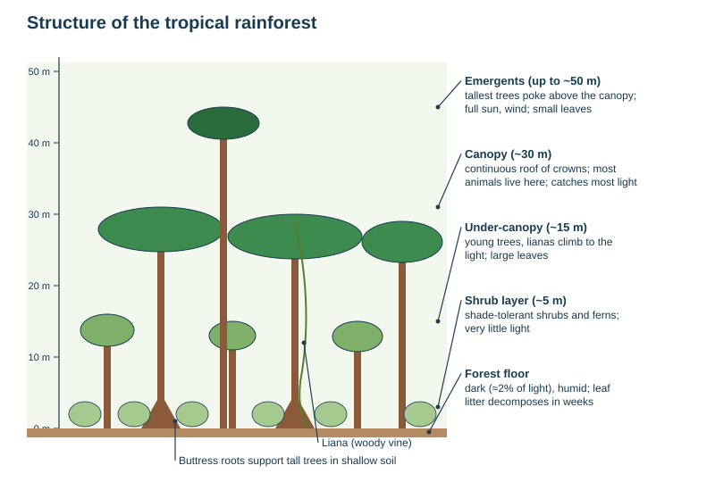

# Ecosystems: tropical rainforest and hot desert

Theme 1, specification 1.5. Named examples: the Amazon rainforest (Brazil) and the Sahara and Sahel (hot desert and its margin). Climate graphs for these biomes are on [Climate and global circulation](../notes/climate.md).

## What an ecosystem is

**Ecosystem** = a community of living things (plants, animals, decomposers) interacting with each other and with the non-living parts of their environment — climate, soil, water, rock and relief — as one system. A change in one component changes the others.

| Term | Meaning |
|---|---|
| **Biotic** | living components: plants, animals, fungi, bacteria |
| **Abiotic** | non-living components: climate, soil, water, rock, relief |
| **Biome** | a large-scale ecosystem covering a large area with a similar climate and vegetation (tropical rainforest, hot desert, tundra) |
| **Producer** | a green plant that makes food by photosynthesis |
| **Consumer** | an animal that eats plants (herbivore, primary consumer) or other animals (carnivore, secondary consumer) |
| **Decomposer** | fungi and bacteria that break down dead matter and return nutrients to the soil |
| **Food chain / food web** | the feeding links by which energy passes between organisms |
| **Nutrient cycle** | the movement of nutrients between the soil, the living biomass and the leaf litter |
| **Biodiversity** | the variety of plant and animal species in an area |
| **Adaptation** | a feature that helps a plant or animal survive in its environment |

## Location

| Biome | Location | Why there |
|---|---|---|
| **Tropical rainforest** | a belt within about 10° of the equator: the **Amazon** basin (South America), the **Congo** basin (Central Africa), **South-East Asia** (Indonesia, Borneo, Malaysia), north-east Australia | rising air at the **equatorial low / ITCZ** gives daily convectional rain; high insolation all year |
| **Hot desert** | about **15–30° N and S**, especially on the west sides of continents and in continental interiors: Sahara, Arabian, Kalahari, Namib, Atacama, Australian, Mojave | **sinking air** of the subtropical high (no cloud); trade winds that have crossed large land areas and lost their moisture; **cold offshore currents** (Atacama, Namib); **rain shadows** |

## Climate compared

| | Tropical rainforest | Hot desert |
|---|---|---|
| Temperature | **26–28 °C** every month | very hot by day, often over 40 °C in summer; near or below freezing on winter nights |
| Annual range | very small, **1–2 °C** | larger (about 10–20 °C between seasons) |
| Daily range | small (cloud) | very large (no cloud) |
| Rainfall | over **2000 mm** a year, every month, heavy convectional afternoon storms | under **250 mm** a year, very unreliable, sometimes none for years, occasional flash floods |
| Humidity | very high (80%+) | very low |
| Sunshine | limited by daily cloud | very high |

- **Why the rainforest has a small range:** the Sun is overhead or high all year, so insolation is constantly high; there is no cold season; daily cloud limits extremes.
- **Why deserts have a large daily range:** clear skies → intense insolation by day; no cloud blanket at night → heat radiates straight back to space.

## Tropical rainforest

**Structure (layers):**
- **Emergents** (up to ~50 m) — the tallest trees, above the canopy; full sun and wind.
- **Canopy** (~30 m) — a continuous roof of tree crowns; catches most light; home to most animals.
- **Under-canopy** (~15 m) — young trees, lianas, large leaves to catch dim light.
- **Shrub layer** (~5 m) — shade-tolerant shrubs and ferns.
- **Forest floor** — dark (about 2% of sunlight), humid, covered with leaf litter that decomposes in weeks.

**Plant adaptations**

| Adaptation | Why |
|---|---|
| **Drip-tip leaves**, waxy surfaces | shed heavy rain quickly, preventing rot and mould |
| **Buttress roots** | support tall trees in shallow soil |
| **Shallow roots** | take up nutrients quickly from the thin fertile top layer |
| **Lianas** (woody vines) | root in the ground and climb trees to reach the light |
| **Epiphytes** (orchids, bromeliads) | grow on branches to reach light; take water from the humid air |
| **Thin, smooth bark** | no need for insulation; stops other plants climbing |
| **Large leaves in lower layers** | catch the little light available |
| Evergreen, continuous growth | no cold or dry season |

**Animal adaptations:** most live in the canopy — monkeys with prehensile tails and toucans with large beaks for fruit; sloths move slowly and are camouflaged by algae; tree frogs have suction pads; poison dart frogs warn predators with bright colours; jaguars hunt on the floor with camouflage; many insects and bats are nocturnal.

**Soil: latosol** — deep, red (iron oxides), but **leached and infertile**.

*Causal chain: why rainforest soils are poor despite lush vegetation.* Heat and constant moisture → very rapid decomposition of leaf litter by fungi and insects → nutrients released and immediately taken up by shallow roots → almost all nutrients are stored in the **living biomass**, not the soil → heavy rain **leaches** what is left downwards → clear the trees and the nutrient store goes with them, so cleared land loses fertility within a few years.

**Interactions in the Amazon:** constant heat and rain → rapid growth and competition for light → tall emergents, dense canopy, plants adapted to shed water and climb → the canopy keeps the floor dark and humid → huge variety of animals adapted to particular layers → decomposers recycle nutrients straight back to the plants → **transpiration** returns moisture to the air, feeding the next day's rain (estimates suggest up to about half of the Amazon's rain is recycled this way).

**Value of rainforests:** biodiversity (over half the world's land species in about 6% of the land), medicines, food (nuts, fruit), timber, a huge **carbon store** and oxygen supply, regulation of regional rainfall, homes and cultures of indigenous peoples, ecotourism.

### Deforestation in the Amazon (named example)

The Amazon covers about **5.5 million km²**, about 60% of it in **Brazil**; roughly a fifth of the original Brazilian Amazon has been cleared. Annual clearing in Brazil peaked at over 27 000 km² in 2004, fell sharply after 2005 with stronger enforcement, rose again to about 13 000 km² in 2021 and fell to about 6 000 km² in 2024.

| Cause of deforestation | Detail |
|---|---|
| **Cattle ranching** | the biggest single cause (about 80% of cleared land becomes pasture); beef for export |
| **Commercial farming** | soya for animal feed, palm oil (in SE Asia) |
| **Logging** | valuable hardwoods such as mahogany; often illegal; opens roads for settlers |
| **Mining** | iron ore (Carajás), gold (with mercury pollution), bauxite |
| **Roads and settlement** | the Trans-Amazonian Highway (1970s) opened the forest to settlers |
| **Hydroelectric dams** | reservoirs flood forest (Belo Monte) |
| **Subsistence and shifting cultivation** | population pressure; slash-and-burn |
| **Fires** | set to clear land; spread in drought years |

| Effects | Local | Global |
|---|---|---|
| Environment | loss of habitat and **biodiversity**, extinctions; **soil erosion** and leaching once the canopy and roots are gone; rivers silted, more flooding; less transpiration → less local rain, longer dry seasons | **carbon** stored in the trees released by burning and decay → enhanced greenhouse effect; less CO₂ absorbed; risk of the forest drying into savanna (a "tipping point") |
| People | indigenous peoples lose land, livelihoods and culture; conflict over land; disease | lost medicines and genetic resources |
| Economic (benefits) | jobs, export earnings (beef, soya, ore), roads, power, land for poor farmers | cheaper food and materials |

**Sustainable management:** protected areas and indigenous reserves; satellite monitoring and enforcement (Brazil's DETER and PRODES systems); the **Soy Moratorium** (2006) on buying soya from newly cleared land; selective logging and replanting; ecotourism; agroforestry; debt-for-nature swaps and international funds (the Amazon Fund); consumer certification (FSC timber).

*Evaluate deforestation* by weighing short-term national economic gain against long-term local and global losses, and by who gains (ranchers, companies, the government) and who loses (indigenous groups, future generations, the global climate).

## Hot desert

**Plant adaptations**

| Adaptation | Why |
|---|---|
| **Succulents** (cacti) store water in thick stems or leaves | survive long droughts |
| **Spines** instead of leaves; small, waxy or hairy leaves | cut water loss by transpiration; deter animals |
| **Very long tap roots** or **wide shallow roots** | reach groundwater, or catch rain quickly over a large area |
| **Seeds dormant for years**; short life cycles after rain (ephemerals) | the desert "blooms" briefly after rain |
| Stomata open at night | less water loss in the heat |

**Animal adaptations:** **camels** store fat in the hump (energy), have long eyelashes and closing nostrils against sand, and wide feet; **fennec foxes** have huge ears to lose heat; **kangaroo rats** get water from seeds and never need to drink; many animals are **nocturnal** or burrow to avoid the heat.

**Soils:** thin, sandy or stony, little organic matter; salts drawn to the surface by evaporation.

**Opportunities and challenges:** minerals and oil (Algeria, Saudi Arabia), solar energy, tourism, farming with irrigation (Nile valley); extreme heat, water shortage, poor soils and long distances.

### The Sahara and the Sahel (named example)

- The **Sahara** is the world's largest hot desert, about 9 million km² across North Africa.
- The **Sahel** is the semi-arid belt along its southern edge (Senegal and Mauritania to Sudan), with 200–600 mm of unreliable rain and a short wet season.
- **Desertification** = the turning of semi-arid land into desert. Causes in the Sahel: **over-cultivation** and **overgrazing** to feed a fast-growing population, **cutting trees for fuelwood** and building, poor soil management, and **climate change** and recurring drought.
- **Effects:** soil erosion, falling crop and livestock yields, **food shortages**, malnutrition (especially of young children), migration to cities and abroad, conflict over land and water, loss of traditions (herders such as the Maasai further south face the same pressures).
- **Responses:** the **Great Green Wall** (launched 2007), a belt of trees and restored land across Africa — roots hold soil, leaves reduce evaporation, trees provide fuel and food (progress is well behind its target); **farmer-managed natural regeneration** in Niger; stone lines (bunds) and **zaï pits** that trap rain; drought-resistant crops; efficient cookstoves to cut fuelwood use.

## This loses marks

- Describing rainforest climate without figures and units.
- Explaining adaptations as wants ("the cactus wants to save water") instead of function.
- Saying rainforest soils are fertile.
- Causes of deforestation with no named example.
