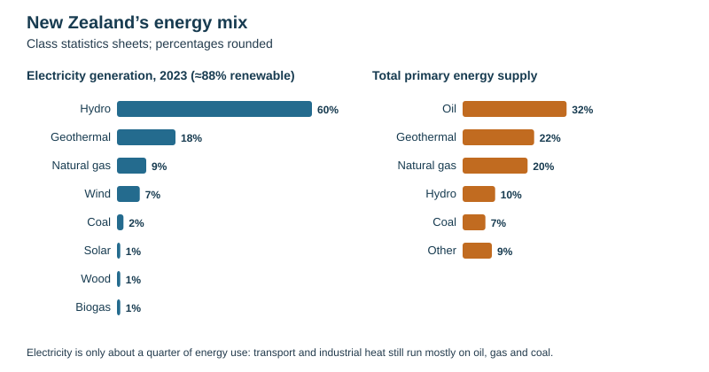

# Energy resources

Theme 3, specification 3.6. Named examples: New Zealand's energy supply, the Three Gorges Dam (China), Iceland, fuelwood in LICs.

## Resources and energy

| Term | Meaning |
|---|---|
| **Resource** | a naturally occurring substance or feature that people can use (class definition: "can be used in its own right") |
| **Renewable** | replenished naturally on a human timescale, so it is not used up (sun, wind, water, geothermal heat, plants) |
| **Non-renewable (finite)** | a fixed stock that is used up faster than it forms (coal, oil, natural gas, uranium) |
| **Fossil fuels** | coal, oil and natural gas, formed over millions of years from the remains of plants and organisms |
| **Primary energy** | energy in its raw form (coal, crude oil, wind, sunlight) |
| **Energy mix** | the share of each source in a country's energy supply |
| **Energy security** | reliable access to enough affordable energy, without dependence on unstable suppliers |
| **Energy conservation** | using less energy: insulation, efficient appliances, public transport |
| **Peak oil** | the point at which oil production (of cheaply obtained oil) reaches its maximum and then declines, making oil more expensive |

| Non-renewable | Renewable |
|---|---|
| coal, oil, natural gas, nuclear (uranium) | hydroelectric (HEP), geothermal, wind, solar, tidal, wave, biofuel / biomass, fuelwood (if trees are replanted) |

**Renewable does not mean impact-free or reliable.** A hydro dam still floods a valley; wind and solar stop when the wind drops or the Sun sets (they are **intermittent**).

## The sources: how they work, advantages and disadvantages

| Source | How it works | Advantages | Disadvantages |
|---|---|---|---|
| **Coal** | fossilised plants burned to boil water → steam turns turbines | large reserves; cheap; reliable; easy to stockpile | the most CO₂ per unit of energy; air pollution, acid rain; mining damage and danger |
| **Oil** | fossilised marine organisms; refined into petrol, diesel, jet fuel | energy-dense; easy to transport; fuels almost all transport; feedstock for plastics | finite (peak oil); price volatile; spills (Rena off Tauranga, 2011); CO₂ |
| **Natural gas** | methane trapped in rock, released through wells; **fracking** cracks shale rock with high-pressure water to release it | the cleanest fossil fuel; flexible, quick to start — good back-up for renewables | still a fossil fuel; methane leaks; fracking may contaminate groundwater and trigger small earthquakes |
| **Nuclear** | uranium atoms split (fission); the heat makes steam | no CO₂ in generation; huge output from little fuel; reliable baseload | very high cost and long build; radioactive waste lasting thousands of years; accident risk (**Chernobyl** 1986, **Fukushima** 2011); weapons concerns |
| **Hydroelectric (HEP)** | water stored behind a dam falls through turbines | renewable; reliable and controllable; long-lived; stores energy; cheap once built; flood control and water supply | floods valleys and displaces people; traps sediment; blocks fish; needs high rainfall and relief; output falls in dry years |
| **Geothermal** | steam or hot water from heated rock drives turbines or heats water directly | continuous output; small land area; low emissions | only in volcanic regions; releases some gases (H₂S, CO₂); subsidence; can affect geysers |
| **Wind** | wind turns turbine blades | no fuel cost or emissions in use; quick to build; offshore potential | intermittent; visual and noise impact; kills birds; needs back-up or storage |
| **Solar** | photovoltaic (PV) cells make electricity; or panels heat water | free once installed; suits remote, off-grid places in LICs; falling costs | no output at night, less in cloud, dust or ash; least sunshine in high-latitude winters when demand peaks; needs storage |
| **Tidal** | tidal flows turn turbines in a barrage or in the open sea | highly predictable; long-lived | very high cost; few sites; damages estuary ecosystems and mudflats |
| **Wave** | wave motion drives generators | large potential on exposed coasts | technology immature; storm damage; expensive |
| **Biofuel / biomass** | crops (sugar cane, maize), wood or waste burned or turned into fuel (ethanol, biogas) | uses waste; carbon-neutral in principle if replanted | competes with food for land; deforestation; smoke and emissions |
| **Fuelwood** | wood burned for cooking, heat and light | cheap and available; renewable if trees are replanted | deforestation, desertification and soil erosion if not replaced; indoor smoke harms health; hours spent collecting it (often by women and children) |

## Global energy use

- **Demand is rising** because of population growth, economic development (industry, transport, air-conditioning), urbanisation and globalisation.
- World primary energy use rose from about **140 000 TWh in 2010** to about **172 000 TWh in 2023**; fossil fuels still supplied about **81%**.
- **Electricity** is changing faster: in **2024** renewables grew to supply **over 40%** of world electricity (renewables and nuclear together).
- **Who uses it:** HICs use far more energy per person than LICs; China is now the largest total consumer; consumption is growing fastest in Asia.
- **Oil reserves and production** are concentrated in the **Middle East** (Saudi Arabia), Russia, the USA, Canada and Venezuela; many importers worry about **energy security**.

**Energy and development**

| Level of development | Main energy sources | Why |
|---|---|---|
| Traditional / LIC | **fuelwood**, dung, crop waste (about 40% of the world's population rely on fuelwood for cooking and heat) | cannot afford power stations, fuel imports or a national grid |
| Developing / NIC | **fossil fuels** (coal in China and India), some HEP | technology exists; fuels widely available; rapid industrialisation (coal still dominates China despite the Three Gorges Dam) |
| Developed / HIC | still mostly fossil fuels, but rising **renewables** and often **nuclear** | money and technology for alternatives; climate commitments; energy security |

## Named example: New Zealand's energy supply

| Measure | Figure (class statistics sheets) |
|---|---|
| Primary energy supply | oil about 32%, geothermal 22%, natural gas 20%, hydro 10%, coal 7%, other 9% |
| Energy consumed by users | oil 48%, electricity 24%, gas 12.5%, other renewables 9.7%, coal 4.1%, geothermal 1.3% |
| Electricity generation 2023 | about 43 500 GWh: hydro 60%, geothermal 18%, gas 9%, wind 7%, coal 2%, solar, wood and biogas about 1% each — **88% renewable** |
| Electricity as a share of all energy | only about a quarter — so 88% renewable electricity is **not** 88% renewable energy |
| Oil | about 73% used in transport; all crude oil is now **imported** (the Marsden Point refinery closed in 2022) |
| Energy use by sector | transport 36%, industry 34%, households 11%, commercial and public 9%, agriculture, forestry and fishing about 5% |
| Greenhouse emissions | agriculture about 53%, energy about 37%, industrial processes about 6%, waste about 5% |

**Why the mix is what it is:**
- **Hydro:** high rainfall and steep relief — the **Waikato**, **Waitaki** and **Clutha** schemes; **Manapōuri** (850 MW) is the largest station and powers the Tiwai Point smelter.
- **Geothermal:** the **Taupō Volcanic Zone** (Wairakei, opened 1958, one of the world's first geothermal stations).
- **Wind:** strong westerlies — farms such as Te Āpiti and Turitea in the Manawatū.
- **Gas:** Taranaki fields (Maui, Pohokura) — declining.
- **Coal and gas back-up:** **Huntly** power station (954 MW) runs in **dry years** when the hydro lakes are low.
- **Future:** most new capacity is wind and solar; the challenge is the other three-quarters of energy use — transport and industrial heat still run on imported oil, gas and coal.

## Locating power stations

| Type | Location factors | Example |
|---|---|---|
| **Thermal (coal, oil, gas)** | near the fuel source (coal is bulky and costly to move — own rail lines to mines), or near a port if fuel is imported, or near pipelines and refineries; large flat site; beside a river or the sea for cooling water; near the grid and demand | Huntly beside the Waikato River |
| **Hydroelectric** | high, reliable rainfall and river flow; a steep gradient or narrow valley to dam; strong, impermeable rock; low population to relocate; little seismic risk | Three Gorges, Manapōuri |
| **Nuclear** | coast or large river for cooling water; away from large populations; stable, flat land above flood level; transport links for fuel and waste | Sizewell, Suffolk (UK) |
| **Wind farm** | high, exposed, consistently windy sites or offshore; near the grid; away from houses; low ecological and landscape value | Manawatū ranges |
| **Geothermal** | volcanic area with hot rock near the surface | Wairakei |
| **Solar farm** | high sunshine hours, flat cheap land, near the grid | |

## Named example: the Three Gorges Dam, China

- On the **Yangtze River** in central China; the **world's largest hydroelectric power station, 22 500 MW**; the dam is over **2 km** long.
- **Site chosen** (from about 15 options) because: the Yangtze, the world's third-longest river, has huge hydroelectric potential; the valley was wide and flat for building; the **bedrock was firm** with few cracks; a **small island** in the channel made it easy to divert the river during construction; the area has had **no recent major earthquakes**.
- **Benefits:** large amounts of low-carbon electricity (replacing coal); **flood control** on the Yangtze (floods in 1998 killed thousands); larger ships can reach Chongqing; water supply.
- **Costs:** over **1.3 million people relocated**; towns such as **Fengdu** and farmland, cultural sites and habitats flooded; **sediment trapped** behind the dam (less fertile silt downstream, delta erosion); landslides on the reservoir banks; water pollution; threat to river species (the Yangtze river dolphin is now probably extinct).

## Technology and resources: Iceland

Iceland has no oil or gas but abundant **geothermal** energy (and hydro), which supplies almost all its electricity and heating. It has experimented with using that electricity to split water into **hydrogen** as a transport fuel (hydrogen buses in Reykjavík). It shows **technology can reduce resource problems** — but only where the right renewable resource exists, and new infrastructure is costly.

## Should LICs rely on renewables? (essay)

| For | Against |
|---|---|
| solar, small hydro and wind need **no fuel imports**, saving foreign exchange | high **upfront cost**; need foreign finance and technology |
| suit remote villages with **no grid** (solar lamps, mini-grids) | **intermittent** without storage; unreliable supply hurts industry |
| avoid locking in fossil-fuel dependence and pollution | maintenance skills and spare parts may be lacking |
| reduce fuelwood use, deforestation and indoor smoke | today's HICs industrialised on cheap fossil fuels — fairness |
| many LICs are sunny (high solar potential) | some LICs have coal or gas reserves that could fund development |

A strong conclusion judges by the country's resources, capital, grid and climate: renewables suit off-grid rural electrification; large industry may still need gas or hydro as a reliable base.

## This loses marks

- Calling nuclear renewable, or saying renewable means "clean and reliable".
- Confusing renewable electricity with renewable energy.
- Advantages and disadvantages with no verdict when asked to evaluate.
- Power station location without the reason for each factor.
