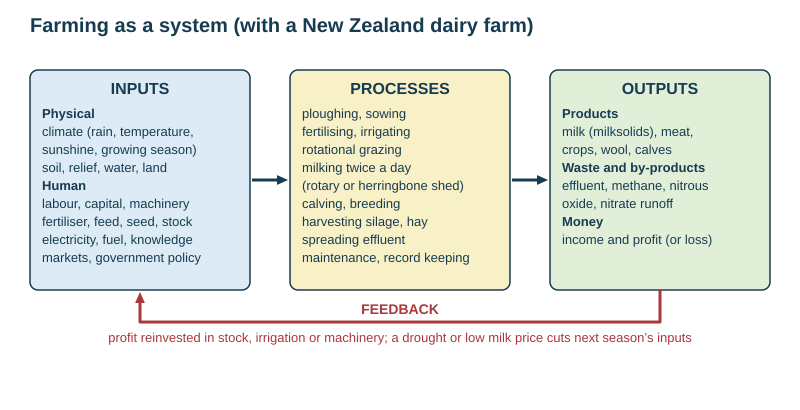
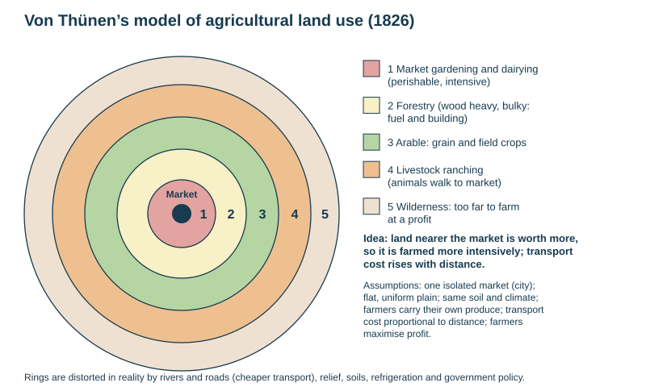

# Farming and food shortages

Theme 3, specification 3.3 (primary industry). Named examples: a New Zealand dairy farm (the Waikato) and food shortages in Somalia (2011) and the Sahel.

## Types of farming

| Classification | Distinction | Example |
|---|---|---|
| **Commercial** | produce grown or reared for sale, for profit | NZ dairy, Canterbury arable |
| **Subsistence** | grown to feed the farmer's own family, little left to sell | shifting cultivation in the Amazon; small farms in the Sahel |
| **Arable** | growing crops | wheat in Canterbury |
| **Pastoral** | rearing animals | sheep in hill country, dairy in Waikato |
| **Mixed** | crops and animals together | |
| **Horticulture** | intensive growing of fruit, vegetables and flowers, often under glass | kiwifruit in the Bay of Plenty, Pukekohe vegetables |
| **Intensive** | high inputs of labour or capital per hectare, giving high output per hectare, usually on small areas | market gardening, rice, dairy |
| **Extensive** | low inputs relative to a large area; low output per hectare | sheep stations, cattle ranching in Australia |
| **Nomadic pastoralism** | herders move animals in search of grazing | Maasai, Sahel herders |
| **Plantation** | large commercial estates growing one cash crop for export, often foreign-owned | tea, rubber, palm oil |
| **Organic** | no artificial fertilisers or pesticides | |

## Factors affecting farm location and type

| Factor | Type | Influence |
|---|---|---|
| **Relief** (slope, altitude) | physical | flat land suits machinery and crops; steep slopes suit grazing or forestry; altitude lowers temperature |
| **Soil** | physical | depth, drainage, fertility and pH decide which crops grow (volcanic soils of Waikato, alluvium of the Canterbury Plains) |
| **Rainfall** | physical | crops and grass need reliable water; irrigation where it is short |
| **Temperature, sunshine, frost-free days** | physical | length of the growing season and which crops ripen |
| **Water source** | physical | rivers or aquifers for irrigation and stock |
| **Market** | human | bulky, heavy or perishable produce is grown near markets or processing plants (fresh milk to a dairy factory, vegetables near Auckland) |
| **Transport** | human | roads, rail, ports for exports |
| **Capital** | human | machinery, fertiliser, irrigation, buildings |
| **Labour** | human | availability and cost, especially for horticulture (seasonal pickers) |
| **Technology** | human | breeding, GM crops, rotary sheds, irrigation |
| **Government policy** | human | subsidies, quotas, environmental rules (nitrogen caps), land ownership |
| **Farmer's choice and tradition** | human | knowledge, attitude to risk |

*This loses marks:* naming a factor without saying how it affects land use. "Relief (1) — flat land allows machinery for crops (2)" is the pattern.

## Farming as a system

| Inputs | Processes | Outputs | Feedback |
|---|---|---|---|
| physical: land, climate, soil, water; human: labour, capital, stock, feed, fertiliser, fuel, machinery, knowledge | ploughing, sowing, irrigating, feeding, milking, harvesting, maintaining | products: milk, meat, crops, wool; waste: effluent, nitrate runoff, methane; money | profit reinvested in more stock or machinery; a bad season or low price cuts next year's inputs |

## Von Thünen's model (1826)

- **Idea:** land nearer the market costs more and transport costs rise with distance, so the most intensive and perishable products are produced closest to the market and the most extensive furthest away.
- **Rings (inner to outer):** 1 market gardening and dairying (perishable, intensive) → 2 forestry (wood was heavy, bulky and needed for fuel and building) → 3 arable crops → 4 livestock ranching (animals walk to market) → 5 wilderness (too far to farm at a profit).
- **Assumptions:** an "isolated state" with one market city; a flat, uniform plain with the same soil and climate everywhere; farmers carry their own produce to market by horse and cart; transport cost is proportional to distance; farmers aim to maximise profit.

| Strengths | Limitations |
|---|---|
| explains why intensive land use (market gardens, dairy) is found near cities — Pukekohe near Auckland | based on 19th-century Germany |
| shows the trade-off between land rent and transport cost | assumes a flat, uniform plain — real relief, soil and climate vary |
| a navigable river or road stretches the rings (cheaper transport) | modern transport, refrigeration and containerisation let perishable produce travel far (NZ lamb and butter to Europe) |
| | ignores government policy, subsidies, global markets and farmers' choices; forestry now usually on poor land, not ring 2 |

## Named example: a New Zealand dairy farm

| | Details |
|---|---|
| Where | dairying is concentrated in the **Waikato** (the largest region: about 1.1 million cows and about 3000 herds), **Taranaki**, **Southland** and, with irrigation, **Canterbury** |
| Scale (2023/24) | about **4.7 million dairy cows**; average herd about **445 cows**; about **400 kg of milksolids per cow** per season; about 20.5 billion litres of milk |
| Physical location factors | mild temperate climate, so **grass grows almost all year** (cows graze outdoors); reliable rainfall (about 1100–1300 mm in Waikato) or irrigation (Canterbury); flat to rolling land; fertile volcanic or alluvial soils |
| Human location factors | a nearby processing plant (milk is perishable and is collected daily by tanker — Fonterra's Te Rapa near Hamilton); good roads; ports for export (Tauranga); farmer knowledge; access to capital |
| Inputs | land, grass, cows, labour (owner, sharemilker, workers), fertiliser, supplementary feed (silage, maize, palm kernel), electricity, water, machinery, a milking shed, vet services |
| Processes | rotational grazing of paddocks; milking **twice a day** in a rotary or herringbone shed; calving in spring (July–September); artificial insemination and breeding; making silage; spreading effluent; drying cows off in late autumn |
| Outputs | milk (sold as milksolids, collected daily by tanker), calves and cull cows (meat); waste: effluent, nitrate, methane |
| Feedback | the milk price (record NZ\$10.16 per kg of milksolids in 2024/25) decides spending next season; profit reinvested in irrigation, herd improvement, a new shed |
| Importance | dairy is NZ's largest goods export — about one dollar in every three earned from goods exports; about NZ\$10 billion of direct value to the economy |

## Environmental impacts of farming

| Impact | Mechanism |
|---|---|
| **Water pollution** | nitrate from fertiliser and urine, and phosphate and bacteria (E. coli) from effluent, leach into groundwater and run off into streams → **eutrophication** (algal blooms, oxygen loss, fish deaths) |
| **Water extraction** | irrigation draws down rivers and aquifers, reducing flow for other users and ecosystems (Canterbury) |
| **Soil erosion** | ploughing, overgrazing and removing shelter belts expose soil to wind and rain; deforested hill country slips in storms |
| **Soil compaction (pugging)** | heavy cattle and machinery on wet ground reduce infiltration and increase runoff |
| **Desertification** | overgrazing and over-cultivation in semi-arid areas strip vegetation; soil blows or washes away (Sahel) |
| **Enhanced global warming** | **methane** from cattle burping, **nitrous oxide** from fertiliser and urine, CO₂ from machinery and land clearance — agriculture produces about half of NZ's greenhouse emissions |
| **Habitat and biodiversity loss** | wetland drainage, clearance of native bush, hedgerow removal |
| **Salinisation** | irrigation water evaporates and leaves salts in the soil |
| **Pesticide use** | kills non-target species, enters food chains |

## Sustainable farming

| Practice | How it helps |
|---|---|
| **riparian planting and fencing** of waterways | filters runoff, shades streams, keeps stock out |
| **nutrient budgeting**, precision fertiliser (GPS) | applies only what the pasture needs, less leaching |
| **effluent ponds** and spreading at the right time | no direct discharge to water |
| **lower stocking rates** matched to the land | less overgrazing, compaction, effluent and methane |
| **stand-off pads**, wintering barns | stock off wet paddocks, less pugging and leaching |
| crop rotation, cover crops, minimum tillage | keeps soil structure and organic matter |
| contour ploughing, terracing, shelter belts | reduces erosion by water and wind |
| retiring and planting the steepest, most erodible land | restores cover; stores carbon |
| feed additives, low-emission breeding, better pasture | cut methane and nitrous oxide |
| regional council rules, consents, nitrogen caps | enforce limits |

*Evaluating the long-term sustainability of dairy farming:* dairy brings export earnings, rural jobs and service towns, but the costs fall on rivers, groundwater and the climate. The judgement depends on whether mitigations are enforced and whether cow numbers fall where water quality cannot cope (national cow numbers have been falling slowly since about 2015).

## Increasing food supply

| Method | Benefit | Problem |
|---|---|---|
| **Green Revolution** (1960s onwards): high-yielding varieties, fertiliser, pesticides, irrigation (India, Mexico) | yields doubled or tripled | needs capital the poorest lack; water use; pollution; loss of crop diversity |
| **Irrigation** | crops in dry seasons and areas | salinisation; depletes rivers and aquifers |
| **Genetically modified (GM) crops** | pest and drought resistance, higher yields | cost, corporate control of seed, possible ecological risks |
| **Mechanisation** | more output per worker | rural unemployment, cost |
| **Land reform**, **micro-credit** | gives poor farmers land and capital | politically difficult |
| **Appropriate technology** (stone lines, drip irrigation, water harvesting) | cheap, local | small scale |
| **Reducing waste** (storage, refrigeration, roads) | food reaches people | investment needed |

## Food shortages

**Food shortage** = when people do not have enough food for an active, healthy life. **Famine** = a severe, widespread shortage causing mass hunger and death. **Food security** = everyone has reliable access to enough affordable, nutritious food.

| Cause | Type | Mechanism |
|---|---|---|
| drought, floods, tropical storms | natural | crops destroyed or the season lost |
| pests and crop disease (locusts) | natural | yield loss, stored grain destroyed |
| soil exhaustion, erosion, desertification | natural and human | long-term fall in productivity |
| low capital investment | economic | no irrigation, fertiliser, seed or machinery |
| poor transport, storage and distribution | economic | food exists but spoils or cannot reach people |
| poverty and high food prices | economic | food is available but unaffordable |
| growing cash crops for export instead of food | economic | less land for local food |
| **war and conflict** | political | farming abandoned, aid blocked, people displaced |
| corruption, poor government | political | aid diverted |
| rapid population growth | demographic | demand outruns production |
| climate change | environmental | more frequent drought and flood |

**Effects:** **malnutrition** (undernourishment and lack of vitamins and protein), stunting, greater vulnerability to disease, higher infant and child mortality, children withdrawn from school, distress sale of livestock and land, debt, migration to cities and refugee camps, conflict over land and water, lost workforce and slower development.

**Solutions and their catches:** **emergency food aid** saves lives but can undercut local farmers' prices; long-term **development aid** for irrigation, seed, storage and roads; **Green Revolution** techniques; **appropriate technology**; **soil conservation and tree planting**; **early warning systems** (FEWS NET); **fair trade**; peace and good government. Most modern food shortages are failures of **access** (poverty, conflict, distribution), not of global production.

## Named example: Somalia, 2011

- **Where:** the Horn of Africa; much of Somalia is semi-arid, and most people are pastoralists or small farmers.
- **Causes:** two failed rainy seasons (the worst drought in the region for about 60 years, linked to La Niña); **high world food prices**; **civil war** — the armed group al-Shabaab controlled much of the south and **blocked food aid**; weak government; poverty.
- **Effects:** the UN declared **famine** in parts of southern Somalia in July 2011; an estimated **258 000 deaths** (October 2010 – April 2012), about **half of them children under five**; livestock died; hundreds of thousands fled to camps in Kenya (Dadaab) and Ethiopia and to Mogadishu.
- **Responses:** emergency food and cash aid from the UN World Food Programme and NGOs (limited by access); feeding centres and refugee camps; later, cash transfers and early warning systems. **Lesson:** the warnings came months early, but conflict and a slow international response turned a drought into a famine.

**The Sahel** (see [Ecosystems](../notes/ecosystems.md)) shows chronic food shortage driven by drought, desertification, rapid population growth and conflict.

## This loses marks

- "Intensive" used to mean "large".
- Location factors with no named place.
- Food-shortage answers that blame only drought, without economic and political causes.
- Solutions with no drawback when asked to evaluate.
