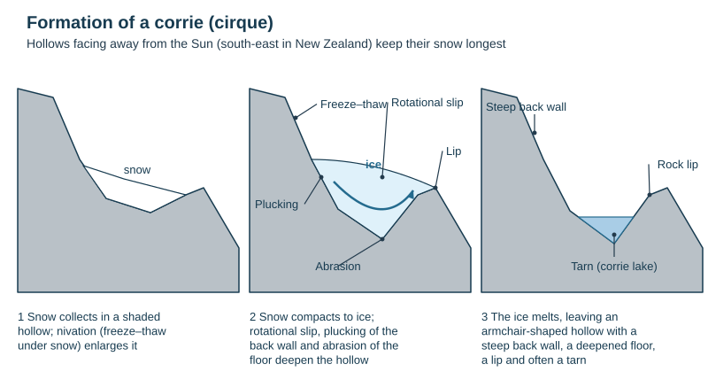
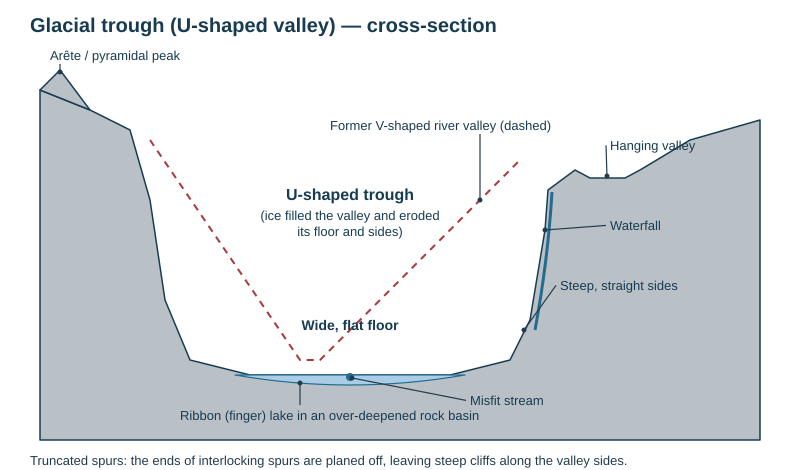
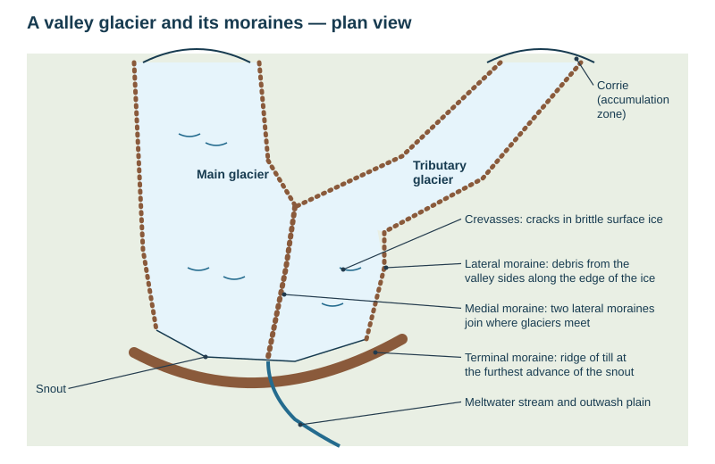

# Glaciation

Theme 1, specification 1.3 (glaciers). Named NZ examples: the Franz Josef and Fox glaciers, the Tasman Glacier, Milford Sound / Piopiotahi, Lake Wakatipu.

## Key terms

| Term | Meaning |
|---|---|
| **Glacier** | a large mass of ice that moves slowly downhill under its own weight |
| **Valley glacier** | a glacier confined to a valley (Franz Josef) |
| **Ice sheet** | a vast dome of ice covering a continent (Antarctica, Greenland) |
| **Ice age / glacial** | a cold period when glaciers advance; the last ended about 10 000–12 000 years ago |
| **Interglacial** | a warmer period between glacials (now) |
| **Accumulation zone** | upper part where more snow falls than melts (inputs exceed outputs) |
| **Ablation zone** | lower part where more ice melts or evaporates than is added |
| **Glacier budget** | accumulation minus ablation: positive → the glacier advances; negative → it retreats |
| **Snout** | the front (lowest end) of a glacier |
| **Firn (névé)** | partly compacted granular snow, between snow and ice |

## How a glacier forms

1. Snow accumulates in a hollow (usually a shaded one) where more falls in winter than melts in summer.
2. The weight of later snow compresses the lower layers and squeezes out air.
3. Snow turns into granular **firn / névé**, then after years into dense blue **glacier ice**.
4. When the ice is thick enough it deforms under its own weight and moves downhill under gravity.

**How ice moves:** **basal sliding** (meltwater at the base, from pressure and friction, lets the glacier slide over the bedrock), **internal deformation** (ice crystals slowly flow), and **rotational slip** in corries. Ice moves fastest at the surface and centre, slowest at the base and sides (friction). **Crevasses** are cracks in the brittle surface ice where the glacier speeds up, bends or passes over a step in its bed.

## Glacial processes

| Process | What happens |
|---|---|
| **Plucking (quarrying)** | meltwater at the base freezes onto jointed bedrock; the moving ice tears out blocks |
| **Abrasion** | rock fragments frozen into the base scrape the bedrock like sandpaper, smoothing and polishing it and cutting scratches (**striations**) |
| **Freeze–thaw** | above the ice, shatters valley sides and back walls, supplying debris onto the glacier |
| **Rotational slip** | ice rotates in a hollow, deepening it |
| **Transport** | debris carried on (supraglacial), within (englacial) and beneath (subglacial) the ice; also pushed in front (bulldozing) |
| **Deposition** | when the ice melts it drops its load **unsorted and angular** as **till** (boulder clay); meltwater deposits **sorted** sand and gravel (**outwash**) |

## Erosional landforms

| Landform | Formation |
|---|---|
| **Corrie (cirque, cwm)** | snow collects in a shaded hollow → nivation enlarges it → snow becomes ice → **plucking** steepens the back wall, **rotational slip** and **abrasion** deepen the floor, freeze–thaw attacks the wall above → the ice thins at the front, leaving a **rock lip** → after melting, an armchair-shaped hollow, often holding a **tarn** |
| **Arête** | a knife-edged ridge between two corries cut back towards each other |
| **Pyramidal peak (horn)** | three or more corries erode back into one mountain, leaving a sharp peak (Aoraki / Mt Cook, the Matterhorn) |
| **U-shaped valley (glacial trough)** | a glacier fills a former V-shaped river valley and erodes the floor **and** sides by plucking and abrasion → steep, straight sides and a wide, flat floor |
| **Truncated spur** | the ice cannot wind round interlocking spurs, so it cuts off their ends, leaving steep cliffs along the trough |
| **Hanging valley** | a smaller tributary glacier eroded less deeply, so its valley is left high above the main trough; a **waterfall** now drops into the trough (Stirling Falls and Bowen Falls in Milford Sound) |
| **Ribbon (finger) lake** | a long, deep lake filling an over-deepened rock basin in the trough floor (where the ice was thickest or the rock weaker), often dammed by moraine (Lake Wakatipu, Lake Te Anau) |
| **Fiord** | a glacial trough eroded below sea level and drowned as sea level rose after the ice age (Milford Sound / Piopiotahi, Doubtful Sound) |
| **Roche moutonnée** | a rock outcrop smoothed by abrasion on the up-glacier side and made steep and jagged by plucking on the down-glacier side |
| **Misfit stream** | a small river flowing on the wide floor of a trough, far too small to have carved it |

## Depositional landforms

| Landform | Formation |
|---|---|
| **Lateral moraine** | debris from freeze–thaw on the valley sides collects along the edges of the glacier; left as a ridge along the valley side |
| **Medial moraine** | where two glaciers join, their inner lateral moraines merge into a ridge down the middle of the combined glacier |
| **Terminal (end) moraine** | a ridge of till across the valley marking the furthest advance of the snout; can dam a ribbon lake |
| **Recessional moraine** | ridges left where the snout paused as the glacier retreated |
| **Ground moraine** | a sheet of till spread over the valley floor as the ice melted |
| **Drumlin** | an egg-shaped hill of till, streamlined by moving ice; blunt end faces up-glacier |
| **Erratic** | a large boulder carried by ice and dropped far from its source, on a different rock type |
| **Outwash plain** | a flat spread of sorted sand and gravel deposited by meltwater beyond the snout (the Canterbury Plains are partly outwash) |

## People and glaciers (useful in essays)

- **Opportunities:** tourism (Franz Josef and Fox glacier walks and heli-hikes, Milford Sound cruises), hydroelectric power from glacial lakes and steep valleys (Lake Pūkaki and Tekapō feed the Waitaki scheme), water supply from meltwater, skiing.
- **Hazards and change:** glacier retreat with global warming (Franz Josef and Fox have retreated several kilometres since the 1800s and are now very hard to reach on foot), rockfall and landslides on over-steepened valley sides, glacial lake outburst floods.

## This loses marks

- Saying a U-shaped valley was "made by ice" without plucking and abrasion of both floor and sides.
- Medial moraine explained without two glaciers joining.
- Mixing up till (unsorted, by ice) and outwash (sorted, by meltwater).
- Drawing a corrie without labelling the back wall, lip and processes.
