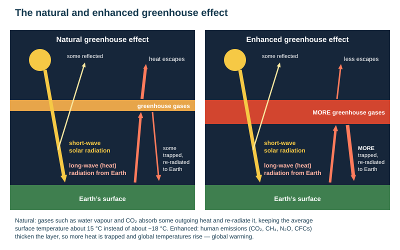
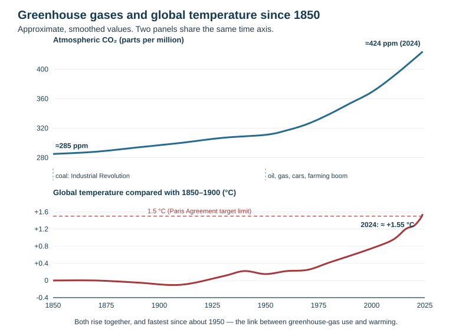
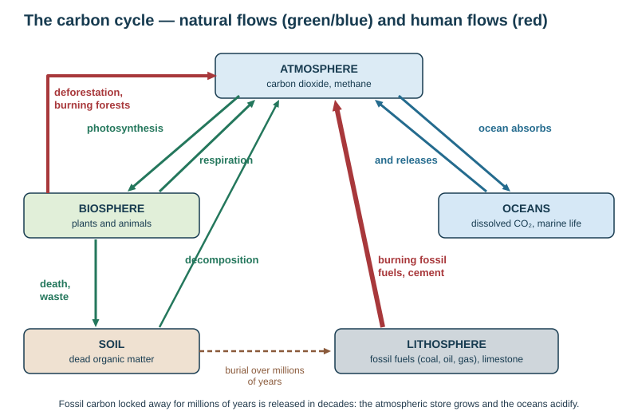

# Global warming and climate change

Theme 3, specification 3.7. Named examples: **Kiribati** (the school's area at risk from sea-level rise), Tuvalu, and Delhi (smog). The school's "syllabus for this topic" asks you to define global warming and the enhanced greenhouse effect; describe anthropogenic pollution; name the greenhouse gases, their sources and impacts (with the carbon cycle); describe impacts on climate and the hydrological cycle; evaluate solutions in farming, industry and homes; and know an area at heightened risk.

## Vocabulary (class definitions)

| Term | Meaning |
|---|---|
| **Climate change** | long-term changes in temperature, precipitation, wind patterns and other elements of the Earth's climate system |
| **Global warming** | the increase in the Earth's average surface temperature due to rising levels of greenhouse gases |
| **Greenhouse gases** | gases such as CO₂, CH₄ and N₂O that trap heat in the atmosphere |
| **Greenhouse effect** | the natural trapping of heat by greenhouse gases, keeping the Earth warm enough for life |
| **Enhanced greenhouse effect** | the increased trapping of heat caused by higher levels of greenhouse gases from human activities |
| **Fossil fuels** | coal, oil and natural gas, formed from the remains of living organisms |
| **Renewable energy** | energy from sources that will replenish in our lifetime |
| **Non-renewable energy** | energy from sources that will not replenish in our lifetime |
| **Anthropogenic** | caused by humans |
| **Mitigation** | actions that reduce or prevent greenhouse-gas emissions (tackling the cause) |
| **Adaptation** | adjusting to actual or expected future climate (living with the effects) |
| **Carbon footprint** | the amount of greenhouse gas emitted directly or indirectly by a person, company or product |
| **Emissions** | the release of gases into the atmosphere |
| **Sustainability** | meeting current needs without compromising the ability of future generations to meet theirs |
| **Carbon sink** | a store that absorbs more carbon than it releases (forests, oceans, peat) |
| **Net zero** | emissions reduced as far as possible and the rest balanced by removals |

## The natural and enhanced greenhouse effect

1. **Short-wave** radiation from the Sun passes through the atmosphere; some is reflected by clouds, ice and the surface.
2. The rest is absorbed and **warms the Earth's surface**.
3. The surface gives off **long-wave (infrared, heat)** radiation.
4. **Greenhouse gases absorb** some of it and **re-radiate** it back towards the surface, warming the lower atmosphere.
5. **Natural:** this keeps the average surface temperature about **15 °C** instead of about **−18 °C** — essential for life.
6. **Enhanced:** human emissions raise the concentration of greenhouse gases → more long-wave radiation is trapped and less escapes → global temperatures rise = **global warming**.

## Greenhouse gases and their sources

| Gas | Main human sources | Notes |
|---|---|---|
| **Carbon dioxide (CO₂)** | burning **coal, oil and gas** in power stations, vehicles, industry and homes; cement making; **deforestation** and burning | the largest contributor; lasts centuries |
| **Methane (CH₄)** | **cattle and sheep** (digestion), rice paddies, **landfill**, leaks from gas and coal extraction, melting permafrost | much stronger warming per tonne than CO₂ but shorter-lived; NZ's largest source is farming |
| **Nitrous oxide (N₂O)** | **nitrogen fertiliser**, animal urine, vehicle exhaust, industry | long-lived and potent |
| **Halocarbons (CFCs, HFCs)** | refrigeration, air-conditioning, aerosols | CFCs also destroy ozone (banned by the Montreal Protocol, 1987) |
| **Water vapour** | increases naturally as the air warms | amplifies warming (positive feedback) |

## Anthropogenic pollution

**Anthropogenic pollution** = pollution of the environment caused directly or indirectly by humans.

| Factor | How it pollutes |
|---|---|
| **Industry** (factories) | sulphur dioxide, nitrogen oxides and heavy metals released into air and water |
| **Transport** | cars, trucks, ships and planes burn fossil fuels, releasing CO₂ — transport produced about **24% of global CO₂ emissions in 2022** |
| **Agriculture** | fertilisers add nitrates and other chemicals to soil and water; pastoral farming releases methane |
| **Waste disposal** | landfills emit methane; improper disposal contaminates soil and water; the **Great Pacific Garbage Patch** holds about **1.8 trillion pieces** of rubbish, mostly plastic |
| **Urbanisation** | construction and land-use change raise air, water and soil pollution, sediment loss and emissions and reduce vegetation |
| **Deforestation** | releases stored carbon and removes a carbon sink |
| **Energy** (power plants), **tourism** | emissions from fuel and flights |

**How pollution degrades the atmosphere:**
- **Smog** — a mixture of smoke, vehicle exhaust and fog; **photochemical smog** forms when sunlight reacts with exhaust gases (ground-level ozone). It is worst under a **temperature inversion**, when cool polluted air is trapped beneath warmer air.
- **Acid rain** — sulphur dioxide and nitrogen oxides dissolve in rain → acids that damage forests, lakes and buildings.
- **Ozone depletion** — CFCs break down the ozone layer, which protects against ultraviolet radiation (the "hole" over Antarctica).
- **Particulates** — fine particles from burning damage lungs.

## History: greenhouse gases and global temperature

- **Natural change:** the climate has always varied — ice ages and warmer interglacials, the "Little Ice Age" (about 1300–1850) — driven by changes in the Earth's orbit (Milankovitch cycles), solar output and volcanic eruptions (ash blocks sunlight).
- **Industrial Revolution (from about 1750–1850):** coal burned for factories, railways and steamships.
- **20th century:** oil and gas for cars, aircraft, electricity and plastics; population and farming boom; deforestation. Emissions accelerate sharply **after 1950**.
- **CO₂** has risen from about **280 ppm** before industrialisation to about **424 ppm (2024)** — the highest for at least hundreds of thousands of years.
- **Temperature:** global average now about **1.2–1.3 °C** above the late 19th century; **2024** was the first calendar year more than **1.5 °C** above pre-industrial levels.

**Evidence of climate change:** thermometer records since about 1850; ice cores (air bubbles record past CO₂ and temperature); retreating glaciers (Franz Josef, Fox); shrinking Arctic sea ice; rising sea level; earlier springs and shifting species ranges; satellite measurements.

## The carbon cycle

| Store | Examples |
|---|---|
| Atmosphere | CO₂, methane |
| Biosphere | plants, animals |
| Soil | dead organic matter |
| Oceans | dissolved CO₂, shells, marine life |
| Lithosphere | **fossil fuels** (coal, oil, gas) and limestone |

| Flow | From → to |
|---|---|
| **Photosynthesis** | atmosphere → plants |
| **Respiration** (animals, plants, roots) | living things → atmosphere |
| **Decomposition** | dead matter → atmosphere and soil |
| **Ocean uptake and release** | atmosphere ↔ ocean |
| **Burial and fossilisation** (millions of years) | dead matter → fossil fuels and rock |
| **Combustion** (human) | fossil fuels → atmosphere |
| **Deforestation and burning** (human) | biosphere → atmosphere |

- Carbon should move between the atmosphere, plants, animals, oceans and soil **in balance**.
- Fossil fuels are **stored carbon** that was not part of the active cycle. Burning them releases it within decades — far faster than photosynthesis and the oceans can remove it — and deforestation shrinks a major sink.
- Result: carbon builds up in the atmosphere → more heat trapped → global warming; the oceans absorb some of the extra CO₂ and become more **acidic**.

## Impacts of global warming

### Environmental

| Impact | Detail |
|---|---|
| **Rising sea level** | from melting glaciers and ice sheets and **thermal expansion** of warmer sea water; about **21–24 cm since 1880**; low-lying areas (Maldives, Bangladesh, Pacific islands) face flooding and land loss. Melting ice → darker ocean absorbs more heat → more melting (a positive feedback) |
| **Melting ice** | Arctic sea ice shrinking by about **13% per decade**; Greenland and Antarctic ice sheets losing mass, adding to sea-level rise and disrupting ocean currents |
| **Extreme weather** | warmer seas fuel stronger storms, floods and droughts — **Hurricane Harvey** (USA, 2017) caused about **US\$125 billion** of damage, worsened by warm Gulf waters |
| **Wildfires** | hotter, drier conditions — Australia's **"Black Summer" (2019–2020)** burnt about **18 million hectares** and killed or displaced about **3 billion animals** |
| **Changing precipitation** | some places get heavier, more intense rain (floods); others persistent drought |
| **Ocean acidification** | dissolved CO₂ lowers ocean pH; corals and shellfish struggle to build skeletons and shells |

### Impacts on the hydrological cycle

A warmer atmosphere holds about 7% more water vapour per 1 °C → **more evaporation** → **heavier downpours** and more flooding; at the same time **more drought** where circulation shifts (the subtropical dry belts move polewards); less snow and **earlier snowmelt**; shrinking glaciers mean less summer meltwater for rivers and irrigation; sea-level rise pushes **salt water into groundwater** on coasts and islands.

### Human health

- **Heat-related illness and death:** Europe's **2022** heatwave caused about **61 000** premature deaths.
- **Food insecurity:** crop yields fall from drought, floods, pests and heat stress; wheat, maize and rice are vulnerable; livestock suffer heat stress and pasture loss.
- **Disease spread:** warmer climates extend the range of mosquito- and tick-borne diseases (malaria, dengue, Lyme disease); standing floodwater spreads water-borne disease.
- **Air pollution:** wildfire smoke and urban heat worsen asthma and lung disease; heat increases smog — dangerous for children and the elderly.

### Economic

- **Cost of disasters:** storms, floods and wildfires cost insurers, governments and people — global disaster costs in **2022** were expected to exceed **US\$275 billion**.
- **Water and resource conflicts:** scarce water and farmland cause conflict and displacement; rivers crossing borders cause tension when upstream countries dam them; the **Syrian civil war** was partly influenced by a severe drought that displaced about **1.5 million** farmers.
- **Disrupted supply chains:** ports, farms, factories and transport are damaged.
- **Climate migration:** a **climate migrant** is someone forced to leave home because of the effects of climate change (drought, floods, wildfires, sea-level rise).

### Biodiversity and ecosystems

- **Habitat loss:** coral reefs (**coral bleaching** from heat stress), tundra and rainforests threatened.
- **Extinction:** about **1 million species** are at risk of extinction from climate and human pressures; many cannot adapt or migrate fast enough.
- **Ecosystem imbalance:** disrupted food chains, pollination and migration; **invasive species** thrive in new climates.

### Impacts on New Zealand

Warmer temperatures and fewer frosts; more drought in the east (Hawke's Bay, Canterbury) and heavier rain in the west and in storms; more intense ex-tropical cyclones (Gabrielle 2023); glacier retreat; sea-level rise and coastal erosion threatening coastal towns, roads and Māori land and marae; marine heatwaves; new pests; some benefits for farming (longer growing season, new crops).

## Named example: Kiribati — an area at risk from sea-level rise

| | Details |
|---|---|
| Geography | a Pacific nation of **32 low-lying coral atolls** (plus Banaba, a raised coral island once mined for phosphate) spread across a vast area roughly halfway between Hawaii and Australia |
| **Atoll** | a ring-shaped coral island formed by the build-up of coral reefs around a sinking volcanic island |
| Population | over **119 000** (2020 census); more than half live on **(South) Tarawa**, only about **3 m above sea level** |
| Threats | **sea-level rise** (thermal expansion and melting ice) → flooding at king tides and storms, **coastal erosion**, **salt water entering the freshwater lens** and ruining crops (taro, coconuts) and drinking water |
| **Ocean acidification** | reduces the calcium carbonate corals need → corals grow more slowly, weaken and die → **reef collapse**, so the islands lose their natural protection from storms and erosion |
| Food security | many people depend on reef fish and shellfish; acidification disrupts the food web (shellfish, plankton, reef fish) → smaller fish stocks, threatening subsistence fishing |
| Economic and cultural | fishing and small-scale tourism depend on a healthy sea; reefs have cultural and spiritual significance, so their loss threatens identity and heritage |
| Responses | sea walls and mangrove planting; rainwater tanks; the government **bought about 20 km² of land in Fiji (2014)** as a possible refuge and for food security; **"migration with dignity"** — training people for jobs abroad; **New Zealand's Pacific Access Category** lets up to **75** people from Kiribati migrate to NZ each year; international aid and climate finance |
| Climate justice | Kiribati has contributed almost nothing to global emissions but faces some of the worst effects |

**Tuvalu** (similar): mostly under about 2 m above sea level; king-tide flooding and saltwater intrusion; land reclamation and sea walls; the **Falepili Union treaty (2023)** with Australia allows up to 280 Tuvaluans a year to migrate.

**Smog example — Delhi, India:** some of the world's worst winter air pollution, when vehicle and industrial emissions, construction dust and crop-stubble burning are trapped under **temperature inversions**; responses include odd–even car rules, closing schools and power stations, and cleaner fuels for vehicles.

## Solutions

| Solution | How it reduces warming | Gas | Challenges |
|---|---|---|---|
| **Renewable energy** (hydro, wind, solar, geothermal) | replaces fossil-fuel power | CO₂ | cost, intermittency, grid investment |
| **Electric vehicles and public transport**, cycling | cuts petrol and diesel use | CO₂ | vehicle cost, charging, low-density cities |
| **Reforestation / afforestation** | trees absorb CO₂ (carbon sink) | CO₂ | land, time; forests can burn |
| **Reducing meat consumption**, especially red meat | fewer cattle | CH₄ | culture, farm incomes (big issue for NZ) |
| **Carbon capture and storage** | traps CO₂ from power stations and stores it underground | CO₂ | expensive, unproven at scale |
| **Government policies** — emissions tax, emissions trading (NZ ETS since 2008), offsetting, net-zero targets (NZ's Zero Carbon Act 2019) | puts a price on emissions | all | political resistance; risk of production moving abroad |
| **Reducing food waste** | less landfill methane and wasted farm emissions | CH₄ | behaviour change |
| **Energy-efficient buildings** | insulation, heat pumps, LED lighting | CO₂ | upfront cost |
| **Cutting methane from agriculture** | feed additives, breeding low-emission animals, lower stocking rates, effluent capture | CH₄, N₂O | technology still developing; cost to farmers |
| **Sustainable consumption** | buy less, reuse, recycle | all | consumer habits |

**By sector (specification):** *farming* — fewer, more productive animals, better fertiliser use, methane inhibitors, planting trees; *industry* — renewable electricity and heat, efficiency, electric arc steel (Glenbrook), carbon pricing; *residential* — insulation, solar panels, heat pumps, EVs, less waste.

**Mitigation vs adaptation:** mitigation tackles the cause (cutting emissions); adaptation lives with the effects (sea walls, drought-resistant crops, managed retreat, raised houses, migration). Both are needed: past emissions guarantee some warming.

**International agreements:**
- **Kyoto Protocol (1997)** — legally binding emissions cuts for developed countries; the USA never ratified it; developing countries had no targets.
- **Paris Agreement (2015)** — almost every country set its own target (nationally determined contributions) to keep warming **well below 2 °C** and aim for **1.5 °C**; reviewed every five years; not enforceable.
- Annual **COP** meetings (e.g. COP28, Dubai 2023, agreed to "transition away from fossil fuels").

**Who should act?** Governments (laws, taxes, infrastructure) and individuals (transport, diet, energy use) — most solutions need both.

## This loses marks

- Confusing global warming with ozone depletion.
- Describing the greenhouse effect as "the ozone layer trapping heat".
- Sea-level rise explained only by melting ice — thermal expansion matters too.
- Solutions with no gas named or no mechanism.
- An "area at risk" with no named place, figures or responses.
