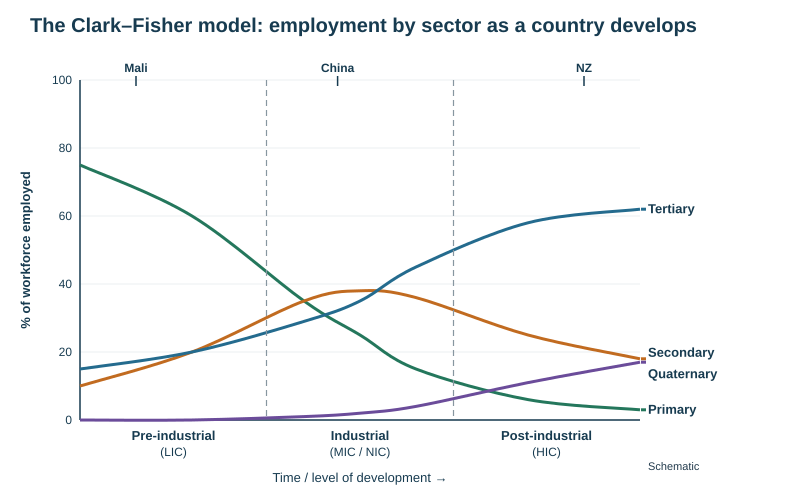

# Sectors, economic transition and globalisation

Theme 3, specification 3.2. Named examples: Fonterra (a New Zealand TNC and its global links) and the Volkswagen Group (a German TNC; the Wolfsburg factory is on [Manufacturing industry](../notes/manufacturing.md)).

## Sectors of production

| Sector | Definition (exam wording) | Examples |
|---|---|---|
| **Primary** | produces energy or basic raw materials, such as coal, oil, metals and crops — usually farming, mining, fishing, forestry | dairy farming, iron-sand mining, fishing, quarrying |
| **Secondary** | manufactures goods: takes a raw material and transforms it into something else | food processing, steel, car assembly, construction |
| **Tertiary** | provides services rather than goods, from teaching to refuse collection | retail, transport, health, tourism, banking |
| **Quaternary** | provides information services: computing, ICT, consultancy, research and development | software, biotechnology, telecommunications, R&D |

**Following a product through the sectors — a packet of crisps:** a farmer grows potatoes (primary) → a factory slices, fries and packs them (secondary) → trucks deliver them and a supermarket sells them (tertiary) → scientists develop new flavours and analysts design the marketing (quaternary).

**Employment structure** = the percentage of the workforce in each sector. It is shown with pie charts, divided bars or a **triangular graph** (three sectors summing to 100%).

## Economic transition and the Clark–Fisher model

**Economic transition** = the change in the relative importance of the sectors as a country develops.

| Stage | Primary | Secondary | Tertiary | Quaternary | Example |
|---|---|---|---|---|---|
| Pre-industrial (LIC) | dominant | small | small | negligible | Mali (65% primary) |
| Industrial (MIC / NIC) | falling | rising to a peak | rising | small | China |
| Post-industrial (HIC) | small | falling | dominant | growing | NZ, UK |

*Causal chain.* Farm mechanisation raises output per worker → labour is released from the land → factories offer higher wages and draw workers to towns (urbanisation) → rising incomes raise demand for services → labour costs rise, so routine manufacturing relocates to lower-wage countries (**deindustrialisation**) → the home economy shifts to services and knowledge work.

**Why so many people in LICs work in the primary sector:** little education, so few qualify for other work; little capital to build factories; no industrial revolution yet; poor access to processing for natural resources; most families farm at subsistence level to feed themselves.

| Strengths of Clark–Fisher | Limitations |
|---|---|
| matches the history of the UK and other HICs | based on the UK; assumes all countries follow the same path |
| simple way to compare countries over time | some countries skip stages (service-led growth in India) or remain primary exporters while rich (NZ, Australia) |
| | ignores the informal sector; secondary employment may fall while output rises (automation) |

## Globalisation

**Globalisation** = the increasing interconnection of the world's economies, cultures and populations through trade, investment, migration, transport and communication.

| Driver | Effect |
|---|---|
| **Transport**: containerisation, bigger ships, cheap air freight | goods move further for less |
| **ICT**: internet, mobile phones, satellites | firms manage global operations; services can be done anywhere (call centres, software) |
| **Trade liberalisation**: WTO, free-trade agreements (e.g. NZ–China FTA 2008, CPTPP) | tariffs and quotas fall, markets open |
| **Transnational corporations** | production chains spread across many countries |
| **Financial deregulation** | money moves freely; foreign direct investment (FDI) |
| **Government policy** | special economic zones and tax incentives attract investment (China, Vietnam) |
| **Rising demand** in emerging economies | new markets |

**Key terms**
- **Foreign direct investment (FDI)** — a company investing in factories or businesses in another country.
- **Outsourcing / offshoring** — moving part of production or services to another firm or country, usually for cheaper labour.
- **Global supply chain** — the network of firms and countries that make and deliver a product.
- **Global shift / new international division of labour** — manufacturing has moved from HICs to Asian NICs and LICs, while HICs keep research, design, finance and management.
- **Interdependence** — countries rely on each other for goods, markets and investment.

## Transnational corporations (TNCs)

**TNC** = a company with its headquarters in one country and operations (factories, offices, outlets) in several others. Examples: Volkswagen, Apple, Nestlé, Toyota, Fonterra.

**Typical pattern:** headquarters, research and design stay in the home country (often an HIC); manufacturing and assembly locate where labour is cheap, raw materials are available or markets are large.

**Why TNCs locate in a country:** cheap and plentiful labour, raw materials, access to a large market (and avoiding import tariffs), government incentives and free-trade zones, good transport links, political stability, fewer environmental or labour regulations.

| | Advantages | Disadvantages |
|---|---|---|
| **Host country** (where the TNC operates) | jobs and wages; training and skills; technology and management expertise; tax revenue and export earnings; infrastructure built to serve the plant; **multiplier effect** on local suppliers and services | profits sent back to the home country (**leakage**); low wages and poor conditions possible; weak environmental rules exploited (pollution); local firms undercut; decisions made abroad — plants can close suddenly (**footloose**); dependence on one company |
| **Home country** (headquarters) | profits return; high-skilled jobs in research, design, management; cheaper goods for consumers; global brand and influence | manufacturing jobs lost to cheaper countries (deindustrialisation); unemployment in old industrial areas; tax avoidance through other countries |

**Multiplier effect** = an initial investment creates jobs, which create spending, which creates more jobs and investment (a positive spiral). The **negative multiplier** works in reverse when a plant closes.

## Named example: Fonterra (a New Zealand TNC)

| | Details |
|---|---|
| What | a dairy **co-operative** formed in **2001** by merging NZ's largest dairy co-operatives; owned by about **9000 farming families** who supply it |
| Home country | New Zealand: collects most of NZ's milk (roughly four-fifths) by tanker each day and processes it in about 30 NZ plants (e.g. Te Rapa, Edendale, the large Darfield plant) into milk powder, butter, cheese and proteins |
| Global links | sells dairy ingredients and brands to **more than 100 countries**; major markets China, South-East Asia, the Middle East, Australia; offices and joint ventures overseas; one of the largest dairy exporters in the world |
| Brands | Anchor, Anlene, Mainland (in 2025 Fonterra agreed to sell its consumer brands business to the French company Lactalis to focus on ingredients and foodservice) |
| Workforce | about 15 000–20 000 staff worldwide |
| Benefits to NZ | export earnings (dairy is about a third of NZ's goods exports), rural jobs, farmer income (a record farmgate milk price of NZ\$10.16 per kg of milksolids in 2024/25) |
| Problems | dependence on world dairy prices and on China; exposure to trade policy; environmental impacts of intensive dairying (water quality, methane); the 2008 melamine scandal at its Chinese partner Sanlu damaged its reputation |

## Named example: the Volkswagen Group (a German TNC)

- Headquarters, research and the main plant at **Wolfsburg, Germany**; the group sold about **9 million** vehicles in 2024 under brands including VW, Audi, Škoda, SEAT, Porsche.
- More than 100 production sites worldwide — in China (joint ventures), Mexico (Puebla), Brazil, South Africa, the USA, Spain, the Czech Republic and elsewhere.
- **Global shift in action:** in December 2024 VW agreed to cut more than 35 000 jobs in Germany by 2030 (by early retirement and buy-outs) and to move **Golf** production from Wolfsburg to **Puebla, Mexico** from 2027 — lower costs and competition from Chinese electric-car makers.

## Evaluating globalisation

| Positive | Negative |
|---|---|
| economic growth and jobs in NICs and LICs; lifted hundreds of millions out of poverty (China) | widening inequality within countries; exploitation of workers (low wages, sweatshops) |
| cheaper goods for consumers | job losses and decline in old industrial regions of HICs |
| spread of technology, ideas and culture | cultural homogenisation (loss of local culture) |
| access to bigger markets for exporters such as NZ | dependence on world prices and supply chains (COVID-19 disruption) |
| | environmental damage: transport emissions, pollution havens |

Evaluate by **scale** (local, national, global) and by **group** (workers, consumers, owners, governments): the same change can raise national output while lowering wages in a particular region.

## This loses marks

- Defining a TNC as "a big company".
- Listing advantages without saying whether they are for the host or the home country.
- Clark–Fisher described without the reason for each shift.
