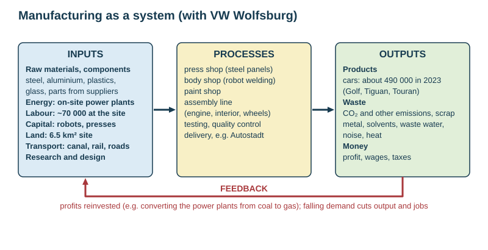

# Manufacturing industry: VW Wolfsburg

Theme 3, specification 3.4 (secondary industry). The school's 2026 case study is the **Volkswagen factory at Wolfsburg, Germany**. New Zealand Steel at Glenbrook is a supporting NZ example. Fact files are in [CASE-STUDIES.md](../CASE-STUDIES.md).

## Key terms

| Term | Meaning |
|---|---|
| **Manufacturing (secondary industry)** | turning raw materials or components into finished products |
| **Heavy industry** | uses large amounts of bulky raw materials and energy to make large products (steel, shipbuilding, chemicals) |
| **Light industry** | uses small components to make small, light products (electronics, clothing, food) |
| **Processing industry** | changes a raw material (dairy factory, sawmill, oil refinery) |
| **Assembly industry** | puts together components made elsewhere (car assembly) |
| **High-technology industry** | research-intensive products (computers, pharmaceuticals, aerospace) |
| **Footloose industry** | not tied to raw materials or power, so free to locate in many places (usually light and high-tech industry using electricity) |
| **Cottage (craft) industry** | small-scale production at home or in small workshops |
| **Agglomeration** | the clustering of related firms in one place to share suppliers, skilled labour, services and ideas |
| **Industrial inertia** | an industry stays in its original location after the original reasons have gone, because of the investment, workforce and links already there |
| **Industrial estate** | a planned area of factories with shared roads and services, usually on the urban fringe (East Tāmaki, Auckland) |
| **Science / business park** | landscaped site of high-tech and research firms, often near a university |
| **Special economic zone / export processing zone** | an area with tax breaks and fewer regulations to attract foreign manufacturers (Shenzhen, China) |

## The importance of resources

- Industry needs **raw materials** to process and **energy** to process them with.
- Early industry (the 1800s Industrial Revolution) clustered on **coalfields** and near **iron ore**, because coal was bulky and expensive to move (the Ruhr in Germany, northern England).
- Countries with resources can build industry on them (NZ: dairy processing, wood processing, aluminium smelting at **Tiwai Point** using cheap hydroelectricity from Manapōuri).
- With electricity, containerisation and imported raw materials, modern industry is far more **footloose** — markets, labour and transport now matter more than local resources.

## Factors affecting the location of manufacturing

| Factor | Pull | Example |
|---|---|---|
| **Raw materials** | bulky, heavy or perishable inputs pull the plant to the source (**weight-losing** industries) | dairy factories near farms; NZ Steel near ironsand |
| **Energy / power** | historically coalfields; now a reliable grid or cheap electricity | Tiwai Point aluminium smelter (cheap hydro) |
| **Transport** | ports, rail terminals, motorway junctions; coastal sites for imports and exports | Shanghai steel |
| **Market** | heavy, fragile or perishable products, or products that **gain weight** in manufacture, locate near customers | bakeries, breweries, car plants near large markets |
| **Labour** | supply, skill and cost | cheap labour draws assembly to Asia; skilled labour keeps R&D in Germany |
| **Land** | large, flat, cheap sites with room to expand, firm foundations | urban fringe industrial estates |
| **Water** | for cooling and processing | steelworks, paper mills beside rivers |
| **Capital** | money for buildings, machinery | banks, investors |
| **Government / political** | grants, tax breaks, special economic zones, planning rules, state ownership; trade barriers | VW Wolfsburg founded by the state; Lower Saxony holds 20% of VW's voting rights |
| **Agglomeration** | suppliers, services and skilled workers already nearby | Silicon Valley; Germany's car industry |
| **Environment / quality of life** | attractive areas attract skilled workers (footloose high-tech) | science parks |

**Changing location — iron and steel in China (Term 2 resource):** in 1950 the few works were clustered in the north-east near coal and iron ore; by 2010 there were many more, spread more widely, especially near the east coast. **Shanghai** suits steelmaking because of huge local demand from construction and manufacturing, a port to import coal and iron ore and export steel, flat land, the Yangtze for transport and water, and a large workforce.

## Manufacturing as a system

| Inputs | Processes | Outputs | Feedback |
|---|---|---|---|
| raw materials, components, energy, labour, capital (machinery, robots), land, transport, research | smelting, pressing, welding, machining, painting, assembly, packing, quality control | **products** and **waste** (emissions, effluent, scrap, heat, noise), plus profit | profit reinvested in new plant and technology; falling demand cuts output and jobs |

## Named example: Volkswagen factory, Wolfsburg, Germany

### Location and history

| | Details |
|---|---|
| Where | **Wolfsburg**, Lower Saxony, northern Germany, on the **Mittelland Canal** between Hanover and Magdeburg; beside the Berlin–Hanover railway and near the A2/A39 autobahns |
| Founded | **1938**, by the Nazi government, to build the cheap "people's car" (the **Beetle**); the town was built for the workers. In the war the plant made military vehicles, largely with forced labour |
| Post-war | taken over by the British military (1945–1949), who restarted Beetle production in 1945; one-millionth Beetle in **1955**; the **Golf** replaced the Beetle at Wolfsburg in **1974** |
| Today | VW's **headquarters** and main plant; described by VW as the **world's largest single car manufacturing complex** |

### Location factors

| Factor | At Wolfsburg |
|---|---|
| **Political** | the site was chosen by the state in 1938; the regional government of Lower Saxony is still a major shareholder (20% of voting rights) and protects jobs |
| **Transport** | the Mittelland Canal links to Germany's waterways and the ports (components, steel); own rail sidings (about 60 km of track on site); autobahns; central position in Germany and Europe |
| **Land** | a huge flat site — about **6.5 km²**, with **1.6 km²** of factory halls and 75 km of internal roads — with room to expand |
| **Market** | Germany is Europe's largest car market and the EU single market is on the doorstep |
| **Labour** | a large skilled workforce trained over generations; in the 1960s labour shortages were met by "guest workers" from Italy |
| **Energy** | VW's own power stations on site |
| **Agglomeration and inertia** | suppliers, research and design (about 11 500 in technical development), the headquarters and decades of investment keep the plant here |

### Inputs, processes, outputs (figures)

- **Workforce:** about **70 000** people at the Wolfsburg site (production, research and headquarters).
- **Inputs:** steel and aluminium coils, plastics, glass, electronics and thousands of components delivered **just-in-time** by suppliers; electricity and heat from two on-site **combined heat and power** plants.
- **Processes:** press shop (steel sheets pressed into panels) → body shop (hundreds of **robots** weld the body) → paint shop → assembly line (engine, interior, wheels fitted) → testing and quality control.
- **Outputs:** about **490 000 vehicles in 2023** — the **Golf**, Golf Variant, **Tiguan** and **Touran** (plus a SEAT model since 2018); waste includes CO₂, solvents from painting, scrap metal and waste water.
- **Delivery:** the **Autostadt** (opened **2000**) next to the plant — a customer delivery centre and theme park where buyers collect their cars from two 48 m glass **car towers** (each holding 400 cars); it draws around two million visitors a year (tertiary sector spin-off).

### Globalisation and change

- VW is a **TNC** with more than 100 plants worldwide (see [globalisation](../notes/globalisation.md)); Wolfsburg keeps the headquarters, research, design and high-value production.
- **Electric transition and competition:** falling sales in Europe, high German labour and energy costs and competition from Chinese electric-car makers led to the **December 2024 agreement**: more than **35 000 German jobs** to go by 2030 (through early retirement and buy-outs, with no forced redundancies), Wolfsburg's assembly lines cut **from four to two**, the **Golf moved to Puebla, Mexico** from 2027, and electric models (ID.3, Cupra Born, later an electric Golf) brought to Wolfsburg.
- **Dieselgate (2015):** VW admitted fitting software that cheated emissions tests to about 11 million diesel cars worldwide — huge fines and costs (over €30 billion) and damage to the brand.

### Impacts

| | Positive | Negative |
|---|---|---|
| Economic | tens of thousands of well-paid jobs; one of Germany's richest cities per head; **multiplier effect** on suppliers, shops and services; exports | Wolfsburg is a **company town** dependent on one employer — job cuts hit the whole city (negative multiplier) |
| Social | the city, housing, schools and the VfL Wolfsburg football club grew with the plant; training (apprenticeships) | the plant's Nazi-era history and forced labour; workers' insecurity during restructuring |
| Environmental | coal power plants converted to **natural gas** (about €400 million; about 60% less CO₂, around 1.5 million tonnes a year); recycling, water treatment; move to electric cars | air emissions (CO₂, NOx, solvents), energy and water use, traffic, the global emissions of the cars themselves; the emissions scandal |

## Industrial zones and agglomeration

- **Benefits of clustering:** shared suppliers (lower transport costs), a pool of skilled labour, shared infrastructure and services, exchange of ideas, a reputation that attracts investment.
- **Drawbacks:** congestion, higher land prices, pollution concentrated in one area, vulnerability if the main industry declines.
- **Examples:** Germany's car cluster (Wolfsburg, Stuttgart, Munich); Silicon Valley (high-tech); East Tāmaki and Wiri (Auckland industrial estates); Shenzhen special economic zone.

## Supporting NZ example: NZ Steel, Glenbrook

- NZ's only integrated steel mill, south of Auckland.
- **Location factors:** ironsand mined at **Waikato North Head** and piped to the mill; coal from the Waikato; flat land; rail and port links; the Auckland market.
- One of NZ's largest single sources of greenhouse gas; in 2023 the company and government agreed to co-fund an **electric arc furnace** to recycle scrap steel and cut emissions.

## Environmental impacts of manufacturing

| Threat | Scale | Example |
|---|---|---|
| air pollution, **smog**, **acid rain** (sulphur dioxide, nitrogen oxides) | local to regional | Chinese industrial cities |
| water pollution: effluent, heavy metals, **thermal pollution** (warm cooling water) | local | rivers below factories |
| solid and hazardous waste, contaminated land | local, long-lasting | old industrial sites |
| noise, visual intrusion, lorry traffic | local | industrial estates |
| **greenhouse gas** emissions → global warming | global | steel, cement, power |
| resource depletion and habitat loss where raw materials are extracted | global | mining for metals |

**Reducing the risks** (points mark schemes credit): restrict emissions by law; **scrubbers** and filters on chimneys; treat waste water before disposal; control waste disposal; replace old machines with efficient ones; fines for polluters and strong enforcement; switch from coal to renewable energy; strict planning rules for new factories; keep industry out of sensitive areas; reuse brownfield sites; recycle materials (**circular economy**); carbon pricing. *This loses marks:* vague answers like "be eco-friendly".

**Evaluating sustainability:** manufacturing creates jobs and wealth that fund development, but its pollution and emissions fall on local people and the global climate; it becomes more sustainable when it uses renewable energy, recycles materials and is properly regulated — the trade-off is cost and competitiveness.

## This loses marks

- "Near raw materials" with no named material or reason (bulk, weight loss, perishability).
- VW facts without dates or figures.
- Environmental impacts without scale (local vs global) or a method to reduce them.
