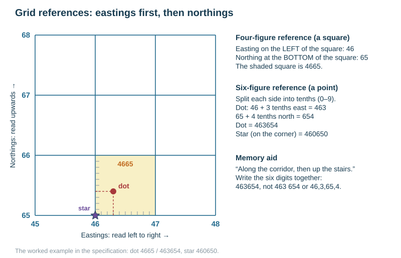
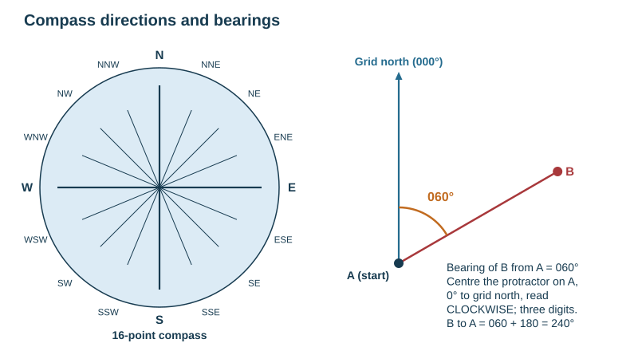
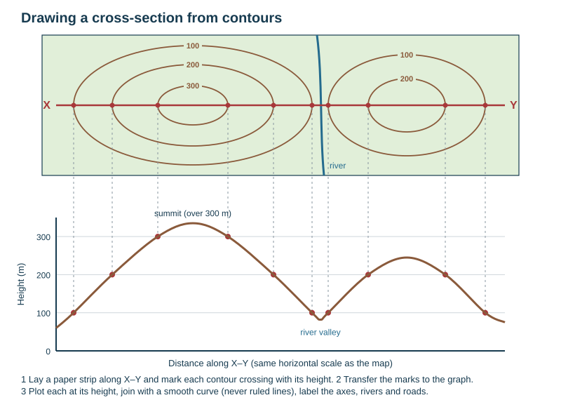

# Map skills

Geographical skills follow the Cambridge IGCSE skills section. They are tested **inside** the theme questions, not as a separate section. A topographic map is likely but not guaranteed. Bring a pencil, rubber, ruler, protractor and calculator, and use the sheet of plain paper for measuring distances and cross-sections. Maps are **1:25 000 or 1:50 000** with a full key, and **every answer to the map question must come from map evidence only**, not from general knowledge.

## Contents

- First moves with any map
- Grid references
- Scale, distance and area
- Direction and bearings
- Relief: contours, spot heights, gradient and cross-sections
- Describing physical and human features from a map
- Settlement site, situation and function from a map
- Sketch maps
- Photographs, satellite images, GIS and cartoons

Practise on this extract. It has a grid of 1 km squares, a linear scale, a north arrow and a key: the four things to check before you answer anything.

## First moves with any map

| Check | Why |
|---|---|
| Title and date | what the map represents and how current it is |
| Scale | every distance, area and gradient answer depends on it |
| North arrow | all directions and bearings are measured from grid north |
| Key | you may only name features the key allows you to name |
| Grid interval | on 1:25 000 and 1:50 000 maps the grid lines are usually 1 km apart: 4 cm on a 1:25 000 map, 2 cm on a 1:50 000 map |
| Contour interval | 5 m or 10 m on 1:25 000 maps, 10 m or 20 m on 1:50 000 maps; read it from the key |

## Grid references

**Eastings before northings: "along the corridor, then up the stairs".**

- A **four-figure** reference names a whole 1 km square. Read the easting line to the *left* of the square, then the northing line *below* it. A dot inside the square with lines 46 and 65 at its bottom-left corner is in square **4665**.
- A **six-figure** reference locates a point inside the square. Divide each side of the square into tenths; the first tenth is 0 and the last is 9. A dot three tenths east of line 46 and four tenths north of line 65 is at **463654**. A star exactly on the corner is at **460650**.
- Write the six digits with no spaces or commas.
- Read the question carefully: a four-figure reference asks what is *in a square*; a six-figure reference asks what is *at a point*.

## Scale, distance and area

$$\text{ground distance} = \text{map distance} \times \text{scale factor}$$

| Scale | 1 cm on the map represents | 1 km on the ground is | One grid square |
|---|---|---|---|
| 1:25 000 | 250 m | 4 cm | 1 km² (4 cm × 4 cm) |
| 1:50 000 | 500 m | 2 cm | 1 km² (2 cm × 2 cm) |
| 1:100 000 | 1 km | 1 cm | |

- A scale may be given as a **ratio** (1:50 000), a **linear scale bar**, or a **statement** ("2 cm to 1 km").
- **Straight-line distance.** On a 1:50 000 map, a line of 7.4 cm is $7.4 \times 500 = 3700$ m $= 3.7$ km. Better still, mark it on the paper strip and read it off the scale bar.
- **Curved route** (a road, railway or river):
  1. Lay the straight edge of the plain paper at the start and mark it.
  2. Follow the route to the first bend, mark the paper, and pivot it to follow the next straight section.
  3. Repeat to the end.
  4. Hold the finished edge against the linear scale and read off the distance.

  Say whether you measured the *route* or the *straight line*; a winding road is always longer. The specification recommends this paper method over rulers.
- **Area.** Count the whole grid squares, then add part-squares as halves. On 1:50 000 and 1:25 000 maps each square is 1 km², so 14 whole squares plus 6 part-squares is about $14 + 3 = 17$ km².
- **Translate scale into real size and shape:** "the lake is about 1.5 km long, elongated north–south, and 300 m wide".

## Direction and bearings

- **Direction** uses the **16-point compass**: N, NNE, NE, ENE, E, ESE, SE, SSE, S, SSW, SW, WSW, W, WNW, NW, NNW.
- Always state direction **from** the first place named **to** the second; reversing it loses the mark.
- A **bearing** is the clockwise angle from grid north, written as three digits from 000° to 359°.
  1. Draw a line between the two points.
  2. Put the protractor's centre on the *starting* point, with 0° pointing to grid north (up the page, parallel to an easting line).
  3. Read the angle clockwise to your line.

  North is 000°, east 090°, south 180° and west 270°.
- **Back bearing.** Add or subtract 180°. The bearing of B from A is 060°, so the bearing of A from B is 240°.

## Relief: contours, spot heights, gradient and cross-sections

| Evidence | What it shows |
|---|---|
| Contours close together | a steep slope |
| Contours far apart | a gentle slope or flat land |
| Contours evenly spaced | a uniform slope |
| Contours closer at the bottom (spreading out uphill) | a **convex** slope |
| Contours closer at the top | a **concave** slope |
| Contours making a V pointing upslope (uphill) | a **valley**; the V points upstream |
| Contours making a rounded U or V pointing downslope | a **spur** |
| Concentric closed contours | a hill or summit |
| A low point between two summits | a **col** or **saddle** |
| No contours over a wide area | flat land: a flood plain or plateau top |
| Spot height / triangulation pillar | the exact height at one point |
| Many contours ending at a cliff symbol | a cliff or escarpment |

**Relief vocabulary:** ridge, plateau, scarp, escarpment, col, saddle, spur, interlocking spurs, re-entrant, flood plain, terrace, valley floor, valley side, watershed, steep-sided, deeply incised (cut), broad, gently sloping, undulating, dissected, rugged.

$$\text{gradient} = \frac{\text{vertical rise (m)}}{\text{horizontal distance (m)}}$$

**Worked example.** A slope rises from 120 m to 300 m over 3 cm on a 1:50 000 map.
- Rise $= 300-120 = 180$ m. Horizontal distance $= 3\times500 = 1500$ m.
- Gradient $= 180/1500 = 0.12$. As a ratio that is $1500/180 = 8.3$, so **1 in 8.3**. As a percentage, $0.12\times100 = 12\%$.
- **Height difference** is just the higher height minus the lower, in metres.

**Drawing a cross-section.**
1. Lay the paper edge along the section line X–Y.
2. Mark where each contour crosses, writing its height. Also mark rivers, roads, railways and the two ends.
3. Transfer the marks to the graph: distance along the horizontal axis, height on the vertical.
4. Plot each point at its height and join them with a **smooth curve**, never ruled straight segments.
5. Label both axes with units, and label features (river, road, summit).
6. State the **vertical exaggeration** (vertical scale ÷ horizontal scale) if asked.

**Completing or interpreting a cross-section.** Name features at the points marked (river valley, spur, summit, col), say whether a point is visible from another (intervisibility), and describe the slopes.

## Describing physical and human features from a map

| Feature | What to describe |
|---|---|
| **Relief** | highest and lowest points (spot heights), the general slope direction, steep and gentle areas, landforms (valleys, ridges, plateaus) |
| **Drainage** | density of streams; pattern (dendritic, radial, trellis, parallel); direction of flow (from contours and confluences); river width and meanders; marsh; lakes |
| **Coastline** | cliffs, beaches, spits, headlands, bays, mudflats |
| **Vegetation and land use** | woodland, orchard, marsh, scrub, rough grazing, built-up area, quarry: only what the key names |
| **Settlement** | pattern (dispersed, nucleated, linear); site (wet point, dry point, bridging point, defensive, sheltered, on a terrace); situation relative to routes and resources |
| **Communications** | type (motorway, main road, track, railway); density; whether routes follow valleys, cross passes, avoid steep ground and marsh, or use embankments, cuttings and tunnels |
| **Function and services** | a church, school, post office, hospital, station, industrial estate or tourist information office shown on the map indicates the services and functions |

**Describing a distribution or pattern from a map.**
1. Give the general pattern first.
2. Then give the exceptions.
3. Anchor both with grid references or named places and a direction or distance.

"Settlement is concentrated along the valley floor in the south-west, for example at 463654, with only isolated farms above the 300 m contour in the north-east" earns far more than "settlement is spread out".

## Settlement site, situation and function from a map

- **Site:** the height (spot heights), the slope, nearness to the river (bridging point, dry point above the flood plain), shelter, flat land.
- **Situation:** the routes that meet there (a route centre), a gap through hills, the coast or a port, the resources nearby.
- **Function:** use the symbols: church, school, hospital, station, tourist information, campsite, industrial estate, quarry, port.
- **Reasons for growth:** flat land for expansion, a route focus, services. **Limits to growth:** steep slopes, flood plain, marsh, coast.

## Sketch maps

A **sketch map** is a simplified map drawn to show one thing. Include:
- a frame and a title;
- a north arrow;
- an approximate scale, or the note "not to scale";
- a key.

Keep it simple and label the pattern you were asked about: river, main roads, settlement outline, relief shown with a few contours or shading.

## Photographs, satellite images, GIS and cartoons

| Resource | How to read it |
|---|---|
| **Oblique photograph** (taken at an angle) | divide it into foreground, middle distance and background, and left, centre and right; describe what is where, using the correct landform term |
| **Vertical aerial photograph / satellite image** | work outwards from the most distinctive feature; look for field size and shape, road pattern, building density, colour (vegetation, water) and shadows; compare it with the map to orient it |
| **Satellite image in false colour** | vegetation often appears red; urban areas grey or blue; water black or dark blue |
| **GIS** (geographical information system) | layers of data (roads, flood zones, population) placed over a map; read the key for each layer |
| **Field sketch** | a simple outline with annotated labels that name processes, not just objects |
| **Cartoon** | identify the subject, what is exaggerated, and the point of view being pushed |

**Photo questions are credited for "anything visible in the picture".** Name only what you can actually see, using the correct term (cliff, wave-cut platform, meander, terraced housing, high-rise CBD).

**Annotate, do not just label.** A label names a part; an annotation says what the part is doing. "Plunge pool" is a label. "Plunge pool deepened by hydraulic action and abrasion as water falls" is an annotation, and annotations earn the explanation marks.

## Common map errors

- Answering the map question from general knowledge instead of map evidence.
- Reversing eastings and northings, or giving the direction from the wrong place.
- Reading a bearing anticlockwise, or from magnetic north rather than grid north.
- Measuring a curved route with a ruler and reporting it as the route distance.
- Forgetting to convert map centimetres into ground metres before calculating a gradient.
- Joining cross-section points with straight ruled lines.
