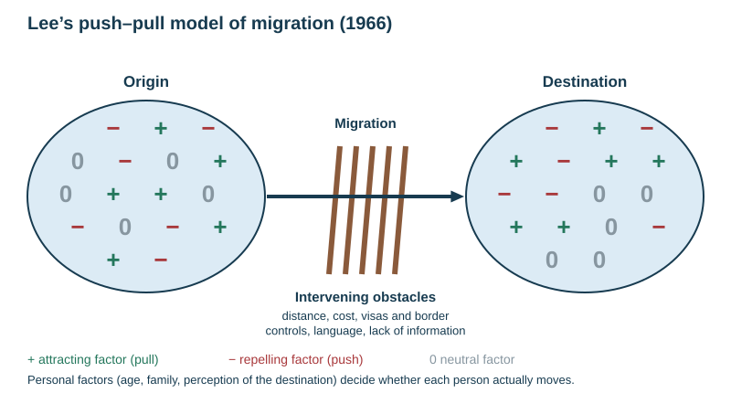

# Migration

Specification objectives 2.5 and 2.6. The named flows are **Samoa to New Zealand** and the **Syrian refugee flow**. Their full facts are in [CASE-STUDIES.md](../CASE-STUDIES.md). Rural-to-urban migration in LICs is on the [Urbanisation in LICs and MICs](../notes/urbanisation-lics.md) page.

## Contents

- Definitions
- Types of migration
- Causes: push and pull factors
- Lee's push–pull model and intervening obstacles
- Impacts on the source and destination areas
- How migration changes population structure
- Controlling migration
- Named flow: Samoa to New Zealand
- Named refugee flow: Syria
- Essay plan: "Migration is always bad"

## Definitions

| Term | Meaning |
|---|---|
| Migration | a permanent or semi-permanent change of residence (usually for at least a year) |
| Emigration / emigrant | leaving a country; the **source** (origin) loses people |
| Immigration / immigrant | entering a country; the **destination** (host, receiving area) gains people |
| Net migration | immigration minus emigration over a given period |
| Refugee | a person who has fled their own country because of a well-founded fear of persecution, conflict or disaster |
| Asylum seeker | a person who has applied for refugee status in another country and is awaiting a decision |
| Internally displaced person (IDP) | forced to move but still inside their own country |
| Economic migrant | moves mainly to improve income or employment |
| Climate refugee | forced to move by the effects of climate change, such as sea-level rise (Tuvalu, Kiribati) |
| Remittance | money sent home by a migrant to family in the source area |
| Brain drain / brain gain | the loss (or gain) of skilled and educated workers through migration |

## Types of migration

| Classified by | Types |
|---|---|
| **Distance and border** | **internal** (within a country, such as rural to urban, or Christchurch to Auckland) and **international** (across a border) |
| **Choice** | **voluntary**, where the migrant chooses, usually for work, study, family or lifestyle; and **forced** (involuntary), where there is no real choice: war, persecution, natural disaster, slavery, eviction for a dam |
| **Motive** | **economic** (jobs, wages); **social** (family reunion, marriage, education, healthcare); **political** (persecution, war, policy); **environmental** (drought, flood, sea-level rise, eruption) |
| **Duration** | **permanent**; **temporary** or **seasonal** (fruit pickers on the RSE scheme, OE working holidays); **circular** or daily (commuting is not migration because residence does not change) |
| **Direction** | **rural to urban** (most of LIC urban growth); **urban to rural** (counter-urbanisation in HICs); **return** migration; **step** migration (village to town to city); **chain** migration (following family or friends who went first) |

## Causes: push and pull factors

| Push factors (at the origin) | Pull factors (at the destination) |
|---|---|
| unemployment, low wages, poverty | jobs, higher wages, a better standard of living |
| poor housing, schools and healthcare | better housing, schools, universities and hospitals |
| crop failure, drought, flood, sea-level rise, natural hazards | a reliable food supply, a safer environment, a pleasant climate |
| war, persecution, discrimination, lack of freedom | safety, political and religious freedom |
| isolation, few prospects, overcrowding | family and community already there, the "bright lights", entertainment |

**Push factors usually dominate forced migration; pull factors usually dominate voluntary economic migration.** Migrants act on their **perception** of the destination, which may be wrong.

## Lee's push–pull model (1966)

The model has four parts.

1. **Factors at the origin.** Each is positive (+, keeps people), negative (−, pushes them out) or neutral (0).
2. **Factors at the destination**, also positive, negative or neutral. The destination is less well known, so it is often perceived wrongly.
3. **Intervening obstacles** stand between the two: distance, the cost of travel, border controls and visas, language, lack of information, family ties, physical barriers.
4. **Personal factors** decide how each person weighs the others: age, family stage, education, personality and perception. This is why two people facing the same conditions make different choices.

Migration happens when the perceived pluses of the destination, minus its minuses, outweigh the balance at the origin **and** the intervening obstacles.

**Strengths.** The model is simple, fits most voluntary moves, and explains why young, educated people move most (they find the obstacles easiest to overcome).

**Limitations.** It suits voluntary moves better than forced ones, it ignores government policy as a cause, and it treats people as rational decision-makers with full information.

## Impacts on the source and destination areas

| | Source (origin) area | Destination (host) area |
|---|---|---|
| **Positive** | less pressure on jobs, land, housing and services; **remittances** sent home; returning migrants bring skills, savings and ideas | labour shortages filled (in farming, care, construction and skilled professions); skills gained (**brain gain**); cultural diversity (food, festivals); a younger age structure; more taxpayers and consumers |
| **Negative** | loss of young, skilled workers (**brain drain**); fewer taxpayers; an older and more dependent population, gender-imbalanced if mainly men leave; farms and services decline; families split | pressure on housing, schools, healthcare and transport; downward pressure on some wages; overcrowding in migrant areas; social tension, discrimination and xenophobia; integration and language-teaching costs |

**Problems when large numbers emigrate.** This was a 5-mark question; each of the following earns a point:
- loss of the workforce and lower production;
- loss of skilled people such as doctors and teachers;
- fewer taxpayers, so less money for services;
- a higher dependency ratio as young adults leave;
- an uneven gender balance when mostly men leave;
- family break-up;
- less demand for goods;
- less attraction for foreign investors;
- slower economic development.

## How migration changes population structure

| Area | Effect on the pyramid |
|---|---|
| Destination | adds bulges in the 20–39 bands (often male-biased); a younger average age; later, more births. This explains why HICs such as Germany use migration to offset ageing |
| Source | indents in the 20–39 bands; a higher proportion of children and elderly left behind; often more women than men in rural areas |

This is the point the essay marking scheme looks for at the higher levels: "explain how migration can benefit population structure".

## Controlling migration

| Method | Example |
|---|---|
| Visas and work permits | New Zealand's skilled-migrant and work visas |
| Points-based systems | Australia, Canada and the UK award points for age, skills, qualifications and language |
| Quotas and ballots | the **Samoan Quota** (up to 1100 a year) and the Pacific Access Category |
| Temporary and seasonal worker schemes | the **Recognised Seasonal Employer (RSE)** scheme; Germany's post-war *Gastarbeiter* |
| Border control and deportation | fences and patrols (the US–Mexico border); returning failed asylum seekers |
| Refugee quotas and resettlement | New Zealand's annual refugee quota, raised to 1500 in 2020 |
| Integration policies | language classes, recognition of qualifications |

Evaluate controls by asking: do they fill real labour gaps, do they protect migrants from exploitation, are they fair, and do they reduce irregular migration or just move it elsewhere?

## Named flow: Samoa to New Zealand

- **Scale.** About 180 000 people of Samoan ethnicity live in New Zealand (2018 census), close to Samoa's own population of about 200 000. Samoans are the largest Pacific group in New Zealand, concentrated in South and West Auckland.
- **Push.** Few paid jobs and low wages; a small economy based on farming, remittances and tourism; limited higher education; cyclone and tsunami risk (the 2009 tsunami).
- **Pull.** Jobs and higher wages; family already settled (chain migration); education and healthcare; historical ties, since New Zealand administered Samoa until independence in 1962.
- **Obstacles and policy.** Visas and cost. The **Samoan Quota** (since 2002) allows up to 1100 Samoan citizens a year to gain residence by ballot. The **RSE scheme** (2007) brings seasonal workers for horticulture and viticulture.
- **Impacts on Samoa.** Remittances are a large share of national income, about a fifth or more of GDP in many years. Samoa loses young and skilled workers, and families are split. Seasonal workers bring back savings and skills.
- **Impacts on New Zealand.** Labour for horticulture, manufacturing and services; a large Pacific community and cultural events (Pasifika Festival). There has also been past discrimination: the 1970s "Dawn Raids" against Pacific overstayers, for which the government formally apologised in 2021.

## Named refugee flow: Syria

- **Cause.** Civil war from **2011**, with the bombing of cities, persecution and the collapse of services and the economy.
- **Scale.** At the peak over 6 million Syrians were refugees abroad and a similar number were displaced inside Syria (IDPs), about half the pre-war population.
- **Destinations.** Turkey (over 3 million at the peak); Lebanon (refugees were roughly a quarter of its population); Jordan (the Zaatari camp); and Europe. Over a million asylum seekers reached Europe in 2015–16, many settling in **Germany**.
- **Impacts on the source.** Loss of doctors, teachers and young workers; the economy and infrastructure destroyed; families divided; a sharp fall in population. Some refugees have returned since the fall of the Assad government in December 2024.
- **Impacts on the destinations.** Pressure on housing, schools, water and jobs in Lebanon and Jordan, and dependence on aid. In Germany, workers for an ageing labour force, but integration costs and a political backlash.

## Essay plan: "Migration is always bad"

1. **Statement.** Migration is not always bad; its effects depend on who moves, why, and how it is managed.
2. **For the statement.** Brain drain and the dependency ratio in the source area (Samoa). Pressure on services and tension in the host (Lebanon, Germany). Refugees' suffering (Syria).
3. **Against.** Remittances; labour gaps filled (RSE workers); a younger structure in ageing hosts (Germany); cultural enrichment; brain gain.
4. **Management.** Quotas, seasonal schemes and integration policies can reduce the costs.
5. **Conclusion.** Forced migration is mostly harmful to the migrants. Managed voluntary migration is usually beneficial to both ends. The verdict depends on scale, skills and policy.

## Common exam errors

- Saying "migration" when you mean "net migration".
- Listing push and pull factors with no named flow.
- Writing impacts that do not say *which end* (source or destination) they affect.
- Treating refugees and economic migrants as the same.
