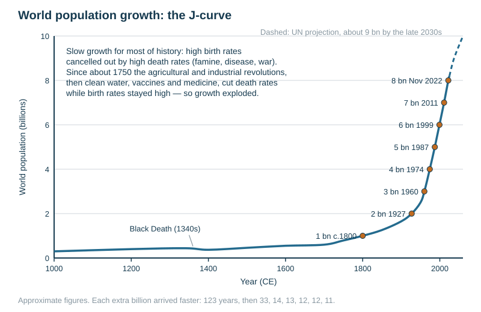
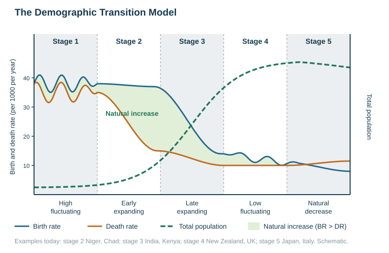

# Population growth and change

Specification objectives 2.1 and 2.2, plus the population–resource balance. The named examples are summarised here; the dated facts are in [CASE-STUDIES.md](../CASE-STUDIES.md).

## Contents

- Global population growth: the J-curve
- Measuring population change: birth, death, natural increase, migration
- Factors affecting birth rates
- Factors affecting death rates, including HIV/AIDS
- The Demographic Transition Model (DTM)
- Contrasting global patterns of natural change
- Over-, under- and optimum population

## Global population growth: the J-curve

For most of human history the population grew very slowly. High birth rates were cancelled out by high death rates from famine, disease and war. Growth since about 1750 has been explosive, which gives the **J-curve**.

| Period | World population (approximate) | Why |
|---|---|---|
| 100 000 years ago | a few hundred thousand hunter-gatherers | the food supply was limited by hunting and gathering |
| about 10 000 years ago | about 5 million | farming began, giving settled villages and a food surplus |
| 1 CE | about 250 million | slow growth; famine and epidemics repeatedly cut numbers back |
| 1340s | a fall | the Black Death killed perhaps a third of Europe's people |
| about 1800 | 1 billion | the agricultural and industrial revolutions raised the food supply |
| 1927 | 2 billion | sanitation, clean water and vaccination cut the death rate in Europe and North America |
| 1960 | 3 billion | medicine and public health spread to LICs; death rates fell but birth rates stayed high |
| 1974, 1987, 1999 | 4, 5 and 6 billion | each extra billion arrived faster, every 12–14 years |
| 2011 | 7 billion | |
| November 2022 | 8 billion | growth continues, but the *rate* of growth has been falling since the 1960s |
| projected | about 9 billion in the late 2030s, peaking at about 10 billion in the 2080s (UN) | falling fertility almost everywhere |

**Causal chain for the last 250 years.**
1. The agricultural revolution, and then the industrial revolution, increased the food supply.
2. Clean water, sewerage, vaccination and antibiotics cut the death rate, especially for infants.
3. Birth rates stayed high for a generation, because families still expected to lose children and needed their labour.
4. The gap between births and deaths produced rapid growth.
5. As countries urbanised and women were educated, birth rates fell and growth slowed.

Almost all of today's growth is in **sub-Saharan Africa and South Asia**. Much of Europe and East Asia has stopped growing.

**Describing the graph.** Give the overall trend: slow, then exponential. Quote the doubling, for example "from 4 billion in 1974 to 8 billion in 2022, a doubling in 48 years". Then note that the rate of increase is now slowing.

## Measuring population change

$$\text{population change} = (\text{births} - \text{deaths}) \pm \text{net migration}$$

| Measure | Definition | Calculation |
|---|---|---|
| Birth rate (crude) | live births per 1000 people per year | $\dfrac{\text{births}}{\text{population}}\times1000$ |
| Death rate (crude) | deaths per 1000 people per year | $\dfrac{\text{deaths}}{\text{population}}\times1000$ |
| Natural increase rate | birth rate minus death rate; a natural decrease if negative | $\text{BR} - \text{DR}$ (per 1000) |
| Natural increase as a % | the same figure as a percentage | $\dfrac{\text{BR}-\text{DR}}{10}$ |
| Net migration | immigrants minus emigrants over a given period | a total, or per 1000 |
| Net migration rate | net migration per 1000 people per year | $\dfrac{\text{immigrants}-\text{emigrants}}{\text{population}}\times1000$ |
| Fertility rate (total) | average number of children per woman over her lifetime | per woman, not per 1000 |
| Infant mortality rate | deaths under one year old per 1000 live births | per 1000 *live births* |
| Life expectancy | average number of years a newborn can expect to live | years |
| Replacement level | fertility at which a population just replaces itself | about 2.1 children per woman |

**Worked example.** BR 28/1000 and DR 9/1000. Natural increase $= 28 - 9 = 19$ per 1000, which is $19/10 = 1.9\%$ a year. If net migration is $-3$ per 1000, the total change $= 19 - 3 = 16$ per 1000.

**Worked example (a rate from raw numbers).** 1260 births in a population of 45 000: $1260 \div 45\,000 \times 1000 = 28$ per 1000.

**Worked example (net migration rate).** 12 000 immigrants and 9000 emigrants in a population of 600 000: $(12\,000-9000)\div600\,000\times1000 = 5$ per 1000.

**How the three parts combine.**
- A country grows when natural increase plus net migration is positive.
- Natural increase can be positive while migration is negative, and the reverse.
- In New Zealand, natural increase has stayed positive since the 1960s but has fallen steadily as fertility dropped. Net migration swings sharply: it is sometimes negative (many New Zealanders leaving for Australia) and sometimes the larger contributor.

**Mark-scheme definitions** (a New Zealand data question):
- *Net migration* is the difference between immigrants and emigrants in an area over a given time period.
- *Natural increase* is the difference between the birth rate and the death rate. It is an increase if births exceed deaths and a decrease if deaths exceed births.

When asked to *compare* two lines, the scheme credits points such as "net migration fluctuates more", "natural increase is always positive, but net migration is sometimes negative" and "both fell overall". It reserves one mark for paired statistics.

## Factors affecting birth rates

| Factor | Raises the birth rate | Lowers the birth rate |
|---|---|---|
| Economic | children work on farms or earn; no pensions, so children support parents in old age | mechanised farming; long schooling; children are expensive to raise, especially in cities; pensions |
| Social: infant mortality | high infant mortality, so parents have more children to make sure some survive | low infant mortality |
| Social: women | little education or paid work for women; early marriage | educated women with careers marry and have children later |
| Social: contraception | little access or knowledge | family planning available, affordable and accepted; legal abortion |
| Cultural and religious | religion or custom favours large families or sons | a secular, urban lifestyle |
| Political | pro-natalist policy (child payments) | anti-natalist policy (China's one-child policy) |
| Health | | HIV/AIDS kills adults of child-bearing age |

## Factors affecting death rates

| Raises the death rate | Lowers the death rate |
|---|---|
| famine, poor diet | a reliable food supply and a balanced diet |
| unsafe water, poor sanitation (cholera, diarrhoea) | clean piped water, sewerage, rubbish collection |
| infectious disease (malaria, TB, measles) | vaccination, antibiotics, medical care, trained doctors |
| HIV/AIDS | antiretroviral drugs, education, condoms |
| war and conflict, natural hazards | peace, stable government, hazard warning systems |
| an ageing population, since more old people die each year | a youthful population |
| lifestyle diseases in HICs (obesity, heart disease, alcohol) | healthy lifestyles, health education |

**HIV/AIDS shows how disease changes both rates.**
- In southern Africa in the 1990s and 2000s it killed large numbers of adults of working and child-bearing age.
- The death rate rose and life expectancy fell by more than a decade in the worst-hit countries (Botswana, eSwatini, Zimbabwe).
- The birth rate fell, many children were orphaned, the workforce shrank and families lost their earners.
- The pyramid narrowed in the 20–49 age bands.
- Antiretroviral drugs, cheaper from the 2000s, have since brought life expectancy back up.

**Why natural decrease occurs in some HICs such as Japan.** The 4-mark answer that the mark scheme credits:
- fewer births and small families;
- access to, and education about, contraception;
- women educated, with careers and higher status;
- children are expensive;
- later marriage and childbearing;
- a rising death rate as the population ages.

*This loses marks:* vague answers such as "government policy", "migration", "people live longer", "low infant mortality" or "low birth rate" with no reason attached.

## The Demographic Transition Model

| Stage | Birth rate | Death rate | Natural increase | Total population | Example today |
|---|---|---|---|---|---|
| 1 High fluctuating | high (35–50) | high, fluctuating | roughly zero | low, stable | no country; isolated groups in the Amazon rainforest |
| 2 Early expanding | high | falling rapidly | very high | rising fast | Niger, Chad, Afghanistan, the DR Congo |
| 3 Late expanding | falling rapidly | low, still falling | falling | still rising, more slowly | India, Kenya, Bangladesh, Brazil |
| 4 Low fluctuating | low, fluctuating | low | roughly zero | high, stable | New Zealand, the USA, the UK, Australia |
| 5 Declining | very low, below the death rate | low, rising slightly as the population ages | negative | slowly falling | Japan, Italy, Germany, South Korea, now China |

**Why each stage happens.**
- **Stage 1 to 2.** Clean water, sanitation, vaccination and better food cut the death rate first.
- **Stage 2.** Births stay high because family expectations change slowly. The widening gap between the curves is the population boom.
- **Stage 3.** The education of women, urban living, falling infant mortality and contraception cut the birth rate.
- **Stage 4.** The gap closes.
- **Stage 5.** Where fertility stays below replacement (about 2.1 children per woman), the population ages and begins to fall.

**Labelling the DTM in an exam:**
- the axes: rate per 1000 per year, and time;
- the birth-rate and death-rate lines;
- the shaded natural increase, and the total population line;
- the stage numbers and names.

**Strengths.** It is simple and easy to compare countries with. It shows the link between development and population. It describes the history of HICs well.

**Limitations.**
- It is based on the history of industrialised European countries.
- It **ignores migration**.
- It does not give the timing of each stage. Today's LICs moved through stage 2 much faster because medicine was imported.
- Government policy (China) or disease (HIV/AIDS) can push a country off the expected path.
- It assumes all countries will industrialise.
- It was drawn before stage 5 was observed, so stage 5 was added later.

## Contrasting global patterns of natural change

| Region | Natural increase | Why |
|---|---|---|
| Sub-Saharan Africa (Niger, Chad, the DR Congo) | highest, often 2.5–3.5% a year | high fertility, rural farming economies, low female education, high infant mortality; death rates have fallen |
| South Asia, Latin America, North Africa | moderate, about 1–1.5% | fertility falling with urbanisation and education |
| Europe, North America, Australia and New Zealand | near zero; growth mainly from migration | low fertility, an ageing structure |
| Japan, Italy, much of Eastern Europe, South Korea, China | negative (natural decrease) | very low fertility, the oldest populations |

The pattern follows development: the higher a country's income, education and urbanisation, the lower its birth rate and natural increase.

## Over-, under- and optimum population

| Term | Meaning | Signs | Example often used |
|---|---|---|---|
| Over-population | too many people for the resources and technology available, so living standards fall | unemployment, food shortage, malnutrition, squatter settlements, environmental damage, emigration | parts of the Sahel; Bangladesh in the past |
| Under-population | too few people to use the resources fully, so potential output is lost | labour shortages, unused land and resources, encouragement of immigration | Canada, Australia; New Zealand recruiting skilled migrants |
| Optimum population | the number that gives the highest standard of living from the resources available | | a theoretical point that moves as technology changes |

- These ideas are about the **population–resource balance**, not about density. A densely populated place with high technology and trade, such as Singapore or the Netherlands, can be comfortably supported. A sparsely populated place with poor soils and no capital can still be over-populated.
- **Technology and trade shift the balance.** Irrigation, fertilisers, the Green Revolution and imports raise the population an area can support.
- **The Auckland essay (2024).** "Auckland is overpopulated" was a school essay. The evaluation turns on whether housing, transport and water infrastructure keep pace with growth, not on the raw number. See [Urban change and issues in HICs](../notes/urban-change-hics.md).

## Common exam errors

- Quoting a rate with no unit. "28" is worth nothing; "28 births per 1000 per year" earns the mark.
- Confusing **birth rate** (per 1000 of the whole population) with **fertility rate** (per woman).
- Treating the DTM as a prediction rather than a generalisation, and forgetting that it excludes migration.
- Describing a graph without data. Anchor the trend to a figure, with its unit and year.
- Writing "over-populated" to mean "densely populated".
