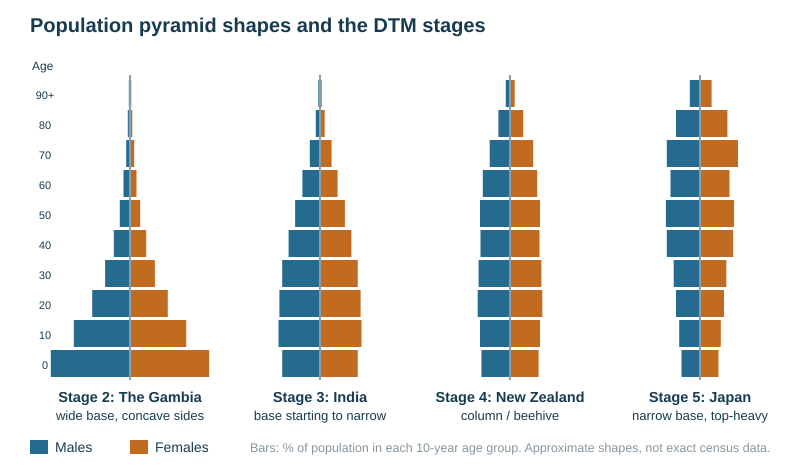

# Population structure and policies

Specification objectives 2.3 and 2.4. The case studies are China, The Gambia, Japan and Italy, with Bangladesh and Germany for contrast. Their dated facts are in [CASE-STUDIES.md](../CASE-STUDIES.md).

## Contents

- Constructing a population pyramid
- Interpreting a pyramid
- Pyramid shapes and the DTM
- The dependency ratio
- Youthful populations: causes, implications and policies
- Ageing populations: causes, implications and policies
- Evaluating population policies: the case studies

## Constructing a population pyramid

A population (age/sex) pyramid is two horizontal bar graphs placed back to back.

- **Males on the left, females on the right.**
- Age groups go up the centre in five-year bands, from 0–4 at the bottom to 85+ or 90+ at the top.
- The horizontal axis shows the **percentage** (or number) of the total population. It increases outwards from the centre in both directions.
- The bars touch, and every band has the same height.
- Give a title (the country and the year) and label both axes.
- Plot a missing bar with the scale given, in the same style as the others.

## Interpreting a pyramid

Read in a fixed order: **shape → base → apex → sides → bulges and notches → one figure quoted with its unit**. Then compare males with females, the working with the dependent ages, and the young with the old.

| Feature | What it means |
|---|---|
| Wide base | high birth rate, youthful population |
| Base narrower than the bar above it | birth rate recently falling, for example after a policy or with development |
| Steeply tapering, concave sides | high death rate at every age, short life expectancy |
| Straight, near-vertical sides | low death rate until old age |
| Wide apex, more women than men at the top | ageing population and high life expectancy; women live longer |
| A notch in one cohort | a past war, epidemic or famine, or a sharp dip in births |
| A bulge of young adult men | in-migration of male workers (Gulf states such as Qatar and the UAE) |
| Fewer young adults than expected | out-migration (rural areas, Samoa) or deaths from HIV/AIDS |
| A baby-boom bulge moving up | a post-war rise in births, now reaching retirement in HICs |

## Pyramid shapes and the DTM

| Shape | DTM stage | Birth and death rates | Typical country |
|---|---|---|---|
| Wide base, narrow concave triangle | 2 | high BR, high but falling DR, short life expectancy | The Gambia |
| Wide base but narrowing at the bottom, straighter sides | 3 | falling BR, low DR | India, Bangladesh |
| Column (beehive), roughly equal bars to old age | 4 | low BR and DR, long life expectancy | New Zealand, the UK |
| Narrow base and wide top (inverted, or "coffin" shaped) | 5 | BR below DR, very old population | Japan, Italy |

## The dependency ratio

| Group | Ages | Why it matters |
|---|---|---|
| Young dependants | 0–14 | schools, child health, future workers |
| Economically active | 15–64 | taxpayers and producers |
| Elderly dependants | 65 and over | pensions, healthcare, residential care |

$$\text{dependency ratio} = \frac{(0\text{–}14) + (65+)}{15\text{–}64}\times100$$

**Worked example.** 3 200 000 young, 1 100 000 elderly and 5 500 000 of working age:
$(3\,200\,000 + 1\,100\,000)\div5\,500\,000\times100 = 78$ dependants per 100 people of working age.

- In LICs most dependants are **young** (The Gambia's ratio is about 80, almost all children).
- In HICs a growing share are **elderly** (Japan's ratio is about 70, mostly old).
- **Limitations.** Many 15–19-year-olds in HICs are still in education, many over-65s still work, and many children in LICs work. The ratio is therefore only an approximation of who supports whom.

## Youthful populations

**Causes.** High birth and fertility rates and falling infant mortality. These come from children's value as labour and old-age security, early marriage, low female education, limited contraception, and religious and cultural norms.

| Implications | |
|---|---|
| **Problems** | not enough school places or teachers; pressure on child healthcare and vaccination; too few jobs as each cohort reaches working age, so unemployment and underemployment; food and water stress; housing shortages and squatter settlements; a high young dependency ratio; future population momentum, as many women are about to enter child-bearing age |
| **Opportunities** | a large, cheap future workforce attracting investment; the **demographic dividend** if birth rates fall and the large cohort finds jobs; a dynamic, innovative population; a large future market |

**Policies (anti-natalist).**
- Family planning clinics with free contraception.
- Education of girls, and raising the legal marriage age.
- Incentives for small families, and limits on family size.
- Media campaigns.
- Development itself: lower infant mortality, pensions, women's jobs.

## Ageing populations

**Causes.** Long life expectancy (better healthcare, diet and living standards) plus low fertility (contraception, careers, the cost of children, later marriage).

| Implications | |
|---|---|
| **Problems** | rising pension and healthcare costs; fewer workers and taxpayers per pensioner; labour shortages; higher taxes or a higher retirement age; shrinking demand, schools closing; rural villages emptying (Japan's *akiya*, or empty houses); a smaller army; families caring for the elderly |
| **Opportunities** | the "grey pound": spending on leisure, tourism and care; experienced workers; volunteering; grandparents providing childcare; new industries in care, robots and health |

**Policies.**

| Type | Measures |
|---|---|
| Pro-natalist (raise births) | baby bonuses and child payments, paid parental leave, subsidised childcare, tax relief, housing help, flexible working |
| Migration-based | skilled-migration visas, points systems, recruiting particular occupations, guest workers |
| Ageing-focused | raising the retirement age, compulsory private pension saving (KiwiSaver in New Zealand), retraining older workers, automation and care robots |

## Evaluating population policies: the case studies

| Example | Situation | Policy | Evaluation |
|---|---|---|---|
| **China** (anti-natalist) | rapid growth after 1950 | **one-child policy** 1979/80–2015, with fines, permits and rewards; two children from 2016, three from 2021 | births were cut sharply, by hundreds of millions on most estimates, but the side effects forced the reversal: a male-biased sex ratio, a rapidly ageing population, the "4-2-1" family and a shrinking workforce. The population began to fall in 2022, and pro-natalist incentives have barely raised births |
| **The Gambia** (youthful) | fertility about 4.5 children per woman; about 4 in 10 people under 15; growth about 2.5% a year; youth unemployment and "back way" emigration to Europe | a national population policy promoting family planning; school fees removed; child marriage banned (2016) | fertility is falling slowly, but early marriage, rural poverty, low contraceptive use and religious and cultural norms keep it high, and laws are hard to enforce in rural areas: policy works only as fast as development, especially girls' education |
| **Bangladesh** (anti-natalist success) | over 6 children per woman in the 1970s | door-to-door family-planning workers, free contraception, girls' schooling, women's jobs in the garment industry | fertility fell to about 2. It is one of the clearest successes, because policy went together with rising education and jobs for women |
| **Japan** (ageing) | about 29% aged 65 or over; fertility about 1.2 | childcare and parental-leave support, a higher retirement age, robots in care, a new visa for foreign workers (2019) | births have kept falling; immigration is limited by cultural reluctance, so the workforce keeps shrinking |
| **Italy** (ageing) | fertility about 1.2; about a quarter aged 65 or over; births at a record low | baby bonuses, tax credits for children, a single universal child allowance (2022) | small payments have not changed decisions shaped by youth unemployment, expensive housing and little childcare; immigration fills some labour gaps |
| **Germany** (ageing) | low fertility, ageing | migration: over a million asylum seekers in 2015–16, mainly from Syria | filled labour gaps and lowered the average age, but integration costs and political tension rose |

**Evaluating a policy** means naming:
- the intended effect;
- the measured effect, with a figure;
- the side effects;
- who gained and who lost;
- what the outcome depended on, such as development, culture, enforcement and cost.

A list of measures on its own earns little.

**Essay angles used by the school:**
- "Declining populations are a problem that needs to be addressed."
- "Ageing populations are a crisis with no solution."
- "The causes, problems and solutions of youthful populations."
- "Governments dealing with demographic issues; Germany turning to migration."

For each, argue both sides with the examples above and conclude with what the answer depends on.

## Common exam errors

- Describing a pyramid shape without quoting a bar value and its unit.
- Mixing up the sides of the pyramid. Males are on the left.
- Calling every ageing country "stage 5". New Zealand is ageing but is still in stage 4.
- Listing policies without evidence of whether they worked.
