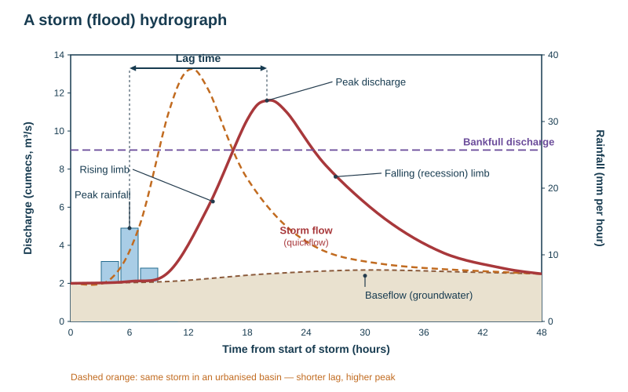
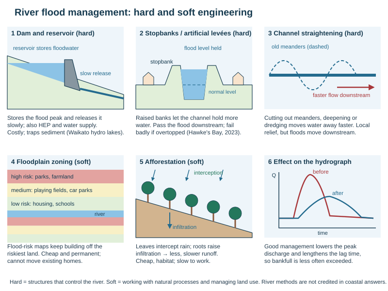

# Rivers: flooding, management and fieldwork

Theme 1, specification 1.3 (rivers and people). Processes and landforms are on [Rivers: drainage basins, processes and landforms](../notes/rivers.md). Named examples: the Waikato River (opportunities and management), Cyclone Gabrielle 2023 and the Auckland Anniversary floods 2023 (hazards), Bangladesh (LIC contrast).

## Flood (storm) hydrographs

**Hydrograph** = a graph of river discharge over time at one point. A **storm (flood) hydrograph** shows how discharge responds to one rainfall event.

| Term | Meaning |
|---|---|
| Rainfall bars | the storm, usually in mm per hour |
| **Peak rainfall** | the time of maximum rainfall |
| **Rising limb** | the steep rise in discharge as storm water reaches the channel |
| **Peak discharge** | the maximum discharge |
| **Lag time** | the time between peak rainfall and peak discharge |
| **Falling (recession) limb** | discharge returning to normal; gentler than the rising limb |
| **Baseflow** | normal flow fed by groundwater |
| **Storm flow (quickflow)** | the extra water from overland flow and throughflow |
| **Bankfull discharge** | the discharge that just fills the channel; above it the river floods |

### Why hydrographs differ between basins

| Factor | "Flashy": short lag, high peak | "Subdued": long lag, low peak |
|---|---|---|
| Rainfall | intense, prolonged, or on frozen or already saturated ground; snowmelt | light, steady, on dry absorbent ground |
| Relief | steep slopes — water runs off fast | gentle slopes |
| Rock | impermeable (granite, clay) — no percolation | permeable (chalk, sandstone) |
| Soil | thin, clay, saturated | deep, sandy, dry |
| Vegetation | bare, ploughed, deforested — little interception | dense forest — high interception and transpiration |
| Land use | **urban**: tarmac, roofs, drains | woodland, wetland, pasture |
| Basin shape and size | small, circular — water arrives together | large, elongated |
| Drainage density | high | low |

*Causal chain: urbanisation makes floods worse.* Tarmac and roofs are impermeable → infiltration falls and surface runoff rises → gutters and drains deliver water to the river in minutes → lag time shortens and peak discharge rises → the same rain now exceeds bankfull → flooding, made more damaging because the floodplain is built on.

## Why rivers flood

**Flood** = when a river's discharge exceeds the capacity of its channel and water spills onto the surrounding land.

| Physical causes | Human causes |
|---|---|
| prolonged rainfall saturating the ground | **urbanisation** (impermeable surfaces, drains) |
| intense rainfall, e.g. from a tropical cyclone, a stalled front, a thunderstorm | **deforestation** (less interception, more runoff, more sediment) |
| rapid snowmelt | building on floodplains (more exposure) |
| frozen or saturated ground | channels narrowed or straightened; sediment raising the bed |
| steep, impermeable basins | climate change: more intense rainfall |
| storm surge or high tides blocking the river mouth | failure of dams or stopbanks |

## Rivers: opportunities and hazards

| Opportunities (benefits) | Hazards (risks) |
|---|---|
| fertile alluvial soil for farming (floods renew it) | flooding of homes, farms, roads; loss of life |
| water supply for drinking, irrigation, industry and cooling | drought and low flow; water shortages |
| hydroelectric power | bank erosion and loss of land; channel shifts |
| transport and trade (navigable rivers, ports at mouths) | pollution and waterborne disease |
| fishing, food, recreation and tourism | silt and debris left by floods; landslides |
| flat land for building, cultural and spiritual value (Te Awa Tupua, Waikato) | damage to infrastructure, insurance costs |

## Managing floods

| Approach | Method | How it works | Strengths | Weaknesses |
|---|---|---|---|---|
| Hard | **Dam and reservoir** | stores floodwater and releases it slowly | controls flow; also supplies water and HEP | very expensive; displaces people; traps sediment; can fail |
| Hard | **Stopbanks (artificial levées, embankments)** | raise the banks so the channel holds more water | protects known assets; immediate | expensive; pushes water downstream; catastrophic if breached or overtopped |
| Hard | **Channel straightening** | removes meanders so water leaves faster | quick local relief | speeds water to places downstream; damages habitat |
| Hard | **Dredging / channel enlargement** | deepens or widens the channel to carry more water | quick | must be repeated; disturbs ecosystems |
| Hard | **Flood relief (diversion) channel, spillway** | takes excess water round a town | protects a specific area | costly; can be overwhelmed |
| Hard | **Floodgates and pump stations** | stop backflow and pump water off low land into the river | drain farmland and towns | costly to run; fail in power cuts |
| Hard | **Flood walls** | concrete walls along urban rivers | narrow footprint in cities | ugly; expensive; overtopping risk |
| Soft | **Floodplain zoning** | no building on the highest-risk land; low-value uses (parks, farms) there | cheap; permanent | cannot remove existing buildings; development pressure |
| Soft | **Afforestation** | trees intercept rain and increase infiltration → longer lag, lower peak | cheap; habitat; carbon store; less erosion | slow; needs land; little effect in extreme events |
| Soft | **Wetland and river restoration** | lets floodwater spread and be stored naturally | habitat; cheap | land taken out of use |
| Soft | **Flood forecasting and warnings** | people move themselves and belongings | cheap; saves lives | does not stop damage; needs public response |
| Soft | **Preparation and insurance** | sandbags, raised power points, emergency kits, insurance | reduces losses | cost to households |
| Soft | **Managed retreat / buy-outs** | people leave the highest-risk land | removes the exposure permanently | costly; politically hard; breaks up communities |

**Hard engineering** = building artificial structures to control the river. **Soft engineering** = working with natural processes and managing land use and people. **Sustainable** schemes are usually soft or a mix.

*Evaluation checklist:* cost; who benefits and who loses (upstream vs downstream); environmental effect; how long it lasts; whether it copes with an extreme event; whether it moves the problem elsewhere.

## Named example: the Waikato River

| | Details |
|---|---|
| The river | NZ's longest river, about **425 km**, flowing from Lake Taupō north to the sea at Port Waikato |
| Opportunities | **hydroelectric power**: eight dams with nine power stations from Aratiatia to Karapiro; **water supply** for Auckland (treatment plant at Tuakau) and Hamilton; cooling water for **Huntly power station**; **irrigation** and dairy farming on fertile alluvial soils; recreation (rowing at Lake Karapiro, Huka Falls tourism); cultural importance to **Waikato-Tainui** (the river as an ancestor) |
| Hazards | floods in the lower basin (the large flood of 1958 led to the flood scheme); bank erosion; pollution from farm runoff (nitrate, bacteria), geothermal arsenic and urban wastewater; algal blooms |
| Management | the **Lower Waikato–Waipā flood control scheme** (from the 1960s): **stopbanks, floodgates and pump stations** protecting farmland and towns such as Huntly; the hydro lakes can store some floodwater; Waikato Regional Council flood warnings; the 2010 Waikato River settlement and Vision and Strategy, which aims to restore the river's health and wellbeing |
| Evaluation | the stopbanks and pumps make the lower floodplain farmable but drained peat land sinks, so the pumps must keep running; dams regulate flow but trap sediment; water quality remains a problem because of farming upstream |

## Named example: flooding in 2023

- **Auckland Anniversary floods, 27 January 2023:** about 250 mm of rain fell at Auckland Airport in 24 hours, a record; 4 deaths; thousands of homes flooded as urban drains and streams were overwhelmed — an example of urban flash flooding (short lag, high peak).
- **Cyclone Gabrielle, 12–14 February 2023:** an ex-tropical cyclone dumped record rain on the eastern North Island; **11 deaths**; a **national state of emergency**; in Hawke's Bay the Tūtaekurī and Esk rivers burst or overtopped stopbanks and the **Esk Valley** was buried in silt; bridges and roads destroyed. Responses: a government recovery package and **voluntary buy-outs** of "Category 3" properties where future risk cannot be reduced (managed retreat).
- *Lesson:* hard defences built for a 1-in-100-year flood failed in a larger event, and deforested hill country added huge volumes of silt and forestry slash.

## LIC contrast: Bangladesh

- Most of Bangladesh lies on the **Ganges–Brahmaputra–Meghna delta**, very low and flat; much of the country floods in the monsoon (June–September).
- **Causes:** monsoon rain, Himalayan snowmelt, deforestation upstream, cyclones and storm surges from the Bay of Bengal, sea-level rise.
- **Benefits:** floods bring water and fertile silt for rice.
- **Responses:** embankments, cyclone and flood shelters on raised land, early warnings by SMS and volunteers, raised homes and plinths, floating gardens; large engineering schemes are limited by cost.

## River fieldwork

| Stage | What to do |
|---|---|
| **Hypothesis** | a testable statement, e.g. *channel width increases with distance downstream* or *velocity increases downstream* (Bradshaw) |
| **Site selection** | several sites at regular intervals downstream; safe access; permission from landowners |
| **Risk assessment** | never alone, wear suitable footwear, avoid deep or fast water and recent heavy rain, check the forecast |
| **Measurements** | **width** with a tape measure bank to bank; **depth** with a metre rule at regular intervals across the channel; **velocity** by timing a float (orange, dog biscuit) over a measured distance (e.g. 10 m) three times and averaging, or with a flow meter; **gradient** with a clinometer and ranging poles; **load size** with calipers or a ruler (long axis) and **roundness** with a Powers roundness chart, sampling pebbles at random or systematically |
| **Calculations** | cross-sectional area = width × mean depth; discharge = area × velocity; averages |
| **Presentation** | cross-section graphs drawn to scale, line graphs of change downstream, scatter graphs with a best-fit line, bar charts of load size, annotated photos and maps |
| **Analysis and conclusion** | describe the trend with figures, explain it, accept or reject the hypothesis, note anomalies |
| **Evaluation** | limitations (few sites, one day, float hitting the bank, human error) and improvements (more sites, repeat readings, flow meter) |

**Primary data** = collected yourself in the field; **secondary data** = collected by others (maps, council records, websites).

## This loses marks

- Reading a hydrograph without quoting times and discharges with units.
- Lag time measured from the start of the rain instead of peak rainfall.
- A management method named without how it works, or "it works" without who, where and when.
- Fieldwork answers that say "measure the velocity" without the equipment and method.
