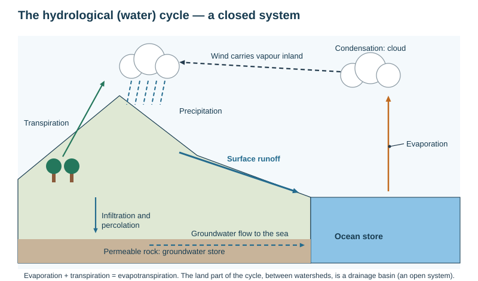
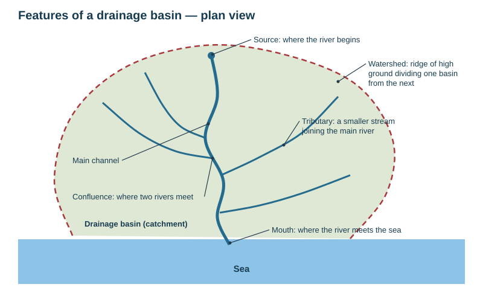
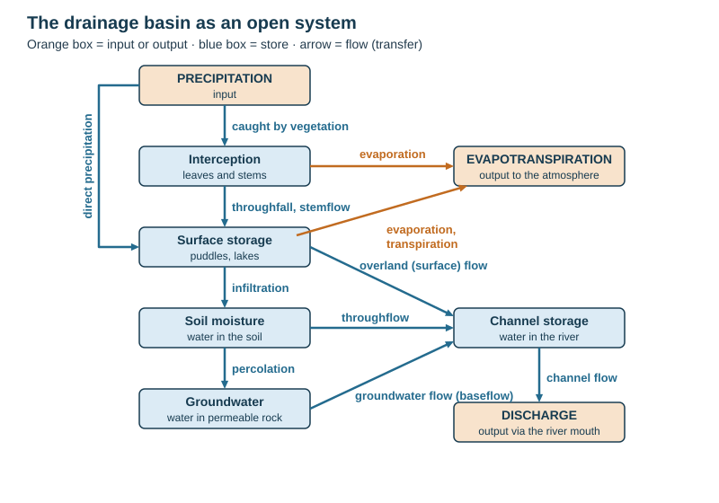
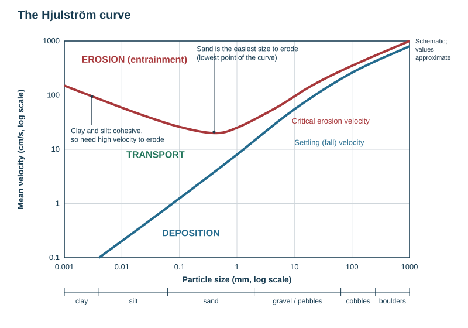
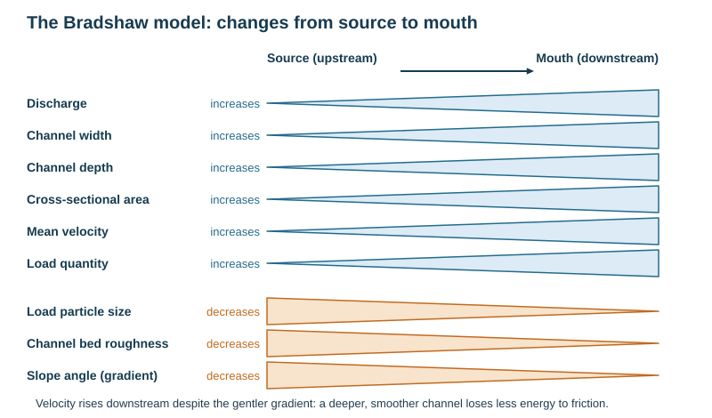
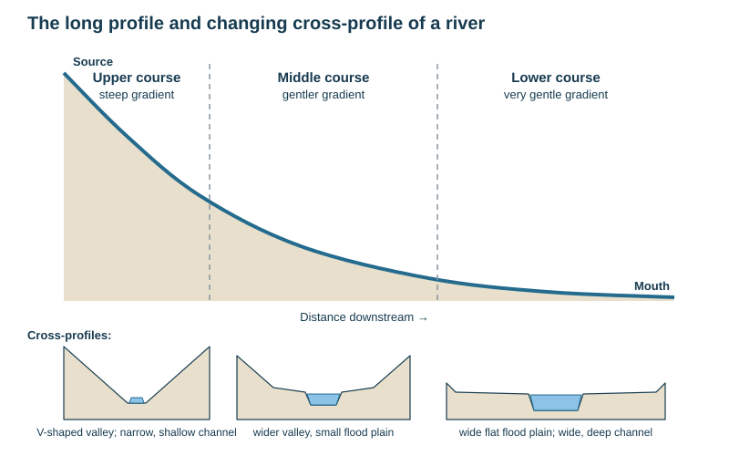
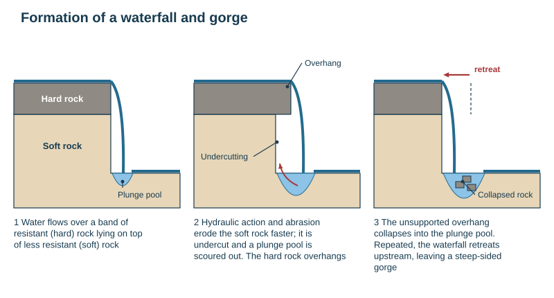
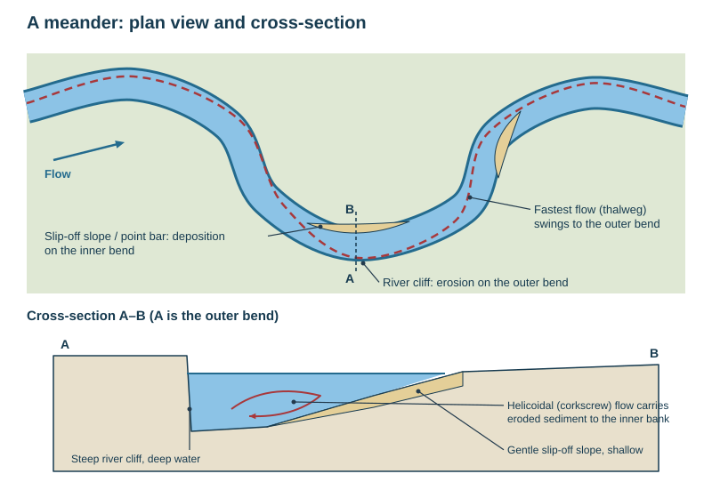
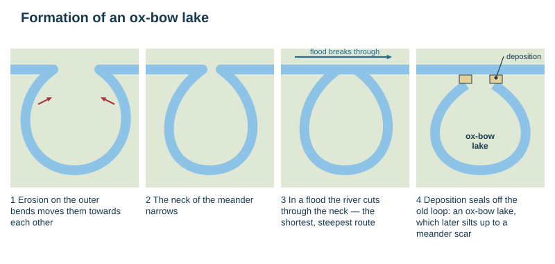
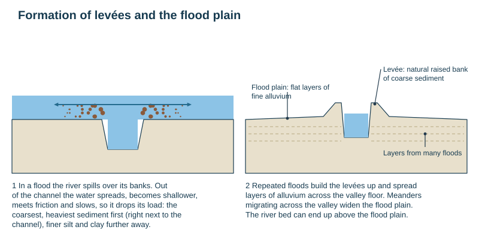

# Rivers: drainage basins, processes and landforms

Theme 1, specification 1.3 (rivers). Flooding, management, the Waikato case study and fieldwork are on [Rivers: flooding, management and fieldwork](../notes/river-flooding.md).

## The hydrological (water) cycle

**Hydrological cycle** = the continuous circulation of water between the oceans, the atmosphere and the land, driven by the Sun's energy. Globally it is a **closed system**: no water is added or lost, it only changes state and store.

| Process | Meaning |
|---|---|
| Evaporation | liquid water → water vapour, using the Sun's heat |
| Transpiration | water vapour lost from plant leaves |
| **Evapotranspiration** | evaporation + transpiration together |
| Condensation | water vapour cools to its dew point → liquid droplets (cloud) |
| Precipitation | any water falling from the atmosphere: rain, snow, sleet, hail |
| Runoff | water flowing over land back to the sea |

Stores: oceans (about 97% of all water), ice caps and glaciers, groundwater, lakes and rivers, soil moisture, the atmosphere, living things.

## The drainage basin

**Drainage basin (catchment)** = the area of land drained by a river and its tributaries. It is an **open system** — water enters (precipitation) and leaves (evapotranspiration, discharge to the sea).

| Feature | Meaning |
|---|---|
| **Watershed** | the boundary of a basin: a ridge of high land dividing one basin from the next |
| **Source** | where a river begins (a spring, lake, glacier or marsh in the uplands) |
| **Tributary** | a smaller river or stream that joins a larger one |
| **Confluence** | where two rivers meet |
| **Mouth** | where the river meets the sea or a lake |
| **Estuary** | the tidal mouth of a river where fresh and salt water mix |
| **Channel** | the river's bed and banks |
| **Drainage density** | total length of streams ÷ basin area; high on impermeable rock |

### Inputs, stores, flows and outputs

| Element | Type | Meaning |
|---|---|---|
| Precipitation | input | all water reaching the basin |
| **Interception** | store | water caught on leaves and stems before reaching the ground |
| Surface storage | store | puddles, ponds, lakes |
| Soil moisture | store | water held in the soil |
| **Groundwater** | store | water in permeable rock (an **aquifer**); the top is the **water table** |
| Channel storage | store | water in the river |
| Throughfall / stemflow | flow | water dripping off leaves / running down stems to the ground |
| **Infiltration** | flow | water soaking into the soil |
| **Percolation** | flow | water moving down from the soil into the rock |
| **Surface runoff (overland flow)** | flow | water flowing over the surface when rain is faster than the infiltration rate or the ground is saturated, frozen or paved — the fastest route to the river |
| **Throughflow** | flow | water moving sideways through the soil to the channel |
| **Groundwater flow (baseflow)** | flow | slow seepage through rock to the river; keeps it flowing between storms |
| Evaporation, transpiration | output | water returned to the atmosphere |
| **Discharge** | output | water leaving the basin through the river |

**Infiltration capacity** = the maximum rate at which soil can absorb water. Above it, water runs off over the surface.

### Discharge

**Discharge** = the volume of water passing a point in a given time, in **cumecs** (cubic metres per second, m³/s).

$$\text{discharge }(Q) = \text{cross-sectional area} \times \text{mean velocity}$$

**Worked example.** Width 8 m, mean depth 0.75 m, mean velocity 1.2 m/s: area $= 8\times0.75 = 6$ m²; $Q = 6\times1.2 = 7.2$ m³/s.

## River processes

### Erosion

| Process | Mechanism |
|---|---|
| **Hydraulic action** | the force of the water hits the bed and banks and forces air into cracks; the compressed air expands and breaks the rock |
| **Abrasion (corrasion)** | the load is dragged and bounced along, scraping and grinding the bed and banks (forms **potholes** where pebbles swirl in hollows) |
| **Attrition** | load particles hit each other and break into smaller, rounder pieces downstream |
| **Corrosion (solution)** | weak acids in the water dissolve soluble rock such as limestone |
| **Cavitation** | air bubbles in very fast, turbulent water collapse, sending tiny shock waves against the banks |

- **Vertical erosion** deepens the channel — dominant in the upper course (steep gradient, high energy above base level).
- **Lateral erosion** widens the channel — dominant in the middle and lower course.
- **Headward erosion** extends the valley back towards the source.
- **Base level** = the lowest level a river can erode to (sea level).

### Transport

| Process | Material |
|---|---|
| **Solution** | dissolved minerals, invisible |
| **Suspension** | fine clay and silt carried in the flow (makes rivers look brown) |
| **Saltation** | sand and small pebbles bouncing along the bed |
| **Traction** | large boulders rolled and dragged along the bed |

**Load** = everything the river carries. **Bedload** = material moved along the bed (saltation and traction). **Capacity** = the total load a river can carry; **competence** = the largest particle it can carry.

### Deposition

A river deposits when it **loses energy**: velocity falls where the gradient decreases, the river enters a lake or the sea, the water becomes shallow (inside of a meander, a flood spreading over the floodplain), discharge falls after a flood or in a drought, or the load increases suddenly. The heaviest material is dropped first, the finest last.

### The Hjulström curve

- Plots **water velocity** (y, log scale) against **particle size** (x, log scale).
- **Critical erosion (entrainment) velocity** — the velocity needed to pick a particle up.
- **Settling (fall) velocity** — below it the particle is deposited.
- Between the two lines particles stay in **transport**.
- **Sand (about 0.1–1 mm) is easiest to erode.** Larger particles need more velocity because they are heavier; **clay and silt also need high velocity** because the fine particles are **cohesive** (stick together) and lie flat and smooth on the bed.
- Once moving, a particle stays in transport at a velocity **lower** than the one needed to lift it — clay can stay in suspension at almost zero velocity.

### The Bradshaw model

| Increases downstream | Decreases downstream |
|---|---|
| discharge (tributaries join) | gradient (slope) |
| channel width and depth | load particle size (attrition) |
| cross-sectional area | channel bed roughness |
| mean velocity | |
| load quantity | |

**Why velocity increases even though the gradient falls:** the channel becomes deeper, wider and smoother, so a smaller share of the water touches the bed and banks (higher **hydraulic radius**, less **friction**) and less energy is lost.

### The Schumm model

Schumm linked channel shape to the type of load:

- **Mainly suspended load** (fine silt and clay) → **narrow, deep, sinuous** (meandering) channel.
- **Mainly bedload** (coarse sand and gravel) → **wide, shallow** channel, often **braided** (split into many channels round gravel bars) — common on NZ's Canterbury rivers (Waimakariri, Rakaia).
- **Mixed load** → intermediate shape.

## The long profile and cross profile

| Course | Gradient and valley | Channel | Main processes | Landforms |
|---|---|---|---|---|
| Upper | steep; narrow **V-shaped valley** | narrow, shallow, rough, large angular load | vertical erosion, hydraulic action, abrasion | V-shaped valley, interlocking spurs, waterfalls, gorges, rapids, potholes |
| Middle | gentler; wider valley with a small floodplain | wider, deeper | lateral erosion and deposition | meanders, river cliffs, slip-off slopes, small floodplain |
| Lower | very gentle; wide, flat valley floor | wide, deep, smooth, fine load | deposition dominant | large meanders, ox-bow lakes, floodplain, levées, delta, estuary |

The long profile is **concave**: steep near the source, gentle near the mouth.

## River landforms

| Landform | Erosional or depositional | Course |
|---|---|---|
| V-shaped valley, interlocking spurs | erosional | upper |
| Waterfall, gorge, rapids, potholes | erosional | upper |
| Meander (river cliff and slip-off slope) | both | middle and lower |
| Ox-bow lake | both | lower |
| Floodplain, levée | depositional | lower |
| Delta | depositional | mouth |

### V-shaped valley and interlocking spurs

1. In the upper course the river has high energy relative to its base level and erodes **vertically** by hydraulic action and abrasion.
2. Weathering (freeze–thaw, rain) and mass movement loosen the valley sides, and the material slides into the river and is carried away.
3. The valley becomes steep-sided and narrow: a **V shape**.
4. The river lacks the energy to erode laterally through harder rock, so it winds round it, leaving **interlocking spurs** — ridges of land that alternate from each side.

### Waterfall and gorge

1. A band of **resistant (hard) rock** lies over **less resistant (soft) rock**.
2. The soft rock is eroded faster (hydraulic action and abrasion), creating a step.
3. Water falling over the step scours a deep **plunge pool** by hydraulic action and abrasion (swirling boulders).
4. Splash-back **undercuts** the soft rock, leaving an **overhang** of hard rock.
5. The unsupported overhang **collapses**; the rock falls into the plunge pool and is used for more abrasion.
6. The process repeats and the waterfall **retreats upstream**, leaving a steep-sided **gorge**. Examples: Niagara Falls (retreating about 1 m a year before engineering), Huka Falls on the Waikato.

**Rapids** form where bands of hard and soft rock alternate, making a steep, turbulent, broken stretch.

### Meander

1. Water flows fastest on the **outside** of a bend (the **thalweg** swings outwards); the channel is deeper and there is less friction.
2. On the outside, lateral erosion (hydraulic action, abrasion) undercuts the bank → a steep **river cliff**.
3. On the inside, water is shallow and slow → deposition → a gentle **slip-off slope** (point bar).
4. A corkscrew (**helicoidal**) flow carries sediment from the outer bank across the bed to the inner bank.
5. The bends become more pronounced and **migrate downstream** across the valley floor, widening the floodplain.
6. The cross-section is **asymmetric**: deep beside the river cliff, shallow beside the slip-off slope.

### Ox-bow lake

1. Erosion on the outer bends of two neighbouring meanders moves them towards each other.
2. The **neck** of the meander narrows.
3. During a **flood**, the river cuts through the neck — the shortest, steepest route.
4. The new straight channel becomes the main river; **deposition** seals off the ends of the old loop.
5. The cut-off loop is a crescent-shaped **ox-bow lake**, which slowly fills with sediment and vegetation to become a **meander scar**.

### Floodplain and levées

- **Floodplain** = the wide, flat area of land beside a river that floods. Formed by **deposition** of fine **alluvium** each time the river floods (the water spreads out, slows and drops its load), and by **lateral erosion** as meanders migrate across the valley.
- **Levée** = a natural raised bank along the river. In a flood the water leaves the channel, meets friction and slows suddenly → the **coarsest, heaviest sediment is dropped first**, right beside the channel → repeated floods build it up; finer silt is carried further onto the floodplain.

### Delta

1. A river carrying a large load reaches the sea or a lake.
2. The water slows and loses energy, so it **deposits** sediment faster than tides and currents can remove it.
3. In salt water, clay particles stick together and sink faster (**flocculation**).
4. The deposits build up and the channel splits into many smaller channels (**distributaries**).
5. Delta shapes: **arcuate** (fan-shaped: the Nile), **bird's-foot** (long fingers: the Mississippi), **cuspate** (pointed, shaped by waves: the Tiber).
- Conditions: a large sediment load, a sheltered sea with weak tides and currents, a gently sloping shelf.

## This loses marks

- Describing a landform without saying *where in the course* it forms, or putting meanders in the upper course.
- Waterfalls explained without hard rock over soft rock **and** retreat upstream.
- Meanders without the fastest flow on the outer bend.
- Ox-bow lakes without the flood that cuts through the neck.
- Discharge without its unit (cumecs, m³/s).
- Saying clay is easiest to erode — on the Hjulström curve it is sand.
