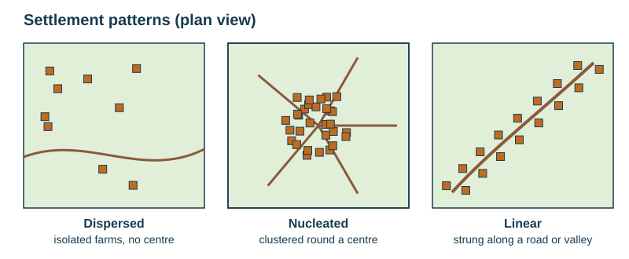
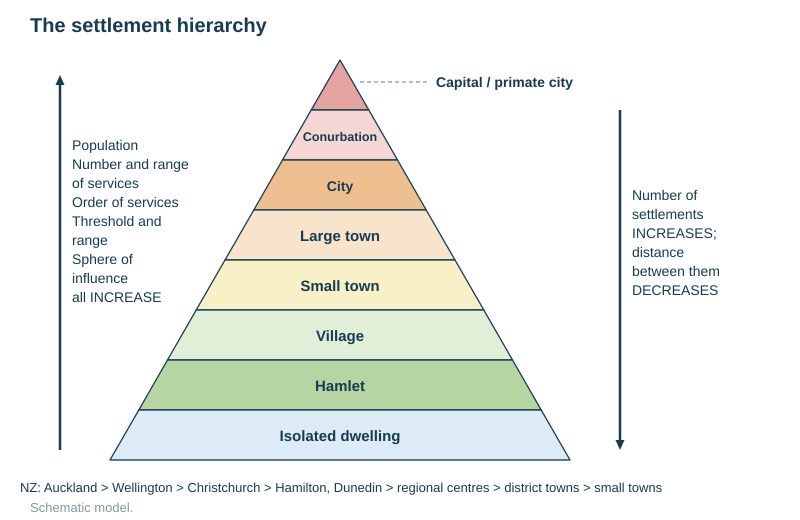
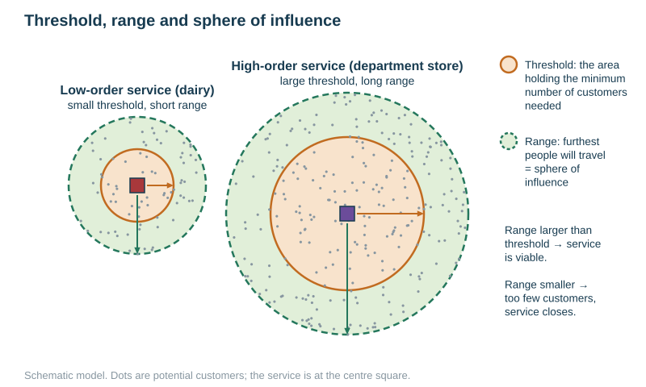
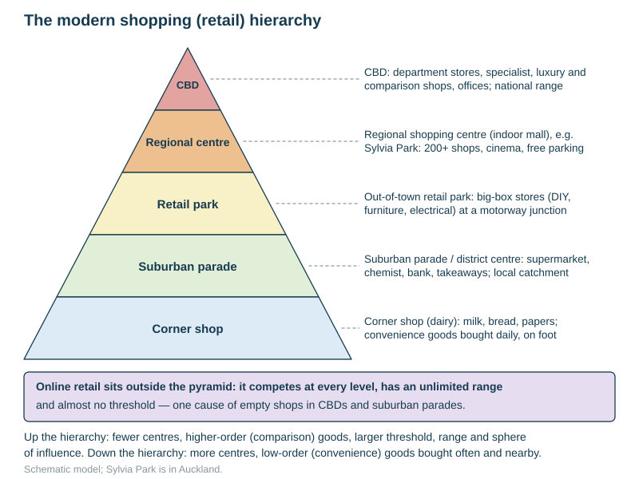
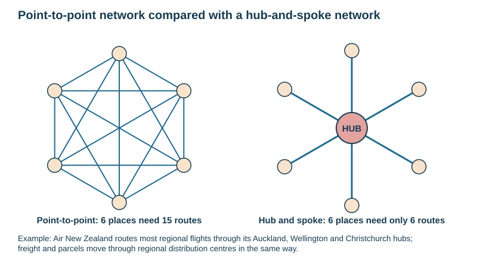

# Settlement and service provision

Specification objectives 2.8 and 2.10. The named example is **New Zealand's urban hierarchy**. See also [CASE-STUDIES.md](../CASE-STUDIES.md).

## Contents

- Site and situation
- Settlement patterns: dispersed, nucleated, linear
- Rural and urban settlements
- Function
- Growth: why some settlements grow and others stay small
- The settlement hierarchy
- Threshold, range and sphere of influence
- Low-, middle- and high-order services; convenience and comparison goods
- Central place theory
- The modern shopping hierarchy, including online retail
- Hub-and-spoke networks
- Changes in rural service provision
- New Zealand's urban hierarchy

## Site and situation

- **Site** is the actual land the settlement is built on. Site explains why it *began* there.
- **Situation** is its position relative to the surrounding region, routes, resources and other settlements. Situation usually explains why it *grew*.

| Site factor | Why a settlement was placed there | Example |
|---|---|---|
| Wet point | a reliable spring or well in a dry area | oasis towns in the Sahara |
| Dry point | a mound or terrace above flood level, in marshy or flood-prone land | villages on terraces above a flood plain |
| Defence | a hilltop, a meander loop or an island, easy to defend | Māori pā on Auckland's volcanic cones (Maungakiekie); Durham in a meander loop |
| Bridging point | the lowest or narrowest crossing point of a river | London on the Thames |
| Shelter | out of the wind, a sheltered harbour, a sunny (north-facing in New Zealand) slope | Wellington and Lyttelton harbours |
| Resources | water, fuel, building stone, timber, fertile soil, gold | Dunedin and the Otago goldfields; Greymouth's coal |
| Route centre (nodal point) | a gap, pass, confluence or crossroads where routes meet | Hamilton on the Waikato River |
| Flat land | easy to build on and farm | Christchurch on the Canterbury Plains |
| Port | deep, sheltered water | Auckland, Tauranga |

**Describing site and situation from a photograph or map** (a 3-mark question): say what it is *on* (a valley floor, a gentle lower slope, a river terrace, a coastal plain). Then say what it is *near*: mountains, forest for wood, pasture, a river, a road or pass. The mark scheme accepts "in a valley; near the mountains; sheltered; close to forest and farmland".

## Settlement patterns

| Pattern | Appearance | Typical causes |
|---|---|---|
| **Dispersed** | isolated farms and houses spread out, no centre | large farms (New Zealand sheep stations), difficult relief, pastoral farming, a reliable water supply everywhere |
| **Nucleated** (clustered) | buildings grouped tightly round a centre (a church, market, crossroads or well) | defence, a single water source, a route centre, communal farming, shared services |
| **Linear** | a line of buildings | along a road, river, valley floor, dyke, railway or coastline; on a narrow valley floor between steep slopes |
| **Clustered** (several groups) | several tight groups | separate water points or patches of better land |

A mark-scheme question showed a photograph of a village in Croatia and asked "dispersed, linear or nucleated?". Identify the pattern from the layout of the buildings, not from the size of the settlement.

## Rural and urban settlements

| | Rural | Urban |
|---|---|---|
| Size | hamlets and villages | towns and cities |
| Functions | mainly farming, forestry or fishing; few services | industry, services, administration; many services |
| Density | low | high |
| Jobs | primary sector | secondary, tertiary and quaternary |

Definitions of "urban" vary between countries. New Zealand uses population size and density rather than function, so compare countries' figures with care.

## Function

The **function** of a settlement is its main economic or social purpose. Large settlements are **multi-functional**.

| Function | Example |
|---|---|
| Market town / service centre | Hamilton (Waikato dairy); Ashburton |
| Port | Auckland, Tauranga, Lyttelton |
| Administrative / capital | Wellington |
| Industrial / manufacturing | Glenbrook (steel), Kawerau (pulp and paper) |
| Mining | Greymouth and Westport (coal), historic Ōtago gold towns |
| Tourist resort | Queenstown, Rotorua, Taupō |
| Educational / university | Dunedin, Palmerston North |
| Residential / dormitory (commuter) | Pukekohe, Ōrewa, Pōkeno |
| Route centre | Taihape, Hamilton |

Functions change over time. A gold-rush town may become a tourist resort (Arrowtown), and a port may become a residential and leisure area (Auckland's Wynyard Quarter).

## Growth: why some settlements grow more than others

| Grows | Stays small or declines |
|---|---|
| a good situation: route centre, port, gap | isolated, off the main routes |
| flat land to expand onto | steep slopes, mountains or water limit building |
| resources and industry provide jobs | resources exhausted (mining towns), factories closed |
| chosen as a capital or administrative centre | services withdrawn |
| attracts migrants and investment; the multiplier effect | young people leave, so the population ages and falls |
| good transport added later (a railway, motorway or airport) | bypassed by new routes |

**Why a mountain village stays small** (a 4-mark question: 2 reasons, each developed):
- There is little flat land to build on, and steep slopes and snow make building and transport hard, so growth is physically limited.
- It is isolated from main roads and railways, so it is difficult to trade or commute.
- There is no industry, so jobs are few and young people leave.

**The multiplier effect** (cumulative causation) explains why big places keep growing. New jobs bring workers, who spend money; that creates more jobs and services, which attract more people and firms.

## The settlement hierarchy

A **settlement hierarchy** ranks settlements by population size, number and range of services, and sphere of influence.

| Level | Settlement | Typical services | Sphere of influence |
|---|---|---|---|
| Lowest | isolated dwelling, hamlet | none, or a post box | very small |
| Low | village | dairy, primary school, church, pub, petrol station | local |
| Middle | small town | supermarket, secondary school, doctor, bank, chemist | district |
| High | large town, city | department store, hospital, specialist shops, university | regional |
| Highest | conurbation, capital or primate city | national government, head offices, international airport, specialist hospitals and finance | national and international |

Moving **up** the hierarchy:
- settlements become fewer, larger and further apart;
- they have more services, and higher-order ones;
- their thresholds, ranges and spheres of influence are larger.

A **primate city** is more than twice the size of the next city and dominates the country (Bangkok, Lima, Dhaka). Auckland is about three times the size of the next New Zealand city, so New Zealand shows a primate pattern.

## Threshold, range and sphere of influence

| Term | Meaning |
|---|---|
| **Threshold population** | the minimum number of customers (or the minimum spending) needed for a service to stay in business |
| **Range** | the maximum distance people are willing to travel to use a service |
| **Sphere of influence** (urban field, catchment or trade area) | the area from which people travel to a settlement or a service |

- A service is viable only if its **range reaches far enough to include its threshold population**.
- A dairy needs only a few hundred customers, and people walk a few hundred metres to it.
- A department store or hospital needs tens or hundreds of thousands of people, who will travel tens of kilometres.

**Mapping a sphere of influence.** Ask shoppers where they have come from (questionnaires), plot their origins, and draw a line round the outermost points. Delivery areas, newspaper circulation, bus routes and school catchments show it too.

## Orders of service and types of goods

| Order | Examples | Threshold | Range | Frequency of use |
|---|---|---|---|---|
| **Low order** | dairy, newsagent, post box, primary school, hairdresser | small | short | daily or weekly |
| **Middle order** | supermarket, chemist, bank, secondary school, GP, petrol station | medium | medium | weekly |
| **High order** | department store, jeweller, car showroom, hospital, university, cinema complex, specialist shops | large | long | rarely |

| | Convenience goods | Comparison goods |
|---|---|---|
| Examples | bread, milk, newspapers, groceries | clothes, shoes, furniture, electrical goods, jewellery |
| Bought | often, cheaply, close to home, with little thought | rarely, expensively, after comparing price and quality between shops |
| Where | corner shops, suburban parades | CBD, regional shopping centres, retail parks |

**Why CBD shops and services have a large sphere of influence** (a 5-mark question; 5 points or developments):
- they are high- and middle-order;
- they sell specialist, luxury and comparison goods;
- there is a wide variety, so people can visit several shops on one trip;
- people do not have similar shops near home;
- people are willing to travel long distances for them;
- the CBD is easily accessible, at the focus of bus, rail and road routes;
- the goods are bought infrequently.

## Central place theory (Christaller, 1933)

- Settlements are **central places** that supply goods and services to the surrounding area.
- On a uniform plain, each order of settlement serves a **hexagonal** market area.
- There are many small low-order centres close together, and fewer large high-order centres further apart.
- **Limitations.** Real landscapes are not flat or uniform. People do not always use the nearest centre. Transport routes distort the pattern. Car ownership and online shopping lengthen ranges.
- **Use.** The theory explains why the hierarchy exists and why settlements of the same order are evenly spaced.

## The modern shopping hierarchy

| Level | Location | Shops | Why it is there |
|---|---|---|---|
| **CBD** | the city centre, the most accessible point | department stores, flagship and specialist shops, offices, entertainment | the highest bid rent; the focus of public transport |
| **Regional shopping centre** | out of town or in the suburbs at motorway junctions (Sylvia Park, Westfield Albany) | 100–200+ shops under one roof, cinemas, food courts | large cheap sites, free parking, car access; serves a whole region |
| **Out-of-town retail park** | the edge of the city, on greenfield land | big-box stores: DIY (Bunnings, Mitre 10), furniture, electrical, warehouses | space for huge single-storey stores and car parks; cheap land |
| **Suburban parade / district centre** | along main roads in the suburbs | supermarket, chemist, bank, takeaways, hairdresser | serves the local suburb; middle- and low-order |
| **Corner shop (dairy)** | within residential streets | milk, bread, newspapers, snacks | serves the neighbourhood on foot; tiny threshold |
| **Online retail** | anywhere (warehouses and delivery hubs) | everything | unlimited range, almost no threshold; growing fast |

**Effects of out-of-town and online shopping.**
- Decline of CBD and suburban-parade shops: empty shopfronts, which fuel inner-city decay.
- Councils respond with pedestrianisation, events, mixed-use redevelopment and apartments in the CBD.
- Delivery warehouses spread on the fringe, near motorways.

## Hub-and-spoke networks

- In a **hub-and-spoke network**, all routes run from outlying places (the spokes) to one central **hub**. Journeys between spokes change at the hub.
- **Transport examples.** Air New Zealand's domestic network routes through the Auckland, Wellington and Christchurch hubs. Bus networks radiate from a city-centre interchange (Britomart).
- **Retail and distribution examples.** Supermarket chains supply every store from a few regional distribution centres. Parcel firms sort everything at a central depot.

| Advantages | Disadvantages |
|---|---|
| far fewer routes are needed (6 places: 6 routes instead of 15) | journeys between two spokes are longer and need a change |
| fuller vehicles, cheaper per passenger or parcel | congestion and delays at the hub spread to the whole network |
| the hub gains jobs and services, which reinforces its place in the hierarchy | spokes depend on the hub; small places lose direct links |

Hub-and-spoke networks help explain why the largest settlements keep growing. They are the most accessible points, so high-order services and firms locate there.

## Changes in rural service provision

- Rural services in HICs are closing (post offices, banks, schools, petrol stations, bus routes). Car ownership lets villagers drive to town (a longer range), so village services fall below their threshold.
- **Effects.** People without cars (the elderly, the young, the poor) are isolated. Young families leave, and the population ages.
- **Responses.** Mobile services (libraries, banks), online services, community-run shops, school buses, combined service points (a post office inside a dairy).

## New Zealand's urban hierarchy (the named example)

| Level | Settlements | Functions, services and reasons for growth |
|---|---|---|
| 1 | **Auckland** | dominates population, industrial production, income, health, education (the top-ranked university), sporting and entertainment venues. Reasons: sheltered harbours on two coasts, a warmer climate, the main entry point to New Zealand, closest to the rest of the world |
| 2 | **Wellington** | the seat of government and political power; head offices; national institutions (Te Papa). Reasons: central location in New Zealand, sheltered harbour, the capital since 1865 |
| 3 | **Christchurch** | formerly the second-largest city, now third; dominates the South Island. Early growth: the productive flat land of the Canterbury Plains and the sheltered port at Lyttelton |
| 4 | **Hamilton, Dunedin** | Dunedin grew to great importance in the 1860s through the Otago gold rush, its port and its university, and was the fourth city for most of the last century, but its growth has been static. Hamilton grew as the service town for the highly productive dairy land of the Waikato and has overtaken it |
| 5 | Tauranga, Napier–Hastings, New Plymouth, Palmerston North, Rotorua, Invercargill, Nelson, Whangārei | regional centres: hospitals, polytechnics, regional shopping centres |
| 6 | Gisborne, Whanganui, Ashburton, Timaru, Blenheim, Masterton, Queenstown, Taupō | district towns |
| 7 | Greymouth, Hokitika, Ōamaru, Levin, Taihape, Matamata, Whakatāne, Taumarunui, Te Kūiti, Alexandra | small service towns |

**How the hierarchy developed.**
- Early 19th century: whaling and trading stations, and Māori settlements.
- 1840: Auckland chosen as the capital. 1865: the capital moved to Wellington for its central position.
- 1860s: the gold rushes made Dunedin the largest city.
- Late 19th century: refrigerated shipping (from 1882) and dairying favoured North Island ports and Auckland.
- 20th century: industry, immigration and the main airport concentrated growth in Auckland.
- Today Auckland has about a third of New Zealand's people. Tauranga and Hamilton are the fastest-growing of the rest. Small rural towns are declining as farms mechanise and services centralise.

## Common exam errors

- Mixing up **site** (the land itself) and **situation** (its position relative to its surroundings).
- Confusing **range** (a distance) with **threshold** (a number of people).
- Calling a settlement "big" without giving the services that prove its order.
- Naming the hierarchy levels without giving any reasons for them.
