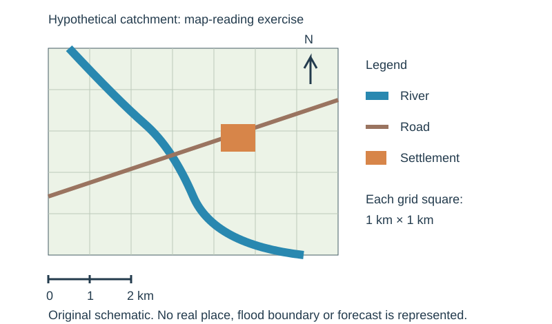

# Geographical skills

Skills are assessed inside the core questions rather than as a separate section, so they can attach to any theme. A topographic map question is likely but not guaranteed. Bring a pencil, rubber, ruler, protractor and calculator, and use the sheet of plain paper for measuring distances and cross-sections. Maps are 1:25 000 or 1:50 000 with a full key, and **every answer to the map question must come from map evidence only** — not from general knowledge.

Practise on that extract: it has a grid of 1 km squares, a linear scale, a north arrow and a key — the four things to check before you answer anything.

## Reading a map: the fixed first moves

| Check | Why |
|---|---|
| Title and date | tells you what the map represents and how current it is |
| Scale | every distance, area and gradient answer depends on it |
| North arrow | all directions and bearings are measured from grid north |
| Key | you may only name features the key allows you to name |
| Grid interval | on a 1:50 000 map each grid square is 1 km × 1 km |

## Grid references

**Eastings before northings — along the corridor, then up the stairs.**

- **Four-figure** reference names a whole 1 km square: read the easting line to the *left* of the square, then the northing line *below* it. A dot inside square 46/65 has the four-figure reference **4665**.
- **Six-figure** reference locates a point inside the square: divide each side of the square mentally into tenths. The first tenth is 0 and the last is 9. A dot three tenths east of line 46 and four tenths north of line 65 is **463654**.

Write the six digits with no spaces or commas. If you cannot find a feature, re-read whether the question gave a four- or six-figure reference — a four-figure reference asks what is *in a square*, not what is at a point.

## Scale and distance

$$\text{ground distance} = \text{map distance} \times \text{scale factor}$$

| Scale | 1 cm on the map represents | 1 km on the ground is |
|---|---|---|
| 1:25 000 | 250 m | 4 cm |
| 1:50 000 | 500 m | 2 cm |
| 1:100 000 | 1 km | 1 cm |

**Worked example.** On a 1:50 000 map, a straight line measures 7.4 cm. $7.4 \times 500 = 3700$ m $= 3.7$ km.

**Measuring a curved route** (a road, a railway, a river): lay the straight edge of the plain paper at the start, mark it, follow the route to the first bend, mark the paper, pivot the paper about that mark to follow the next straight section, and repeat. Then hold the finished edge against the linear scale and read off the distance. Say in your answer whether you measured the *route* or the *straight line* — a winding road is always longer than the straight-line distance between its ends.

**Area.** Count whole grid squares, then add the part-squares as halves. On a 1:50 000 map each square is 1 km², so 14 whole squares plus 6 part-squares gives approximately $14 + 3 = 17$ km².

## Direction and bearings

**Direction** is given on the 16-point compass: N, NNE, NE, ENE, E, ESE, SE, SSE, S, SSW, SW, WSW, W, WNW, NW, NNW. Always state direction **from** the first place named **to** the second — reversing it loses the mark.

**Bearing** is the clockwise angle from grid north, written as three digits: 000° to 360°. Draw a line between the two points, lay the protractor's centre on the *starting* point with 0° pointing to grid north (up the page, parallel to a northing line), and read the angle clockwise to your line. North is 000°, east 090°, south 180°, west 270°.

## Relief, gradient and cross-sections

| Evidence | What it tells you |
|---|---|
| Contours close together | steep slope |
| Contours far apart | gentle slope or flat land |
| Contours evenly spaced | uniform slope |
| Contours forming a V pointing upslope | a valley, with the V pointing upstream |
| Contours forming a rounded nose downslope | a spur |
| Concentric closed contours | a hill or summit |
| Spot height / triangulation pillar | an exact height at one point |

Useful relief vocabulary: ridge, plateau, scarp, escarpment, col, saddle, spur, re-entrant, flood plain, terrace, steep-sided, deeply incised, broad, gently undulating, dissected.

$$\text{gradient} = \frac{\text{vertical rise (m)}}{\text{horizontal distance (m)}}$$

**Worked example.** A slope rises from 120 m to 300 m over 3 cm on a 1:50 000 map. Rise $= 300-120 = 180$ m; horizontal distance $= 3\times500 = 1500$ m. Gradient $= 180/1500 = 0.12$, which is **1 in 8.3**, or $0.12\times100 = 12\%$.

**Drawing a cross-section.** Lay the paper edge along the section line. Mark where each contour crosses, writing its height. Mark rivers, roads and the ends. Transfer the marks onto graph paper with distance on the horizontal axis and height on the vertical, plot each point at its height, join with a smooth curve, label both axes with units, and state the **vertical exaggeration** if the question asks. Never join the points with straight ruled segments — the ground is a curve.

## Reading human and physical patterns from a map

| Feature | What to describe |
|---|---|
| Drainage | density of streams, pattern (dendritic, radial, trellis), direction of flow (contours and confluences show it), channel width and sinuosity |
| Settlement | pattern (dispersed, nucleated, linear), site (wet point, dry point, bridging point, defensive, sheltered), situation relative to routes and resources |
| Communications | type (motorway, A road, track, railway), density, and whether routes follow valleys, cross passes or avoid steep ground and marsh |
| Land use | woodland, orchard, marsh, quarry, built-up area, open moorland — only what the key names |
| Function and services | a church, school, post office, hospital, station or industrial estate shown on the map indicates the services the settlement provides |

**Describing a distribution from a map.** Give the general pattern first, then the exceptions, then anchor both with grid references or named places and a direction or distance. "Settlement is concentrated along the valley floor in the south-west, for example at 463654, with only isolated farms above the 300 m contour in the north-east" earns far more than "settlement is spread out".

## Photographs, satellite images and sketch maps

| Resource | How to read it |
|---|---|
| Oblique photograph | divide into foreground, middle distance and background, and left, centre and right; describe what is where |
| Aerial / satellite image | work outwards from the most distinctive feature; look for field size, road pattern, building density and shadow |
| Field sketch | simple outline with annotated labels naming processes, not just objects |
| Cartoon | identify the subject, the exaggeration, and the point of view it is pushing |

A **sketch map** is a simplified map drawn to show one thing. Include a frame, a title, a north arrow, an approximate scale or a note that it is not to scale, and a key. Keep it simple and label the pattern you are being asked about.

**Annotate, do not just label.** A label names a part; an annotation says what the part is doing. "Plunge pool" is a label; "plunge pool deepened by hydraulic action and abrasion as water falls" is an annotation, and annotations earn the explanation marks.

## Graphs and charts

| Type | Best for | Reading tip |
|---|---|---|
| Line graph | continuous change over time | describe the overall trend, then the rate of change, then anomalies |
| Bar graph | comparing separate categories | compare the largest and smallest, and quote both |
| Divided (compound) bar | composition of a total, compared between places | read the segment length, not the end position |
| Histogram | a continuous variable grouped into classes | bars touch; the area matters |
| Pictogram | simple comparison for a general audience | check what one symbol represents |
| Pie graph | proportions of a single whole | 1% = 3.6°, so a quarter is 90° |
| Scatter graph | relationship between two variables | describe strength and direction, add a best-fit line, name no cause from correlation alone |
| Dispersion graph | the spread of a set of values | shows clustering, median and quartiles |
| Triangular graph | three components that total 100%, e.g. employment by sector or soil texture | read each axis in the direction its own labels run |
| Population pyramid | age and sex structure | shape, base, apex, sides, and one quoted figure |
| Climate graph | monthly temperature (line) and rainfall (bars) | quote maximum, minimum, annual range and total rainfall |
| Wind rose | frequency and strength of wind by direction | the longest arm is the prevailing wind direction |
| Kite diagram | species abundance along a transect | symmetrical about the transect line |
| Flow line | movement and volume between places | line width is proportional to quantity |
| Isoline map | a continuous surface such as pressure, rainfall or travel time | lines join equal values; close lines mean a steep gradient |
| Choropleth map | rates or densities by area | shading classes; it hides variation *inside* each area |
| Proportional symbol map | quantity at points | check the key — symbol **area**, not diameter, is usually proportional |
| Radial graph | data with a directional or cyclical dimension | read outwards from the centre |

When asked to **plot**, use the axes and scale provided, plot accurately, and complete the bar or point in the same style as the existing ones. When asked to **suggest a suitable graph**, name the type *and* say why it suits that data: three components totalling 100% → triangular graph; a relationship between two variables → scatter graph; proportions of one total → pie graph; rates by region → choropleth map.

## Calculations

| Quantity | Formula |
|---|---|
| Population density | $\dfrac{\text{population}}{\text{area in km}^2}$ |
| Percentage | $\dfrac{\text{part}}{\text{whole}}\times100$ |
| Percentage change | $\dfrac{\text{new}-\text{old}}{\text{old}}\times100$ |
| Rate per 1000 | $\dfrac{\text{events}}{\text{population}}\times1000$ |
| Natural increase | $\text{birth rate} - \text{death rate}$ |
| Mean | $\dfrac{\sum x}{n}$ |
| Median | the middle value when the data are ranked |
| Mode | the most frequently occurring value |
| Range | $\text{maximum} - \text{minimum}$ |
| Interquartile range | $Q_3 - Q_1$ |
| Gradient | $\dfrac{\text{vertical rise}}{\text{horizontal distance}}$ |
| River discharge | $\text{cross-sectional area} \times \text{velocity}$ |
| Dependency ratio | $\dfrac{(0\text{--}14)+(65+)}{15\text{--}64}\times100$ |

**Mean, median, mode, range.** Data: 4, 7, 7, 9, 13, 15, 17.
Mean $= (4+7+7+9+13+15+17)\div7 = 72\div7 = 10.3$. Median $= 9$ (the fourth of seven). Mode $= 7$. Range $= 17-4 = 13$.

**Interquartile range.** Ranked data: 11, 14, 16, 18, 21, 25, 28, 33. With $n=8$, $Q_1$ is the mean of the 2nd and 3rd values $= (14+16)\div2 = 15$; $Q_3$ is the mean of the 6th and 7th $= (25+28)\div2 = 26.5$. $\text{IQR} = 26.5-15 = 11.5$. The IQR describes the middle half of the data, so unlike the range it is not thrown off by one extreme value.

**Rate per 1000.** 1260 births in a population of 45 000: $1260\div45\,000\times1000 = 28$ births per 1000 per year.

**Percentage of a pie graph.** A sector measured as 126°: $126\div360\times100 = 35\%$.

Always: show the working, give the unit, and round sensibly — one decimal place is usually enough, and a population cannot be 3.7 people.

## Fieldwork methodology

| Stage | What it involves |
|---|---|
| Aim and hypothesis | a single testable statement, e.g. "channel width increases downstream" |
| Site selection | sites chosen to test the hypothesis, safe and accessible, and justified |
| Sampling | random, systematic or stratified — say which and why |
| Data collection | primary (your own measurements, counts, questionnaires, sketches) and secondary (maps, census data, records) |
| Equipment | tape measure, metre rule, flow meter or float and stopwatch, clinometer, quadrat, tally sheet, questionnaire, camera |
| Recording | a prepared table with quantities, units and consistent decimal places; repeat readings and average them |
| Presentation | the graph or map that suits the data, properly labelled |
| Analysis | describe the pattern, use the data as evidence, then explain it |
| Conclusion | answer the hypothesis directly: supported, partly supported, or not supported |
| Evaluation | sources of error, the limits of the sample, weather on the day, and specific improvements |

| Enquiry | Typical measurements |
|---|---|
| River | channel width, depth at intervals, velocity, wetted perimeter, bedload size and roundness, gradient — repeated at several sites downstream |
| Coastal | beach profile with a clinometer, sediment size up the profile, longshore drift by float timing, groyne height difference |
| Urban | land-use mapping, pedestrian and traffic counts, environmental quality surveys, questionnaires, building-age and quality surveys along a transect from the CBD |

More data raises confidence but cannot correct a biased sample: three sites all on the same straight reach will not test a hypothesis about meanders.

## Answering each question family

| Command | What it demands |
|---|---|
| **Define / state the meaning of** | the meaning of the term, in one precise sentence, no example needed |
| **Identify / name / state** | pick it out; one or two words |
| **Describe** | what something is like, or where it is — pattern, size, shape, trend, location. No reasons |
| **Explain / give reasons for / account for** | why it happens: causes and the mechanism linking them to the result |
| **Compare / what differences are shown** | comparative statements using "whereas", "more than", "by contrast". Two separate descriptions score poorly |
| **Suggest** | apply your knowledge to an unfamiliar resource where you cannot be certain |
| **Evaluate / to what extent / how far do you agree** | evidence on both sides, then a judgement |
| **Justify** | say why you chose that option and why you rejected the others |
| **Draw / label / annotate** | a sketch, with names added, and with notes explaining the process |
| **Measure** | read the value off the instrument or the scale |
| **Using the information provided / with the help of** | base the answer on the resource; "with the help of" also allows your own knowledge |

**Describe vs explain.** These are the two most commonly confused commands.

| Describe | Explain |
|---|---|
| "Discharge rose from 8 to 42 m³/s in four hours." | "Discharge rose rapidly because the catchment is steep and urbanised, so infiltration was low and runoff reached the channel within minutes." |
| "The highest density is in the north-west." | "Density is highest in the north-west because the land is flat, the soil is deep alluvium and the port provides employment." |

If your sentence contains no *because*, *so*, *this causes* or *as a result*, it is not an explanation.

**Using data as evidence.** Three steps: state the pattern, quote the figure with its unit and date, then say what it shows. "Life expectancy is far higher in the HIC — 82 years against 58 years in 2020, a gap of 24 years — which indicates much better nutrition and healthcare." Never quote a number without saying what it proves, and never claim a trend you have not quantified.

**Structuring an evaluated paragraph — SDEEL.**

| Step | What goes in it |
|---|---|
| **S**tatement | a direct answer to the question, taking a position |
| **D**escribe | what the process, problem or response actually is |
| **E**xplain | the causal chain — why it happens or why the response should work |
| **E**xample | a named, dated, located illustrative example with a fact that does work |
| **L**ink | tie it back to the words of the question |

For a full **evaluation**, write SDEEL paragraphs on both sides, state the criteria you are judging against — cost, number of people helped, durability, environmental effect, who gained and who lost — and finish with a conclusion that answers the question and says what the judgement depends on. A conclusion that merely repeats both sides scores nothing; a conclusion that takes a position and names its condition scores well.

## Common exam errors

- **Describing when asked to explain**, and giving two separate descriptions when asked to compare.
- **Giving a trend without data**, or quoting a figure with no unit and no date.
- **Answering the map question from general knowledge** instead of map evidence.
- **Reversing eastings and northings**, or giving direction from the wrong place.
- **Reading a bearing anticlockwise**, or from magnetic rather than grid north.
- **Measuring a curved route with a ruler** and reporting it as the route distance.
- **Forgetting to convert map centimetres to ground metres** before calculating gradient.
- **Labelling a diagram instead of annotating it.**
- **Inferring cause from a scatter graph** — correlation is not causation, and the direction of any causation is not shown.
- **Writing an evaluation with no criteria**, so there is nothing for the judgement to rest on.
- **Running out of time on the essay** because the core questions were over-written. Plan the essay for two minutes before you start it.
