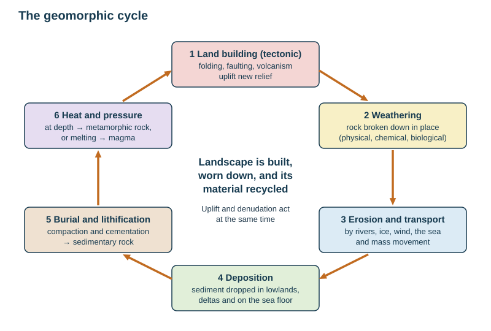
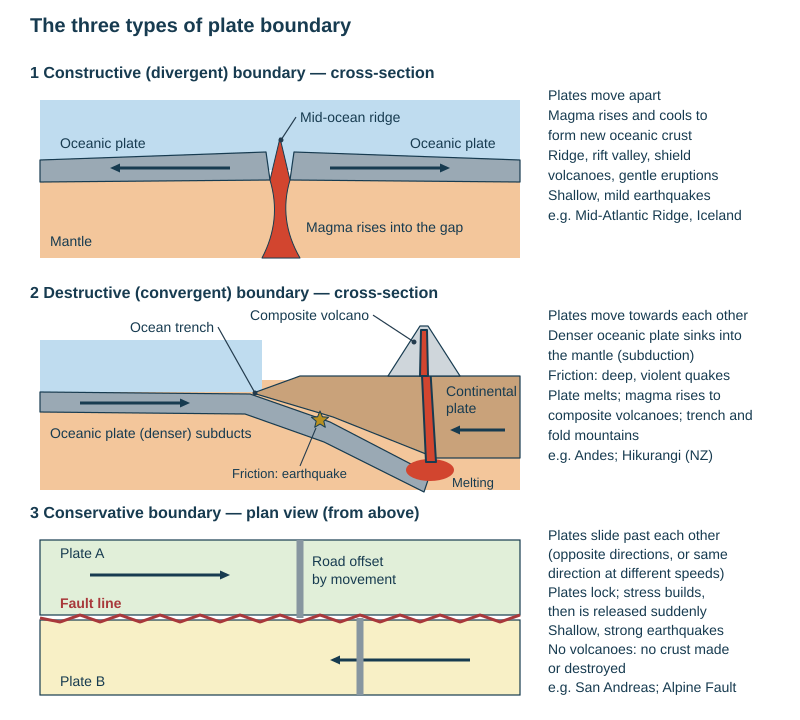
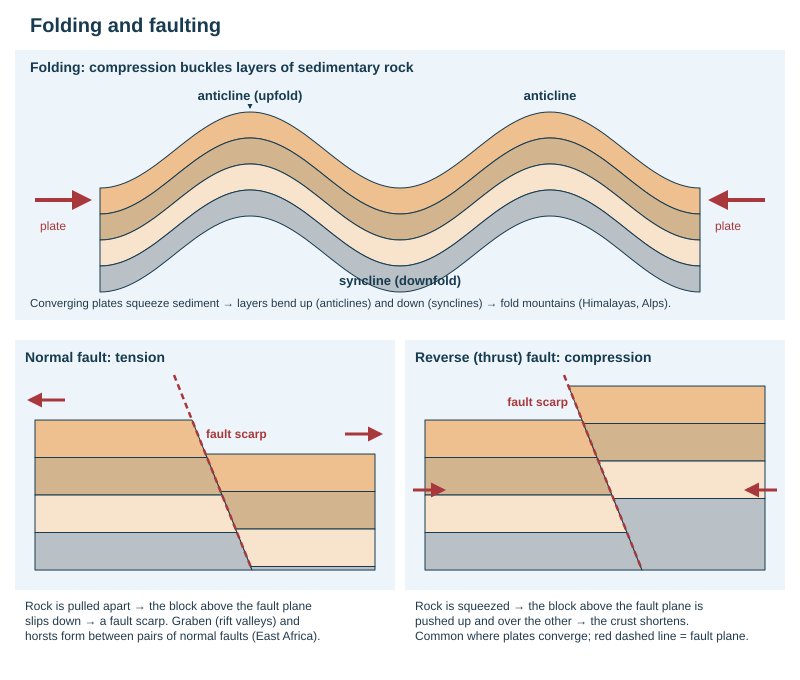
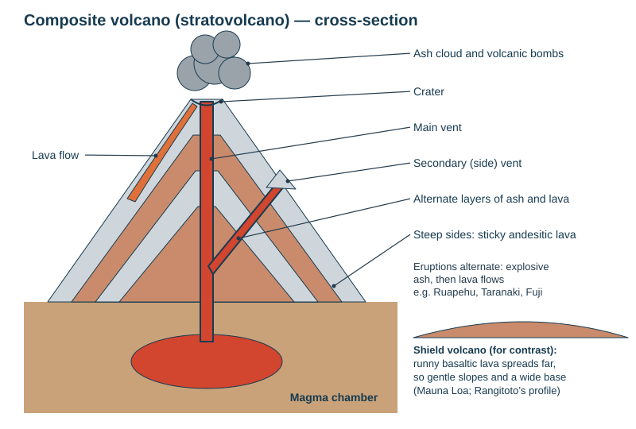
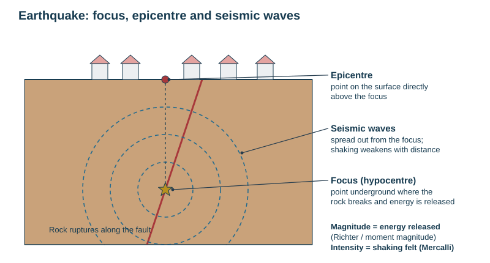

# The geomorphic cycle and plate tectonics

Theme 1, specification 1.1–1.2. Named examples: the Christchurch earthquake (2011) and the Whakaari / White Island eruption (2019). The full fact files are in [CASE-STUDIES.md](../CASE-STUDIES.md).

## The geomorphic cycle

The landscape is built, worn down, and its material is recycled — all at the same time.

| Stage | Processes | Result |
|---|---|---|
| Land building (tectonic) | folding, faulting, volcanism | new relief: fold mountains, volcanoes, fault scarps, block mountains |
| Land modifying (denudation) | weathering, then erosion, transport and deposition | relief worn down, valleys cut, sediment moved to lowlands and the sea |
| Recycling | sediment buried, compacted and cemented → **sedimentary** rock; heat and pressure → **metamorphic** rock; melting → magma → **igneous** rock | uplift brings the rock back to the surface to be eroded again |

- **Land-building processes:** folding, faulting, volcanism.
- **Land-modifying agents:** fluvial (rivers), glacial (ice), aeolian (wind), marine (waves), plus gravity (mass movement). A Term 2 question asked students to circle these: *aeolian, fluvial, glacial* — not faulting, folding or volcanism.
- **Denudation** = the four stages: weathering → erosion → transportation → deposition (see [Weathering](../notes/weathering.md)).
- **Rock types:** igneous (cooled magma: basalt, granite, andesite), sedimentary (layers of sediment: sandstone, limestone, mudstone), metamorphic (rock altered by heat and pressure: marble, schist).

*Causal chain.* Plate movement folds, faults and erupts rock into high relief → weathering loosens it and agents of erosion carry it downhill → it is deposited in lowlands and on the sea floor → burial compacts and cements it into sedimentary rock; heat and pressure turn some into metamorphic rock → plate movement uplifts it again.

## Structure of the Earth

| Layer | Composition and state | Notes |
|---|---|---|
| Inner core | solid iron and nickel | about 5000–6000 °C; solid because of the pressure |
| Outer core | liquid iron and nickel | generates the magnetic field |
| Mantle | dense silicate rock; solid but able to flow slowly; partly molten near the top (asthenosphere) | convection currents here drive the plates |
| Crust | **oceanic**: thin (5–10 km), dense, basaltic, young; **continental**: thick (25–70 km), less dense, granitic, old | the crust and rigid top of the mantle form the **lithosphere**, broken into plates |

- **Plate** = a rigid slab of lithosphere moving over the mantle.
- **Plate tectonics** = the theory that the lithosphere is divided into plates that move, and that most earthquakes, volcanoes and fold mountains form where they meet.
- **Oceanic crust is destroyed** (subducted) and created; **continental crust is too light to sink**, so it survives and is crumpled instead.

## Why plates move

*Causal chain of convection currents.* Radioactive decay heats the mantle → hot rock expands, becomes **less dense** and rises → near the crust it spreads sideways, cools, becomes **denser** and sinks → this circulation drags the plate above it → plates move a few centimetres a year.

- **Slab pull:** the cold, dense edge of a subducting plate sinks and pulls the rest of the plate after it.
- **Ridge push:** new, hot crust at a mid-ocean ridge stands high, and the plate slides away from it.

*This loses marks:* an answer that never says *why* material rises and sinks (density) is capped at 2 of 3.

## Plate boundaries

| Boundary | Movement | Processes | Landforms and hazards | Example |
|---|---|---|---|---|
| **Constructive** (divergent) | plates move apart | magma rises to fill the gap and cools into new crust | mid-ocean ridge, rift valley, shield volcanoes, gentle eruptions, shallow mild earthquakes | Mid-Atlantic Ridge, Iceland; East African Rift (on land) |
| **Destructive** (convergent, subduction) | oceanic plate meets continental or oceanic plate | the denser oceanic plate is **subducted**; friction; the plate melts at about 100 km depth and magma rises | deep-sea **trench**, fold mountains, **composite volcanoes**, explosive eruptions, deep and violent earthquakes, tsunami; island arcs where ocean meets ocean | Andes (Nazca under South America); Hikurangi subduction zone off the North Island; Japan |
| **Collision** (convergent, continent–continent) | two continental plates collide | neither subducts; crust is crumpled, thrust and uplifted | highest fold mountains, strong earthquakes, **no volcanoes** | Himalayas (Indian and Eurasian plates) |
| **Conservative** (transform) | plates slide past each other | friction locks them; stress builds and is released suddenly | fault line, offset roads and streams, shallow strong earthquakes, **no volcanoes** (no crust made or destroyed) | San Andreas Fault (USA); Alpine Fault (NZ, with some compression) |

**Hot spots** are plumes of magma rising through the middle of a plate, e.g. **Hawaii**: the plate moves over the fixed plume, leaving a chain of volcanoes. Auckland's volcanic field is an **intraplate** field fed by a magma source under the city.

### New Zealand's plate setting

- NZ lies on the boundary between the **Pacific** and **Australian** plates.
- East of the North Island the Pacific plate **subducts westward** under the Australian plate at the **Hikurangi subduction zone** → magma feeds the **Taupō Volcanic Zone** (Ruapehu, Tongariro, Ngāuruhoe, Taranaki to the west, Whakaari offshore, the Taupō and Okataina calderas).
- Through the South Island the plates **slide past and squeeze together** along the **Alpine Fault** → the **Southern Alps** are uplifted.
- South-west of Fiordland the direction flips: the Australian plate subducts under the Pacific plate (Puysegur).

### Global distribution

- Earthquakes, volcanoes and fold mountains lie in **long, narrow belts along plate boundaries**, because that is where plates collide, separate or grind past each other.
- The **Pacific Ring of Fire** (including NZ) holds most active volcanoes and the strongest earthquakes.
- Fold mountains line convergent margins: Andes, Rockies, Alps, Himalayas.
- Plate interiors have few, except **hot spots** (Hawaii) and intraplate fields (Auckland).

*Describing a distribution:* name the pattern (linear belts, clustered, around the Pacific), give named places, and note the exceptions.

## Folding and faulting

| Process | What happens | Landforms |
|---|---|---|
| **Folding** | compression buckles layers of sedimentary rock | **anticline** (upfold), **syncline** (downfold), overfolds, nappes (thrust folds) → fold mountains |
| **Faulting** | rock breaks under stress and the blocks move along the **fault** | **fault scarp** (steep face), **block mountain / horst** (block pushed up between faults), **rift valley / graben** (block dropped down between faults) |

- **Normal fault** — tension pulls rock apart; one block slips down.
- **Reverse (thrust) fault** — compression pushes one block up over the other.
- **Tear (strike-slip) fault** — blocks slide sideways (conservative boundaries).

*Causal chain of fold mountains.* Two plates converge → sediment that built up on the sea floor between them (the accretionary wedge) is scraped up and squeezed → layers buckle into anticlines and synclines and are thrust over one another → the crust thickens and, because continental crust is too light to sink, it is pushed upwards → a range of fold mountains forms, still rising while the plates converge. Examples: **Himalayas**, **Alps**, **Andes**. A fully annotated diagram, with the plates named and their movement shown, can earn the marks by itself.

## Volcanoes

**Volcano** = an opening in the crust through which magma, gas and ash erupt. **Magma** is molten rock underground; **lava** is magma at the surface.

**Features to label:** magma chamber, main vent, secondary (side) vent and parasitic cone, crater, layers of ash and lava, lava flow, ash cloud, volcanic bombs.

| Magma type | Silica | Viscosity and gas | Eruption | Landform | Example |
|---|---|---|---|---|---|
| **Basaltic** | low (~50%) | runny; gas escapes easily | frequent, gentle; lava flows travel far | **shield volcano** (wide, gentle slopes), lava plateau | Mauna Loa, Iceland; Rangitoto's lava shield |
| **Andesitic** | intermediate (~60%) | sticky; traps gas | explosive, alternating ash and lava | **composite cone** (stratovolcano): steep, layered | Ruapehu, Taranaki, Fuji |
| **Rhyolitic** | high (~70%) | very sticky; traps much gas | violently explosive; pyroclastic flows; huge ash falls | **lava dome**; **caldera** (collapsed crater after a huge eruption) | Taupō caldera (Lake Taupō), Mt Tarawera |

- **Active** = erupted recently and likely to again; **dormant** = not erupted for a long time but could; **extinct** = will not erupt again.
- **Caldera** — a huge basin formed when the ground collapses into an emptied magma chamber after a very large eruption.
- **Rangitoto** (field trip) — Auckland's youngest volcano, about 600 years old: an underwater eruption built a scoria cone and tuff ring, then basaltic lava flows built the broad shield shape.

| Volcanic hazard | What it is |
|---|---|
| **Pyroclastic flow** | fast (often over 100 km/h), extremely hot avalanche of gas, ash and rock — the main killer |
| **Lahar** | mudflow of ash and water from rain, a crater lake or melted snow, following valleys (Tangiwai, 1953: 151 deaths when a Ruapehu crater-lake lahar destroyed a rail bridge) |
| **Ash fall (tephra)** | collapses roofs, ruins crops, contaminates water, grounds aircraft |
| **Volcanic bombs** | large lumps of lava thrown from the vent |
| **Lava flow** | destroys everything in its path but usually slow enough to escape |
| **Gases** | CO₂ and sulphur dioxide; suffocation in hollows, acid rain |
| **Steam (phreatic) eruption** | groundwater flashes to steam and blasts rock and steam out with little warning (Whakaari 2019) |

## Earthquakes

**Earthquake** = a sudden shaking of the ground caused by the release of built-up stress when rocks break or slip along a fault.

- **Focus (hypocentre)** — the point underground where the rock breaks.
- **Epicentre** — the point on the surface directly above the focus; shaking is usually strongest here.
- **Seismic waves** — energy spreading out from the focus; they weaken with distance.
- **Shallow-focus** earthquakes (0–70 km) do more damage than deep ones because less energy is lost before the waves reach the surface.

| Measure | What it measures | Scale |
|---|---|---|
| **Magnitude** | energy released at the source | **Richter** scale; today the **moment magnitude** scale. Both logarithmic: each whole number = 10× the ground movement and about 32× the energy |
| **Intensity** | the effects felt and damage at a place | **Modified Mercalli** scale, I–XII; falls with distance from the epicentre |

Earthquakes are recorded by **seismometers** (seismographs) and studied by **seismologists**. *This loses marks:* confusing magnitude with intensity.

**Primary and secondary effects.**

| | Earthquake | Eruption |
|---|---|---|
| Primary (immediate) | buildings and bridges collapse, deaths and injuries, roads and pipes broken | pyroclastic flows, ash fall, lava, bombs, gas |
| Secondary (follow on) | **liquefaction**, landslides, **tsunami**, fires from broken gas pipes, disease from broken sewers, homelessness, lost jobs and business, insurance and rebuild costs | lahars, crop failure, famine, flooding, disruption to air travel, lost tourism |
| Environmental | landslides, uplift or subsidence, altered drainage | vegetation destroyed; later, fertile soils and new land |

- **Liquefaction** — shaking makes waterlogged, sandy soil behave like a liquid: buildings sink and tilt, silt bursts up through the ground.
- **Tsunami** — a series of huge sea waves caused when an undersea earthquake (or eruption, landslide) suddenly moves the sea floor and displaces the water above it.

## Why people live in hazardous areas

| Reason | Example |
|---|---|
| fertile volcanic and alluvial soils | farming on the volcanic soils of Waikato, Java |
| geothermal energy and tourism | Wairakei, Rotorua |
| minerals and building materials | sulphur, scoria quarries |
| flat coastal land, harbours, existing cities | Wellington, Tokyo |
| jobs, family ties, the cost of moving | most residents |
| **hazard perception** — people underestimate a risk they have not personally experienced, or trust monitoring and building codes | Auckland's volcanic field |

## Reducing the impacts: the four Ps

| | Earthquakes | Volcanoes |
|---|---|---|
| **Prediction and monitoring** | seismometers, records of past events, GPS strain; no reliable short-term prediction | gas emissions, ground swelling (tiltmeters, GPS), earthquake swarms, temperature — much more predictable; NZ's **volcanic alert levels 0–5** (GeoNet) |
| **Protection** (building design) | **aseismic** design: base isolation (rubber bearings), cross-bracing, deep foundations, flexible pipes, light roofs, retrofitting earthquake-prone buildings | strengthened sloping roofs; lava diversion channels and barriers; lahar warning systems |
| **Preparation** | drills such as **ShakeOut** ("drop, cover, hold"), emergency kits, trained services, tsunami warning sirens and blue lines | evacuation routes and plans, hazard maps, public education |
| **Planning** (land use) | avoid active faults and soft sediment; red-zone land that cannot be made safe; building codes enforced | exclusion zones, no building in lahar paths, restrict access when alert levels rise |

- Prediction is the weak point for earthquakes and the strong point for volcanoes — but **Whakaari 2019** showed that monitoring and a raised alert level do not protect people if access is still allowed. That contrast is the core of most evaluation answers.
- **HIC vs LIC:** HICs can afford monitoring, strict codes, insurance and fast emergency response, so deaths are lower but economic losses higher; LICs suffer far more deaths from the same magnitude (Haiti 2010, M7.0, with estimates from about 100 000 to over 300 000 deaths, vs Christchurch 2011, M6.2, 185 deaths).

## Named example: Christchurch earthquake, 22 February 2011

| | Details |
|---|---|
| When and where | 12:51 pm, 22 February 2011; epicentre about 10 km south-east of the CBD near Lyttelton; focus only about 5 km deep |
| Cause | rupture on a previously unknown fault, an aftershock of the 4 September 2010 Darfield (Canterbury) earthquake (M7.1, no deaths), as the Pacific–Australian plate boundary stress spread across Canterbury |
| Size | moment magnitude **6.2**, but extremely violent shaking (strong vertical acceleration) because it was shallow and close to the city |
| Social impacts | **185 deaths** (115 in the collapse of the CTV building), several thousand injured; thousands of homes damaged; the first-ever national state of emergency (declared 23 February) |
| Environmental | widespread **liquefaction** in the eastern suburbs (hundreds of thousands of tonnes of silt); rockfalls in the Port Hills; land subsidence |
| Economic | rebuild cost estimated at about **NZ\$40 billion**; much of the CBD demolished; businesses relocated |
| Responses | search and rescue (including international teams); the residential **red zone** — about 8000 properties on land judged too damaged to rebuild, bought by the government; stronger building rules for earthquake-prone buildings nationwide |
| Evaluation | modern building codes kept most houses standing, but older unreinforced masonry and a poorly designed office block caused most deaths; recovery took over a decade |

## Named example: Whakaari / White Island eruption, 9 December 2019

| | Details |
|---|---|
| Where | a privately owned andesitic volcano about 48 km off Whakatāne in the Bay of Plenty, NZ's most active cone volcano, on the subduction zone |
| What | a sudden **phreatic (steam-driven) eruption** at 2:11 pm, blasting steam, ash and rock across the crater floor |
| Impact | **47 people** on the island (most from a cruise ship); **22 died**, and most survivors suffered severe burns |
| Warning | GeoNet had raised the **alert level to 2** (moderate to heightened unrest) on 18 November 2019, yet tours continued |
| Response | helicopter pilots rescued survivors; specialist burn care in NZ and Australia; the island closed to visitors; WorkSafe prosecutions over health and safety |
| Evaluation | monitoring worked — the unrest was detected — but **access was not restricted**: hazard perception and commercial pressure outweighed the warning |

## This loses marks

- No density in the convection-current explanation.
- Calling the Alpine Fault purely destructive, or saying conservative boundaries have volcanoes.
- Mixing up magnitude (energy) with intensity (effects felt).
- Listing hazards without the mechanism (*how* a lahar forms, *why* andesitic eruptions are explosive).
- Management answers that name a method without saying how it reduces the impact.
