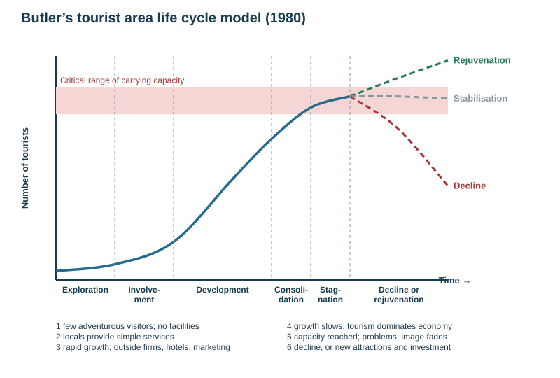

# Tourism: Vietnam

Theme 3, specification 3.5 (tertiary industry). The school's 2026 case study is **Vietnam**. Queenstown is a supporting NZ example. Fact files are in [CASE-STUDIES.md](../CASE-STUDIES.md).

## Tourism as a tertiary industry

- **Tertiary industry** = provides services to consumers rather than goods: retail, finance, education, health, transport, hospitality, tourism. As an economy develops, it shifts from primary to secondary to tertiary (see [globalisation](../notes/globalisation.md)).
- **Tourism** = travelling away from home for leisure, business or visiting friends and relatives, staying at least one night.
- **Domestic** tourism = within your own country; **international** = to another country.

| Type | Meaning | Example |
|---|---|---|
| **Mass tourism** | large numbers on package holidays to resorts | beach resorts at Nha Trang |
| **Ecotourism** | small-scale, nature-based, low impact, benefits local people and conservation | Phong Nha caves, Sa Pa homestays |
| **Cultural / heritage** | visiting historic sites, festivals and ways of life | Hội An, Huế |
| **Adventure** | active, risky activities | Queenstown bungy, trekking |
| **Business, medical, educational** | travel for work, treatment, study | |

## Why tourism has grown

| Factor | Mechanism |
|---|---|
| **Rising incomes (affluence)** | more disposable income for travel, especially the growing middle class in Asia |
| **More leisure time** | paid holidays, shorter working weeks, earlier retirement |
| **Cheaper, faster transport** | wide-bodied jets, budget airlines, more routes and airports |
| **Technology** | online booking, price comparison, social media promotion |
| **Ageing, healthy populations** | retired people with time and money travel outside peak season |
| **Political events and stability** | easier visas and peace open destinations; war, terrorism and pandemics close them |
| **Marketing and media** | films, influencers, government tourism campaigns |
| **Globalisation** | more business travel, migration, curiosity about other cultures |

**Attractions:** **natural** (climate, beaches, mountains, lakes, wildlife, scenery, caves, geothermal features) and **cultural / human** (history, architecture, religious sites, festivals, food, indigenous culture, sport, shopping, theme parks).

**Infrastructure** tourism needs: airports, roads and transport; accommodation; food and water supply; power; waste and sewage disposal; communications; retail; tour guides, operators and information services; health and safety services.

## Butler's tourist area life cycle model (1980)

| Stage | What happens |
|---|---|
| 1 **Exploration** | a few adventurous visitors; no tourist facilities; little impact |
| 2 **Involvement** | locals start providing accommodation and services; numbers grow |
| 3 **Development** | rapid growth; outside companies build hotels; heavy marketing; local control falls |
| 4 **Consolidation** | growth slows; tourism dominates the economy; some local resentment |
| 5 **Stagnation** | **carrying capacity** reached; environmental and social problems; the destination's image fades |
| 6 **Decline or rejuvenation** | visitors go elsewhere and facilities close — or new attractions, investment and marketing revive it |

- **Carrying capacity** = the maximum number of visitors an area can take before its environment or visitor experience is damaged.
- **Strengths:** simple; fits many resorts; warns planners. **Limitations:** not all places pass through every stage or at the same speed; it is hard to tell which stage a place is in until afterwards; ignores external shocks (COVID-19, disasters, politics).

## Impacts of tourism

| | Benefits | Problems |
|---|---|---|
| **Economic** | jobs in hotels, transport, guiding, retail; foreign currency and tax revenue; **multiplier effect** on farming, building and crafts; infrastructure that residents also use; diversification | many jobs seasonal, low-paid, unskilled; **leakage** — profits go to foreign-owned airlines, hotel chains and tour firms; land, food and housing prices rise; dependence on a volatile industry |
| **Social / cultural** | cultural exchange; revival of traditional crafts, festivals and languages; better services | loss or commercialisation of local culture ("staged authenticity"); crowding; crime, drugs, begging; resentment; locals priced out of housing |
| **Environmental** | money and incentive to conserve landscapes, wildlife and heritage (national parks, entry fees) | footpath erosion, litter, water and air pollution, sewage, disturbance of wildlife, coral damage, habitat cleared for resorts, high water and energy use, **emissions from flights** |

## Sustainable tourism

**Sustainable tourism** = tourism that meets the needs of today's visitors and host communities while protecting the environment and culture for the future.

| Strategy | How it works |
|---|---|
| **visitor caps, permits, booking systems** | keep use within carrying capacity |
| **entry fees and levies** reinvested in conservation | the visitor pays for protection |
| **boardwalks, marked tracks, hardened surfaces** | concentrate wear where it can be absorbed |
| **zoning** | separate busy areas from protected zones |
| **ecotourism and community-based tourism** (homestays, local guides) | keep income local and pressure low |
| **employment and training of local people** | more of the benefit stays in the area (less leakage) |
| **off-season promotion, spreading visitors to new areas** | eases pressure at peak times and places |
| **education and codes of conduct** | change visitor behaviour |
| **waste and plastic controls, renewable energy** | reduce pollution and emissions |

## Named example: tourism in Vietnam

### Growth

| Year | International arrivals |
|---|---|
| 2019 | about **18 million** (the pre-pandemic record) |
| 2020–2021 | collapse — borders closed in the COVID-19 pandemic |
| 2022 | about 3.7 million (reopened March 2022) |
| 2024 | about 17.6 million |
| **2025** | **about 21 million — a new record**, up about 20% on 2024 |

- **Top source markets (2025):** China (about 5.3 million), South Korea (about 4.3 million), then Taiwan, the USA and Japan; Asia supplies about four-fifths of visitors.
- **Revenue (2025):** total tourism revenue about VND 1 quadrillion (roughly **US\$38 billion**), about **8–9% of GDP**.
- **Target:** 25 million international visitors in 2026.

**Why tourism has grown in Vietnam:**
- **Đổi Mới** economic reforms (from 1986) opened the country to foreign investment and visitors.
- **Natural attractions:** limestone karst seascapes, caves, mountains, beaches, rice terraces, the Mekong Delta.
- **Cultural attractions:** ancient towns, imperial cities, temples, war history, food.
- **Low cost** for visitors; seen as **safe** and politically stable.
- **Easier visas:** 90-day e-visas for all nationalities from August 2023, and visa-free entry for many countries.
- **Budget airlines** (VietJet) and new and expanded airports; closeness to the huge Chinese and Korean markets.
- **Government strategy** and marketing; social media and films (the 2017 film *Kong: Skull Island* was shot at Ha Long and Tràng An).

### Key areas

| Area | Attraction | Notes |
|---|---|---|
| **Hạ Long Bay** (Quảng Ninh, north) | about 1600 limestone islands and pillars rising from the sea; caves; overnight boat cruises | UNESCO World Heritage (1994; extended to the Cát Bà archipelago in 2023); millions of visitors a year |
| **Hội An** (central) | well-preserved old trading port: Japanese Covered Bridge, merchant houses, lantern festivals, tailors | UNESCO 1999; entry tickets for the ancient town; floods from the Thu Bồn river most years |
| **Sa Pa** (Lào Cai, north-west mountains) | terraced rice fields, trekking, ethnic minority villages (Hmong, Red Dao), **Fansipan** (3143 m, Indochina's highest peak) | a cable car opened in 2016 cut a two-day trek to about 20 minutes; rapid hotel growth |
| **Phong Nha–Kẻ Bàng National Park** (central) | huge karst caves including **Sơn Đoòng**, the world's largest cave passage | UNESCO 2003; Sơn Đoòng tours strictly limited in number and very expensive (ecotourism) |
| **Huế** | the Imperial City of the Nguyễn emperors | UNESCO 1993 |
| **Tràng An** (Ninh Bình) | karst towers, rivers and caves by boat; temples | UNESCO mixed site 2014 |
| **Phú Quốc** (island, south) | beach resorts, casinos, cable car | visa-free special zone; rapid resort construction |
| Hà Nội, Hồ Chí Minh City, Đà Nẵng, Mekong Delta | Old Quarter, war history (Củ Chi tunnels), beaches and the Golden Bridge, floating markets | cities and resorts |

### Impacts in Vietnam

| | Positive | Negative |
|---|---|---|
| **Economic** | millions of jobs (hotels, restaurants, guides, transport, crafts); foreign currency; income for poor rural regions (homestays in Sa Pa); multiplier effect; investment in airports and roads | **leakage** to foreign-owned resorts, airlines and tour firms; low-paid, seasonal work; dependence on China and Korea; collapse during COVID-19; rising land prices |
| **Social / cultural** | income for ethnic minority families; revival of crafts (Hội An lanterns, Sa Pa textiles); cultural exchange | commercialisation of minority culture in Sa Pa; children selling souvenirs instead of attending school; overcrowding of Hội An's narrow streets; locals displaced by resort development; noise |
| **Environmental** | entry fees fund conservation; protected status for Hạ Long and Phong Nha | **Hạ Long Bay:** waste and wastewater from tour boats, hotels and the growing city, plastic litter, damage to coral and mangroves (plus nearby coal mining and industry); **Sa Pa:** hillside hotel construction, landslides, pressure on water supply; **Phú Quốc:** forest cleared for resorts; air travel emissions |

### Management

- **Hạ Long Bay:** limits on licensed tour boats and overnight routes, waterway zoning, a ban on single-use plastic on tourist boats and at sites (from 1 September 2019, enforced with fines and suspensions), upgrading wastewater treatment, entrance fees, a management plan under UNESCO monitoring.
- **Hội An:** **ticketing** for the ancient town (introduced 1995, reintroduced 2022 and tightened for tour groups in 2024) with revenue for restoring old houses; pedestrian-only streets and limits on vehicles in the old town.
- **Phong Nha–Kẻ Bàng:** caps on visitor numbers to Sơn Đoòng and other caves, licensed guides — high-value, low-volume **ecotourism**.
- **Sa Pa:** **community-based tourism** and homestays so minority families earn directly; local guide training.
- **National:** the tourism development strategy to 2030 aims for "green" and sustainable growth, spreading visitors to new regions.
- **Evaluation:** visitor numbers keep breaking records, so pressure is rising faster than management can respond; ticketing and caps work best at small sites; Hạ Long's pollution comes from industry and urban growth as well as tourism.

## Supporting NZ example: Queenstown

- Natural attractions (lakes, mountains, ski fields, Milford Sound trips) and adventure activities (the world's first commercial bungy jump, 1988) bring visitors all year.
- **Benefits:** jobs, an international airport, high incomes. **Problems:** housing too expensive for workers, congestion, pressure on water and sewerage, and near-total collapse during the COVID-19 border closure (March 2020).

## Why countries keep investing in tourism despite market swings

It earns foreign exchange; it employs many people with little training; it spreads income to regions with few other industries; it uses landscapes and culture that cannot be exported any other way; and demand has always recovered after shocks (Vietnam beat its 2019 record by 2025). But diversification reduces the risk.

## This loses marks

- Listing impacts without saying who is affected and where.
- Butler stages named without what happens in each.
- Sustainable tourism methods without how they reduce the impact.
- Vietnam facts without places, dates or figures.
