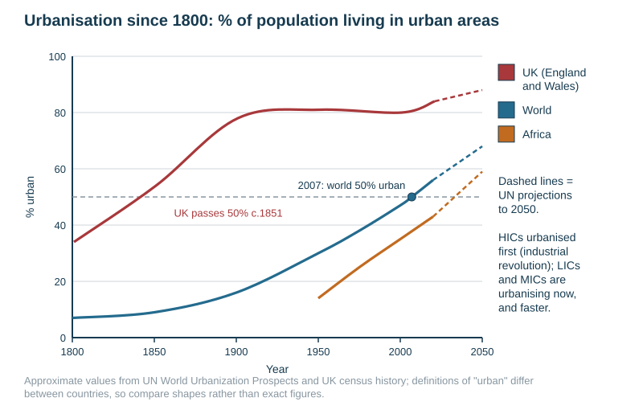
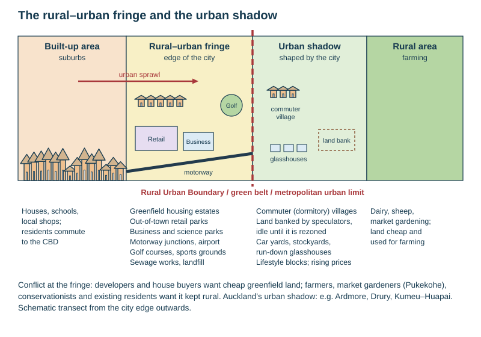
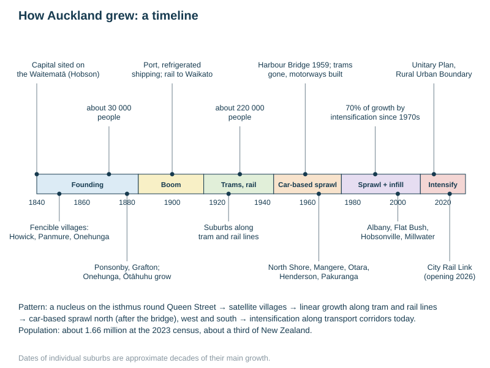

# Urban change and issues in HICs

Specification objectives 2.9 and 2.11 (change and problems). The named examples are **Auckland** (growth, sprawl, intensification and infrastructure) and **London Docklands** (an inner-city problem area). Full case studies are in [CASE-STUDIES.md](../CASE-STUDIES.md). Urban fieldwork methods are on [Graphs, statistics and fieldwork](../notes/data-fieldwork.md).

## Contents

- Urbanisation since 1700
- The cycle of urban change
- Suburbanisation and suburbia
- Urban sprawl
- The rural–urban fringe: land uses and conflicts
- The urban shadow
- Counter-urbanisation
- Green belts and urban limits
- Intensification: infill and the compact city
- Inner-city decay
- Redevelopment, regeneration, gentrification and re-urbanisation
- Urban problems and solutions: traffic, housing, pollution, infrastructure
- Auckland: growth over time
- Auckland: problems and solutions evaluated

## Urbanisation since 1700

| Term | Meaning |
|---|---|
| **Urbanisation** | an increase in the **proportion** of a population living in urban areas |
| **Urban growth** | an increase in the urban **population or built-up area** |
| **Megacity** | an urban area of over 10 million people (Tokyo, Delhi, Shanghai, São Paulo, Mumbai) |
| **Millionaire city** | a city of over a million people |

| Period | Pattern | Reasons |
|---|---|---|
| Before 1700 | the world about 5% urban; a few large cities (Rome in ancient times; Beijing, Istanbul, London) | most people farmed; cities were trade, religious and government centres |
| 1700–1850 | **Britain urbanises first**: over half its people urban by about 1851. The rest of the world is still rural | the **agricultural revolution** released farm labour (enclosure, machines); the **industrial revolution** put factories on coalfields and at ports; canals and railways |
| 1850–1950 | Europe, North America, Australia, New Zealand and Japan urbanise. World urban share about 30% by 1950 | industrialisation spread; mass emigration to the New World's cities; trams and railways; better sanitation lowered urban death rates |
| 1950–now | **rapid urbanisation in LICs and MICs** in Latin America, Asia and Africa. The world passed 50% urban in about **2007** and is about 55–57% now. HICs are 75–90% urban and growing slowly; some HIC cities shrink (Detroit) | rural-to-urban migration plus high natural increase in the cities; industrialisation and globalisation (China); push factors in rural areas |
| Projected | about two-thirds of the world urban by 2050; nearly all the growth in Asia and Africa (India, China, Nigeria) | |

**Spatial pattern today.**
- Most urbanised: North America, Europe, Latin America (about 80%), Australia and New Zealand (New Zealand about 87%).
- Least urbanised: sub-Saharan Africa and South Asia (about 35–45%), but these are urbanising fastest.
- Latin America urbanised early for an LIC/MIC region.
- The essay mark scheme rewards *place-specific and historical* detail ("UK over 50% urban by 1851") and models such as the urbanisation curve, not just "the industrial revolution".

**The urbanisation curve (S-curve).** Each country passes through three stages: slow (rural, under 25%), rapid (industrialising), then levelling off at about 75–90%. HICs are at the top; most LICs are in the steep middle.

## The cycle of urban change in HICs

1. **Urbanisation.** People move into the city from the countryside.
2. **Suburbanisation.** People move from the inner city to the suburbs.
3. **Counter-urbanisation.** People move out of the city altogether, to small towns and villages.
4. **Re-urbanisation.** People move back into the regenerated inner city.

Each stage can happen in the same city at the same time, in different groups.

## Suburbanisation and suburbia

- **Suburbanisation** is the outward growth of the urban area, as housing spreads onto the edge with residents commuting back in.
- **Suburbia** is the residential areas that result: low-density housing with gardens on the edge of a city.

**Why cities grew rapidly outwards (from about 1900, and especially after 1945):**
- **Transport.** Trams, suburban railways and buses, then mass car ownership after the 1950s, cut the time cost of distance (the "streetcar suburbs" and then the car suburbs).
- **Cheaper land** on the edge allowed larger houses and gardens.
- **Rising incomes** and mortgages let families buy their own homes.
- **Population growth**: the post-war baby boom.
- **Push from the inner city**: old, overcrowded, polluted housing and slum clearance.
- **Government housing**: council and state-house estates on the edge; New Zealand's state houses from 1937.

**Features of the suburbs, and why they were possible:**
- Detached and semi-detached houses with front and back gardens, garages, cul-de-sacs and crescents, all possible because land was cheaper.
- Low density.
- **Services followed the people.** As distance from the CBD grew, people could not walk to it, so suburban shopping parades, then shopping centres, schools, churches, libraries, parks and sports grounds developed to serve local needs (low- and middle-order services close to home).
- Later, business parks and out-of-town retail.

**Commuting** is the daily journey to work and back. It became necessary because homes moved out while jobs stayed in the CBD and inner industrial areas. It was made possible by trams, trains and cars, and it causes rush-hour congestion.

| Private estates | Council (state) estates |
|---|---|
| built by private developers for sale, mainly to middle-income buyers | built by the council or government to rent to lower-income families |
| detached and semi-detached houses, gardens, garages, varied designs, cul-de-sacs | uniform houses, terraces or flats, often in large blocks; built quickly and cheaply |
| greenfield sites on the fringe, near main roads | on the edge (Ōtara, Mangere, Porirua) or replacing inner-city slums |
| purpose: profit; meet demand for home ownership | purpose: rehouse slum-clearance families and low-income workers |

**Effects of suburbanisation.**
- Urban sprawl and the loss of farmland.
- Long commutes and congestion.
- Car dependence and pollution.
- The inner city loses wealthier residents, its rates income and shops, which leads to decay.
- New infrastructure (roads, pipes, schools) is costly to extend.

## Urban sprawl

**Urban sprawl** is the uncontrolled outward spread of a city's built-up area onto surrounding rural land, usually at low density.

| Causes | Problems |
|---|---|
| population growth and immigration | loss of farmland, including the best soils (Pukekohe's market gardens) and habitats |
| cheaper greenfield land; developers prefer it | long commutes, congestion, car dependence, emissions |
| car ownership and motorways | expensive infrastructure: roads, water, sewerage, schools and buses stretched over a wide area |
| the demand for larger houses and gardens | a weaker CBD and inner city |
| weak planning controls | social isolation for those without cars; less community |

**Example: Atlanta, USA** (from the school's worksheet). It is one of the most sprawling cities in the world: low-density car-based suburbs spread across a huge area with few natural barriers. It has long commutes and heavy traffic, poor public transport (hard to run at low density), loss of forest, and air pollution.

**Example: Auckland.** Squeezed by two harbours, the city sprawled north (after the Harbour Bridge, 1959), west and south. Since the 1970s, about 70% of growth has come through intensification and 30% through sprawl. Recent greenfield growth: Flat Bush, Takanini, Hobsonville, Millwater, Drury and Pōkeno.

**Solutions to sprawl:** green belts and urban limits; brownfield redevelopment; intensification; better public transport; higher-density zoning (each is evaluated below).

## The rural–urban fringe

**The rural–urban fringe** is the transition zone where the built-up area meets the countryside. It has a mix of urban and rural land uses.

**Development after the 1960s:**
- Private housing estates on **greenfield** (never built on) sites.
- Council estates.
- Out-of-town retail parks and regional shopping centres.
- Business and science parks; motorway junctions, ring roads, airports.
- Golf courses, garden centres, sports grounds.
- Hospitals, universities, sewage works and landfill (bad-neighbour uses pushed out of the city).

**Why the fringe had become popular by 2000:**
- The land is large, flat and cheap.
- It has motorway access and space for parking.
- It is pleasant, with a green environment.
- There is little congestion.
- There is room to expand.
- Firms and shoppers are car-based.
- Planners zoned growth there.

**Conflicts over the fringe:**

| Want development | Oppose it |
|---|---|
| developers and builders (profit) | farmers and market gardeners: lost land; trespass, vandalism and complaints from new neighbours |
| house buyers (affordable homes) | conservationists: habitats, landscape, streams |
| retailers and businesses (cheap sites, access) | existing residents: traffic, noise, lost views, falling quiet |
| councils (rates, housing targets) | inner-city businesses: lose trade to out-of-town retail |

**Auckland's fringe** has spread south (Takanini, Drury, Pukekohe) and north-west (Kumeū, Huapai, Whenuapai). Market gardeners at Pukekohe, which grows a large share of New Zealand's vegetables, say they are being squeezed by urban sprawl.

## The urban shadow

The **urban shadow** is the area beyond the fringe that is still rural in appearance, but whose land use, prices and population are shaped by the nearby city. It is "in the shadow" of future urban growth. (Auckland's example in the school's notes is the fringe at Ardmore.)

- **Land is constantly changing.** Landowners and speculators buy farmland and **hold it undeveloped** (land banking), waiting for its value to rise when it is rezoned for housing.
- Rising land values eventually bring development and further sprawl.
- In the meantime there are **haphazard, small-scale, temporary activities**: car yards, half-finished housing projects, old farmhouses, stockyards and glasshouses falling into disrepair, lifestyle blocks and horse paddocks.
- **Commuter (dormitory) villages** grow because residents work in the city.
- Farming becomes less intensive, because farmers expect to sell.

## Counter-urbanisation

**Counter-urbanisation** is the movement of people from cities to smaller towns, villages and rural areas, beyond the continuous built-up area.

| Push from the city | Pull of the countryside | Made possible by |
|---|---|---|
| congestion, pollution, noise, crime | peace, space, a clean environment, a sense of community | car ownership, motorways |
| high house prices | cheaper or larger houses, lifestyle blocks | working from home, broadband, remote working (much more since COVID-19) |
| | retirement destinations (Kerikeri, the Kāpiti Coast, Tauranga) | pensions and savings |

**Effects on rural areas.**
- *Positive:* new residents bring money; property is renovated; some services gain customers.
- *Negative:* house prices rise beyond local young people's reach; commuters shop in the city, so village shops close; the village is empty by day (a dormitory village); traffic grows; second homes stand empty; there is conflict between newcomers and locals.

## Green belts and urban limits

| Tool | Meaning | Example |
|---|---|---|
| **Green belt** | a ring of protected countryside round a city where building is strictly controlled | London (from 1938 and 1955), other British cities |
| **Metropolitan Urban Limit (MUL)** / **urban growth boundary** | a line beyond which urban development is not allowed | Auckland's MUL, replaced in 2016 |
| **Rural Urban Boundary (RUB)** | Auckland's line under the **Unitary Plan (2016)** marking where urban growth may occur up to about 2040; it allows some planned greenfield expansion | Drury, Pukekohe, Silverdale and Whenuapai inside the RUB |

| Advantages | Disadvantages |
|---|---|
| stop sprawl and protect farmland, landscape and habitats | raise land and house prices inside the limit (scarce land) |
| push development into brownfield sites and intensification | "leapfrog" development: growth jumps beyond the belt into commuter towns, lengthening commutes |
| keep public transport and infrastructure efficient | pressure to move the boundary out; inconsistent enforcement |
| preserve the separate identity of towns | |

## Intensification: infill and the compact city

**Intensification** means fitting more homes and people **inside** the existing urban area instead of spreading outwards. The aim is a **compact city**: more people living close to jobs, services and public transport.

| Method | Example |
|---|---|
| **Infill housing**: building on spare land between or behind existing houses (back sections), or on old quarries and racecourses | Stonefields (a former quarry: apartments, townhouses and green space); Three Kings quarry; Alexandra Park |
| **Subdivision** of large sections into several townhouses | 5–6 two- or three-storey townhouses on a plot that had one old state house |
| **Brownfield redevelopment** of old industrial land | Hobsonville Point (a former air-force base); Wynyard Quarter |
| **High-density apartments** in town centres and along transport corridors | the CBD (population up about 200%); Newmarket, New Lynn, Takapuna |
| **Regeneration of state-housing land** | the **Tāmaki regeneration** in Glen Innes and Point England (Fenchurch Street): low-density 1960s state houses on large sections cleared from 2015–16 and replaced by denser townhouses. Only part of the new housing is state or affordable; the rest is sold for profit |

**The Auckland Unitary Plan (2016)** zones density by distance from transport:
- higher densities along main transport corridors (Remuera Road, Great South Road, Manukau Road, rail lines);
- a **centres-based approach**: nodes of intensification round town centres and transport hubs (New Lynn, Avondale, Takapuna, Newmarket, Manukau);
- most of Auckland to have "moderate change";
- growth split between intensification within the urban area and planned greenfield land.

| Residential zone | Share of urban land | Maximum height |
|---|---|---|
| Terrace Housing and Apartment Buildings | 5% | 4 storeys next to most centres, up to 6 next to others |
| Mixed Housing Urban | 10% | 3 storeys |
| Mixed Housing Suburban | 40% | 2 storeys |
| Single House | 32% | 1–2 storeys |
| Large Lot | 9% | low density |
| Rural and Coastal settlement | 4% | low density |

**Later changes.**
- National rules from 2021 allowed three homes of up to three storeys on most sites; this was Auckland's Plan Change 78.
- In 2025 the council notified **Plan Change 120** to replace it. It concentrates higher buildings (six storeys or more) within walking distance of the city centre, metropolitan centres and rapid-transit stations, with up to 10–15 storeys round some Western Line stations. It drops the blanket three-storey rule in less accessible and hazard-prone areas.
- **Demographic change** drives the need: Auckland's households of one or two people will soon outnumber households with children.

**Evaluating intensification** (the September 2026 homework):

| For: the need for housing | Against: the issues it causes |
|---|---|
| houses more people without losing farmland or extending pipes and roads | school rolls and local services (doctors, parks, parking) are strained |
| supports public transport, since enough people live within walking distance of stations (the CRL) | changes neighbourhood character; heritage villas and trees are lost |
| shorter commutes, fewer emissions | shading, overlooking, loss of privacy and sunlight |
| more affordable, smaller homes for smaller households | old water, wastewater and stormwater pipes overloaded; flooding risk (January 2023) |
| revitalises town centres | infill townhouses can be poor quality; profits go to developers |

Verdict pattern: intensification is necessary and efficient **if** infrastructure (schools, pipes, transport) is upgraded at the same pace and design is controlled.

## Inner-city decay

**Inner-city decay** (urban decline) is the deterioration of the inner city's economy, housing, environment and community.

**Causal chain.**
1. Old industries close (deindustrialisation), because of foreign competition, containerisation moving ports downstream, and the need for bigger sites.
2. Jobs are lost, so there is unemployment and poverty.
3. Wealthier residents move to the suburbs, so rates income falls and shops close.
4. Housing and services decay; derelict land and empty buildings appear.
5. Crime, vandalism and graffiti rise, and the area's image worsens, so investment stays away.
6. The cycle of decline is self-reinforcing.

**Characteristics:**
- derelict factories and warehouses; vacant land;
- old terraced housing in poor repair, often lacking amenities; 1960s high-rise blocks;
- overcrowding; high unemployment;
- low incomes, a concentration of the elderly and of ethnic minorities, social problems, crime;
- a poor environment, with pollution, traffic and little green space.

**Extreme example: Detroit, USA.** The car industry declined, and wealthy and middle-class residents left for the suburbs. The population fell from about 1.85 million in 1950 to about 640 000 by 2020, leaving tens of thousands of abandoned houses. The city went bankrupt in 2013.

## Redevelopment, regeneration, gentrification and re-urbanisation

| Strategy | Meaning | Example | Evaluation |
|---|---|---|---|
| **Comprehensive redevelopment** (1950s–70s) | bulldoze slums and rebuild, often as high-rise flats and ring roads | British slum clearance | new amenities, but communities broken up; tower blocks became new problem estates |
| **Urban renewal / improvement** | improve existing housing and the environment instead of demolishing | grants for repairs | keeps communities; slower, piecemeal |
| **Regeneration (property-led)** | public agencies attract private investment to transform an area: offices, housing, transport | **London Docklands** (1981–98); Auckland's Britomart and Wynyard Quarter | jobs and buildings, but benefits may go to newcomers rather than original residents |
| **Gentrification** | higher-income people buy and improve run-down inner-city housing, raising prices | Ponsonby, Grey Lynn, Kingsland (Auckland); Islington (London) | better housing and shops and a higher tax base, but poorer residents are priced out and displaced |
| **Re-urbanisation** | people move back into the inner city, attracted by regenerated areas, jobs and apartments | Auckland CBD apartments; London | revives the centre and supports public transport; can be limited to the young and wealthy |
| **Olympic-led regeneration** | an event used to regenerate a district | Stratford, east London, for the 2012 Olympics (a school video) | new transport, parks and housing, but rising prices |

**London Docklands (the named inner-city example).**
- **Problem.** The docks closed between the late 1960s and 1981 as ships moved to deep-water container ports downstream. This left derelict land, high unemployment and poor housing.
- **Response.** The **London Docklands Development Corporation (1981–1998)** used public money to attract private investment: **Canary Wharf** offices, the **Docklands Light Railway** (1987), London City Airport and the Jubilee Line extension.
- **Outcome.** About 24 000 new homes; jobs rose from about 27 000 to over 80 000 (approximate).
- **Evaluation.** A physical and economic success, but many new jobs went to commuters rather than former dockers, and rising house prices displaced long-standing residents (gentrification).

## Urban problems and solutions, evaluated

| Problem | Causes | Solutions | Evaluation |
|---|---|---|---|
| **Traffic congestion** | sprawl separates homes from jobs; car dependence; a narrow isthmus funnels traffic onto a few routes; poor public transport historically | rapid transit: the **Northern Busway** (2008), electrified rail (2014–15), the **City Rail Link**; motorway building (the **Western Ring Route**, completed by the Waterview tunnels in 2017); park-and-ride; cycleways; bus lanes; proposed time-of-use (congestion) charging; intensification near stations | motorways ease congestion only until new traffic fills them (induced demand). Public transport works only where density is high enough. Charging is effective (London, Stockholm) but unpopular and hits poorer drivers |
| **Housing shortage and cost** | growth faster than building; land limits; zoning; investment buying | intensification and upzoning; the RUB releasing greenfield land; state housing (Kāinga Ora); Tāmaki regeneration | supply has risen strongly since about 2016, but prices remain high. Quality and infrastructure lag |
| **Pollution** (air, water, noise) | vehicle exhaust; industry; stormwater and wastewater overflows into harbours and beaches | electric trains and buses; cleaner fuel standards; the **Central Interceptor** wastewater tunnel to cut overflows; stormwater upgrades | slow and expensive; emissions are still dominated by cars |
| **Infrastructure provision** (water, sewerage, roads, schools, power) | rapid growth; ageing pipes; sprawl stretching networks; floods | big projects (CRL, Central Interceptor, new reservoirs); development contributions from developers; growth directed to where pipes already exist | huge costs (the CRL about NZ\$5.5 billion); funding disputes between council and government |
| **Urban sprawl** | see above | RUB, green belts, intensification, brownfield first | protects farmland but can raise prices |
| **Inner-city decay** | see above | regeneration, gentrification, re-urbanisation | judge by jobs and homes created *and* who benefited |

## Auckland: growth over time

| Stage | What happened |
|---|---|
| **Before 1840** | Māori iwi settled on the flanks of the volcanic cones: Maungakiekie (One Tree Hill), Maungawhau (Mt Eden), Maungarei (Mt Wellington), Māngere Mountain. The cones were fortified pā with fertile volcanic soils |
| **1840** | Governor Hobson chose Auckland as the site of New Zealand's capital, replacing Kororāreka (Russell). It lay on the main transport route between Dargaville and Taupō. The town was planned round present-day **Queen Street**, with other nuclei of commerce at Freemans Bay and Mechanics Bay |
| **1840s** | Growth west and south. **Fencible** (soldier-settler) villages at Howick, Panmure and Onehunga: satellite settlements of the town |
| **Later 19th century** | Onehunga grew in the 1850s; villages at Epsom, Newmarket, Mt St John, Ōtāhuhu, Panmure and Howick. About **30 000** people by 1872. Expansion in the 1880s, driven by credit and loans, into Ponsonby and Grafton. Ōtāhuhu and Onehunga became major settlements on the southern harbour |
| **Boom years, 1885–1914** | The **Port of Auckland** drove growth: refrigerated shipping and rising commodity prices made it the North Island's main port and city. Early 20th-century industry let it leapfrog other regions, helped by the **rail link to the Waikato** and its dairy expansion |
| **Why central Auckland grew fast in the early 20th century** | well-serviced sites and industrial and commercial hubs; road connections; rail and sea terminals; **land reclaimed from the sea**; a ready supply of labour. About **220 000** people by 1930 |
| **1911–1945** | Population and industry decentralised. Tram and rail extensions to the suburbs, then buses and cars; New Lynn and Ōtāhuhu grew. After 1945, a loosely **linear** pattern from Papakura in the south to Long Bay in the north, with State Highway 1 and the main railway in the middle |
| **1950s–1960s sprawl** | The **Harbour Bridge (1959)** caused rapid North Shore growth (Northcote, Birkenhead, Takapuna, Glenfield, the East Coast Bays). Car ownership rose. The North-Western Motorway was built in the 1960s, and the trams were removed by 1956, a shift to car-based sprawl. West (Mt Roskill, New Lynn, Henderson) and South (Māngere, Manurewa, Papatoetoe, Ōtara) grew in the 1960s; East (Pakuranga) in the 1970s |
| **Since the 1970s** | About **70% of growth through intensification, 30% through further sprawl**. Sprawl in the 1980s–2010s: Botany, Flat Bush, East Tāmaki, Takanini, Ormiston and Drury; Albany, Oteha Valley and Long Bay; Hobsonville and West Harbour. Satellite growth at Ōrewa, Millwater, Whangaparāoa, Pōkeno and Kumeū–Huapai |
| **1996–2018** | Growth round the airport industrial area and East Auckland; Waiheke Island a focus from 1996. By 2018 Omaha, Matakana, Helensville, Waiuku and Silverdale were outlying urban areas. **CBD intensification** (apartment towers) gave a population rise of about 200% |
| **2010 onwards** | One "Super City" council (2010); the Unitary Plan (2016); the Waterview tunnels (2017); the City Rail Link (its opening on 13 September 2026 was announced in August 2026); intensification under Plan Changes 78 and 120 |
| **Today** | about **1.66 million** people (2023 census), about a third of New Zealand, and forecast to keep growing |

**The CBD and suburban growth.**
- The CBD is the main business core, mostly on reclaimed land. Bid rent drives intensification in height: high-rise offices, banks, finance, insurance and legal firms, with entertainment and dining precincts.
- Suburban growth was linked to growing wealth, better transport (buses, rail, the Dominion Road tram, cars, bicycles) and rising living standards.

## Auckland: problems and solutions evaluated

- **Site constraint.** Auckland sits on a narrow isthmus between the Waitematā and Manukau harbours, just over a kilometre wide at Ōtāhuhu. Growth is forced north, west and south, and traffic funnels through a few corridors (the Harbour Bridge, the Southern Motorway).
- **Transport.** The Northern Busway (2008) carries large numbers across the bridge corridor. The Waterview Connection (2017) completed the Western Ring Route, an alternative to State Highway 1 through the centre. The City Rail Link turns Britomart into a through-station, roughly doubling rail capacity. The Waikato Expressway (completed 2022) and the Te Huia train (2021) link Hamilton commuters.
  - *Evaluation:* rail and busway patronage has grown, but most trips are still by car, and new roads attract more traffic.
- **Urban sprawl.** The RUB and intensification (above). *Evaluation:* farmland at Pukekohe is still being lost, and greenfield suburbs such as Drury lack transport at first.
- **Infrastructure.** Watercare's Central Interceptor; stormwater upgrades after the **27 January 2023 floods**; new schools. *Evaluation:* very costly, and always catching up with growth.
- **"Auckland is overpopulated" (a 2024 essay).**
  - *For:* congestion, housing costs, overloaded pipes and schools, flooding.
  - *Against:* the benefits of size (jobs, universities, a skilled workforce, international links, enough density for good public transport) and the solutions in progress.
  - *Conclusion:* Auckland is not overpopulated in the population–resource sense; its problems come from infrastructure lagging behind growth. Whether that is fixed depends on funding and planning.

## Common exam errors

- Confusing **urbanisation** (a rising proportion) with **urban growth** (more people or area).
- Confusing **suburbanisation** (moving to the edge of the same city) with **counter-urbanisation** (leaving the city for small towns and villages).
- Writing "Auckland has traffic problems" with no named project, date or figure.
- Evaluating with "it worked". State the criterion: journey times, homes built, farmland saved, or who benefited.
