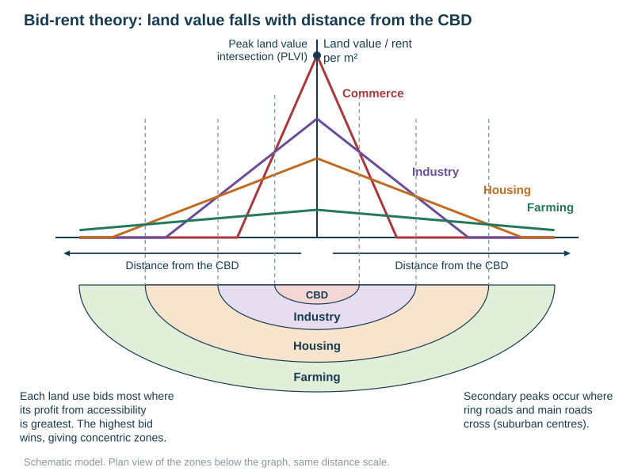
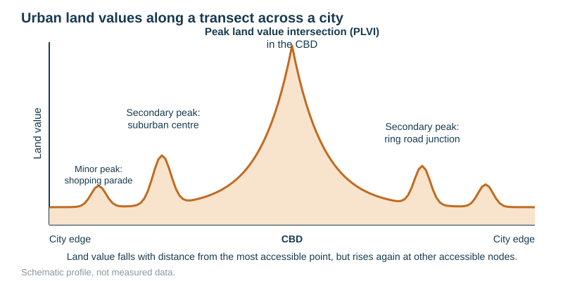
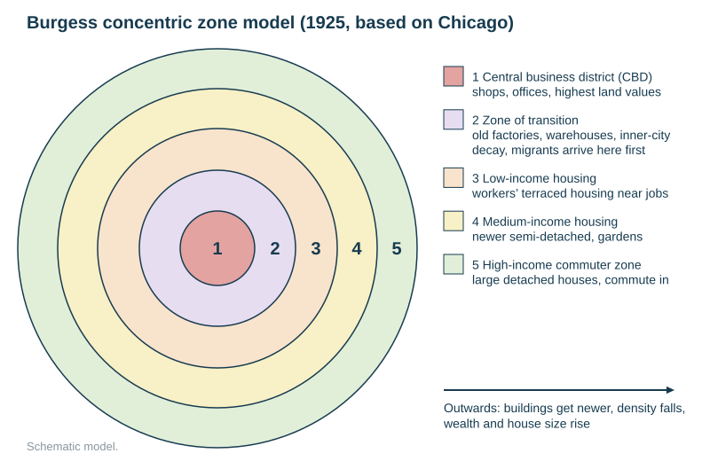
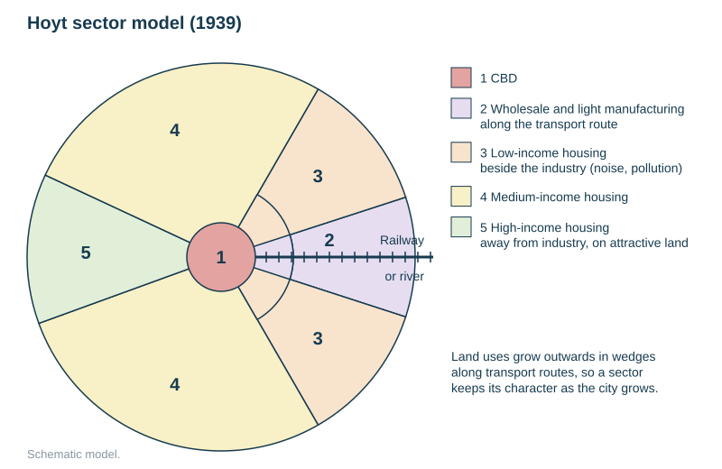
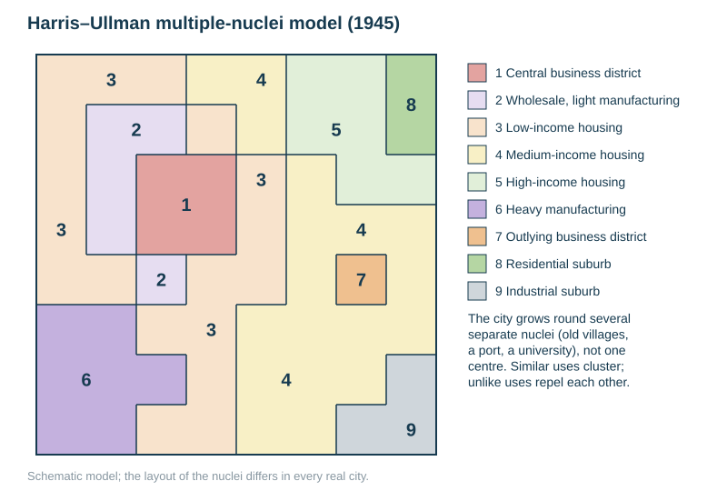
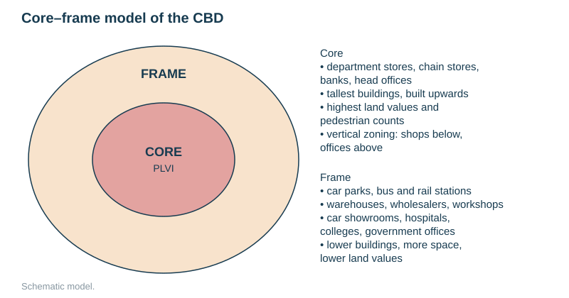
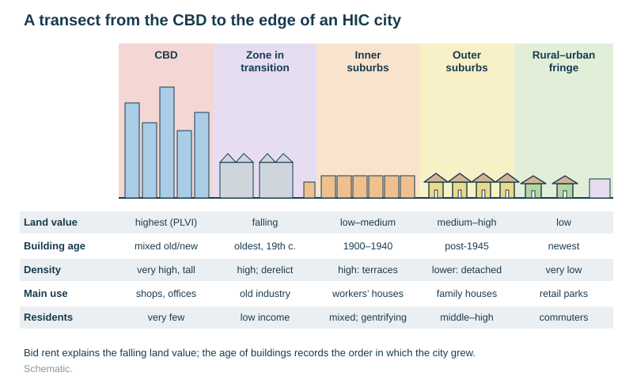
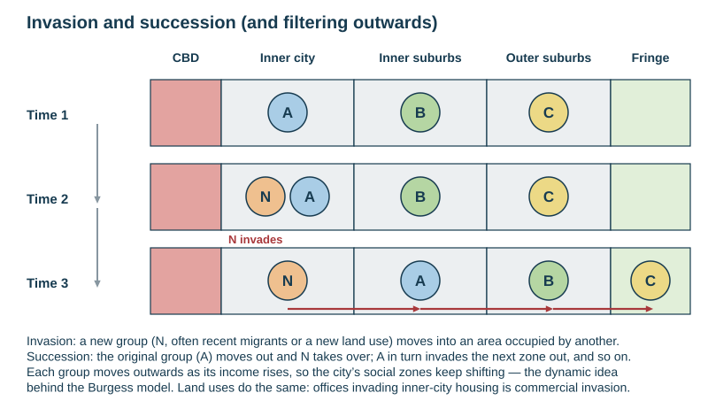
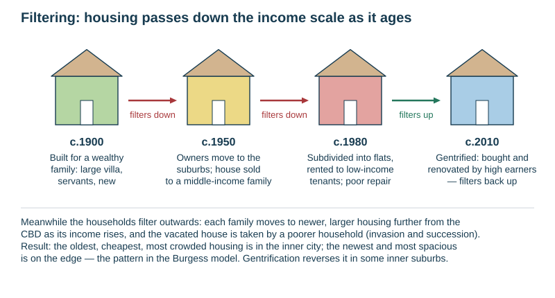

# Urban land use and models (HICs)

Specification objective 2.11 (land use). This page covers what each zone of an HIC city is like and *why* each land use is where it is, using every model taught. Change and problems are on the next page, [Urban change and issues in HICs](../notes/urban-change-hics.md). The Latin American model is on [Urbanisation in LICs and MICs](../notes/urbanisation-lics.md).

## Contents

- Urban land uses
- Bid-rent theory and the urban land value curve (PLVI)
- Burgess concentric zone model
- Hoyt sector model
- Harris–Ullman multiple nuclei model
- Comparing the models, and Auckland
- The CBD: characteristics and the core–frame model
- The zone in transition
- Land-use characteristics of each zone
- Invasion and succession
- Filtering

## Urban land uses

| Land use | What it includes | Typical location and reason |
|---|---|---|
| **Commercial** | shops, offices, banks, hotels, entertainment | the CBD (most accessible); suburban centres and out-of-town retail at road junctions |
| **Industrial** | factories, warehouses, workshops, distribution depots | 19th-century industry beside the CBD along rivers, railways and docks; modern industrial estates on the edge near motorways and airports (cheap, flat, large sites) |
| **Residential** | housing of different ages, densities and incomes | most of the urban area. Old, dense, low-income housing in the inner city; newer, lower-density, wealthier housing further out |
| **Transport** | roads, motorways, rail lines and stations, ports, airports, car parks | radiating routes focus on the CBD; ports on the waterfront; airports on the edge (space, noise) |
| **Open space and recreation** | parks, sports grounds, golf courses, cemeteries | small parks inside the city; large open space on the fringe |
| **Public and institutional** | hospitals, universities, government offices, schools | the CBD frame (government, universities) and the suburbs (schools) |

## Bid-rent theory and the urban land value curve

**Bid-rent theory** says land value (rent) falls with distance from the most accessible point, the city centre. Each land use **bids** what it can afford for each location, and the highest bidder occupies it.

1. The CBD is the **most accessible** point: all routes meet there, so it has the most potential customers and workers.
2. **Shops and offices** gain most from accessibility (passing trade, clients). Their bid-rent line is steep, so they outbid everyone for the centre, and land values are highest there.
3. Land is so expensive that buildings go **upwards**: high-rise offices, and vertical zoning with shops below and offices above.
4. **Industry** needs more space and gains less from passing trade, so it takes the next ring.
5. **Housing** takes the cheaper outer land. Households trade off travel costs against space: the further out, the larger the plot.
6. **Farming** takes the land beyond the city.

- The **peak land value intersection (PLVI)** is the single most valuable and accessible point in the city, usually a major road junction in the CBD core. It has the highest land values, pedestrian counts and buildings.
- **Secondary peaks** occur at other accessible points: suburban centres, ring-road and main-road junctions, and railway stations.
- **In Auckland**, land and house prices are highest round the CBD and the inner isthmus and fall outwards. This is "bid-rent theory in action" (from the school's Auckland notes). Bid rent explains the high-rise intensification of the CBD, much of it on reclaimed land, where low-density historic buildings have been demolished.

| Strengths | Limitations |
|---|---|
| explains why the CBD has the highest land values and tallest buildings | assumes a flat, uniform city with one centre |
| explains the concentric pattern of uses | assumes everyone has equal transport, and ignores public transport corridors |
| predicts secondary peaks at junctions | ignores planning and zoning, which control where uses can go |
| | ignores historical inertia, physical barriers (harbours, hills) and personal choice; online shopping reduces the value of accessibility |

## Burgess concentric zone model (1925)

Based on **Chicago** in the 1920s. The city grows outwards in **concentric rings** from the CBD.

| Zone | Name | Characteristics |
|---|---|---|
| 1 | CBD | shops, offices, the highest land values, few residents |
| 2 | Zone in transition | old factories and warehouses, inner-city decay, slums; newly arrived migrants live here first |
| 3 | Low-income housing (working-class zone) | workers' terraced housing near the factories |
| 4 | Medium-income housing | newer semi-detached houses with gardens |
| 5 | High-income commuter zone | large detached houses; residents commute in |

Moving outwards, buildings get **newer**, density **falls**, and wealth and house size **rise**. The model is **dynamic**: each zone expands into the next through **invasion and succession**.

| Strengths | Limitations |
|---|---|
| simple; based on a real city | based on one American city in the 1920s |
| fits bid-rent theory | ignores transport routes and relief: rivers, hills and coasts distort the rings |
| shows age and wealth increasing outwards, true of many HIC cities | assumes one centre; modern cities have several |
| includes change over time (invasion and succession) | ignores planning, council housing on the edge, gentrification and out-of-town retail |
| | does not fit LIC cities, where the poor live on the edge |

## Hoyt sector model (1939)

Land uses grow outwards in **sectors (wedges)** along transport routes from the CBD, so each sector keeps its character as the city grows.

- **Industry** (with wholesaling and light manufacturing) follows a railway, river or main road.
- **Low-income housing** lies beside the industrial sector: close to work, but noisy and polluted.
- **High-income housing** takes a separate sector on attractive land (high ground, views, upwind), as far from industry as possible.
- **Medium-income housing** lies in between.

| Strengths | Limitations |
|---|---|
| includes transport routes, which really do shape cities | still assumes a single centre |
| explains why industry and poor housing are found together in corridors | sectors are rarely so neat; relief and planning interfere |
| explains wealthy sectors on attractive land | based on 1930s American cities |
| combines distance with direction | ignores the edge-of-city developments built in the car era |

## Harris–Ullman multiple nuclei model (1945)

The city grows round **several separate nuclei**, not one centre. The nuclei may be old villages swallowed by the city, a port, a university or an industrial estate.

- **Similar uses cluster together** for mutual benefit (offices with offices).
- **Unlike uses repel each other** (high-income housing away from heavy industry).
- Some uses cannot afford the high-rent sites (warehouses).
- It includes outlying business districts and suburban industrial estates, as in car-based cities.

| Strengths | Limitations |
|---|---|
| fits modern car-based cities with several centres (Los Angeles, Auckland) | the nuclei are placed differently in every city, so it predicts little |
| explains suburban business districts and industrial estates | complicated to draw and apply |
| includes the reasons uses cluster or separate | still based on American cities |

## Comparing the models, and Auckland

| | Burgess | Hoyt | Harris–Ullman |
|---|---|---|---|
| Shape | rings | wedges | several cells |
| Key control | distance from the CBD (bid rent) | transport routes | several nuclei; attraction and repulsion |
| Best fits | older industrial cities on flat land | cities with strong rail and river corridors | modern sprawling car-based cities |

**Which model fits Auckland?** This is the question in the school's Auckland notes. Auckland fits **multiple nuclei** best:
- The CBD is on the Waitematā waterfront, with the PLVI near Queen Street.
- The city grew round old villages and centres (Onehunga, Ōtāhuhu, Howick, Takapuna, New Lynn, Manukau) and now has metropolitan centres such as Newmarket, Sylvia Park, Albany and Manukau.
- Industry follows **sectors** along rail lines, the motorway and the southern harbour (Penrose, East Tāmaki, Mangere near the airport). That part is Hoyt-like.
- Wealth follows sea views and the eastern bays (Remuera, St Heliers). Large state-housing areas lie to the south and west.
- The harbours and volcanic cones make concentric rings impossible.

## The CBD: characteristics and the core–frame model

**Characteristics of the CBD:**
- the highest land values, at the PLVI;
- the tallest buildings, high density, vertical zoning;
- the most accessible point, where public transport routes and stations converge;
- shops: department stores, specialist and comparison shops;
- offices: finance, insurance, law, head offices, and government;
- entertainment, hotels, restaurants;
- a few permanent residents, though inner-city apartments are rising;
- high pedestrian and traffic counts by day and few at night (the "doughnut" effect);
- functional zoning: separate shopping, office, finance and entertainment districts;
- clear boundaries, often a ring road or the edge of the old town.

| | Core | Frame |
|---|---|---|
| Uses | department stores, chain and specialist shops, banks, head offices, hotels | car parks, bus and rail stations, warehouses, wholesalers, small workshops, car showrooms, hospitals, colleges, government offices, some older housing |
| Buildings | tallest, built upwards, the newest office towers | lower, older, spread out |
| Land values | highest, at the PLVI | lower |
| Activity | intensive; the highest pedestrian counts | less intensive; needs more space and less footfall |
| Change | expands into the frame: commercial invasion | invaded by core uses, or decays |

**Strengths.** It explains the internal structure of the CBD and the edge zone. **Limitation.** Real CBDs have several cores (finance, retail) and blurred edges. Apartment conversions and waterfront redevelopment (Wynyard Quarter) do not fit.

## The zone in transition (inner city)

The zone in transition is the ring immediately round the CBD (Burgess zone 2).

- **Origin.** It was built in the 19th-century industrial phase: factories, warehouses, docks and railway yards, with dense terraced housing for workers within walking distance.
- **Characteristics now:**
  - old, obsolete industry; derelict and vacant land (**brownfield sites**);
  - poorly maintained terraced housing, often subdivided into flats or bedsits;
  - high-rise council housing from the 1960s;
  - cheap rents, so low-income households, students and recent migrants;
  - mixed land use;
  - "in transition" because land uses are changing: the CBD expanding outwards, demolition, regeneration and gentrification.
- **Problems** (linked to inner-city decay on the next page): unemployment, poverty, crime, poor environment, overcrowding.
- **Opportunities.** Brownfield sites close to the CBD are ideal for regeneration: London Docklands; Auckland's Wynyard Quarter and Britomart.

## Land-use characteristics of each zone

| Zone | Age of buildings | Housing type and density | Residents | Other uses | Environment |
|---|---|---|---|---|---|
| CBD | mixed: historic and new towers | few homes; apartments rising | few | shops, offices, entertainment | busy, congested, polluted, little green space |
| Zone in transition (inner city) | oldest, 19th century | dense terraces, flats, high-rise council blocks | low income, students, migrants; gentrifiers in places | old industry, warehouses, derelict land | poor; noise, pollution, graffiti, little open space |
| Inner suburbs | about 1900–1940 | terraced or semi-detached villas, small gardens | working and middle class; gentrifying near the centre | corner shops, local parades, schools | moderate |
| Outer suburbs | post-1945 | detached houses, larger gardens, cul-de-sacs; lower density | middle and high income, families | suburban shopping centres, schools, parks | green, quiet; car-dependent |
| Rural–urban fringe | newest | new estates, lifestyle blocks | commuters | retail parks, business parks, airports, golf courses, landfill | open, but under pressure |

## Invasion and succession

- **Invasion** is when a new group of people, or a new land use, moves into an area occupied by another.
- **Succession** is when the original occupants leave and the newcomers take over. The displaced group then invades the next zone out.
- It explains how the **Burgess** zones change over time. Migrants arrive in the cheap zone in transition, prosper, and move outwards; their place is taken by the next newcomers.
- **Land-use invasion.** Offices invading inner-city housing (CBD expansion); retail invading the rural–urban fringe; apartments invading old industrial land.
- **Example.** In 1960s–1970s Auckland, Pacific Island migrants settled first in cheap inner-city housing (Ponsonby, Grey Lynn). As those suburbs gentrified, many moved to the newer state housing of South and West Auckland.

## Filtering

- **Filtering** is the process by which housing passes **down** the income scale as it ages, while households move **up and out** to newer housing as their incomes rise.
- A large house built for a wealthy family becomes outdated. It is sold to a middle-income family, then subdivided and rented to low-income tenants as it decays.
- Wealthier households "filter" outwards to the new suburbs, and lower-income households take over the vacated housing.
- **Result:** the oldest, cheapest and most crowded housing is near the centre, and the newest is on the edge, which is the Burgess pattern.
- **Filtering up.** Gentrification reverses the process: old inner-city housing is bought and renovated by higher-income people (Ponsonby, Grey Lynn, Kingsland).

## Common exam errors

- Naming a model instead of explaining it. "Burgess model" is not an explanation of why the CBD has the highest land values; *accessibility and bid rent* are.
- Drawing a model without labels or a key. Every zone must be named.
- Saying the CBD has "lots of people living there".
- Forgetting the limitations. Evaluation questions expect them.
