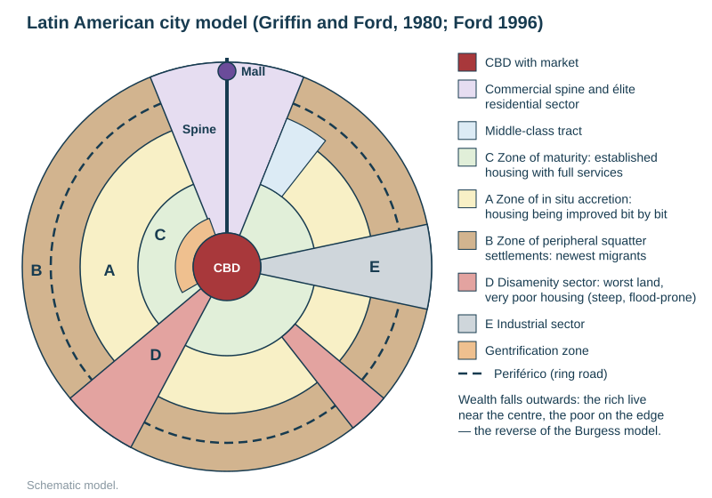

# Urbanisation in LICs and MICs

Specification objective 2.12. The school's named slums are **Dharavi, Mumbai (India)** and **Diepsloot, Johannesburg (South Africa)**, with **Rio de Janeiro's favelas** as supporting material from the 2026 homework. Full case studies are in [CASE-STUDIES.md](../CASE-STUDIES.md).

## Contents

- Rapid urban growth in LICs and MICs
- Rural-to-urban migration: push and pull factors
- Impacts on the city and on the rural areas left behind
- The Latin American city model (Griffin–Ford)
- Squatter settlements: characteristics and issues
- The informal economy
- Case study: Dharavi, Mumbai
- Case study: Diepsloot, Johannesburg
- Supporting example: Rio de Janeiro's favelas
- Strategies to reduce the impacts of rapid urban growth
- Should governments demolish slums? (the homework debate)

## Rapid urban growth in LICs and MICs

- Since 1950, almost all the world's urban growth has been in LICs and MICs. Cities such as Lagos, Kinshasa, Dhaka and Delhi grow by hundreds of thousands a year.
- **Two causes:**
  1. **rural-to-urban migration**;
  2. **natural increase** within the city, because the migrants are young adults of child-bearing age, and urban healthcare lowers the death rate.
- Growth is faster than jobs, housing and services can be provided. The result is **squatter settlements** (slums, informal settlements), an **informal economy**, congestion and pollution.
- About **1 billion people** live in slums worldwide (UN-Habitat, approximate).
- **Over-urbanisation** means urban population growth outrunning urban jobs and infrastructure.

## Rural-to-urban migration: push and pull factors

| Push (rural areas) | Pull (cities) |
|---|---|
| poverty, low farm incomes, debt | jobs in factories, construction, services and the informal sector; higher wages |
| **mechanisation** of farming replaces labour | better schools, hospitals, clean water, electricity (or the perception of them) |
| land held in large estates, or plots subdivided too small to live on | the "bright lights": entertainment, a modern lifestyle |
| drought, flooding, soil erosion, desertification, climate change | family and friends already there, who help with housing and work (chain migration) |
| few services: no secondary school or clinic | more opportunity for women and young people; escape from traditional constraints |
| conflict and insecurity | relative safety |

**Causal chain.**
1. Mechanisation, land concentrated in large estates, and drought cut rural employment.
2. Rural wages and services fall behind the city's.
3. The perceived urban opportunity is reinforced by family contacts and the media.
4. Young adults move to the city, often by step migration (village, then town, then city).
5. Formal housing cannot be built fast enough.
6. Migrants settle informally on marginal land: steep slopes, flood plains, beside railways and rubbish tips.
7. Services lag behind.
8. Natural increase in the city adds to the growth.

**Named flows.**
- **To Mumbai:** from rural Maharashtra and poorer states, especially Uttar Pradesh and Bihar, and historically from Tamil Nadu and Gujarat (Dharavi's potters came from Gujarat). Push: drought, debt, small farms and caste discrimination. Pull: Mumbai is India's financial capital with port, film and textile jobs.
- **To Johannesburg:** from the former homelands and rural provinces (Limpopo, Eastern Cape, KwaZulu-Natal), and from neighbouring countries (Zimbabwe, Mozambique, Malawi). Push: rural poverty and unemployment, and the legacy of apartheid's homelands. Pull: Gauteng is South Africa's economic heartland (mining, finance, industry). The apartheid controls on movement were lifted in 1986, after which migration grew rapidly.
- **To Rio de Janeiro and São Paulo:** from Brazil's drought-prone **north-east**, where land is concentrated in large estates and farming is mechanising.

## Impacts of rural-to-urban migration

| | On the city | On the rural communities left behind |
|---|---|---|
| **Positive** | a large, cheap workforce for industry and services; enterprise in the informal sector; enough people to support services; cultural mixing | **remittances** sent home and invested in land, housing and school fees; less pressure on land and food; returning migrants bring skills and ideas |
| **Negative** | squatter settlements; overloaded water, sanitation, schools, health care and transport; congestion and air pollution; unemployment and underemployment; crime; disease; pressure on land | loss of young adults, especially men, leaving an ageing population of women and children; labour shortages on farms, so food production falls; schools and services close as numbers fall; farms abandoned; a dependency on remittances |

## The Latin American city model (Griffin and Ford, 1980)

| Zone | Characteristics |
|---|---|
| **CBD** with market | colonial core round the plaza; offices, shops, markets |
| **Commercial spine and élite residential sector** | a wide boulevard extending from the CBD, lined with offices, shops, restaurants, parks and the homes of the rich. It ends in a mall or a modern business centre |
| **Zone of maturity** | older, established, good-quality housing with full services; middle class; formerly squatter or colonial housing that has been improved |
| **Zone of in-situ accretion** | modest housing being improved bit by bit as owners extend; partial services; mixed |
| **Zone of peripheral squatter settlements** | the newest migrants on the edge; self-built shacks, few services, long commutes |
| **Disamenity sector** | the worst land: steep slopes, flood plains, beside rubbish tips, railways and polluted rivers; the poorest people, even close to the centre (Rio's hillside favelas) |
| **Industrial sector** | along a railway or main road |
| **Gentrification zone** | historic buildings near the centre being restored (added in Ford's 1996 revision) |
| **Periférico** | a ring road linking the outer areas (1996 revision) |

**Key idea.** Wealth **falls** outwards. The rich live near the centre and the spine, and the poor live on the edge. This is the **reverse of the Burgess model**, because the edge is where unclaimed, unwanted land is available and services are fewest.

| Strengths | Limitations |
|---|---|
| shows the relative location of squatter settlements and high-income housing, which the specification asks for | based on Latin American colonial cities; fits African and Asian cities less well |
| explains change over time (accretion: shacks improving into permanent homes) | in many cities squatter settlements are also close to the centre (Dharavi; Rio's hillside favelas beside rich beach suburbs) |
| includes disamenity zones on the worst land | modern gated communities and malls on the periphery (São Paulo's Alphaville) break the pattern |

## Squatter settlements: characteristics and issues

**Definition.** A squatter (informal) settlement is an area of self-built housing erected **without legal title** to the land or planning permission. Names: *favelas* (Brazil), *bustees* and *jhuggis* (India), *informal settlements*, *townships* or *shack settlements* (South Africa), *barriadas* and *pueblos jóvenes* (Peru), *bidonvilles* (French-speaking Africa).

| Characteristic | Issue it causes |
|---|---|
| self-built from scrap materials (wood, corrugated iron, plastic), later brick | fire (Dharavi fires; paraffin stoves in Diepsloot); collapse in storms or landslides |
| on steep slopes, river banks, flood plains, beside railways and rubbish tips: land nobody else wants | landslides (Rio 2010) and floods (Mumbai 2005; Diepsloot's lower extensions) |
| no legal title to the land | no incentive to improve; constant threat of eviction; no address, so no bank account or formal job |
| no piped water, sewerage or rubbish collection; shared standpipes and toilets | water-borne disease (cholera, typhoid, diarrhoea); TB; long queues; open sewers |
| illegal electricity connections | fires and electrocution; lost revenue for the power company |
| very high density and overcrowding | disease spreads fast (COVID-19); no privacy; no space for children |
| narrow unpaved lanes | no access for ambulances, fire engines or rubbish trucks |
| informal-sector jobs | low, irregular income, no protection or pension |
| gangs and weak policing | crime, drug trafficking (Rio), vigilantism (Diepsloot) |
| **strong community**, self-help and enterprise | a basis for upgrading rather than clearance |

**Why favelas grow on hillsides and steep slopes** (homework): the slopes are the only land left unclaimed by the formal city, too steep for developers. They are close to jobs in the CBD and the wealthy suburbs, so commuting is cheap. Residents can build at night, unseen.
**Problems this brings:**
- landslides after heavy rain;
- stairs and alleys too steep for vehicles, so it is hard to install pipes, sewers and roads;
- rubbish and sewage wash downhill;
- very dense building.

**Infrastructure in favelas** (homework):
- roads: steep, narrow, unpaved alleys;
- power: many illegal connections (*gatos*), with fires;
- water and waste: intermittent supply and open drains;
- communications: mobile phones are now widespread, and community Wi-Fi and apps fill gaps.

**Dwellings and their issues** (homework):
- *Health:* damp, crowded, unsanitary homes spread disease.
- *Crime:* gang control and violent police operations.
- *Community:* tight-knit, with residents' associations and self-help building.

## The informal economy

The **informal economy (informal sector)** is unregistered, untaxed and unregulated work: street trading, waste picking and recycling, small workshops, domestic work, shoe-shining, casual labour, home-based production. The **formal sector** is registered, taxed and regulated employment with contracts and legal protection.

| Good for the people | Bad for the people |
|---|---|
| an income with no qualifications or capital needed | low, irregular pay; no sick pay, pension or job security |
| flexible; works from home; uses local skills | unsafe conditions; child labour; exploitation |
| a route to a formal business later | harassment by police and officials; risk of eviction |

| Good for the country | Bad for the country |
|---|---|
| employment for millions the formal economy cannot absorb | no tax revenue to pay for services |
| cheap goods and services; recycling (Dharavi) | unregulated pollution and unsafe products |
| entrepreneurship | hard to measure or plan; it lowers GDP figures |

**Building the economy of a favela** (homework):
- micro-credit loans for small businesses;
- legal land title, so homes can be used as security for loans;
- training and education;
- formalising and registering businesses;
- tourism (favela tours, Rocinha);
- connecting legal electricity and internet;
- better transport to jobs;
- community co-operatives.

## Case study: Dharavi, Mumbai (India)

Learn the **ideas**: where it is, why it grew, what goes wrong, what has been tried and whether it works. One or two anchor facts are enough to make the example "developed".

- **Location — the key idea:** a **central** slum. It sits on swampy, once-unwanted land between railway lines in the middle of Mumbai, next to a modern business district, so it is now some of the most valuable land in the city. That is why developers want it.
- **Why it grew:** Mumbai is India's richest city, so it pulls migrants from poor rural states (push: drought, debt, tiny farms; pull: jobs, wages, hope). Formal housing is far too expensive, so newcomers built wherever they could. Dirty industries (tanning, pottery) pushed out of the old centre settled there too. It has grown for over a century and is one of Asia's largest slums.
- **Anchor fact:** perhaps up to **a million people on about 2 km²**, one of the densest places on Earth (estimates vary; there is no reliable census).
- **Problems — and why they matter:**
  - **Overcrowding:** families live in one small room, often above or below a workshop → disease spreads fast, no privacy, no space to study.
  - **Sanitation and water:** shared toilets and standpipes, open drains → water-borne disease (diarrhoea, typhoid) and hours lost queuing, which falls mostly on women and children.
  - **Hazards:** low, flood-prone land, flammable materials and tangled wiring → floods and fires, and narrow lanes block fire engines and ambulances.
  - **Pollution:** tanning, recycling and burning waste → polluted air and creek, respiratory illness.
  - **No legal title:** residents can be evicted, so they hesitate to invest in better homes, and they struggle to get loans or services.
- **Strengths — why it is not only a problem:**
  - a huge **informal economy** (leather, pottery, garments, food and recycling) that employs most residents and sells across India and abroad;
  - strong, mixed communities and self-help groups, such as women's savings groups working with NGOs to build community toilet blocks;
  - homes double as workplaces, so people live next to their income.
- **Solutions tried:**
  - **Slum rehabilitation:** developers build free flats for residents and pay for it by selling extra flats on the freed land.
  - **Large-scale redevelopment:** repeated plans since 2004 to clear the area and rehouse people in tower blocks; the current scheme is led by the **Adani Group** (tender won 2022). Only long-term residents qualify for a free flat inside Dharavi; later arrivals are offered housing outside it.
  - **Community-led upgrading:** NGOs and residents improving toilets, water and lanes in place.
- **Evaluation:**
  - *For redevelopment:* safe flats with water and toilets; less fire and flood risk; schools and roads.
  - *Against:* many residents do not qualify and are moved far from their jobs; tower blocks do not suit home workshops, so the informal economy can be destroyed; the developer profits most from prime land; residents have protested.
  - *Judgement:* success should be measured by how many original residents and businesses stay. In-situ upgrading with residents is cheaper and keeps livelihoods.

## Case study: Diepsloot, Johannesburg (South Africa)

- **Location — the key idea:** a **peripheral** slum on the northern edge of Johannesburg, far from the city centre, right beside wealthy gated estates: a sharp picture of inequality.
- **Why it grew:** it began in **1995** as a "temporary" transit camp for people moved from other informal settlements and flood-prone riverbanks. The temporary residents stayed, and migrants kept arriving from poor rural provinces and neighbouring countries (Zimbabwe, Mozambique, Malawi), pulled by Gauteng's jobs. Apartheid had kept Black South Africans out of the cities; when those controls ended, migration grew far faster than housing.
- **Anchor fact:** from a camp to a township of a few hundred thousand people in about 30 years.
- **Problems — and why they matter:**
  - **Housing:** many live in self-built shacks of corrugated iron and wood → cold, crowded, and easily burned by paraffin stoves.
  - **Services:** many homes lack piped water, a flush toilet or a legal power connection → disease, illegal wiring and fires; unpaved roads flood in summer storms.
  - **Jobs:** high unemployment, and the edge location means long, expensive journeys to work → poverty is hard to escape.
  - **Crime and policing:** few police → high crime and "mob justice"; tension with foreign migrants has led to xenophobic violence.
  - **Health and social issues:** HIV, teenage pregnancy and substance abuse.
- **Strengths:** a busy informal economy of small shops (spaza shops), taverns, salons and street food; community and NGO projects such as food gardens and youth programmes.
- **Solutions tried:**
  - **RDP houses**, free basic government homes (since 1994);
  - **site-and-service** plots with water and toilets on which residents build;
  - **self-help** housing, where residents add their own labour to a subsidy;
  - a planned mixed-income **new town** nearby (Cosmo City) for some residents;
  - NGO projects for jobs, recycling and small businesses.
- **Evaluation:**
  - Government houses have given many families a proper home, but supply never catches up with new arrivals, so shacks keep spreading.
  - Housing poor people on the city edge, far from jobs, repeats the apartheid pattern.
  - Services are improving but patchy, and crime and xenophobia scare off investment.
  - *Judgement:* upgrading in place (secure tenure, water, sanitation, lighting, policing) plus local jobs would help more than moving people.

**Comparing the two slums.**

| | Dharavi | Diepsloot |
|---|---|---|
| Position in the city | central, on very valuable land | peripheral, on the urban edge |
| Age | over a century old | about 30 years old |
| Economy | a huge productive informal economy, with exports | mainly small retail and services; high unemployment |
| Main threat | redevelopment and displacement | crime, service backlog, continued growth |
| Policy | developer-led high-rise redevelopment | state houses, site-and-service, a nearby new town |

## Supporting example: Rio de Janeiro's favelas (2026 homework)

- **Why they grew:** migrants from Brazil's poor, drought-prone north-east, where land is held in large estates and farming is mechanising, plus natural increase among young migrants.
- **Where:** on **steep hillsides** close to the centre and the rich beach suburbs (land too steep for developers but close to jobs) and on flood-prone land. More than a fifth of the city's people live in favelas; **Rocinha** is the largest.
- **Problems:** landslides after heavy rain; steep, narrow alleys that vehicles, pipes and sewers cannot reach; poor sanitation; illegal power connections; drug-gang violence and violent police raids.
- **Strengths:** strong communities and many informal businesses.
- **Solutions:** clearance to distant estates (unpopular, far from jobs) → **Favela-Bairro** upgrading in place from 1994 (paved paths, drains, water, sewerage, crèches) → police "pacification" units from 2008 → legalising electricity.
- **Evaluation:** upgrading in place has been cheaper and more popular than clearance. Pacification reduced violence at first but did not last.

## Strategies to reduce the impacts of rapid urban growth

| Strategy | What it involves | Strengths | Weaknesses |
|---|---|---|---|
| **Self-help schemes** | the authorities supply materials, land title, loans or training; residents build or improve their own homes | cheap; uses residents' skills; builds community and pride; homes grow as incomes grow | slow; quality varies; needs secure tenure first |
| **Site-and-service schemes** | the government provides plots with basic services (water, sewerage, electricity, roads); residents build their own homes | services in place before people move in; cheaper than finished housing | plots often on the edge, far from jobs; even small charges exclude the poorest (Diepsloot stands) |
| **In-situ upgrading** | improve the existing settlement: paving, drains, water, sanitation, lighting, land titles | keeps communities and livelihoods; cheaper than clearance (Favela-Bairro; Dharavi's community toilets) | does not solve overcrowding; rising values can push out tenants |
| **Demolition and rebuilding (redevelopment)** | clear the slum and build flats on site or elsewhere | modern, safe housing; land freed for other uses | destroys communities and businesses; relocates people far from jobs; often favours developers (Dharavi's debate) |
| **Low-cost / social housing** | government-built apartments or houses | quick improvement for those housed (RDP, Minha Casa Minha Vida) | expensive; never enough; often peripheral |
| **Improving services and transport** | standpipes, public toilets, clinics, schools, buses, cable cars | immediate health gains | treats symptoms; needs maintenance |
| **Supporting the informal economy** | micro-credit, training, legal markets for street traders | income and enterprise | does not reach everyone; hard to regulate |
| **New towns / counter-magnets** | build planned towns to divert growth | relieve pressure on the main city (Navi Mumbai from the 1970s; Brasília, 1960; Cosmo City, 2005) | slow to attract jobs; costly; people still drift to the main city |
| **Rural development** (slows migration) | rural electrification, clean water, schools and clinics in villages, land reform, micro-credit for farmers, better farm prices, rural employment guarantees (India's MGNREGA, 2005) | tackles the cause by reducing the push; benefits the rural areas too | expensive; slow; may not compete with the city's pull |

## Should governments demolish slums and rebuild on the edge? (homework)

| Yes | No |
|---|---|
| land on hillsides and flood plains is dangerous; relocation saves lives | the edge is far from jobs, so commutes are long and expensive, and people return to the slums |
| new housing can have full services from the start | communities and informal businesses are destroyed |
| frees central land for the formal economy | in Rio, coast and mountains leave little edge land; in Mumbai, land is scarce everywhere |
| | upgrading in place is cheaper and has worked (Favela-Bairro) |

**Conclusion.** Relocate only from genuinely hazardous land, with residents' consent. Otherwise upgrade in place, with secure tenure and services.

## Common exam errors

- Calling all slum dwellers unemployed. Most work in the informal economy.
- Describing squatter settlements without their **location** in the city (the specification wants their relative location).
- Treating Dharavi as only a problem. Its economy and community are also strengths.
- Naming a strategy without a place and an evaluation.
- Reciting statistics about a slum instead of explaining its problems, why they matter and how well the solutions work.
