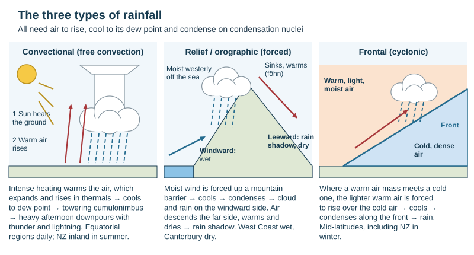
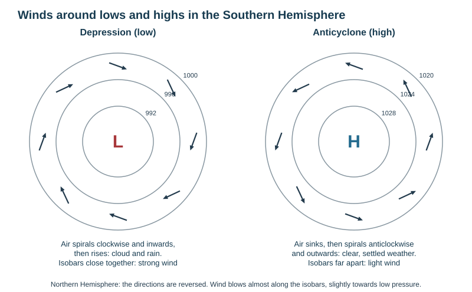
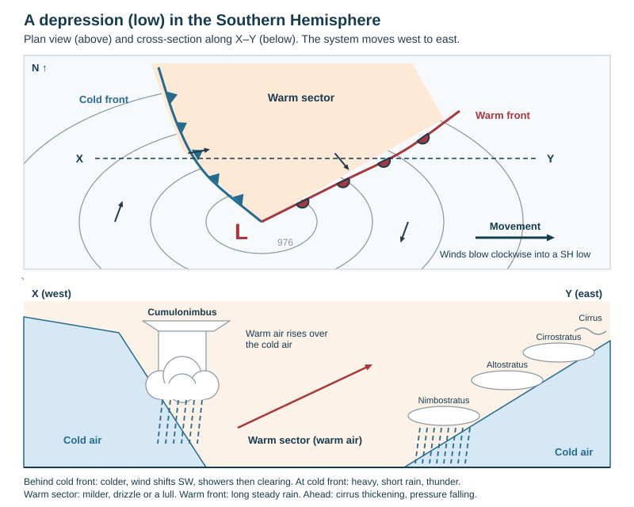

# Weather

Theme 1, specification 1.4 (weather processes and synoptic charts). Global circulation, climate zones, climate graphs and New Zealand's climate are on [Climate and global circulation](../notes/climate.md).

Scope: the school's topic page marks *describing how weather data is collected* and *calculations from instruments* as not required, while the 2025 specification still lists the instruments and the Stevenson screen, so they are kept briefly.

## Weather and climate

- **Weather** = the state of the atmosphere at a place at a particular time (hours or days): temperature, rain, wind, cloud and so on.
- **Climate** = the average weather of a place measured over a long period, usually **30 years**.
- *Weather is what is happening; climate is what you expect to happen.*

**Elements of weather:** temperature, precipitation, humidity, wind (speed and direction), sunshine, cloud cover, air pressure.

## Instruments (brief)

| Element | Unit | Instrument | Key point |
|---|---|---|---|
| Temperature | °C | **maximum–minimum thermometer** (Six's) | records the current, highest and lowest temperature since reset; reset daily with a magnet |
| Humidity | % relative humidity | **wet-and-dry bulb thermometer (hygrometer)** | the wet bulb reads lower because evaporation cools it; a bigger difference = drier air; read the RH from a table |
| Rainfall | mm | **rain gauge** | sunk into short grass with the rim about 30 cm above ground (stops splash), away from trees and buildings |
| Wind speed | km/h, knots, m/s | **anemometer** (rotating cups) | mounted high in an open site |
| Wind direction | compass point | **wind vane** | the arrow points to where the wind comes **from**; a southerly blows from the south |
| Sunshine | hours | **sunshine recorder** (Campbell–Stokes) | a glass sphere burns a trace on a card |
| Pressure | millibars (mb) = hectopascals (hPa) | **barometer** (aneroid or mercury); a barograph records it | average sea-level pressure about 1013 mb |
| Cloud cover | oktas (eighths) | observation | 0 = clear, 8 = overcast |

**Stevenson screen:** white (reflects sunlight); louvred sides (air circulates, direct sun and rain kept out); solid roof; on legs so thermometers are about **1.2 m** above the ground; standing on **grass**, not concrete; in an open site at least twice the height of nearby objects away from them; door facing **south in the Southern Hemisphere** so the sun never shines in when it is opened. It holds the thermometers and hygrometer.

**Reading a max–min thermometer:** current temperature = top of the mercury in either arm; maximum = bottom of the index in the max arm; minimum = bottom of the index in the min arm (scale reads downwards).

## Humidity, condensation and stability

| Term | Meaning |
|---|---|
| **Humidity** | the amount of water vapour in the air |
| **Absolute humidity** | mass of water vapour in a volume of air (g/m³) |
| **Saturated** | air holding the maximum vapour it can at that temperature |
| **Relative humidity (RH)** | vapour present as a % of the maximum the air could hold at that temperature; 70% = could hold 30% more |
| **Dew point** | the temperature at which air becomes saturated; further cooling → condensation |
| **Evaporation** | liquid → vapour; **absorbs** heat energy |
| **Condensation** | vapour → liquid; **releases** latent heat |
| **Freezing / melting** | liquid → ice / ice → liquid |
| **Sublimation / deposition** | ice → vapour directly / vapour → ice directly (frost) |
| **Condensation (hygroscopic) nuclei** | tiny particles of dust, smoke or salt that vapour condenses onto |

- Warm air holds far more vapour than cold air, so **cooling raises RH** and **warming lowers it** without any change in the amount of vapour.
- **Adiabatic cooling** — rising air expands as pressure falls and cools without losing heat to its surroundings.
- **Lapse rate** — the fall in temperature with height, on average about **6.5 °C per 1000 m** (the class booklet uses about 1 °C per 100 m for rising dry air).
- **Stable air** — a lifted parcel becomes colder and denser than its surroundings and sinks back: flat stratus or clear skies; can trap pollution.
- **Unstable air** — a lifted parcel stays warmer than its surroundings and keeps rising: cumulonimbus, heavy showers, thunder.
- **Conditional instability** — stable when dry, unstable once saturated, because condensation releases latent heat that keeps the parcel warmer.
- **Temperature inversion** — warm air lying above cooler air near the ground; it stops air rising and traps smog (Christchurch winter smog).

*Causal chain of cloud and rain.* Air is made to rise → it expands and cools adiabatically → RH rises until dew point is reached → vapour condenses onto condensation nuclei → cloud droplets or ice crystals → droplets collide and merge (coalesce) until too heavy for the rising air to hold → precipitation.

**Four ways air is made to rise:** convection (heated ground), relief (mountains), frontal (warm air over cold air), convergence (air streams meeting, e.g. the ITCZ).

## Clouds

| Cloud | Height | Appearance | Weather |
|---|---|---|---|
| **Cirrus** | high, above about 5500 m | thin, white, wispy ("mares' tails"), ice crystals | fair; thickening cirrus signals an approaching warm front |
| Cirrostratus / cirrocumulus | high | thin veil (halo round the Sun) / small ripples | warm front approaching |
| Altostratus / altocumulus | middle | grey sheet, Sun a bright smudge / rounded masses | rain possible |
| **Stratus** | low, below about 2000 m, sometimes to the ground | flat grey layer | drizzle, light rain or snow |
| **Nimbostratus** | low, thick | dark grey layer | steady, prolonged rain ("nimbus" = rain) |
| **Cumulus** | base about 600–1200 m | separate heaps like cotton wool | fair, light showers |
| **Cumulonimbus** | towering, up to about 10–12 km, anvil top | giant cauliflower | heavy rain, thunder, lightning, hail |

## Precipitation

**Precipitation** = any water falling from the atmosphere to the ground: rain, drizzle, snow, sleet, hail. (Dew and frost form on the surface.)

| Type | How air rises | Sequence | Where |
|---|---|---|---|
| **Convectional** (free convection) | the Sun heats the ground strongly, which heats the air above | heated air expands, becomes less dense and rises in thermals → cools to dew point → towering cumulonimbus → heavy afternoon downpours, thunder and lightning | equatorial regions almost every afternoon; continental interiors and inland NZ in summer |
| **Relief / orographic** (forced convection) | a moist wind is forced up a mountain barrier | rises and cools → condensation on the **windward** slope → heavy rain or snow → air descends the **leeward** side, warms and dries → **rain shadow** and a warm dry **föhn** wind | West Coast of the South Island (wet) vs Canterbury and Central Otago (dry) |
| **Frontal** (cyclonic) | warm, lighter air meets cold, denser air and is forced to rise over it | gentle ascent at a **warm front** → layered cloud and long steady rain; steep ascent at a **cold front** → cumulonimbus and short heavy showers | mid-latitudes, especially NZ in winter |
| **Convergence** | air streams meet and are forced up | rising air cools → cloud → rain | the ITCZ near the equator |

*This loses marks:* a convectional-rainfall answer without a diagram is capped at 2 of 4; an annotated diagram can earn all four.

**Forms:** **rain**; **drizzle** (fine drops from stratus); **sleet** (partly melted snow, or rain freezing as it falls); **snow** (ice crystals clumping into flakes, reaching the ground when it is near or below 0 °C); **hail** (ice pellets built up in layers as strong updrafts in a cumulonimbus carry them up and down through supercooled water).

**Dew, frost and fog.** By day the ground absorbs short-wave radiation from the Sun; day and night it gives off long-wave radiation. Cloud absorbs and returns long-wave radiation, keeping the ground warm. On a **clear, calm night** heat escapes to space, the ground cools fast, and the air touching it cools to its dew point → water condenses on grass as **dew**. Below 0 °C the vapour turns straight to ice on surfaces → **frost** (hoar frost). If cooling extends some way above the ground, condensation on particles in the air forms **fog** (radiation fog) — a cloud at ground level. Cold air drains downhill into valleys at night, so frost and fog are worst in **frost hollows**. **Advection fog** forms when warm moist air moves over a cold surface (sea fog).

## Air pressure and wind

**Air pressure** = the weight of the air pressing on the Earth's surface, measured with a barometer in millibars.

- Warm air expands, becomes less dense and **rises** → **low pressure** at the surface.
- Cold air contracts, becomes denser and **sinks** → **high pressure** at the surface.
- **Wind** = air moving from high to low pressure to replace rising air. The rising and sinking air complete a **convection cell**.
- **Pressure gradient** = the change in pressure over distance; the bigger it is (isobars close together), the stronger the wind.

| Influence | Effect on the wind |
|---|---|
| **Pressure gradient force** | starts air moving from high to low |
| **Coriolis effect** | the Earth's rotation deflects moving air to the **left in the Southern Hemisphere**, right in the Northern; none at the equator, greatest at the poles |
| **Friction** | slows surface wind, so it blows almost parallel to the isobars but slightly across them **towards low pressure** |

- **Southern Hemisphere:** air spirals **clockwise into a low** and **anticlockwise out of a high**. Northern Hemisphere: the reverse.
- Winds are calm near the centre of a high but can be strong near the centre of a low.
- **Buys Ballot's law (SH):** stand with your back to the wind and low pressure is on your **right** (NH: left).
- Winds are named by the direction they come **from**.

**Local winds**
- **Sea breeze** (day): land heats faster than sea → air rises over land → cooler air flows in from the sea.
- **Land breeze** (night): land cools faster → air sinks over land and flows out to sea.
- **Valley (anabatic) wind** blows up-slope by day; **mountain (katabatic) wind** drains cold air down valleys at night.
- **Föhn wind** — a warm, dry wind descending the leeward side of mountains (Canterbury's **nor'wester**).
- **Monsoon** — a seasonal reversal of wind caused by land–sea heating on a continental scale; brings a wet season to South and East Asia.

## Synoptic weather charts

**Synoptic chart** = a map of the weather over a large area at one time. **Isobars** join places of equal pressure (corrected to sea level), usually every 4 mb.

| Feature | Recognise it by | Weather |
|---|---|---|
| **Anticyclone (high, H)** | widely spaced isobars, pressure rising to the centre (strong highs above about 1030 hPa) | sinking air, light winds, settled. Summer: warm and sunny. Winter: cold clear nights, frost and fog; sometimes grey "anticyclonic gloom" |
| **Depression (low, L)** | roughly circular, closely spaced isobars, pressure falling to the centre (deep lows below about 980 hPa), usually with fronts | rising air, strong winds, cloud and rain |
| **Ridge** | a tongue of high pressure | fine |
| **Trough** | an elongated area of low pressure | cloud, showers, sometimes thunderstorms |
| **Col** | slack pressure between two highs and two lows | light variable winds; fog or thunderstorms |
| **Cold front** | line with **triangles** (blue) | colder air replacing warmer air |
| **Warm front** | line with **semicircles** (red) | warmer air replacing colder air |
| **Occluded front** | triangles and semicircles on the same side (purple) | the cold front has caught up with the warm front, lifting the warm air off the ground |

Symbols point in the direction the front is moving. A **deepening** low has falling central pressure (stronger winds); a **filling** low has rising pressure.

**Air masses** = large bodies of air with similar temperature and humidity throughout, named by source: **tropical** (warm) or **polar** (cold), **maritime** (moist) or **continental** (dry). NZ mainly gets **maritime polar** (from the south-west: cold, showers) and **maritime tropical** (from the north: warm, humid). A **front** is the boundary between two air masses.

**Passage of a depression** (moving west to east over a place):

| Stage | Weather |
|---|---|
| Ahead of the warm front | cirrus thickening to cirrostratus and altostratus; pressure falling; wind strengthening |
| Warm front | nimbostratus, long steady rain; temperature rises |
| Warm sector | milder, humid; a lull with drizzle or broken cloud |
| Cold front | cumulonimbus, short heavy downpours, possibly thunder and hail; temperature drops; in NZ the wind swings from north-west to south-west |
| Behind the cold front | colder, clearer, showers then brightening; pressure rising |

**Reading wind from a chart:** find the isobars at the place → wind blows nearly along them, slightly towards low pressure → clockwise round lows and anticlockwise round highs (SH) → name it by where it comes from → closer isobars = stronger wind. A **station model** shows temperature, pressure, cloud cover (shaded circle, oktas), present weather, and wind (a shaft pointing to where the wind comes from, feathers for speed).

## New Zealand's weather pattern

- NZ lies in the **westerlies**, so weather systems move **west to east** across the Tasman Sea, usually taking about a week for a high and a low to pass: an alternating sequence of **anticyclones** (settled spells) and **depressions and troughs** with **cold fronts** (wet, windy, then a cold southerly change).
- **Ex-tropical cyclones** (December–April) sometimes track south from the tropics, bringing extreme rain and wind (Cyclone Bola 1988, Cyclone Gabrielle 2023).
- **Southerly outbreaks** of cold polar air bring snow to low levels in winter.
- See [Climate and global circulation](../notes/climate.md) for why the pattern changes between summer and winter.

## This loses marks

- Naming a wind by where it is going.
- Getting the hemisphere wrong — NZ is **clockwise round lows**.
- Relief rainfall without the descending air warming and drying on the leeward side.
- Reading isobars as if close spacing meant light wind.
- Describing a synoptic chart without quoting pressures (in hPa or mb) and places.
