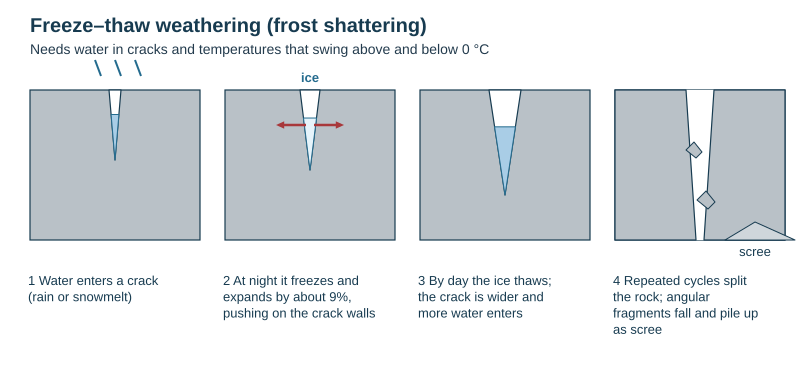
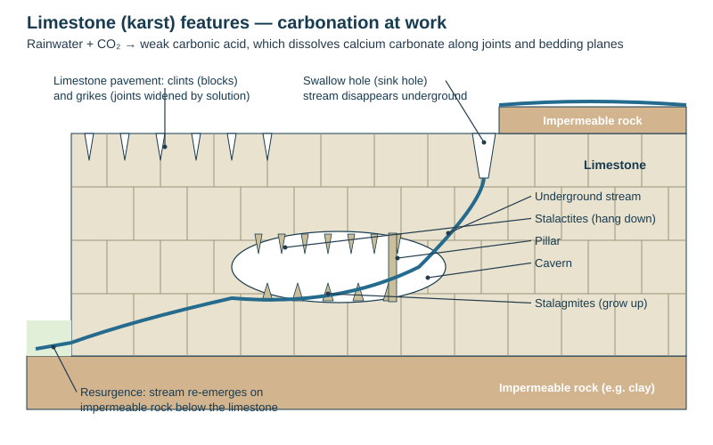
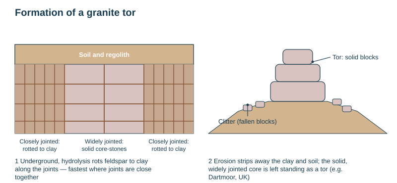

# Weathering, mass movement and wind

Theme 1, specification 1.3 (weathering and the work of wind). Wind erosion is headed "not to be assessed" in the 2025 specification but is still on the school's topic list (deflation, mesas, dunes, loess), so it is covered briefly at the end.

## Denudation: the four stages

**Denudation** = the wearing away of the land surface, lowering its height and relief.

| Stage | Meaning | Agents |
|---|---|---|
| **Weathering** | the breakdown of rock **in place**, without movement | temperature change, water, ice, plants, animals, chemicals |
| **Erosion** | the wearing away **and removal** of rock by a moving agent | water (rivers, sea), ice, wind |
| **Transportation** | the movement of eroded material | rivers, ice, wind, waves, gravity |
| **Deposition** | the dropping of material when the agent loses energy | rivers, ice, wind, waves |

*This loses marks:* confusing weathering (in place) with erosion (involves movement).

Weathering **supplies the loose material** that the agents of erosion carry away — without it, rivers, ice and waves would have far less load to abrade with.

## Types of weathering

| Type | Process | Mechanism | Where it is most effective |
|---|---|---|---|
| Physical (mechanical) | **Freeze–thaw** (frost shattering) | water in a crack freezes and expands by about 9%, prising the rock apart; repeated cycles shatter it | where temperatures swing around 0 °C: mountains, high latitudes, NZ alps |
| Physical | **Exfoliation** (thermal expansion and contraction, onion-skin weathering) | the outer layer heats and expands by day and cools and contracts by night faster than the interior; stress makes it peel off in sheets | hot deserts with a large daily temperature range |
| Physical | **Pressure release** (unloading, dilatation) | erosion removes overlying rock; the rock below expands and cracks in sheets parallel to the surface | granite exposed after erosion |
| Physical | **Salt crystallisation** | salt crystals grow in pores and cracks and force them apart | deserts, coasts |
| Biological | **Root action, burrowing** | roots grow into cracks and widen them; animals burrow and break up rock | anywhere with vegetation |
| Biological / chemical | **Organic acids** | decaying vegetation and lichens release acids that rot rock | vegetated, humid areas |
| Chemical | **Carbonation** (solution) | rainwater absorbs CO₂ → weak **carbonic acid** → reacts with calcium carbonate in **limestone** → soluble calcium bicarbonate is carried away | limestone areas; faster in cold water (holds more CO₂) |
| Chemical | **Hydrolysis** | slightly acidic water reacts with **feldspar** in **granite**, rotting it to clay (kaolin) | warm, wet climates |
| Chemical | **Oxidation** | oxygen reacts with iron minerals → rust, which crumbles (red-brown soils) | iron-rich rocks |

**Factors affecting the rate of weathering:** climate (temperature and rainfall: chemical weathering is fastest in hot, wet places, freeze–thaw in cold, wet places with frequent frost), rock type (mineral make-up), rock structure (joints, bedding planes, faults give water a way in), vegetation, and time.

## Landforms of weathering

| Landform | Rock | Formation |
|---|---|---|
| **Scree (talus) slope** | any jointed rock | freeze–thaw shatters a cliff or crag; angular fragments fall and pile up at its base at a steep angle (about 35°) |
| **Exfoliation dome** | massive granite | sheets peel off a rounded outcrop by pressure release and thermal expansion, leaving a dome (e.g. Half Dome, Yosemite) |
| **Granite tor** | granite | hydrolysis rots the rock along closely spaced joints underground; widely jointed blocks survive as core-stones; erosion strips the clay away and the blocks stand on a hilltop (Dartmoor, UK) |
| **Limestone pavement** | limestone | carbonation widens vertical joints into deep grooves (**grikes**), leaving flat blocks (**clints**) |
| **Swallow hole (sink hole)** | limestone | a stream disappears down a joint widened by solution, or the ground collapses into a cavern |
| **Cave / cavern** | limestone | water dissolves along joints and bedding planes, enlarging passages underground (Waitomo, NZ) |
| **Stalactite / stalagmite / pillar** | limestone | dripping water loses CO₂ and deposits calcium carbonate: stalactites hang from the roof, stalagmites grow up from the floor, and they join as pillars |
| **Resurgence** | limestone over impermeable rock | an underground stream re-emerges where it meets impermeable rock |
| **Gorge** | limestone | a cavern roof collapses, leaving a steep-sided valley |

## Mass movement

**Mass movement** = the downhill movement of weathered material under **gravity**, often helped by water. It links weathering on slopes to the rivers and glaciers that carry the debris away.

| Type | Speed | What happens | Example of trigger |
|---|---|---|---|
| **Soil creep** | very slow | soil particles heave up when wet or frozen and settle back slightly downhill; shows as bent trees, tilted fences, terracettes | wetting and drying, freeze–thaw |
| **Rockfall** | very fast | blocks fall from a cliff, often loosened by freeze–thaw; builds scree | frost, earthquakes |
| **Slide (landslide)** | fast | a mass of rock or soil moves along a flat slip plane | heavy rain, undercutting, earthquakes |
| **Slump (rotational slip)** | fast | saturated material slides along a curved slip plane, leaving a crescent scar | waterlogged clay cliffs |
| **Mudflow** | fast | saturated fine material flows downhill like a liquid | intense rain on bare slopes; volcanic lahars |

**Causes:** steep slopes, heavy or prolonged rain (water adds weight and lubricates), undercutting by rivers or waves, earthquakes, deforestation, and building on or cutting into slopes. Cyclone Gabrielle (February 2023) triggered thousands of landslides on the deforested hill country of the East Coast and slips at Muriwai.

## Wind (aeolian) processes

*Not assessed in the 2025 specification; on the school's topic list.*

| Process | Meaning |
|---|---|
| **Deflation** | wind lifts and removes loose, fine material, lowering the surface into hollows (deflation hollows) and leaving stony desert (reg) |
| **Abrasion** (sandblasting) | sand carried by the wind wears away rock, mostly within about 1 m of the ground |
| **Attrition** | wind-blown grains hit each other and become small and rounded |
| **Suspension** | fine dust carried high in the air |
| **Saltation** | sand grains bounce along the surface |
| **Surface creep** | larger grains rolled by the impact of saltating grains |
| **Deposition** | when the wind slows, especially behind an obstacle |

| Landform | Formation |
|---|---|
| **Mushroom rock** (pedestal rock) | abrasion is concentrated near the ground where sand is carried, so the base of an outcrop is undercut faster than its top |
| **Sand dune** | wind slows at an obstacle and drops sand; dunes have a gentle windward slope and a steep leeward **slip face** and migrate downwind (barchan dunes are crescent-shaped) |
| **Mesa and butte** | flat-topped hills capped by resistant rock; erosion of the softer surrounding rock leaves them standing (a butte is a smaller mesa) |
| **Yardang** | ridges of rock streamlined by abrasion, parallel to the wind |
| **Loess** | thick deposits of fine wind-blown silt, often from glacial outwash or desert margins (northern China); fertile |

## This loses marks

- Saying weathering "moves" material.
- Carbonation without naming the acid (carbonic) and the rock (limestone / calcium carbonate).
- Hydrolysis without granite and feldspar → clay.
- Freeze–thaw without the 9% expansion *and* repeated cycles around 0 °C.
- Naming a landform without the process that made it.
