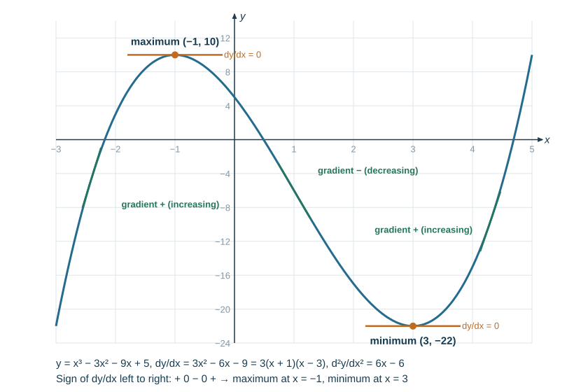
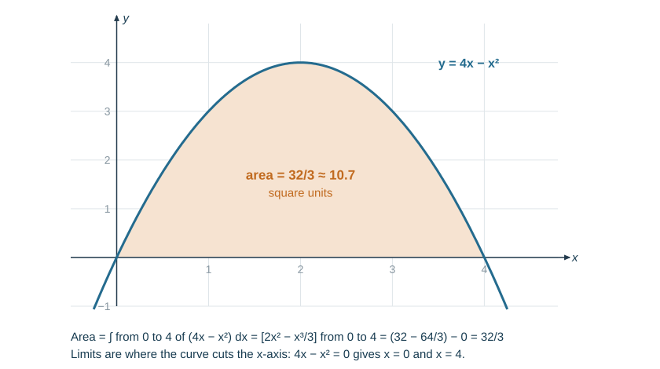

# Calculus

Calculus is taught in Term 3 and **is examined**. It has been in every final from 2022 to 2025, usually as several short parts of 2–4 marks each inside a longer question. The table shows what those papers asked, so you know where the marks are.

| Skill | 2022 | 2023 | 2024 | 2025 |
|---|---|---|---|---|
| Differentiate a sum of powers of $x$ | ✓ (fractional power) | ✓ | ✓ (negative powers) | ✓ (negative power) |
| Expand a bracket, then differentiate | ✓ | ✓ | ✓ | ✓ |
| Gradient at a point and the equation of the tangent | — | — | tangent recognised on a graph | ✓ |
| Integrate, with $+C$ | ✓ (simplify a fraction first) | ✓ | ✓ | ✓ (negative power; expand first) |
| Find a function from its gradient function and one point | ✓ | ✓ | ✓ | ✓ |

Sections 7–9 below (normals, second derivatives, increasing and decreasing, practical maximum and minimum problems, definite integrals and area) were **not** asked in those four finals. They are included because they follow from the same rules and are in the current Cambridge 0580 Extended syllabus (which has differentiation but no integration). Learn sections 1–6 first.

## 1. The gradient function

The gradient of a curve changes from point to point. The **derivative** (gradient function) gives the gradient of the tangent at any $x$. It is written $f'(x)$ or $\dfrac{dy}{dx}$.

**The rule.** Multiply by the power, then reduce the power by one:

$$y = ax^n \quad\Rightarrow\quad \frac{dy}{dx} = anx^{n-1}$$

- A term in $x$ differentiates to its coefficient: $5x \to 5$.
- A constant differentiates to $0$: $7 \to 0$.
- Differentiate a sum term by term.

*Example.* $f(x) = x^4+3x^2-5x+7$ gives $f'(x) = 4x^3+6x-5$.

*Example (2023 type).* $f(x) = \tfrac45x^5-2x$ gives $f'(x) = \tfrac45\times5x^4 - 2 = 4x^4-2$.

The letter does not matter. Differentiating with respect to $s$: $\tfrac43 s^6 \to 8s^5$.

**Mark-losing error:** reducing the power but forgetting to multiply by the old power ($x^4 \to x^3$ instead of $4x^3$), or leaving a constant in the answer.

## 2. Rewrite as powers of $x$ first

The rule works only on terms of the form $ax^n$. Before differentiating, rewrite roots and fractions as powers.

| Written as | Rewrite as |
|---|---|
| $\sqrt{x}$ | $x^{1/2}$ |
| $\dfrac{1}{x}$ | $x^{-1}$ |
| $\dfrac{4}{x^2}$ | $4x^{-2}$ |
| $\dfrac{2}{3x^3}$ | $\tfrac23x^{-3}$ — the 3 stays in the coefficient |
| $\dfrac{1}{\sqrt x}$ | $x^{-1/2}$ |

**Negative powers (2024 and 2025 types).** The power goes *down*, so it becomes more negative.

$$f(x) = \frac{4}{x^2}-\frac{3}{x} = 4x^{-2}-3x^{-1} \quad\Rightarrow\quad f'(x) = -8x^{-3}+3x^{-2} = -\frac{8}{x^3}+\frac{3}{x^2}$$

$$f(x) = \frac{2}{3x^3} = \tfrac23x^{-3} \quad\Rightarrow\quad f'(x) = \tfrac23\times(-3)x^{-4} = -2x^{-4}$$

$$f(x) = \tfrac65x^{-5}-x^{-2} \quad\Rightarrow\quad f'(x) = -6x^{-6}+2x^{-3}$$

**Fractional powers (2022 type).**

$$f(x) = \sqrt{x}+2x = x^{1/2}+2x \quad\Rightarrow\quad f'(x) = \tfrac12x^{-1/2}+2$$

$$y = 4x^{3/2} \Rightarrow \frac{dy}{dx} = 6x^{1/2} \qquad y = \frac{1}{\sqrt x} = x^{-1/2} \Rightarrow \frac{dy}{dx} = -\tfrac12x^{-3/2}$$

The 2024 mark scheme accepted the answer either unsimplified ($\tfrac65\times(-5)x^{-6}+\ldots$) or simplified ($-6x^{-6}+\ldots$). Index form ($x^{-3}$) and fraction form ($\tfrac{1}{x^3}$) mean the same thing.

**Mark-losing errors:** $-2-1 = -3$, not $-1$; treating $\dfrac{2}{3x^3}$ as $\tfrac23x^3$; writing $\sqrt x$ as $x^2$.

## 3. Expand or divide first

There is no rule here for differentiating a product or a quotient. Turn it into a sum of powers first.

**Expand brackets** (asked every year):

$$g(x) = (3x-1)^2 = 9x^2-6x+1 \quad\Rightarrow\quad g'(x) = 18x-6$$

$$g(x) = (2x+1)^2 = 4x^2+4x+1 \quad\Rightarrow\quad g'(x) = 8x+4$$

$$y = (x+2)(x-5) = x^2-3x-10 \quad\Rightarrow\quad \frac{dy}{dx} = 2x-3$$

**Divide each term** by a single-term denominator:

$$y = \frac{2x^3-x}{x^2} = 2x - x^{-1} \quad\Rightarrow\quad \frac{dy}{dx} = 2+x^{-2}$$

**Mark-losing error:** bringing the power down without expanding. A common wrong answer for $(3x-1)^2$ is $2(3x-1) = 6x-2$; the correct derivative is $18x-6$. The method mark is for the expansion.

## 4. Gradient at a point, tangents and normals

Substitute the $x$-value into $f'(x)$ to get the gradient there. Substitute it into $f(x)$ to get the $y$-coordinate.

The **tangent** at a point has the curve's gradient there. The **normal** is perpendicular to the tangent, so its gradient is $-\dfrac{1}{m}$.

*Worked example (2025 type).* $f(x) = 2x^2-8x+3$. Find the gradient at $x = 3$ and the equation of the tangent there.

1. $f'(x) = 4x-8$
2. Gradient: $f'(3) = 12-8 = 4$
3. Point: $f(3) = 18-24+3 = -3$, so $(3,-3)$
4. Tangent: $y-(-3) = 4(x-3)$, so $y = 4x-15$

The normal at the same point has gradient $-\tfrac14$: $y+3 = -\tfrac14(x-3)$, so $y = -\tfrac14x-\tfrac94$, or $x+4y+9 = 0$.

*Worked example — finding the point from the gradient.* Where on $y = x^3-3x$ is the gradient 9? Set $\dfrac{dy}{dx} = 3x^2-3 = 9$, so $x^2 = 4$ and $x = \pm2$. The points are $(2, 2)$ and $(-2,-2)$.

*Worked example (2024 type) — show a line is a tangent.* Show that $y = -2x+3$ touches $y = 2x^3-4x^2+3$ at $(1, 1)$.

- The curve passes through $(1,1)$: $2-4+3 = 1$ ✓, and so does the line: $-2+3 = 1$ ✓
- Curve gradient: $\dfrac{dy}{dx} = 6x^2-8x$, which is $6-8 = -2$ at $x = 1$ — equal to the line's gradient ✓

Same point and same gradient, so the line is the tangent at $(1,1)$. On a drawn graph, the line meets the curve there without crossing it.

**Mark-losing errors:** using $f'(3)$ as the $y$-coordinate; leaving the gradient function (with $x$ in it) as the "gradient" of a straight line; forgetting the negative reciprocal for a normal.

## 5. Integration

Integration reverses differentiation. Add one to the power, then divide by the new power. **Always add $C$** — a constant differentiates to zero, so you cannot know it until you are given a point.

$$\int ax^n\,dx = \frac{ax^{n+1}}{n+1}+C \qquad (n \neq -1)$$

*Example (2023 type).* $\displaystyle\int(3x-2)\,dx = \frac{3x^2}{2}-2x+C$

*Example (2024 type).* $\displaystyle\int\left(\tfrac13x^2-2x\right)dx = \frac{x^3}{9}-x^2+C$

*Example (2025 type, negative power).* $\displaystyle\int\left(x^5-2x^{-2}\right)dx = \frac{x^6}{6}-\frac{2x^{-1}}{-1}+C = \frac{x^6}{6}+2x^{-1}+C$

*Example (2025 type, expand first).* $g'(x) = (x-1)^2 = x^2-2x+1$, so $g(x) = \tfrac13x^3-x^2+x+C$.

*Example (2022 type, simplify first).* Factorise the top, cancel, then integrate:

$$\int\frac{4x^2-4x+1}{2x-1}\,dx = \int\frac{(2x-1)^2}{2x-1}\,dx = \int(2x-1)\,dx = x^2-x+C$$

*Fractional and negative powers.* $\displaystyle\int3\sqrt x\,dx = \int3x^{1/2}\,dx = \frac{3x^{3/2}}{3/2}+C = 2x^{3/2}+C$, and $\displaystyle\int\frac{6}{x^3}\,dx = \int6x^{-3}\,dx = -3x^{-2}+C$.

**Check by differentiating your answer** — you should get back what you started with.

**Mark-losing errors:** no $+C$ (a mark every time); dividing by the old power instead of the new one; integrating a bracket or fraction without expanding or simplifying first.

## 6. Finding a function from its gradient function

Integrate, then substitute the given point to find $C$. This was in every final from 2022 to 2025.

*Worked example (2025 type).* $V'(x) = 4x-3$ and $V(0) = 2$. Find $V(x)$.

- $V(x) = 2x^2-3x+C$
- $V(0) = 2$: $2 = 0-0+C$, so $C = 2$
- $V(x) = 2x^2-3x+2$

*Worked example (2022 type).* $g'(x) = 2x-3x^2$ and $g(1) = 3$.

- $g(x) = x^2-x^3+C$
- $3 = 1-1+C$, so $C = 3$
- $g(x) = x^2-x^3+3$

*Worked example (2024 type).* $f'(x) = 3(5-3x^2)$ and $f(1) = 9$. Expand first: $f'(x) = 15-9x^2$.

- $f(x) = 15x-3x^3+C$
- $9 = 15-3+C$, so $C = -3$
- $f(x) = 15x-3x^3-3$

*Worked example (2023 type, linked to functions).* $g(x) = 4-2x^2$, $f'(x) = 3g(x)$ and $f(1) = 3$.

- $f'(x) = 12-6x^2$, so $f(x) = 12x-2x^3+C$
- $3 = 12-2+C$, so $C = -7$ and $f(x) = 12x-2x^3-7$

*Using the result.* A curve has $\dfrac{dy}{dx} = 6x^2-4x+5$ and passes through $(1, 4)$. Then $y = 2x^3-2x^2+5x+C$, and $4 = 2-2+5+C$ gives $C = -1$. At $x = 2$, $y = 16-8+10-1 = 17$.

**Mark-losing error:** substituting the point into $f'(x)$ instead of into the integrated $f(x)$.

## 7. Stationary points and their nature

*Not asked in the 2022–2025 finals.* The 2025 final found the minimum of $2x^2-8x+3$ by completing the square instead.

A **stationary point** (turning point) is where the gradient is zero: solve $\dfrac{dy}{dx} = 0$.

To decide whether it is a maximum or a minimum, use either test:

- **Second derivative.** Differentiate again to get $\dfrac{d^2y}{dx^2}$. If it is **negative** at the point, it is a **maximum**; if **positive**, a **minimum**. If it is zero, use the sign test.
- **Sign test.** Find the sign of $\dfrac{dy}{dx}$ just left and just right of the point. $+\,0\,-$ is a maximum; $-\,0\,+$ is a minimum.

*Worked example.* $y = x^3-3x^2-9x+5$.

1. $\dfrac{dy}{dx} = 3x^2-6x-9 = 3(x+1)(x-3)$, which is zero at $x = -1$ and $x = 3$.
2. $y(-1) = -1-3+9+5 = 10$ and $y(3) = 27-27-27+5 = -22$.
3. $\dfrac{d^2y}{dx^2} = 6x-6$: at $x = -1$ it is $-12 < 0$, so $(-1, 10)$ is a **maximum**; at $x = 3$ it is $12 > 0$, so $(3,-22)$ is a **minimum**.
4. Sign test check: $\dfrac{dy}{dx}$ is $15$ at $x = -2$, $-9$ at $x = 0$ and $15$ at $x = 4$, giving $+\,0\,-\,0\,+$.

*Quadratic check.* For $f(x) = 2x^2-8x+3$, $f'(x) = 4x-8 = 0$ at $x = 2$, $f(2) = -5$, and $f''(x) = 4 > 0$, so $(2,-5)$ is a minimum. This agrees with the completed square $2(x-2)^2-5$, and the tangent there is the horizontal line $y = -5$.

**Mark-losing errors:** reading a positive second derivative as a maximum (it is a minimum — the curve bends upwards); finding $x$ but not the $y$-coordinate; assuming every stationary point is a maximum or minimum ($y = x^3$ has a stationary point at the origin that is neither — the sign is $+\,0\,+$).

## 8. Increasing and decreasing functions

*Not asked in the 2022–2025 finals.*

A function is **increasing** where $f'(x) > 0$ and **decreasing** where $f'(x) < 0$.

*Example.* For $y = x^3-3x^2-9x+5$, $\dfrac{dy}{dx} = 3(x+1)(x-3)$. This is a U-shaped quadratic with roots $-1$ and $3$, so it is negative between them:

- decreasing for $-1 < x < 3$
- increasing for $x < -1$ and for $x > 3$

*Example.* $f(x) = x^3+3x$ is increasing for all $x$, because $f'(x) = 3x^2+3 \geqslant 3 > 0$.

**Mark-losing error:** answering with $y$-values instead of an inequality in $x$.

## 9. Practical maximum and minimum problems

*Not asked in the 2022–2025 finals.*

Write the quantity as a function of one variable, differentiate, set the derivative to zero, check the nature, and answer the question in context.

*Worked example.* Squares of side $x$ cm are cut from the corners of a 12 cm square sheet, and the sides are folded up to make an open box. Find the maximum volume.

1. $V = x(12-2x)^2 = 4x^3-48x^2+144x$, for $0 < x < 6$.
2. $\dfrac{dV}{dx} = 12x^2-96x+144 = 12(x-2)(x-6)$, which is zero at $x = 2$ or $x = 6$. $x = 6$ gives $V = 0$, so reject it.
3. $\dfrac{d^2V}{dx^2} = 24x-96 = -48$ at $x = 2$, so it is a maximum.
4. $V = 2\times8^2 = 128$ cm³.

*Short example.* A rectangle has perimeter 40 m. With one side $x$, the area is $A = x(20-x) = 20x-x^2$. $\dfrac{dA}{dx} = 20-2x = 0$ gives $x = 10$, so the maximum area is $100$ m² (a square).

## 10. Definite integrals and the area under a curve

*Not asked in the 2022–2025 finals.*

A definite integral has limits. Integrate, then substitute the top limit and subtract the bottom limit. No $+C$ is needed — it cancels.

$$\int_1^3(3x^2-2x)\,dx = \Big[x^3-x^2\Big]_1^3 = (27-9)-(1-1) = 18$$

The **area between a curve and the $x$-axis** from $x = a$ to $x = b$ is $\displaystyle\int_a^b y\,dx$, when the curve is above the axis.

*Worked example.* Find the area enclosed by $y = 4x-x^2$ and the $x$-axis.

1. Limits: $4x-x^2 = x(4-x) = 0$ gives $x = 0$ and $x = 4$.
2. $\displaystyle\int_0^4(4x-x^2)\,dx = \Big[2x^2-\tfrac13x^3\Big]_0^4 = \left(32-\tfrac{64}{3}\right)-0 = \tfrac{32}{3}$
3. Area $= \tfrac{32}{3} \approx 10.7$ square units.

Below the axis an integral comes out **negative**: $\displaystyle\int_0^2(x^2-2x)\,dx = \tfrac83-4 = -\tfrac43$, so that area is $\tfrac43$. Find the parts above and below the axis separately and add their sizes.

Compare with kinematics: the area under a speed–time graph is the distance travelled (see [Coordinate geometry and graphs](../notes/graphs.md)).

## Summary of rules

| Task | Method |
|---|---|
| Differentiate $ax^n$ | $anx^{n-1}$ |
| Roots and fractions | rewrite as $ax^n$ first |
| Brackets | expand first |
| Gradient at $x = a$ | $f'(a)$ |
| Tangent at $x = a$ | $y-f(a) = f'(a)(x-a)$ |
| Normal at $x = a$ | gradient $-\dfrac{1}{f'(a)}$ |
| Stationary point | $f'(x) = 0$; $f''<0$ maximum, $f''>0$ minimum |
| Increasing / decreasing | $f'(x) > 0$ / $f'(x) < 0$ |
| Integrate $ax^n$ ($n\neq-1$) | $\dfrac{ax^{n+1}}{n+1}+C$ |
| Function from gradient and a point | integrate, then substitute the point to find $C$ |
| Definite integral | $\Big[F(x)\Big]_a^b = F(b)-F(a)$ |
