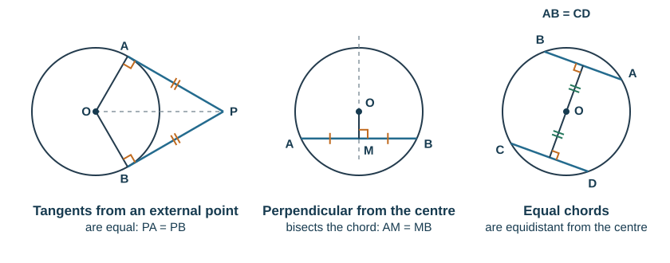

# Geometry

## Vocabulary

**Angles:** acute $<90°$, right $=90°$, obtuse $90°$–$180°$, reflex $>180°$.

**Triangles:** equilateral (3 equal sides, all 60°), isosceles (2 equal sides, 2 equal base angles), scalene (none equal), right-angled.

**Quadrilaterals:**

| Shape | Key properties |
|---|---|
| Square | 4 equal sides, 4 right angles, diagonals equal and bisect at 90° |
| Rectangle | opposite sides equal, 4 right angles, diagonals equal |
| Parallelogram | opposite sides parallel and equal, opposite angles equal |
| Rhombus | 4 equal sides, opposite angles equal, diagonals bisect at 90° |
| Trapezium | exactly one pair of parallel sides |
| Kite | two pairs of adjacent equal sides, one line of symmetry |

**Circle parts:** centre, radius, diameter, chord, tangent, arc, sector, segment, circumference.

**Similar** — same shape, equal angles, sides in proportion. **Congruent** — identical in shape and size.

## Angle rules

| Rule | Statement |
|---|---|
| Angles at a point | sum to 360° |
| Angles on a straight line | sum to 180° |
| Vertically opposite angles | equal |
| Corresponding angles (F shape) | equal |
| Alternate angles (Z shape) | equal |
| Co-interior angles (C shape) | sum to 180° |
| Angles in a triangle | sum to 180° |
| Exterior angle of a triangle | equals the sum of the two opposite interior angles |
| Angles in a quadrilateral | sum to 360° |

**Polygons.** For an $n$-sided polygon:

$$\text{sum of interior angles} = (n-2)\times180°$$
$$\text{sum of exterior angles} = 360° \text{ (always)}$$
$$\text{each exterior angle of a regular polygon} = \frac{360°}{n}$$

A regular octagon has exterior angles of $360/8 = 45°$, so interior angles of 135°, totalling $6\times180 = 1080°$.

If a regular polygon has interior angles of 162°, its exterior angles are 18°, so $n = 360/18 = 20$ sides. With interior angles of 160°, the exterior angle is 20° and $n = 18$.

**Mark-losing errors:** dividing 360 by the **interior** angle; using $(n-2)\times180$ for a single angle instead of the total; "Z angles" and "F angles" as reasons — write *alternate* and *corresponding*.

## Circle theorems

| Theorem | Statement | Reason to write |
|---|---|---|
| Angle at the centre | the angle at the centre is **twice** the angle at the circumference standing on the same arc | angle at centre = 2 × angle at circumference |
| Angle in a semicircle | the angle subtended by a diameter at the circumference is 90° | angle in a semicircle |
| Same segment | angles standing on the same arc, in the same segment, are equal | angles in the same segment |
| Cyclic quadrilateral | opposite angles sum to 180° | opposite angles of a cyclic quadrilateral |
| Tangent–radius | a tangent meets the radius at the point of contact at 90° | tangent ⟂ radius |
| Tangents from a point | the two tangents from an external point are equal in length | tangents from an external point are equal |
| Chord bisector | the perpendicular from the centre to a chord bisects it; the perpendicular bisector of a chord passes through the centre | perpendicular from centre bisects chord |
| Equal chords | equal chords are equidistant from the centre | equal chords are equidistant from the centre |
| Alternate segment | the angle between a tangent and a chord equals the angle in the alternate segment | alternate segment theorem |

The alternate segment theorem is in the current Cambridge 0580 syllabus but not on the school's objective list, so treat it as useful rather than certain to be needed.

**You must name the rule you used.** "Angles in the same segment are equal" earns the reason mark; "because they look the same" earns nothing. Write the reason next to each step. Radii are equal, so a triangle with two radii as sides is **isosceles** — this unlocks most multi-step questions.

**Worked examples** (letters as in the diagrams):

- *Angle at the centre.* $\angle APB = 48°$, so $\angle AOB = 2\times48 = 96°$ (angle at centre = 2 × angle at circumference).
- *Using the isosceles triangle.* $OA = OB$ (radii) and $\angle OAB = 42°$, so $\angle OBA = 42°$ and $\angle AOB = 180-84 = 96°$; then $\angle APB = 48°$.
- *Semicircle.* $AB$ is a diameter and $\angle CAB = 37°$. $\angle ACB = 90°$ (angle in a semicircle), so $\angle ABC = 180-90-37 = 53°$.
- *Same segment.* $\angle APB = 35°$, so $\angle AQB = 35°$ (angles in the same segment).
- *Cyclic quadrilateral.* $\angle DAB = 112°$, so the opposite angle $\angle BCD = 180-112 = 68°$.
- *Tangent–radius.* $PT$ is a tangent at $T$ and $\angle TOP = 28°$. $\angle OTP = 90°$ (tangent ⟂ radius), so $\angle OPT = 180-90-28 = 62°$.
- *Two tangents.* $PA$ and $PB$ are tangents and $\angle APB = 54°$. $PA = PB$, so triangle $PAB$ is isosceles and $\angle PAB = \tfrac{180-54}{2} = 63°$.
- *Chord.* A chord is 5 cm from the centre of a circle of radius 13 cm. The perpendicular bisects it, so half the chord is $\sqrt{13^2-5^2} = 12$ cm and the chord is 24 cm. Any other chord of length 24 cm is also 5 cm from the centre.
- *Alternate segment.* The tangent at $T$ makes $55°$ with chord $TA$, so $\angle TBA = 55°$. If also $\angle BTA = 70°$, then $\angle TAB = 180-55-70 = 55°$.

*Worked example (from a past paper type).* $AB$ is a diameter and $C$ is on the circumference. $\angle CAB = 34°$.

- $\angle ACB = 90°$ — angle in a semicircle
- $\angle ABC = 180 - 90 - 34 = 56°$ — angles in a triangle sum to 180°

**Mark-losing errors:** using "angle at the centre" when the two angles do not stand on the same arc; calling a quadrilateral cyclic when one vertex is the centre (it must have all four vertices on the circle); missing the 90° at a tangent; giving the answer without the reason.

Other circle results, such as lengths of intersecting chords or secants, are not on the objective list. When a question needs one, it states the formula, so substitute into it carefully.

## Symmetry

**Line symmetry** — a mirror line maps the shape onto itself. A rectangle has 2; a regular hexagon has 6; a parallelogram has 0.

**Rotational symmetry** — the **order** is the number of positions in a full turn where the shape looks unchanged. A parallelogram has order 2; a regular pentagon order 5; a scalene triangle order 1 (no rotational symmetry).

**Solids.** A prism has a uniform cross-section and a plane of symmetry through it; a cylinder has infinitely many. A pyramid on a regular base has as many planes of symmetry as the base has lines; a cone has infinitely many.

## Similar figures

If two figures are similar with a **length scale factor** $k$:

| Quantity | Scale factor |
|---|---|
| Length | $k$ |
| Area | $k^2$ |
| Volume | $k^3$ |

*Example.* Two similar cones have heights 6 cm and 9 cm, so $k = 1.5$. If the smaller has surface area 80 cm² and volume 100 cm³, the larger has surface area $80\times1.5^2 = 180$ cm² and volume $100\times1.5^3 = 337.5$ cm³.

Working backwards: if the volumes are 8 cm³ and 27 cm³, then $k^3 = 27/8$, so $k = 3/2$ and the areas are in the ratio $9:4$.

**Finding a missing length in similar triangles.** Match corresponding sides and set up a ratio:

$$\frac{AB}{DE} = \frac{BC}{EF}$$

Look for the equal angles first — that is what establishes similarity.

*Worked example.* In triangle $ABC$, $D$ is on $AB$ and $E$ is on $AC$ with $DE$ parallel to $BC$. $AD = 4$ cm, $DB = 6$ cm and $DE = 5$ cm.

- Triangles $ADE$ and $ABC$ are similar (corresponding angles are equal because $DE \parallel BC$, and $\angle A$ is shared).
- $k = \dfrac{AB}{AD} = \dfrac{4+6}{4} = 2.5$, so $BC = 5\times2.5 = 12.5$ cm.
- If triangle $ADE$ has area 20 cm², triangle $ABC$ has area $20\times2.5^2 = 125$ cm², and the trapezium $DECB$ has area $125-20 = 105$ cm².

**Mark-losing errors:** using $\dfrac{AB}{DB}$ (6) instead of $\dfrac{AB}{AD}$ — compare whole corresponding sides; multiplying an area by $k$ instead of $k^2$, or a volume by $k^2$ instead of $k^3$; for capacity or mass of similar solids, use $k^3$ (they are proportional to volume).

**Congruent triangles** are identical. They are proved congruent by **SSS** (three sides), **SAS** (two sides and the included angle), **ASA** (two angles and a corresponding side) or **RHS** (right angle, hypotenuse and one side). AAA proves only similarity, not congruence.

## Constructions

Use a **sharp pencil** and **leave all construction arcs visible** — they carry the marks.

**Triangle from three sides (SSS).** Draw the longest side. From one end, draw an arc of radius equal to the second side; from the other end, an arc equal to the third. Join the intersection to both ends.

**Perpendicular bisector of $AB$.** Set the compasses to more than half of $AB$. Draw arcs above and below from $A$, then from $B$ with the same radius. Join the two intersections. Every point on this line is **equidistant from $A$ and $B$**.

**Angle bisector of $\angle ABC$.** With the compasses at $B$, draw an arc crossing both arms. From each crossing, draw equal arcs that meet. Join $B$ to that meeting point. Every point on this line is **equidistant from the two arms**.

**Perpendicular from a point to a line.** Centre the compasses at the point, cut the line twice, then bisect the segment between those cuts.

## Scale drawings

A scale of 1 : 50 000 means 1 cm on the map is 50 000 cm = 0.5 km in reality.

To convert: real distance = map distance × scale. A 6.4 cm map measurement at 1 : 25 000 is $6.4\times25\,000 = 160\,000$ cm = 1.6 km.

Always state the scale on a drawing, and measure to the nearest millimetre.

## Loci

A **locus** is the set of all points satisfying a condition.

| Condition | Locus |
|---|---|
| A fixed distance $r$ from a point | a circle of radius $r$ |
| A fixed distance $d$ from a straight line | two parallel lines, $d$ either side (with semicircular ends if the line is a segment) |
| Equidistant from two points | the perpendicular bisector of the segment joining them |
| Equidistant from two intersecting lines | the two angle bisectors |

**Intersecting loci.** Draw each locus, then shade or mark the region satisfying all conditions at once. Read the inequality carefully: "less than 4 cm from $A$" is **inside** the circle; "nearer to $A$ than to $B$" is the side of the perpendicular bisector containing $A$. Use a solid line for inclusive boundaries and a dashed line for strict ones, and state what the shaded region means.
