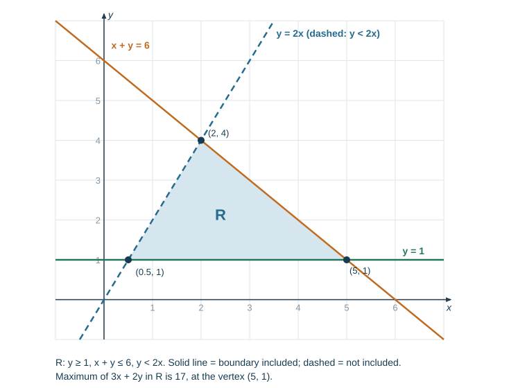

# Coordinate geometry and graphs

## Straight lines

$$y = mx + c$$

$m$ is the gradient, $c$ the $y$-intercept.

**Gradient from two points:**

$$m = \frac{y_2-y_1}{x_2-x_1}$$

Through $(1,3)$ and $(-2,-9)$: $m = \dfrac{-9-3}{-2-1} = \dfrac{-12}{-3} = 4$.

**Length of a line segment** (Pythagoras):

$$\text{length} = \sqrt{(x_2-x_1)^2+(y_2-y_1)^2}$$

From $(1,3)$ to $(5,6)$: $\sqrt{16+9} = 5$.

**Midpoint** — average the coordinates:

$$\left(\frac{x_1+x_2}{2},\ \frac{y_1+y_2}{2}\right)$$

Midpoint of $(1,3)$ and $(5,6)$ is $(3, 4.5)$.

**Finding the equation.** Get $m$, then substitute one point to find $c$.

Through $(1,3)$ with $m = 4$: $3 = 4(1)+c$, so $c = -1$ and $y = 4x-1$.

Equivalently, use $y-y_1 = m(x-x_1)$: $y-3 = 4(x-1)$, which gives $y = 4x-1$ again.

## Parallel and perpendicular lines

- **Parallel** lines have the **same gradient**.
- **Perpendicular** gradients multiply to $-1$: $m_2 = -\dfrac{1}{m_1}$.

A line parallel to $y = 4x-1$ through $(0,-3)$: same gradient 4, so $y = 4x-3$.

A line perpendicular to $y = 3x+1$ has gradient $-\tfrac13$.

A line perpendicular to the one through $(1,3)$ and $(-2,-9)$: that line has $m = 4$, so the perpendicular has $m = -\tfrac14$.

## Travel and conversion graphs

**Distance–time graph:** gradient = speed. Horizontal = stationary. Steeper = faster.

**Speed–time graph:** gradient = acceleration; **area under the line = distance travelled**.

For a linear speed–time graph, split the area into triangles and rectangles.

*Example.* A car accelerates from rest to 20 m/s in 8 s, holds 20 m/s for 10 s, then decelerates to rest in 4 s.

- Acceleration: $20/8 = 2.5$ m/s²
- Deceleration: $20/4 = 5$ m/s² (the gradient is $-5$)
- Distance: $\tfrac12(8)(20) + 10(20) + \tfrac12(4)(20) = 80+200+40 = 320$ m
- Average speed: $320/22 = 14.5$ m/s

*Working backwards.* A train accelerates from rest to 15 m/s in 10 s, travels at 15 m/s for $T$ seconds, then decelerates to rest in 5 s. It travels 600 m in total. Find $T$.

$$\tfrac12(10)(15) + 15T + \tfrac12(5)(15) = 600 \Rightarrow 75 + 15T + 37.5 = 600 \Rightarrow T = 32.5 \text{ s}$$

Its acceleration is $15/10 = 1.5$ m/s² and its deceleration $15/5 = 3$ m/s².

**Mark-losing errors:** reading the gradient of a speed–time graph as speed; mixing units (convert km/h to m/s by dividing by 3.6 before using seconds); giving a deceleration as a negative number when the question asks for the deceleration (state it as positive, or say "acceleration $= -3$ m/s²").

**Conversion graphs** are straight lines through the origin when the quantities are proportional. Read across and down; state the units.

## Curves to recognise

| Function | Shape |
|---|---|
| $y = ax$ | straight line through the origin |
| $y = ax^2$ | parabola; minimum if $a>0$, maximum if $a<0$ |
| $y = ax^3$ | cubic, rotational symmetry about the origin |
| $y = \dfrac{a}{x}$ ($ax^{-1}$) | reciprocal — two branches, asymptotes at both axes |
| $y = \dfrac{a}{x^2}$ ($ax^{-2}$) | both branches above the $x$-axis when $a>0$ |
| $y = a^x$ ($a>1$) | exponential — rises steeply, never reaches zero |
| $y = ax^0$ | horizontal line $y = a$ |

Graphs in the exam are built from $ax^n$ with $n = -2, -1, 0, 1, 2, 3$, and sums of up to **three** such terms — e.g. $y = x^2 + \tfrac{4}{x} - 3$.

**Asymptote** — a line the curve approaches but never meets. For $y = \tfrac ax$, both axes are asymptotes, and there is no value at $x = 0$: leave that cell of the table blank.

## Drawing a curve from a table

1. Substitute each $x$ into the function, including negatives, and record $y$ to 1 d.p.
2. Choose scales that fit the full range of $y$ values.
3. Plot each point; join with a **single smooth curve** — no straight segments, no feathering.

## Solving equations graphically

To solve $f(x) = k$, draw the horizontal line $y = k$ and read the $x$-coordinates where it cuts the curve.

To solve $f(x) = g(x)$, draw both and read the $x$-coordinates of the intersections.

To solve $x^2 - 3x = 2$ from a drawn graph of $y = x^2-3x$, draw $y = 2$ and read off both roots. Give answers to the accuracy your scale supports — usually 1 d.p.

## Gradient of a curve

The gradient changes along a curve, so you estimate it at a point by drawing a **tangent**:

1. Place a ruler touching the curve at that point only, matching the curve's direction.
2. Draw a long tangent line.
3. Take two widely separated points **on the tangent** and compute $\Delta y / \Delta x$.

The tangent gradient at a maximum or minimum is zero.

For a curve given by an equation, the exact gradient comes from differentiation — see [Calculus](../notes/calculus.md). Drawing a tangent only estimates it, so your answer is accepted within a range.

**Mark-losing errors:** a "tangent" that cuts the curve; a gradient triangle that is too small to read accurately; forgetting the sign — a curve going down to the right has a negative gradient.

## Exponential growth and decay

$$y = ka^x \text{ with } a>1 \text{ (growth)} \qquad y = ka^x \text{ with } 0<a<1 \text{ (decay)}$$

$y = a^{-x}$ with $a>1$ is also decay, because $a^{-x} = \left(\tfrac1a\right)^x$.

Growth curves rise slowly then steeply; decay curves fall steeply then flatten towards the $x$-axis without reaching it.

Real contexts: compound interest $P(1.04)^n$, depreciation $P(0.85)^n$, bacterial doubling $N_0 2^t$, radioactive decay.

*Worked example.* \$5000 is invested at 6% compound interest a year. After how many whole years does it first exceed \$8000?

Try values: $5000\times1.06^8 = \$7969.24$ (not yet) and $5000\times1.06^9 = \$8447.39$. So the answer is **9 years**.

*Half-life.* An 80 g sample halves every 3 days. After 12 days (four half-lives) it is $80\times0.5^4 = 5$ g.

**Mark-losing errors:** adding the same amount each year (that is simple interest); using $1.6$ instead of $1.06$ for 6%; giving the year it is reached as 8 because 7969 "rounds to" 8000.

## Inequalities and regions

A linear inequality in $x$ and $y$ describes a **region** on one side of a straight line.

1. Draw the boundary line as if it were an equation. Use a **solid** line for $\leqslant$ or $\geqslant$ (points on it are included) and a **dashed** line for $<$ or $>$.
2. Decide which side satisfies the inequality by testing a point not on the line, usually $(0,0)$.
3. Shade as the question says. Cambridge-style questions often ask you to **shade the unwanted region** and leave the required region $R$ unshaded — read the instruction.

$y > 2$ is above the horizontal line $y = 2$; $x \leqslant 3$ is on and to the left of the vertical line $x = 3$.

*Worked example.* Show the region $R$ satisfying $y \geqslant 1$, $x+y \leqslant 6$ and $y < 2x$.

- $y = 1$ — solid, region above it
- $x + y = 6$ through $(0,6)$ and $(6,0)$ — solid; test $(0,0)$: $0 \leqslant 6$ is true, so the region is on the origin side
- $y = 2x$ through $(0,0)$ and $(2,4)$ — dashed; test $(1,0)$: $0 < 2$ is true, so the region is below the line

The corners are where the lines cross: $(0.5, 1)$, $(5, 1)$ and $(2, 4)$.

**Linear programming.** To maximise or minimise an expression such as $3x+2y$ over the region, evaluate it at the corners (or at whole-number points near them if $x$ and $y$ must be whole numbers). Here $3x+2y$ is $3.5$ at $(0.5,1)$, $17$ at $(5,1)$ and $14$ at $(2,4)$, so the maximum is **17 at $(5, 1)$**. Corners on a dashed line are not in the region, which is why only whole-number points matter in practice.

**Finding the inequalities from a drawn region.** Find each boundary line's equation ($y = mx+c$), then use a point inside the region to choose the sign.

**Mark-losing errors:** shading the wrong side (always test a point); solid and dashed lines swapped; shading the wanted region when the question said to leave it unshaded.
