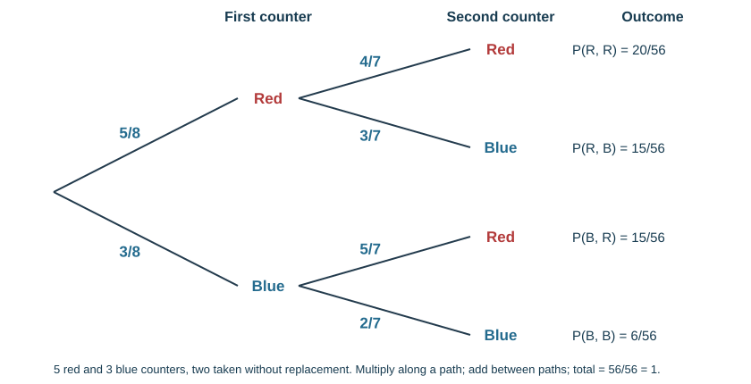
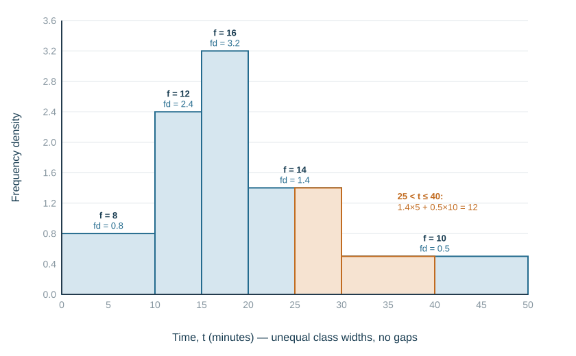
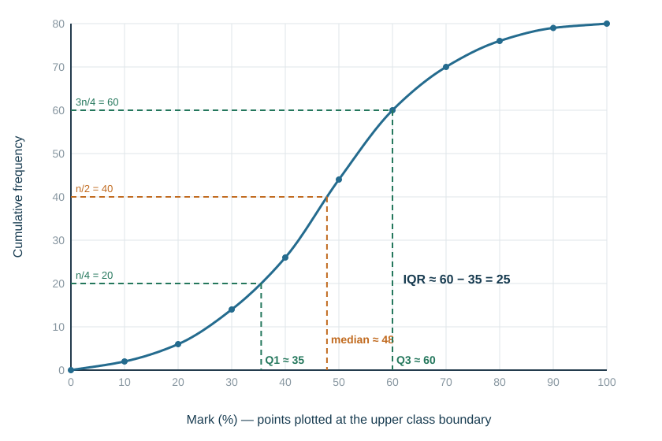
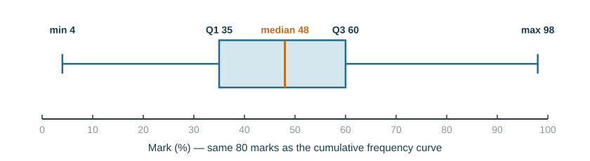

# Statistics and probability

## Probability basics

$$P(\text{event}) = \frac{\text{number of favourable outcomes}}{\text{total number of outcomes}}$$

Probability runs on a scale from **0** (impossible) to **1** (certain) and can be given as a fraction, decimal or percentage. Probabilities of all possible outcomes sum to 1.

$$P(\text{not } A) = 1 - P(A)$$

If $P(\text{rain}) = 0.35$ then $P(\text{no rain}) = 0.65$.

**Relative frequency** estimates probability from experimental data:

$$\text{relative frequency} = \frac{\text{number of times the event happened}}{\text{number of trials}}$$

The more trials, the closer it tends to the theoretical probability. In 200 spins a spinner lands on red 46 times, so $P(\text{red}) \approx 0.23$.

**Expected frequency** $=$ probability × number of trials. With $P = 0.23$ over 500 spins, expect about 115 reds.

## Combined events

**Possibility diagrams** — a grid of all outcomes, with each outcome a point. Two dice give a 6×6 grid of 36 equally likely outcomes. $P(\text{total} = 7) = \tfrac{6}{36} = \tfrac16$.

**Tree diagrams** — outcomes at the end of branches, probabilities beside them.

- **Along** the branches, **multiply** (AND)
- **Between** different complete paths, **add** (OR)
- The probabilities on each set of branches from a point sum to 1

*Without replacement* the second set of probabilities changes — the denominator drops by one.

*Example.* A bag holds 5 red and 3 blue counters; two are drawn without replacement.

$$P(\text{both red}) = \frac58\times\frac47 = \frac{20}{56} = \frac{5}{14}$$
$$P(\text{one of each}) = \frac58\times\frac37 + \frac38\times\frac57 = \frac{15}{56}+\frac{15}{56} = \frac{15}{28}$$
$$P(\text{both blue}) = \frac38\times\frac27 = \frac{6}{56} = \frac{3}{28}$$

Checking that all path probabilities sum to 1 catches most errors: $\tfrac{20+15+15+6}{56} = 1$.

**"At least one"** — use the complement: $P(\text{at least one blue}) = 1-P(\text{both red}) = 1-\tfrac{5}{14} = \tfrac{9}{14}$.

**Repeated independent trials.** A fair die is rolled three times. $P(\text{at least one six}) = 1-\left(\tfrac56\right)^3 = \tfrac{91}{216}$. $P(\text{exactly one six}) = 3\times\tfrac16\times\left(\tfrac56\right)^2 = \tfrac{25}{72}$ — the 3 counts the three positions the six could be in. (The 2023 final used the same idea with 0.6 × 0.4⁴ × 5.)

## Conditional probability

"The probability of $A$ **given that** $B$ has happened" is written $P(A \mid B)$. Restrict attention to the outcomes where $B$ happened:

$$P(A \mid B) = \frac{P(A \text{ and } B)}{P(B)}$$

*From a tree.* For the counters above, given that the **second** counter is red, what is the probability the first was red?

$$P(\text{2nd red}) = \frac{20}{56}+\frac{15}{56} = \frac{35}{56} \qquad P(\text{1st red} \mid \text{2nd red}) = \frac{20/56}{35/56} = \frac{20}{35} = \frac47$$

*From a two-way table.* Of 120 students, 70 walk to school (40 of them boys) and 50 take the bus (20 boys). A student is chosen at random.

- $P(\text{walks} \mid \text{boy}) = \dfrac{40}{60} = \dfrac23$ — the denominator is the 60 boys, not 120
- $P(\text{boy} \mid \text{walks}) = \dfrac{40}{70} = \dfrac47$

*From a Venn diagram.* With 30 students, 17 doing French, 15 History and 6 both: $P(\text{History} \mid \text{French}) = \dfrac{6}{17}$.

**Mark-losing errors:** dividing by the whole total instead of the "given" group; on a without-replacement tree, keeping the original denominator on the second branches; adding along a path instead of multiplying.

## Collecting and displaying data

**Discrete** data takes separate values (shoe sizes, number of pets). **Continuous** data can take any value in a range (height, time).

| Diagram | Use |
|---|---|
| Bar chart | compare discrete categories; equal bar widths, gaps between bars |
| Pie chart | show proportions of a whole |
| Pictogram | counts with a stated key |
| Histogram | continuous data in class intervals; **no gaps** |
| Scatter diagram | relationship between two variables |
| Cumulative frequency curve | medians, quartiles, percentiles |

**Pie chart angles:**

$$\text{angle} = \frac{\text{frequency}}{\text{total}}\times360°$$

With a total of 72 and a category of 18: $\tfrac{18}{72}\times360 = 90°$. The angles must sum to 360°.

## Histograms with unequal intervals

When class widths differ, the **area** of each bar represents the frequency, and the vertical axis is **frequency density**:

$$\text{frequency density} = \frac{\text{frequency}}{\text{class width}}$$

| Height (cm) | Frequency | Width | Frequency density |
|---|---|---|---|
| $0 < h \leqslant 10$ | 8 | 10 | 0.8 |
| $10 < h \leqslant 20$ | 22 | 10 | 2.2 |
| $20 < h \leqslant 50$ | 30 | 30 | 1.0 |

Going the other way, frequency = frequency density × class width. Label the axis "Frequency density" — "Frequency" loses the mark.

*Worked example.* Times $t$ (minutes) for 60 people:

| Time | Frequency | Width | Frequency density |
|---|---|---|---|
| $0 < t \leqslant 10$ | 8 | 10 | 0.8 |
| $10 < t \leqslant 15$ | 12 | 5 | 2.4 |
| $15 < t \leqslant 20$ | 16 | 5 | 3.2 |
| $20 < t \leqslant 30$ | 14 | 10 | 1.4 |
| $30 < t \leqslant 50$ | 10 | 20 | 0.5 |

- The tallest bar is $15 < t \leqslant 20$, so that is the modal class — even though it is not the widest.
- **Estimate the number between 25 and 40 minutes**: half of the $20$–$30$ bar and half of the $30$–$50$ bar, $1.4\times5+0.5\times10 = 7+5 = 12$. This assumes the values are spread evenly within each class.
- Estimated mean: $\dfrac{8(5)+12(12.5)+16(17.5)+14(25)+10(40)}{60} = \dfrac{1220}{60} = 20.3$ minutes.

**Mark-losing errors:** drawing bar heights equal to the frequencies; leaving gaps between bars; reading frequency off the vertical axis instead of multiplying by the width.

## Averages and range

| Measure | Definition | Best when |
|---|---|---|
| **Mean** | $\dfrac{\sum x}{n}$ | data is fairly symmetric; uses every value |
| **Median** | the middle value when ordered | there are extreme values (outliers) |
| **Mode** | the most frequent value | data is categorical, or you want the most common |
| **Range** | highest − lowest | a quick measure of spread; distorted by outliers |

The mean is affected by every value, so one extreme result pulls it; the median is not. For 2, 3, 3, 4, 88 the mean is 20 but the median is 3 — the median describes this data better.

For an even number of values, the median is the mean of the middle two.

**From a frequency table:**

$$\text{mean} = \frac{\sum fx}{\sum f}$$

| $x$ | $f$ | $fx$ |
|---|---|---|
| 1 | 4 | 4 |
| 2 | 7 | 14 |
| 3 | 9 | 27 |
| | 20 | 45 |

Mean $= 45/20 = 2.25$.

## Grouped data

With grouped data you do not know the individual values, so you **estimate** the mean using the **midpoint** of each class:

$$\text{estimated mean} = \frac{\sum f\times\text{midpoint}}{\sum f}$$

| Class | Midpoint | $f$ | $f\times$mid |
|---|---|---|---|
| $0<x\leqslant10$ | 5 | 6 | 30 |
| $10<x\leqslant20$ | 15 | 14 | 210 |
| $20<x\leqslant30$ | 25 | 10 | 250 |
| | | 30 | 490 |

Estimated mean $= 490/30 = 16.3$.

The **modal class** is the class with the highest frequency — here $10<x\leqslant20$. With unequal widths, it is the class with the highest **frequency density**.

## Cumulative frequency

Add the frequencies as you go, and plot against the **upper class boundary**. Join with a smooth curve (an S-shape).

From a curve with $n$ values, read across at:

| Position | Read at |
|---|---|
| Median ($Q_2$) | $\tfrac{n}{2}$ |
| Lower quartile ($Q_1$) | $\tfrac{n}{4}$ |
| Upper quartile ($Q_3$) | $\tfrac{3n}{4}$ |
| $p$th percentile | $\tfrac{p}{100}n$ |

$$\text{interquartile range} = Q_3 - Q_1$$

The IQR measures the spread of the middle half of the data, so unlike the range it is unaffected by extreme values. A smaller IQR means more consistent data.

*Worked example.* Marks of 80 students:

| Mark $m$ | $\leqslant10$ | $\leqslant20$ | $\leqslant30$ | $\leqslant40$ | $\leqslant50$ | $\leqslant60$ | $\leqslant70$ | $\leqslant80$ | $\leqslant90$ | $\leqslant100$ |
|---|---|---|---|---|---|---|---|---|---|---|
| Cumulative frequency | 2 | 6 | 14 | 26 | 44 | 60 | 70 | 76 | 79 | 80 |

- $n = 80$: read across at 20, 40 and 60.
- $Q_1 \approx 35$, median $\approx 48$, $Q_3 = 60$, so IQR $\approx 60-35 = 25$.
- **90th percentile**: read across at $0.9\times80 = 72$, giving about 73 — 90% scored 73 or less. (The 2022 final asked exactly this kind of percentile question.)
- **"How many scored more than 75?"** Read **up** from 75 to the curve: about 73 scored 75 or less, so about $80-73 = 7$ scored more.

Readings from a curve are estimates; the mark scheme accepts a small range.

**Box plot.** Draw a box from $Q_1$ to $Q_3$ with a line at the median, and whiskers out to the minimum and maximum. For these marks the lowest was 4 and the highest 98:

**Comparing two distributions** — make two comments, each with numbers:

1. **Average:** "Class B's median (55) is higher than class A's (48), so class B typically scored higher."
2. **Spread:** "Class A's IQR (25) is larger than class B's (15), so class A's marks were less consistent."

**Mark-losing errors:** plotting at the class midpoint instead of the upper boundary; reading the median at $\tfrac{n+1}{2}$ on a curve (use $\tfrac n2$); giving the range instead of the IQR; comparing without numbers or without context.

## Correlation and lines of best fit

A scatter diagram shows the relationship between two variables:

- **Positive correlation** — as one increases, so does the other (points slope up)
- **Negative correlation** — as one increases, the other decreases (points slope down)
- **Zero / no correlation** — no pattern

Describe the **strength** too: strong correlation means the points lie close to a line.

**Line of best fit**, drawn by eye: follow the trend of the points with roughly equal numbers either side, passing through the mean point. Use it to estimate a value, but note that estimating well outside the plotted range is unreliable.

Correlation does not prove that one variable **causes** the other.
