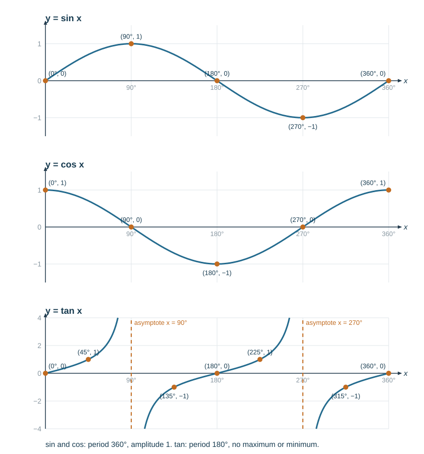

# Trigonometry

Angles are quoted in, and answers required in, **degrees to one decimal place**.

## Pythagoras' theorem

For a right-angled triangle with hypotenuse $c$:

$$a^2+b^2 = c^2$$

To find the hypotenuse, add; to find a shorter side, subtract.

$$c = \sqrt{5^2+12^2} = 13 \qquad a = \sqrt{13^2-5^2} = 12$$

## SOH CAH TOA

For an acute angle $\theta$ in a right-angled triangle:

$$\sin\theta = \frac{\text{opposite}}{\text{hypotenuse}} \qquad \cos\theta = \frac{\text{adjacent}}{\text{hypotenuse}} \qquad \tan\theta = \frac{\text{opposite}}{\text{adjacent}}$$

Label the triangle relative to the angle you are using: the hypotenuse is always opposite the right angle; "opposite" and "adjacent" swap if you switch to the other acute angle.

**Finding a side.** A ladder 6.0 m long leans at 65° to the ground. Height reached:

$$\sin65° = \frac{h}{6.0} \Rightarrow h = 6.0\sin65° = 5.44\ \text{m}$$

**Finding an angle.** Use the inverse function.

$$\tan\theta = \frac{7}{4} \Rightarrow \theta = \tan^{-1}(1.75) = 60.3°$$

## Elevation and depression

The **angle of elevation** is measured **up** from the horizontal; the **angle of depression** is measured **down** from the horizontal. They are equal between the same two points (alternate angles).

*Example.* From a cliff top 40 m above sea level, a boat has an angle of depression of 22°. Horizontal distance to the boat:

$$\tan22° = \frac{40}{d} \Rightarrow d = \frac{40}{\tan22°} = 99.0\ \text{m}$$

Always sketch the triangle and mark the horizontal before choosing a ratio.

## Bearings

Three-figure bearings are measured **clockwise from North**, always written with three digits: 000° to 360°.

- North 000°, East 090°, South 180°, West 270°
- North-east is 045°; 7° east of north is written 007°

**Back bearing** — add 180° if the bearing is less than 180°; otherwise subtract 180°. The bearing of $B$ from $A$ is 125°, so the bearing of $A$ from $B$ is 305°.

Bearings questions almost always need a sketch with a North arrow at **each** point.

## Obtuse angles

Sine and cosine extend beyond 90°:

$$\sin(180°-\theta) = \sin\theta \qquad \cos(180°-\theta) = -\cos\theta$$

So $\sin150° = \sin30° = 0.5$ and $\cos150° = -\cos30° = -0.866$.

**Consequence for the sine rule:** $\sin^{-1}$ on a calculator returns only the acute angle. If the problem allows an obtuse triangle, the second solution is $180° - $ that angle. Check which fits the diagram — this is the "ambiguous case".

## Trigonometric graphs and equations

For $0° \leqslant x \leqslant 360°$:

| Graph | Starts at | Maximum | Minimum | Crosses the $x$-axis |
|---|---|---|---|---|
| $y = \sin x$ | 0 | 1 at 90° | −1 at 270° | 0°, 180°, 360° |
| $y = \cos x$ | 1 | 1 at 0° and 360° | −1 at 180° | 90°, 270° |
| $y = \tan x$ | 0 | none | none | 0°, 180°, 360° (asymptotes at 90°, 270°) |

- $y = a\sin x$ or $y = a\cos x$ has **amplitude** $a$: it runs from $-a$ to $a$.
- $y = \sin bx$ has **period** $\tfrac{360°}{b}$, so $y = 2\sin2x$ has amplitude 2 and repeats every 180°.
- $y = \cos x - 1$ is $y = \cos x$ moved down 1, so it runs from −2 to 0.

**Solving an equation.** The calculator gives one angle; the graph's symmetry gives the other.

- $\cos x = \tfrac{\sqrt3}{2}$: $x = 30°$, and $360° - 30° = 330°$.
- $\sin x = k$: the second solution is $180° -$ the calculator angle.

| Equation | Calculator angle | Solutions in $0°$–$360°$ | Why |
|---|---|---|---|
| $\sin x = 0.4$ | $23.6°$ | $23.6°$, $156.4°$ | sin symmetric about 90° |
| $\sin x = -0.5$ | $-30°$ | $210°$, $330°$ | sin negative in 180°–360° |
| $\cos x = -0.3$ | $107.5°$ | $107.5°$, $252.5°$ | cos symmetric about 180°: $360-107.5$ |
| $\tan x = -1$ | $-45°$ | $135°$, $315°$ | tan repeats every 180° |

**Mark-losing errors:** giving only the calculator angle; giving a negative angle when the range is $0°$–$360°$; calculator in radians (sin 30 = −0.988 is the giveaway).

## Sine rule

For **any** triangle:

$$\frac{a}{\sin A} = \frac{b}{\sin B} = \frac{c}{\sin C}$$

Use it when you have an **angle and its opposite side**, plus one more piece.

*Example.* $A = 40°$, $B = 75°$, $a = 8.0$ cm. Find $b$:

$$b = \frac{8.0\sin75°}{\sin40°} = 12.0\ \text{cm}$$

Invert it when finding an angle:

$$\frac{\sin A}{a} = \frac{\sin B}{b}$$

**The ambiguous case.** When you find an angle with the sine rule, there may be two triangles. $\sin^{-1}$ gives the acute angle $B$; the obtuse angle $180°-B$ also works **if** it leaves room for the third angle.

*Worked example.* $A = 40°$, $a = 7$ cm, $b = 9$ cm. Find $B$.

$$\sin B = \frac{9\sin40°}{7} = 0.8264 \Rightarrow B = 55.7° \text{ or } 180-55.7 = 124.3°$$

Both are possible, because $40+124.3 < 180$. So there are two triangles:

- $B = 55.7°$, $C = 84.3°$, $c = \dfrac{7\sin84.3°}{\sin40°} = 10.8$ cm
- $B = 124.3°$, $C = 15.7°$, $c = \dfrac{7\sin15.7°}{\sin40°} = 2.95$ cm

Use the diagram (is $B$ drawn obtuse?) or the question's wording to choose.

*No ambiguity.* With $A = 40°$, $a = 10$, $b = 9$: $\sin B = 0.5785$, $B = 35.3°$. The obtuse option $144.7°$ would make $A+B > 180°$, so it is impossible. In general, if the side opposite the **given** angle is the longer of the two sides, there is only one triangle.

**Mark-losing errors:** never checking the obtuse option when the diagram shows an obtuse angle; finding the largest angle with the sine rule (use the cosine rule — it is never ambiguous).

## Cosine rule

$$a^2 = b^2+c^2-2bc\cos A$$

Use it when you have:
- **two sides and the included angle** (to find the third side), or
- **all three sides** (to find any angle), rearranged as

$$\cos A = \frac{b^2+c^2-a^2}{2bc}$$

*Example.* $b = 7$, $c = 9$, $A = 52°$:

$$a^2 = 49+81-2(7)(9)\cos52° = 130 - 77.6 = 52.4 \Rightarrow a = 7.24$$

*Example.* Sides 5, 7, 9 — find the largest angle (opposite the 9):

$$\cos A = \frac{25+49-81}{2(5)(7)} = \frac{-7}{70} = -0.1 \Rightarrow A = 95.7°$$

A negative cosine correctly gives an obtuse angle — no ambiguity with the cosine rule.

## Area of a triangle

$$\text{area} = \tfrac12 ab\sin C$$

where $C$ is the angle **between** sides $a$ and $b$.

With $a = 6$, $b = 8$, $C = 40°$: area $= \tfrac12(48)\sin40° = 15.4$ cm².

Use $\tfrac12 bh$ only when you actually have a perpendicular height.

## Which rule to use

| You know | Use |
|---|---|
| Right angle + 2 sides | Pythagoras |
| Right angle + side and angle | SOH CAH TOA |
| Angle + opposite side + one more | Sine rule |
| Two sides + included angle | Cosine rule |
| Three sides | Cosine rule (rearranged) |
| Two sides + included angle, want area | $\tfrac12 ab\sin C$ |

## Three dimensions

Work inside **one right-angled triangle at a time**. Draw that triangle separately, out of the 3-D figure, and label what you know.

**Angle between a line and a plane.** Drop a perpendicular from the far end of the line to the plane, then join the foot of that perpendicular to the line's start point. The angle is between the original line and that projection.

*Example.* A cuboid is $4\times3\times12$ cm. Find the angle the long diagonal makes with the base.

1. Base diagonal (by Pythagoras): $\sqrt{4^2+3^2} = 5$ cm.
2. That diagonal, the vertical edge 12 cm, and the space diagonal form a right-angled triangle.
3. $\tan\theta = \dfrac{12}{5} \Rightarrow \theta = 67.4°$

The space diagonal itself is $\sqrt{5^2+12^2} = 13$ cm.

*Example — pyramid.* A pyramid has a square base of side 8 cm, with its apex $V$ 10 cm vertically above the centre $M$ of the base. Find the angle between a sloping edge $VA$ and the base.

1. $MA$ is half the base diagonal: $\tfrac12\sqrt{8^2+8^2} = \sqrt{32} = 5.657$ cm.
2. Triangle $VMA$ is right-angled at $M$: $\tan\theta = \dfrac{10}{5.657}$, so $\theta = 60.5°$.
3. The edge itself is $\sqrt{32+100} = 11.5$ cm.

The angle between a **face** and the base uses the midpoint $N$ of a base edge instead: $MN = 4$, so $\tan\phi = \tfrac{10}{4}$ and $\phi = 68.2°$.

**Mark-losing errors:** using a sloping edge where the projection on the base is needed; using a side of the base (8) instead of half the diagonal; rounding the intermediate length to 5.7 and getting 60.3°.
