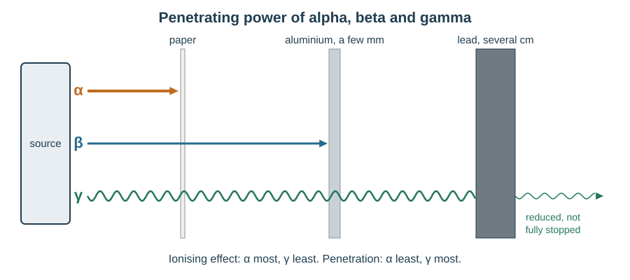
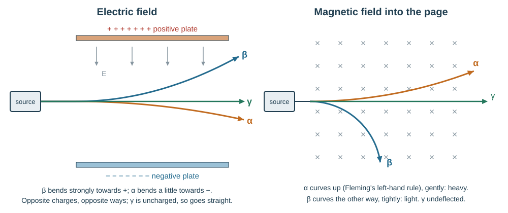
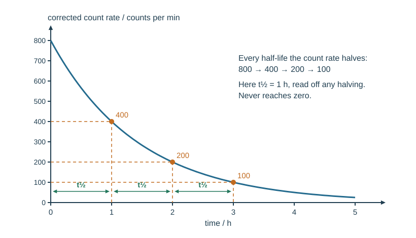
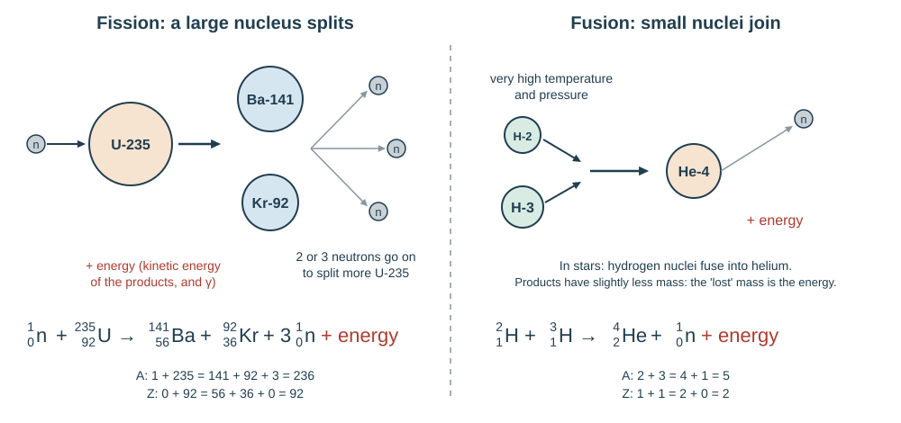

# Atomic physics and space

## Models of the atom

| Model | Picture | Why it was replaced |
|---|---|---|
| Hard sphere (Dalton) | solid indivisible ball | discovery of the electron |
| Plum pudding (Thomson) | electrons embedded in a positive dough | α-scattering results |
| Nuclear (Rutherford) | tiny positive nucleus, electrons orbiting | needed to explain fixed spectra |
| Bohr refinement | electrons in specific shells | — |

**Rutherford's α-scattering experiment.** A thin gold foil was bombarded with α-particles and the scattering was recorded at many angles. Three results and what each shows:

1. Most α-particles went **straight through** — the atom is mostly empty space, with a very small nucleus.
2. Some were **deflected** through small angles — there is a concentrated **positive** charge repelling them.
3. A very few **bounced back** through more than 90° — that positive charge is in a very small nucleus that holds **most of the mass** of the atom.

The plum-pudding model predicts only tiny deflections, so it had to go. The nucleus is roughly $10^5$ times smaller than the diameter of the inner electron orbits.

**Ions.** An atom that **loses** electrons becomes a **positive ion**; one that **gains** electrons becomes a **negative ion**. The nucleus is unchanged.

## Nucleus and nuclide notation

The nucleus contains **protons** and **neutrons** (together, **nucleons**). Electrons orbit outside.

| Particle | Relative charge | Relative mass | Where |
|---|---|---|---|
| Proton | +1 | 1 | nucleus |
| Neutron | 0 | 1 | nucleus |
| Electron | −1 | about 1/1840 (negligible) | orbits |

A **nuclide** is one specific nucleus, written in **nuclide notation**:

$${}^{A}_{Z}\mathrm{X}$$

- $Z$ = **proton number** (atomic number) — identifies the element, and is the relative **charge** of the nucleus ($+Z$)
- $A$ = **nucleon number** (mass number) = protons + neutrons — the relative **mass** of the nucleus
- number of neutrons $= A - Z$

**Worked example.** ${}^{235}_{\ 92}\mathrm{U}$ has 92 protons, $235 - 92 = 143$ neutrons and 235 nucleons. Its nucleus has charge $+92$ (in units of the proton charge).

**Isotopes** are nuclides of the same element — same $Z$, different $A$, so different numbers of neutrons. Carbon-12 and carbon-14 are isotopes: both $Z = 6$, with 6 and 8 neutrons. An element can have several isotopes; some are stable, some radioactive.

Particles and radiations in nuclide notation — learn these, they are the building blocks of every nuclear equation:

| Particle | Symbol | $A$ | $Z$ |
|---|---|---|---|
| α-particle (helium nucleus) | ${}^{4}_{2}\mathrm{He}$ or ${}^{4}_{2}\alpha$ | 4 | 2 |
| β-particle (fast electron) | ${}^{\ \ 0}_{-1}\mathrm{e}$ or ${}^{\ \ 0}_{-1}\beta$ | 0 | −1 |
| γ-ray | ${}^{0}_{0}\gamma$ | 0 | 0 |
| neutron | ${}^{1}_{0}\mathrm{n}$ | 1 | 0 |
| proton | ${}^{1}_{1}\mathrm{p}$ (or ${}^{1}_{1}\mathrm{H}$) | 1 | 1 |

The β-particle gets $Z = -1$ because it carries one negative charge; $A = 0$ because an electron is not a nucleon.

## The three emissions

| | α (alpha) | β⁻ (beta) | γ (gamma) |
|---|---|---|---|
| What it is | helium nucleus, 2p + 2n | fast electron **from the nucleus** | high-frequency EM wave |
| Notation | ${}^{4}_{2}\mathrm{He}$ | ${}^{\ \ 0}_{-1}\mathrm{e}$ | ${}^{0}_{0}\gamma$ |
| Relative charge | +2 | −1 | 0 |
| Relative mass | 4 | about 1/1840 | 0 |
| Typical speed | slow (about 5% of $c$) | fast (up to 98% of $c$) | $c$ |
| Ionising effect | **most** | medium | **least** |
| Range in air | a few cm | about a metre | very large; intensity falls with distance |
| Stopped by | a sheet of paper (or skin) | a few mm of aluminium | reduced by thick lead or concrete, never fully stopped |
| Deflected by fields? | yes, slightly (heavy) | yes, strongly, the opposite way | no (uncharged) |

**Why the ionising powers differ — kinetic energy and charge.** An α-particle has a **charge of +2** and a large mass, so it moves slowly and pulls hard on the electrons of every atom it passes. It ionises densely, losing its kinetic energy within a few centimetres of air. A β-particle has a smaller charge (−1) and is fast and light, so it interacts less often and travels further. A γ-ray has **no charge**, interacts only rarely, and travels furthest. **The more strongly it ionises, the less it penetrates** — every ionisation uses up some of its energy.

### Deflection in electric and magnetic fields

- **Electric field** (between charged plates): α is attracted to the **negative** plate, β to the **positive** plate — electrostatic attraction. β is deflected much more because its mass is so much smaller. γ is not deflected.
- **Magnetic field**: apply **Fleming's left-hand rule**. A moving α-particle counts as conventional current in its direction of travel; a β⁻ particle moving one way is a conventional current the **other** way, so it curves the opposite way. β curves tightly (light), α gently (heavy). γ is undeflected.

Deflection in a field is the test that tells α, β and γ apart by **charge**; absorption (paper, aluminium, lead) tells them apart by **penetration**.

β⁺ (positron) emission is **not in scope** — the Pre-Q objectives and the IGCSE 0625 syllabus both say every β here means β⁻. (For reference only: in β⁺ decay a proton becomes a neutron and $Z$ falls by 1. Do not use it in answers.)

## Radioactive decay

**Radioactive decay** is a change in an **unstable nucleus** in which it emits an α-particle or a β-particle, and/or γ-radiation, becoming more stable. Decay is **random** and **spontaneous**: you cannot predict which nucleus decays next, or when, and nothing (temperature, pressure, chemical bonding) speeds it up or slows it down. Emission is also random in **direction**.

Why a nucleus is unstable: it has **too many neutrons** for its protons, and/or it is **too heavy**. β-decay reduces the excess of neutrons; α-decay makes a heavy nucleus lighter; γ-emission gets rid of surplus energy.

In **α or β decay** the proton number changes, so the nucleus becomes a **different element**. In **γ emission** it does not.

### The three decay equations

**α-decay** — the nucleus loses 2 protons and 2 neutrons.

$${}^{A}_{Z}\mathrm{X} \rightarrow {}^{A-4}_{Z-2}\mathrm{Y} + {}^{4}_{2}\mathrm{He}$$

*Example.* Uranium-238 decays by α emission:

$${}^{238}_{\ 92}\mathrm{U} \rightarrow {}^{234}_{\ 90}\mathrm{Th} + {}^{4}_{2}\mathrm{He}$$

Check: $238 = 234 + 4$ ✓ and $92 = 90 + 2$ ✓. Uranium (92) has become thorium (90).

**β⁻-decay** — inside the nucleus **a neutron changes into a proton and an electron**, and the electron is shot out as the β-particle:

$${}^{1}_{0}\mathrm{n} \rightarrow {}^{1}_{1}\mathrm{p} + {}^{\ \ 0}_{-1}\mathrm{e}$$

So the nucleon number stays the same (one neutron swapped for one proton) and the proton number goes **up by one**:

$${}^{A}_{Z}\mathrm{X} \rightarrow {}^{\ \ \ A}_{Z+1}\mathrm{Y} + {}^{\ \ 0}_{-1}\mathrm{e}$$

*Example.* Carbon-14 decays by β emission:

$${}^{14}_{\ 6}\mathrm{C} \rightarrow {}^{14}_{\ 7}\mathrm{N} + {}^{\ \ 0}_{-1}\mathrm{e}$$

Check: $14 = 14 + 0$ ✓ and $6 = 7 + (-1)$ ✓. Carbon (6) has become nitrogen (7). Strontium-90 does the same: ${}^{90}_{38}\mathrm{Sr} \rightarrow {}^{90}_{39}\mathrm{Y} + {}^{\ \ 0}_{-1}\mathrm{e}$.

**γ-emission** — the nucleus loses surplus energy as an electromagnetic wave. Nothing changes in $A$ or $Z$; the element is the same. γ is usually emitted **straight after an α or β decay**, when the new nucleus is left with excess energy (an "excited" nucleus, marked with an asterisk).

$${}^{A}_{Z}\mathrm{X}^{*} \rightarrow {}^{A}_{Z}\mathrm{X} + {}^{0}_{0}\gamma$$

*Example.* Cobalt-60 β-decays to an excited nickel-60 nucleus, which then emits γ:

$${}^{60}_{27}\mathrm{Co} \rightarrow {}^{60}_{28}\mathrm{Ni}^{*} + {}^{\ \ 0}_{-1}\mathrm{e} \qquad {}^{60}_{28}\mathrm{Ni}^{*} \rightarrow {}^{60}_{28}\mathrm{Ni} + {}^{0}_{0}\gamma$$

### What happens to A and Z

| Emission | Change to $A$ | Change to $Z$ | Neutrons | Protons | New element? |
|---|---|---|---|---|---|
| α | **−4** | **−2** | −2 | −2 | yes, two places down the periodic table |
| β⁻ | **0** | **+1** | −1 | +1 | yes, one place up |
| γ | 0 | 0 | 0 | 0 | **no** |

### How to balance a nuclear equation

1. Write the parent nucleus on the left and every product on the right, all in ${}^{A}_{Z}\mathrm{X}$ form.
2. **Top numbers**: total $A$ on the left = total $A$ on the right.
3. **Bottom numbers**: total $Z$ on the left = total $Z$ on the right (the β-particle counts as $-1$).
4. Use the new $Z$ to name the element (from the periodic table given in the question).

*Worked example — find the unknown.* ${}^{222}_{\ 86}\mathrm{Rn} \rightarrow {}^{218}_{\ 84}\mathrm{Po} + \mathrm{X}$. Then $A_X = 222 - 218 = 4$ and $Z_X = 86 - 84 = 2$, so X is ${}^{4}_{2}\mathrm{He}$ — an **α-particle**.

*Worked example — a decay chain.* ${}^{238}_{\ 92}\mathrm{U}$ emits an α, then two β⁻ in turn. After α: $A = 234$, $Z = 90$ (thorium). After the first β: $A = 234$, $Z = 91$ (protactinium). After the second β: $A = 234$, $Z = 92$ — **uranium again**, now ${}^{234}_{\ 92}\mathrm{U}$, an isotope of the original.

**This loses marks**

- Writing the β-particle as ${}^{0}_{1}\mathrm{e}$ — its proton number is **−1**.
- Taking 2 off $A$ for an α-decay instead of 4. α changes $A$ by 4 and $Z$ by 2.
- Saying β-decay "removes an electron from the shell". The electron is **created in the nucleus** when a neutron turns into a proton.
- Saying γ-emission changes the element. It changes neither $A$ nor $Z$.
- Not checking both rows of numbers. Always add up the top row and the bottom row separately.

## Background radiation and detection

**Background radiation** is the low level of ionising radiation that is always present. Significant sources:

- **radon gas** in the air (seeping from rocks; the largest single source)
- **rocks and buildings** (granite, bricks, concrete)
- **food and drink** (e.g. potassium-40)
- **cosmic rays** from space
- medical uses (X-rays, scans) and, very slightly, nuclear industry and weapons tests

**Detection.** A **Geiger–Müller (GM) tube** connected to a **counter** (scaler or ratemeter) registers one count per ionising particle entering it. Count rate is quoted in **counts/s** or **counts/minute**. Photographic film (film badges) and cloud chambers also detect emissions.

To identify an emission experimentally, place paper, then aluminium, then lead between source and GM tube and see which absorber makes the count rate fall to background.

**Corrected count rate** = measured count rate − background count rate. Measure the background first, with no source present, for a long time (to average out randomness).

## Half-life

The **half-life** of an isotope is the time taken for **half the nuclei** of that isotope in any sample to decay — equivalently, for the **count rate** (activity) to fall to half. Each isotope has its own fixed half-life, from fractions of a second to billions of years.

After 1 half-life, ½ remains; after 2, ¼; after 3, ⅛; after $n$, $(\tfrac12)^n$.

**From a decay curve.** Read the starting value, halve it, and read across to the curve and down to the time axis. Do it twice from different starting points and average for a better answer. The curve never reaches zero.

**Worked example (table).** A source has a corrected count rate of 800 counts/min. Four hours later it reads 50 counts/min. Find the half-life.

$800 \to 400 \to 200 \to 100 \to 50$ is **4 half-lives** in 4 hours, so the half-life is **1 hour**.

**Worked example (what remains).** A 6.4 g sample of iodine-131 has a half-life of 8 days. How much is left after 24 days? $24/8 = 3$ half-lives: $6.4 \to 3.2 \to 1.6 \to 0.80$ g.

**Worked example with background.** The background is 20 counts/min. A sample reads 340 counts/min initially and 100 counts/min after 90 minutes.

Corrected: $340 - 20 = 320$ and $100 - 20 = 80$. That is a fall by a factor of 4, so 2 half-lives in 90 min — a half-life of **45 minutes**.

If the graph shows **uncorrected** counts, the curve levels off at the background count instead of heading towards zero. Subtract the background from every reading before halving.

**This loses marks:** forgetting to subtract the background is the single most common error in these questions; halving the *time* instead of the count; quoting the time for the count to reach zero.

## Uses of radioactivity

The choice of isotope depends on **which emission** (penetration and ionisation) and **how long its half-life is**.

| Use | Emission | Half-life | Why |
|---|---|---|---|
| Smoke alarm (americium-241) | α | long (hundreds of years) | α ionises the air in a small gap, letting a tiny current flow; smoke absorbs the α and the current drops, setting off the alarm. Paper-thin range, so safe. Long half-life — no replacement needed |
| Thickness control of paper, foil, plastic sheet | β | long (years) | β partly passes through thin sheets; the count rate beyond the sheet changes with thickness. α would all be stopped; γ would pass almost unchanged |
| Thickness of thick steel sheet | γ | long | only γ penetrates thick metal |
| Sterilising medical equipment | γ | long (e.g. cobalt-60, about 5 years) | penetrates the sealed packaging and kills bacteria |
| Irradiating food | γ | long | kills bacteria so food keeps longer; the food does **not** become radioactive |
| Medical tracer (diagnosis) | γ | **short** (hours, e.g. technetium-99m, about 6 h) | γ escapes the body to a detector; short half-life limits the dose |
| Cancer treatment (radiotherapy) | γ | long source | beams aimed at the tumour from many angles kill cancer cells |
| Carbon dating | β (carbon-14) | 5700 years | fraction of C-14 left in dead organic material gives its age |

## Safety

Ionising radiation damages living cells: it can cause **cell death** (high dose), or **mutation** of DNA leading to **cancer** (lower dose). Outside the body, α is least dangerous (stopped by skin) and γ most; **inside** the body (breathed in or swallowed), α is the most dangerous because all its ionisation is concentrated in nearby cells.

Safe practice reduces **exposure time**, increases **distance** and uses **shielding**:

- **Time:** use the source for as short a time as possible.
- **Distance:** handle with long tongs, never with bare hands; point it away from people. Intensity falls rapidly with distance.
- **Shielding:** store sources in lead-lined boxes in a locked cupboard; lead or concrete walls for γ; protective screens.
- Wear a **film badge** to monitor the dose received; label containers; return the source immediately after use.

## Fission and fusion

**Nuclear fission** is the splitting of a large, unstable nucleus into two smaller nuclei of roughly equal size. **Nuclear fusion** is the joining of two small (light) nuclei to form one larger nucleus. Both release energy.

### Fission

A slow neutron is absorbed by a uranium-235 nucleus, making it very unstable. It splits into two smaller **daughter nuclei**, releasing **2 or 3 neutrons** and a large amount of energy (as kinetic energy of the products, plus γ-rays).

General form:

$${}^{1}_{0}\mathrm{n} + {}^{235}_{\ 92}\mathrm{U} \rightarrow \text{two smaller nuclei} + 2\text{ or }3\,{}^{1}_{0}\mathrm{n} + \text{energy}$$

Two possible splits — the daughter nuclei vary from one fission to the next:

$${}^{1}_{0}\mathrm{n} + {}^{235}_{\ 92}\mathrm{U} \rightarrow {}^{141}_{\ 56}\mathrm{Ba} + {}^{92}_{36}\mathrm{Kr} + 3\,{}^{1}_{0}\mathrm{n} + \text{energy}$$

$${}^{1}_{0}\mathrm{n} + {}^{235}_{\ 92}\mathrm{U} \rightarrow {}^{140}_{\ 54}\mathrm{Xe} + {}^{94}_{38}\mathrm{Sr} + 2\,{}^{1}_{0}\mathrm{n} + \text{energy}$$

Check the first: $A$: $1 + 235 = 141 + 92 + 3(1) = 236$ ✓; $Z$: $0 + 92 = 56 + 36 + 3(0) = 92$ ✓. Remember to multiply the neutron by how many there are.

**Chain reaction.** The neutrons released can each split another U-235 nucleus, which releases more neutrons, and so on. In a **nuclear reactor** the chain reaction is kept steady:

- **control rods** (boron or cadmium) absorb spare neutrons — lowered further in to slow the reaction, raised to speed it up;
- a **moderator** (graphite or water) slows the fast neutrons, because slow neutrons are much more likely to be absorbed by U-235;
- the energy heats a coolant, which makes steam to drive a turbine and generator.

(Reactor details are context; IGCSE asks only for the fission process and its equation.) An uncontrolled chain reaction is an atomic bomb.

### Fusion

Two light nuclei, such as isotopes of hydrogen, collide and **join** to form a heavier nucleus, releasing energy. Because both nuclei are **positive**, they repel strongly; fusion only happens at **extremely high temperature** (millions of °C, so the nuclei move fast enough) and **high pressure/density** (so they collide often enough) — conditions found in the cores of **stars**.

$${}^{2}_{1}\mathrm{H} + {}^{3}_{1}\mathrm{H} \rightarrow {}^{4}_{2}\mathrm{He} + {}^{1}_{0}\mathrm{n} + \text{energy}$$

$${}^{1}_{1}\mathrm{H} + {}^{2}_{1}\mathrm{H} \rightarrow {}^{3}_{2}\mathrm{He} + {}^{0}_{0}\gamma$$

Check the first: $A$: $2 + 3 = 4 + 1$ ✓; $Z$: $1 + 1 = 2 + 0$ ✓. In the **Sun** and other stable stars, hydrogen nuclei fuse, in several steps, into **helium**.

**Mass and energy.** In both fission and fusion the total mass of the products is slightly **less** than the total mass before; that "missing" mass has been converted into the energy released. (No values are needed.)

### Fission vs fusion

| | Fission | Fusion |
|---|---|---|
| What happens | one large nucleus **splits** into two smaller ones | two small nuclei **join** into one larger one |
| Typical nuclei | uranium-235, plutonium-239 | hydrogen isotopes → helium |
| Trigger / conditions | absorbs a slow **neutron**; works at ordinary temperatures | **very high temperature and pressure** to overcome repulsion of positive nuclei |
| Products | two daughter nuclei + 2–3 neutrons + energy | larger nucleus (+ maybe a neutron) + energy |
| Where it happens | **nuclear power stations** (all current reactors) | the **Sun and stars**; research reactors on Earth |
| Waste | radioactive daughter nuclei, long-lived waste | helium, little long-lived waste |
| Electricity on Earth? | yes, now | not yet — research continues into large-scale fusion power |
| Mass of products | slightly less than before → energy | slightly less than before → energy |

**This loses marks:** "fission is when atoms split" — it is the **nucleus** that splits; saying fusion "needs a neutron to start it"; saying nuclear power stations use fusion; forgetting the 2–3 neutrons in a fission equation.

## The Earth, Moon and Sun

- The Earth **rotates** on its tilted axis once in about **24 hours**. This causes day and night and the Sun's apparent daily motion from east to west across the sky.
- The Earth **orbits** the Sun once in about **365 days** (a year). Because the axis is **tilted** (about 23°), each hemisphere leans towards the Sun for part of the orbit (summer: Sun higher, longer days, more concentrated sunlight) and away for the other part (winter) — the **seasons**.
- The Moon orbits the Earth in about **one month** (27–29 days). The Moon reflects sunlight; as it orbits, we see different fractions of its lit half — the cycle of **phases** (new, crescent, quarter, gibbous, full).

## The Solar System

The Solar System contains:

- **one star**, the Sun, which holds over 99% of the Solar System's mass — so its gravity dominates and the planets orbit **it**;
- **eight planets**, in order from the Sun: **Mercury, Venus, Earth, Mars, Jupiter, Saturn, Uranus, Neptune** ("My Very Easy Method Just Speeds Up Naming");
- **minor planets**, including **dwarf planets** such as Pluto, and **asteroids** (most in the asteroid belt between Mars and Jupiter);
- **moons** (natural satellites) orbiting planets;
- smaller bodies such as **comets** — icy bodies on very elongated elliptical orbits.

The four inner planets are **small and rocky**; the four outer planets are **large and gaseous**. The **accretion model** explains this: the Solar System formed from a rotating interstellar cloud of gas and dust containing many elements. **Gravity** pulled it together; the rotation flattened it into an **accretion disc** around the young Sun. Near the hot Sun only rocky and metallic material could condense, building small rocky planets; further out, where it was colder, ices and huge amounts of gas could gather, building the gas giants.

## Orbits and gravity

An **orbit** is the curved path of one body around another under gravity. Planets, minor planets and comets have **elliptical** orbits — an oval with the Sun **not at the centre** (it is at one focus). Many planetary orbits are nearly circular, so the Sun is close to the centre.

The force that keeps a planet in orbit is the **gravitational attraction of the Sun**; it acts towards the Sun and constantly changes the planet's direction.

For a near-circular orbit, the average orbital speed is the circumference divided by the period:

$$v = \frac{2\pi r}{T}$$

where $r$ is the average orbital radius (m) and $T$ the orbital period (s).

**Worked example.** A satellite orbits at $r = 7.0\times10^6$ m with a period of 100 minutes (6000 s):

$$v = \frac{2\pi(7.0\times10^6)}{6000} = 7.3\times10^3\ \text{m/s}$$

Gravitational field strength:

- at a planet's **surface**, it depends on the planet's **mass** — Jupiter's surface field is far stronger than the Moon's
- **around** a planet (or the Sun), it **decreases** as the distance increases

So planets further from the Sun feel a weaker pull and **orbit more slowly**, as well as having further to go — their years are much longer.

**Speed around an elliptical orbit.** A body moves **fastest when closest** to the Sun. Explained by **conservation of energy**: as it falls inwards it loses gravitational potential energy and gains the same amount of kinetic energy; moving outwards, kinetic energy is converted back into gravitational potential energy and it slows.

**Interpreting planetary data.** Questions give a table (orbital distance, orbital period, density, surface temperature, surface $g$). Look for trends: period increases with distance; surface temperature generally falls with distance (Venus is the exception, because of its thick CO₂ atmosphere); inner planets have high density (rock and metal), outer planets low density (gas).

**Light travel time.** Light crosses space at $c = 3.0\times10^8$ m/s, so

$$t = \frac{d}{c}$$

Sun to Earth, $d = 1.5\times10^{11}$ m: $t = 1.5\times10^{11}/3.0\times10^8 = 500$ s, about **8 minutes**. We see the Sun as it was 8 minutes ago.

## Stars and galaxies

**The Sun** is a **medium-sized star**, made mostly of **hydrogen and helium**. It radiates most of its energy as **infrared, visible light and ultraviolet**. Stars are powered by **nuclear fusion**; in stable stars, **hydrogen fuses into helium**.

A **galaxy** is a group of many billions of stars. The Sun is one star in the **Milky Way** galaxy. The other stars of the Milky Way are much further from Earth than the Sun is.

A **light-year** is a **distance** — not a time — equal to the distance light travels in (the vacuum of) space in one year, about $9.5\times10^{15}$ m. Check: $3.0\times10^8 \times 365 \times 24 \times 3600 = 9.5\times10^{15}$ m.

The Milky Way is one of many billions of galaxies making up the Universe. Its diameter is about **100 000 light-years**.

### Life cycle of a star

1. A star forms from an **interstellar cloud of gas and dust** (a nebula) containing hydrogen.
2. **Gravity** pulls the cloud together. It collapses and heats up: a **protostar**.
3. When the core is hot enough, hydrogen fusion starts. The star becomes **stable** when the **inward force of gravity is balanced by an outward force due to the high temperature** (pressure) in the centre. It stays stable for most of its life — billions of years for the Sun.
4. All stars eventually **run out of hydrogen** in the core. When most of the core hydrogen has become helium, the star **expands**:
   - most stars (like the Sun) become **red giants**;
   - much more massive stars become **red supergiants**.
5. A red giant from a less massive star throws off its outer layers as a **planetary nebula**, leaving a small hot **white dwarf** at its centre, which slowly cools.
6. A red supergiant **explodes as a supernova**, forming a nebula containing hydrogen and **new heavier elements**, and leaving behind a **neutron star** or (for the most massive) a **black hole**.
7. The nebula from a supernova may form **new stars with orbiting planets** — which is where the heavy elements in the Earth (and in us) came from.

**This loses marks:** "the star becomes a red giant when it runs out of fuel" — it runs out of **hydrogen in its core**; saying the Sun will become a supernova (it is not massive enough); calling a light-year a time.

## Astronomical distances

The distance $d$ to a far galaxy can be found from the **brightness of a supernova** in it: supernovae of a given type have a known actual brightness, so the observed brightness reveals how far away they are.

## Redshift and the expanding Universe

**Redshift** is an increase in the observed wavelength of electromagnetic radiation emitted from receding stars and galaxies.

Light from distant galaxies is redshifted compared with the same light emitted on Earth. Almost every galaxy is redshifted, and the further away it is the greater the shift — evidence that the **Universe is expanding**, which supports the **Big Bang theory**. The recession speed $v$ can be calculated from the size of the wavelength change.

**Cosmic microwave background radiation (CMBR).** Microwave radiation of a specific frequency is observed coming from **all directions**, at all points in space around us. It was produced **shortly after the Universe was formed** (as high-energy radiation); as the Universe expanded, its wavelength was stretched until it is now in the **microwave** region. It is the second key piece of evidence for the Big Bang.

| Evidence | What is observed | What it shows |
|---|---|---|
| Redshift | light from distant galaxies shifted to longer wavelengths, more so for further galaxies | galaxies are receding; the Universe is expanding |
| CMBR | uniform microwave radiation from every direction | the early Universe was hot and dense; its radiation has been stretched by expansion |

## Hubble's law

The **Hubble constant** $H_0$ is the ratio of a galaxy's recession speed to its distance from Earth:

$$H_0 = \frac{v}{d}$$

with $v$ in m/s, $d$ in m, so $H_0$ in s⁻¹. The current estimate is $H_0 \approx 2.2\times10^{-18}$ s⁻¹.

**Worked example.** A galaxy is $5.0\times10^{24}$ m away. Its recession speed is $v = H_0 d = 2.2\times10^{-18} \times 5.0\times10^{24} = 1.1\times10^7$ m/s.

Rearranged, $\dfrac{d}{v} = \dfrac{1}{H_0}$ gives an **estimate of the age of the Universe** — the time for which galaxies have been separating at their present rates. That a single number works for galaxies in every direction is evidence that all the matter in the Universe was once at a single point.

$$\frac{1}{H_0} = \frac{1}{2.2\times10^{-18}} = 4.5\times10^{17}\ \text{s} \approx 14\ \text{billion years}$$
