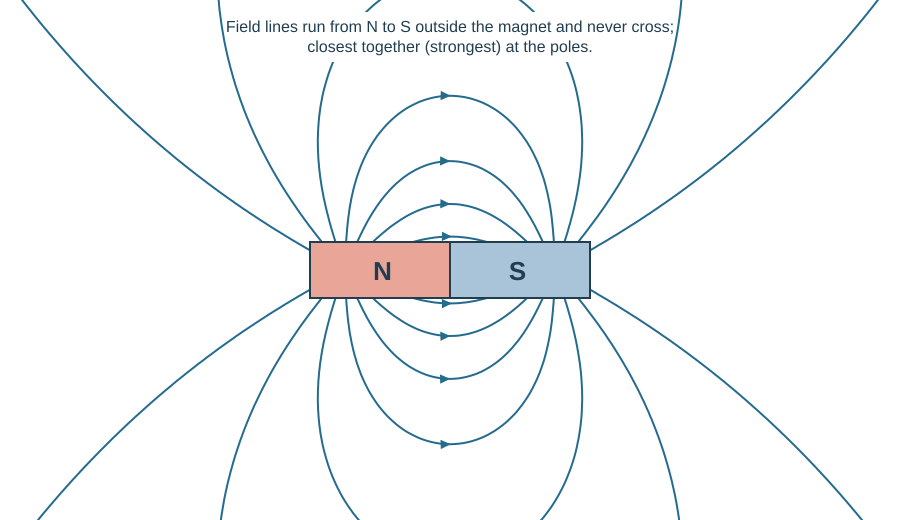
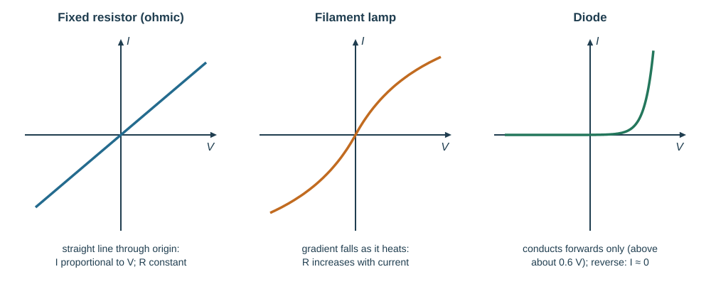
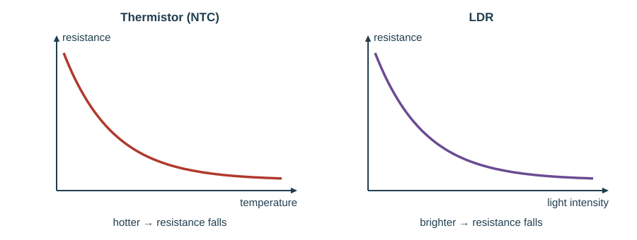
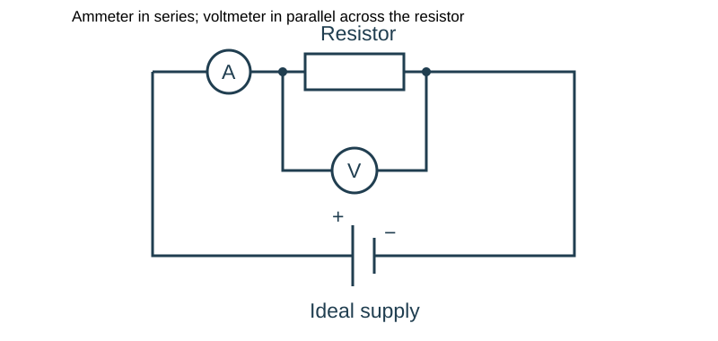
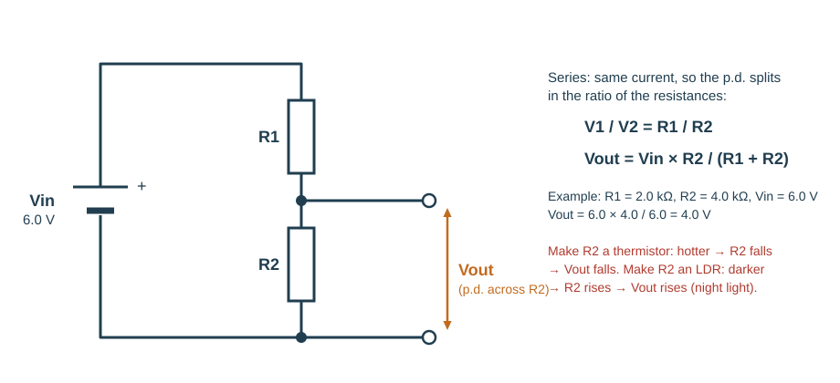
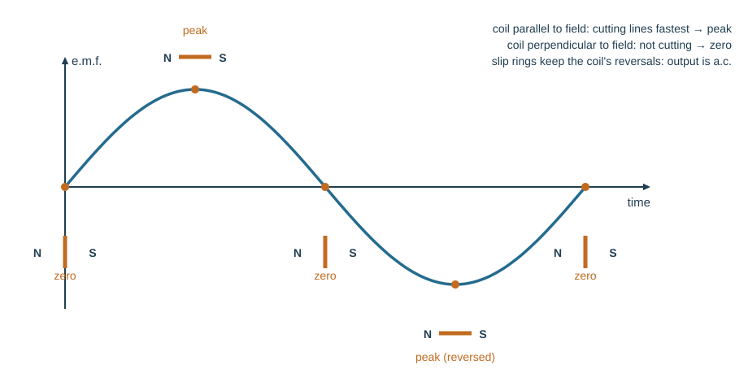
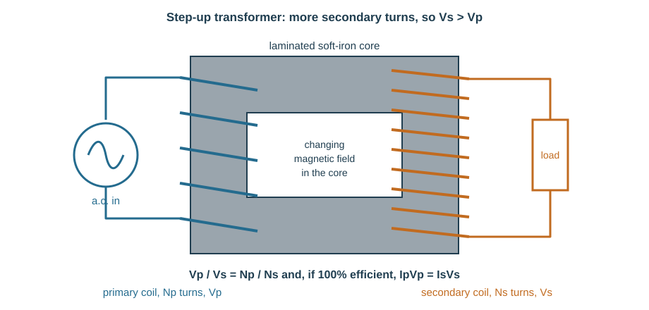
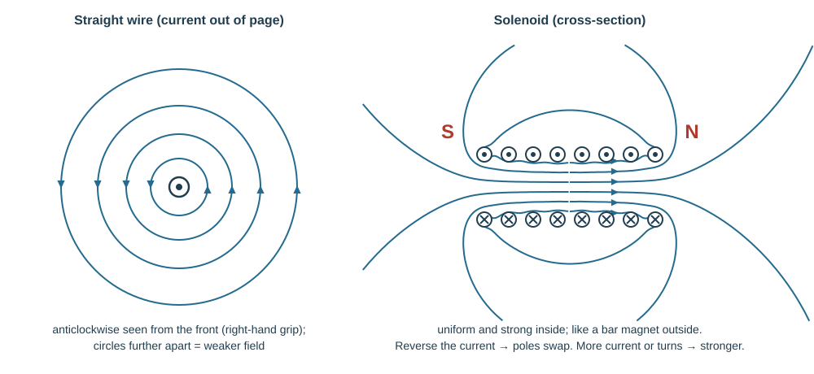

# Electricity and magnetism

## Magnetism

Like poles repel, unlike poles attract. A magnet attracts magnetic materials (iron, steel, cobalt, nickel) whether or not they are already magnetised; it repels only another magnet — so **repulsion is the only true test** that an object is a magnet. Non-magnetic materials (copper, aluminium, wood, plastic) are not affected.

**Induced magnetism.** A magnetic material placed near (or touching) a magnet becomes a magnet itself, with the opposite pole nearest the magnet's pole — which is why it is attracted. A chain of iron nails hanging from a magnet shows it.

Magnetic materials contain **magnetic domains** — small crystal regions each acting as a tiny magnet. In an unmagnetised sample the domains point in random directions and cancel. Magnetising aligns them. Non-magnetic materials have no domains.

A **magnetic field** is a region in which a magnetic pole experiences a force. The **direction** of the field at a point is the direction of the force on a **N pole** placed there.

**Field lines** run from N to S outside the magnet and **never cross** (the field can only have one direction at a point). The **relative strength** of the field is shown by the **spacing** of the lines: closest together where the field is strongest (at the poles). Magnetic forces are due to the **interactions between magnetic fields** — the field of one magnet acting on another.

*Plotting the field.* Sprinkle iron filings on paper over a bar magnet and tap gently: the filings line up along the field. Filings show the **pattern** but not the **direction** — for that, move a small plotting compass around the magnet and mark the needle's direction at each point.

Two N poles facing each other give a **neutral point** between them where the fields cancel.

| Magnetising | Demagnetising |
|---|---|
| Stroking repeatedly with one pole of a magnet | Hammering |
| Placing in a coil carrying **d.c.** | Heating strongly |
| Hammering while inside a magnetic field | Placing in a coil carrying **a.c.** |

**Soft** magnetic material (soft iron) loses its magnetism as soon as the external field is removed — ideal for electromagnet and transformer cores. **Hard** magnetic material (steel) keeps it — ideal for permanent magnets.

A **permanent magnet** is always on. An **electromagnet** can be switched off, and its strength varied by changing the current or the number of turns — which is what makes cranes, relays and loudspeakers possible.

| Permanent magnets (steel, alloys) | Electromagnets (soft-iron core) |
|---|---|
| fridge-door seals, compasses, loudspeakers, motors and generators, microphones | scrap-yard cranes, relays, electric bells, circuit breakers, MRI scanners |
| cannot be switched off | can be switched on and off and strength varied |

## Charge and electric fields

Atoms contain positive protons and negative electrons with charges of equal magnitude. Charge is measured in **coulombs (C)**. Unlike charges attract, like charges repel.

**Charging by friction.** Rub a polythene rod with a cloth: electrons transfer from one material to the other. The rod gaining electrons becomes negative; the cloth losing them becomes positive. Only **electrons** move — protons stay in the nucleus.

**Detecting charge.** A gold-leaf electroscope has a metal cap on a stem with a thin gold leaf. Bringing a charged rod near the cap makes the leaf rise, because the leaf and stem acquire like charges and repel.

**Charging by induction.** Bring a charged rod near (not touching) an insulated metal sphere: electrons in the sphere shift, leaving the near face oppositely charged and the far face like-charged. Earth the far side briefly while the rod is still there, then remove the earth and then the rod. The sphere keeps a charge **opposite** to the rod's, without ever touching it.

*Experiment (conductor or insulator?).* Connect the sample into a series circuit with a cell and a lamp (or ammeter). If the lamp lights, it is a conductor. For static: touch a charged electroscope with the sample while holding it — a conductor discharges it (leaf falls), an insulator does not.

**Conductors vs insulators.** Metals have **free (delocalised) electrons** that drift through the lattice, so charge flows. In insulators every electron is bound to its atom, so charge stays where it is put.

An **electric field** is a region in which a charge experiences a force. The field direction at a point is the direction of the force on a **positive** charge there.

| Arrangement | Field pattern |
|---|---|
| Point positive charge | straight lines radiating outwards |
| Point negative charge | straight lines pointing inwards |
| Charged conducting sphere | radial outside, as if from the centre; zero inside |
| Two parallel plates | uniform, evenly spaced parallel lines from + to − |

## Current, e.m.f., p.d. and resistance

**Current** is the rate of flow of charge:

$$I = \frac{Q}{t}$$

Current is the **charge passing a point per unit time**; $I$ in A, $Q$ in C, $t$ in s. *Example.* 120 C passes a point in 1 minute: $I = 120/60 = 2.0$ A.

**Direct current (d.c.)** flows in one direction only (from a cell or battery). **Alternating current (a.c.)** repeatedly reverses direction (mains: 50 Hz in NZ).

In a metal, current is a flow of **free electrons**, from negative to positive. **Conventional current** is drawn from positive to negative — the opposite direction. Measure current with an **ammeter in series**. With an **analogue** meter, check the needle reads zero first and read it with your eye directly above the needle; with a **digital** meter, pick a range just above the expected value for the finest resolution.

**E.m.f.** (electromotive force) is the **electrical work done by a source in moving a unit charge around a complete circuit** — the energy changed inside the supply (chemical to electrical in a cell) per coulomb. Measured in volts.

$$E = \frac{W}{Q}$$

**Potential difference** (p.d.) is the **work done by a unit charge passing through a component** — the energy transferred per coulomb in that component. Measured in volts; 1 V = 1 J/C.

$$V = \frac{W}{Q}$$

Measure p.d. with a **voltmeter in parallel** across the component. *Example.* 30 C of charge passes through a lamp and transfers 180 J: $V = 180/30 = 6.0$ V.

**This loses marks:** "e.m.f. is the force that pushes the current" (it is energy per unit charge, not a force); "current is used up in the lamp" (charge is conserved — energy is transferred).

**Resistance:**

$$R = \frac{V}{I}$$

Current is *not* used up passing through a resistor — charge is conserved. For a fixed p.d., more resistance means less current.

**Ohm's law:** the current through a metallic conductor at constant temperature is directly proportional to the p.d. across it. A component that obeys it is **ohmic**.

*Experiment.* Connect the unknown resistor in series with a cell, an ammeter and a variable resistor, with a voltmeter across it. Record several $V$ and $I$ pairs, plot $V$ against $I$: the gradient is $R$. Switch off between readings so the resistor does not heat up. *Example.* 4.5 V across a resistor drives 0.30 A: $R = 4.5/0.30 = 15$ Ω.

For a constant current, the p.d. across a conductor is larger when its resistance is larger ($V = IR$).

### Resistance of a wire

Resistance is **proportional to length** and **inversely proportional to cross-sectional area**:

$$R = \frac{\rho L}{A}$$

where $\rho$ is the resistivity, a constant for the material. Double the length, double the resistance; double the diameter (so quadruple the area), quarter the resistance.

### I–V characteristics

- **Ohmic resistor (metal at constant temperature)** — a straight line through the origin. Resistance is constant.
- **Filament lamp** — an S-shaped curve that flattens. As the current rises the filament heats up, the lattice ions vibrate more, electrons collide more often, and the resistance **increases**.
- **Diode** — almost no current in the **reverse** direction (very high resistance); in the **forward** direction, almost no current until about 0.6 V, then the current rises steeply (low resistance).

**This loses marks:** saying the lamp's resistance falls as it heats; drawing the lamp curve as straight; reading resistance as the gradient of an $I$–$V$ graph — on $I$ (y) against $V$ (x) the gradient is $1/R$, and for a curve use $R = V/I$ at the point, not the gradient.

## Series and parallel circuits

| | Series | Parallel |
|---|---|---|
| Current | the same at every point | source current = sum of branch currents |
| P.d. | p.d.s across components add to the supply p.d. | the same across each branch |
| Resistance | $R_T = R_1 + R_2 + \dots$ | $\dfrac{1}{R_T} = \dfrac{1}{R_1} + \dfrac{1}{R_2} + \dots$, so for two: $R_T = \dfrac{R_1R_2}{R_1+R_2}$ |
| One lamp fails | all go out | the others stay on |

The combined parallel resistance is always **less** than either individual resistor, because there are more paths for charge to take. Cells in series add their e.m.f.s (a cell connected the wrong way round subtracts).

**Junction rule.** The sum of the currents **entering** a junction equals the sum of the currents **leaving** it, because charge is conserved — it cannot pile up or vanish at the junction. *Example.* 3.0 A enters a junction; one branch carries 1.2 A, so the other carries 1.8 A.

**Worked example (three in parallel).** 6.0 Ω, 3.0 Ω and 2.0 Ω in parallel: $1/R_T = 1/6 + 1/3 + 1/2 = 1/6 + 2/6 + 3/6 = 1$, so $R_T = 1.0$ Ω. Remember to take the reciprocal at the end.

Household lamps are wired in **parallel** so each can be switched independently, each gets the full mains p.d., and one failing does not black out the house.

The diagram above is the basic meter circuit: the ammeter is in the main loop, so the same current passes through it and the resistor; the voltmeter is connected across the resistor's two ends. The long plate of the cell symbol is the positive terminal.

**Worked example.** A 6.0 V supply across a 3.0 Ω resistor:

- $I = V/R = 6.0/3.0 = 2.0$ A
- $P = VI = 6.0 \times 2.0 = 12$ W
- In 10 s, $E = Pt = 120$ J
- Check independently: $Q = It = 20$ C and $E = VQ = 6.0\times20 = 120$ J ✓

**Worked example (combination).** A 4.0 Ω and a 12 Ω resistor in parallel, the pair in series with a 3.0 Ω resistor, across 12 V.

- Parallel pair: $\dfrac{4\times12}{4+12} = 3.0$ Ω
- Total: $3.0 + 3.0 = 6.0$ Ω
- Supply current: $12/6.0 = 2.0$ A
- P.d. across the parallel pair: $2.0 \times 3.0 = 6.0$ V, so the 4.0 Ω branch carries 1.5 A and the 12 Ω branch 0.5 A (summing to 2.0 A ✓)

## Electrical power and energy

$$P = IV \qquad E = IVt$$

$P$ in W, $I$ in A, $V$ in V, $E$ in J, $t$ in s. A circuit transfers energy from the supply to the components, and the components transfer it onwards to the surroundings — as light, sound, motion or heating.

**The kilowatt-hour.** Electricity companies charge per **kilowatt-hour (kWh)**: the energy transferred by a 1 kW appliance in 1 hour. $1\ \text{kWh} = 1000\ \text{W} \times 3600\ \text{s} = 3.6\times10^6$ J.

$$\text{energy (kWh)} = \text{power (kW)} \times \text{time (h)} \qquad \text{cost} = \text{kWh} \times \text{price per kWh}$$

*Example.* A 2.5 kW heater runs for 4 hours a day for 30 days at 32 c per kWh. Energy $= 2.5 \times 4 \times 30 = 300$ kWh; cost $= 300 \times 0.32 = 96$ dollars.

**This loses marks:** multiplying watts by hours (convert W to kW first); using minutes instead of hours.

## Circuit components

Learn to draw and read: cell, battery, switch, fixed resistor, variable resistor, heater, thermistor, LDR, lamp, ammeter, voltmeter, galvanometer, magnetising coil, transformer, bell, fuse, relay, diode.

**Potential divider.** Two resistors in series across a supply share the supply p.d. in the **ratio of their resistances** (the same current flows through both, and $V = IR$):

$$\frac{V_1}{V_2} = \frac{R_1}{R_2} \qquad V_{out} = V_{in}\times\frac{R_2}{R_1+R_2}$$

The bigger resistor takes the bigger share of the p.d. A **variable potential divider** (potentiometer — a resistance track with a sliding contact) lets you set any output p.d. from zero to the full supply: a volume control or a dimmer.

*Worked example.* $R_1 = 2.0$ kΩ and $R_2 = 4.0$ kΩ across 6.0 V: $V_{out} = 6.0 \times 4.0/6.0 = 4.0$ V across $R_2$, and 2.0 V across $R_1$ (ratio 1 : 2 ✓).

**Thermistor** — resistance **falls** sharply as temperature rises. **LDR** — resistance **falls** as light intensity rises. Both are **input transducers**: put one in a potential divider and the output p.d. changes with temperature or light.

**Relay** — a small current through a coil makes an electromagnet that closes contacts in a separate circuit. It lets a small, safe sensing current switch a large current, and electrically isolates the two circuits.

**Diode** — conducts in one direction only (the direction of the arrow in its symbol). As a **rectifier**, it converts a.c. to d.c. by blocking the reverse half of the cycle. A **light-emitting diode (LED)** behaves the same way and also gives out light when it conducts — an indicator lamp that only lights if connected the right way round.

**Light-sensitive switch.** LDR in a potential divider → output p.d. rises as it gets dark → that p.d. operates a relay → the relay switches on a lamp. Swap in a thermistor and the same circuit becomes a **temperature-operated alarm**. Which resistor you take $V_{out}$ across decides whether the output **rises or falls** — reason it through with the ratio rule each time.

**Logic gates** (Unit 5.4 Digital electronics) were removed from the Pre-Q syllabus in 2022 and are no longer in IGCSE 0625 either.

## Dangers of electricity

| Hazard | Why it is dangerous |
|---|---|
| Damaged insulation | exposed live conductor — risk of electric shock |
| Overheating cables | too much current for the cable; melts insulation, fire risk |
| Damp conditions | water conducts, completing a path through the body |
| Overloading plugs, extension leads and sockets | too many appliances draw too much total current → cables overheat → fire |

Three-pin plug wiring: **live = brown**, **neutral = blue**, **earth = green/yellow stripes**. A mains circuit has a **live** (line) wire at high alternating voltage, a **neutral** wire near 0 V that completes the circuit, and an **earth** wire for safety.

**Switches and fuses go in the live wire.** Then, when the switch is off or the fuse has blown, the appliance is disconnected from the high voltage. A switch in the neutral would leave the appliance live even when "off".

A **fuse** is a thin wire that melts and breaks the circuit if the current exceeds its rating. It protects the **appliance and the wiring**, not the person — it does not blow fast enough to prevent a shock. A **trip switch (circuit breaker)** does the same job electromagnetically: too much current makes an electromagnet strong enough to pull open a switch. It acts faster and can be reset instead of replaced. Choose the trip setting, like the fuse rating, just above the normal working current.

Choose the fuse just above the appliance's normal current. A 230 V, 700 W appliance draws $I = P/V = 700/230 = 3.0$ A, so a 5 A fuse suits it; a 13 A fuse would let a dangerous fault current flow.

**Earthing** connects a metal case to earth by a low-resistance path. If a fault makes the case live, a very large current flows straight to earth, blowing the fuse at once and disconnecting the supply — so the case can never stay live.

The outer casing of an appliance must be either **earthed** (metal case) or **double-insulated** (a non-conducting plastic case, with no exposed metal, marked with a square inside a square). A double-insulated appliance has **no earth wire**; its fuse still protects the **circuit and the cabling**.

**Causal chain (earthing):** fault: live wire touches metal case → large current flows through the earth wire (low resistance) → current far exceeds the fuse rating → fuse melts → live wire disconnected → case no longer live → no shock.

## Electromagnetic induction

Moving a conductor across a magnetic field, or changing the field linking a conductor, **induces an e.m.f.** in it. If the circuit is complete, an induced current flows.

*Experiment.* Connect a coil to a sensitive galvanometer and push a bar magnet in: the needle deflects. Hold the magnet still: no deflection. Pull it out: the needle deflects the other way. It is the **relative motion** — the change — that matters.

Induced e.m.f. increases with:
- a faster rate of change of the magnetic field
- more turns of wire on the coil
- a stronger magnet

**Lenz's law** — the direction of the induced e.m.f. **opposes the change causing it**. Push a N pole into a coil: the induced current makes the near end of the coil a **N pole**, which repels the incoming magnet — you must do work to push it in, and that work becomes electrical energy. Pull it out: the near end becomes a S pole, attracting it back.

Use **Fleming's right-hand rule** for the relative directions of force (motion), field and induced current in the generator effect: thu**M**b = **M**otion, **F**irst finger = **F**ield (N → S), se**C**ond finger = induced **C**urrent. (Left hand for motors, right hand for generators.)

**This loses marks:** "a magnet inside a coil induces a current" — only a **changing** field or relative **motion** does; using the left hand for induction.

## a.c. generator

**d.c.** flows in one direction only; **a.c.** reverses direction periodically.

A rotating-coil generator has a coil spinning between the poles of a magnet. Each end of the coil connects to a **slip ring**, pressed by a carbon brush, so the output keeps the coil's own reversals and the external current is **alternating**.

The voltage–time output is a sine curve:
- **Peak** output when the coil is **parallel to the field** (horizontal in the field), where it cuts field lines fastest.
- **Zero** output when the coil is **perpendicular to the field**, where it is momentarily cutting no lines.
- Every half turn the output reverses: a **trough** (negative peak) when the coil is parallel to the field again, but the other way round.

Spinning faster gives **higher peaks and more cycles per second** (higher frequency). A stronger magnet, more turns or a larger coil give higher peaks only. A **rotating-magnet** generator (a bicycle dynamo, power-station alternators) spins the magnet inside fixed coils instead, so no slip rings or brushes are needed.

## Transformers

A **soft-iron core** carries two coils. **Principle of operation, as a causal chain:** alternating current in the **primary** coil → a continuously **changing magnetic field** in the soft-iron core → the core carries this changing field through the **secondary** coil → the changing field linking the secondary **induces** an alternating e.m.f. in it. It only works with a.c., because a steady (d.c.) field induces nothing. Soft iron is used because it magnetises and demagnetises easily.

$$\frac{V_p}{V_s} = \frac{N_p}{N_s}$$

**Step-up** has more secondary turns ($V_s > V_p$); **step-down** has fewer.

For a 100% efficient transformer, power in = power out:

$$I_pV_p = I_sV_s$$

**Worked example.** A transformer steps 230 V to 11.5 V with 2000 primary turns. Secondary turns: $N_s = N_p V_s/V_p = 2000 \times 11.5/230 = 100$. If the secondary draws 2.0 A, the primary current is $I_p = I_sV_s/V_p = 2.0\times11.5/230 = 0.10$ A.

**High-voltage transmission.** Power is transmitted at very high voltage because, for a given power $P = IV$, raising $V$ lowers $I$. Cable losses are

$$P_{loss} = I^2R$$

so halving the current cuts the loss to a quarter. Advantages: much less energy wasted as heat in the cables, and thinner, cheaper cables can be used. Step-up transformers raise the voltage at the power station; step-down transformers lower it again for consumers.

**Worked example.** A power station sends 20 MW through cables of total resistance 5.0 Ω. At 25 kV: $I = P/V = 2.0\times10^7/2.5\times10^4 = 800$ A, loss $= I^2R = 800^2 \times 5.0 = 3.2$ MW (16%). At 400 kV: $I = 50$ A, loss $= 50^2 \times 5.0 = 12.5$ kW (0.06%).

**This loses marks:** using $P = V^2/R$ with the transmission voltage (that $V$ is not the p.d. across the cable); saying high voltage "reduces resistance".

## Magnetic effect of a current

A current produces a magnetic field around it.

- **Straight wire** — concentric circles around the wire, weakening with distance. Direction: right-hand grip rule — thumb along the conventional current, fingers curl the field direction.
- **Solenoid (coil)** — a field like a bar magnet's, uniform and strong inside, spreading outside. One end acts as N, the other as S; reverse the current and the poles swap.

The field is **strongest close to the wire** (circles further apart further out) and **strong and uniform inside a solenoid**. It gets stronger with more current, more turns, or an iron core. **Reversing the current reverses the field direction** (the poles of a solenoid swap). The direction of a field line at a point is the direction of the force on a **north** pole placed there.

*Experiment.* Pass a vertical wire through a horizontal card. Sprinkle iron filings on the card and tap: they form concentric circles. Place plotting compasses on the card to show the direction; reverse the current and every compass reverses.

**Relay.** Current in the coil magnetises a soft-iron core, which attracts an iron armature; the armature pivots and closes (or opens) a separate pair of contacts. A small current switches a large one — a car's starter motor, or a sensing circuit switching a mains lamp.

**Loudspeaker.** An alternating current in a coil, attached to a paper cone and sitting in the field of a permanent magnet, feels a force that reverses with the current, so the coil and cone vibrate back and forth at the frequency of the a.c., producing sound.

## Force on a current-carrying conductor

A current-carrying wire in a magnetic field experiences a force — the **motor effect**.

*Experiment.* Rest a stiff copper wire loosely across the poles of a horseshoe magnet and pass a current: the wire jumps. Reverse the **current** and it jumps the other way. Reverse the **field** (turn the magnet) and it also reverses. Reverse both and it jumps as before.

Use **Fleming's left-hand rule** for the motor effect: first finger = field (N to S), second finger = conventional current, thumb = force (motion). The force is greatest when the wire is perpendicular to the field and zero when parallel.

A beam of charged particles is deflected the same way — a cathode-ray beam bends in a magnetic field, with electrons (negative) deflecting opposite to the conventional-current direction. For a beam of electrons, point the second finger **opposite** to the electrons' motion.

The force is larger with a larger current, a stronger field, or a longer length of wire in the field.

## d.c. motor

A current-carrying coil in a magnetic field experiences a **turning effect**, because the forces on the two sides of the coil act in opposite directions. The turning effect increases with:

- more turns on the coil
- a larger current
- a stronger magnetic field

**How the motor works.** Current flows in through a **carbon brush** to one half of the **split-ring commutator**, round the coil, and out through the other half and brush. The two sides of the coil carry current in opposite directions, so by Fleming's left-hand rule one side is pushed up and the other down — a turning effect.

A **split-ring commutator** reverses the current direction in the coil every half turn, just as the coil passes the vertical. Without it, the coil would stop at the vertical position and rock; with it, the turning effect always acts the same way round and the coil rotates continuously. Momentum carries the coil past the vertical, where the gaps in the ring pass the brushes.

**This loses marks:** "the commutator reverses the current in the circuit" — it reverses it in the **coil**; confusing slip rings (generator, a.c. out) with a split ring (d.c. motor).
