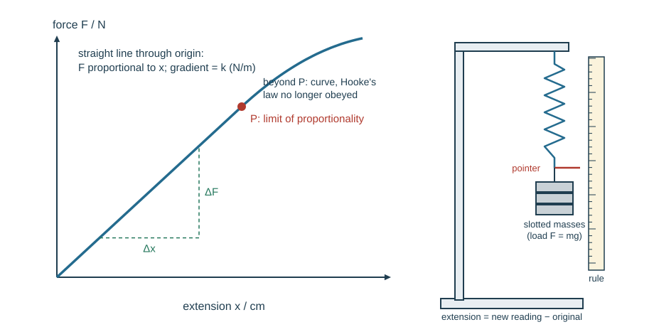
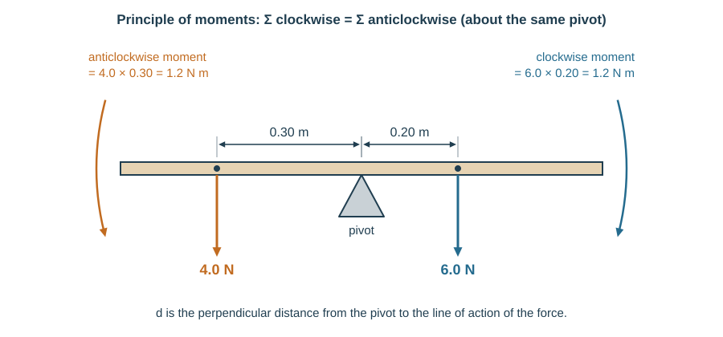

# Forces and momentum

## Mass and weight

**Mass** (kg, scalar) measures how strongly a body resists a change in its state of motion — its inertia. IGCSE also defines it as a measure of the **quantity of matter** in an object. It is the same everywhere.

**Weight** (N, vector) is the gravitational force on a mass in a gravitational field, acting vertically downwards:

$$W = mg$$

A 60 kg student weighs $60 \times 9.81 = 589$ N on Earth. Their mass on the Moon is still 60 kg; their weight is about one sixth.

**Gravitational field strength** $g$ is the force per unit mass on a mass in a gravitational field:

$$g = \frac{W}{m}$$

in **N/kg**. Near the Earth's surface $g = 9.8$ N/kg (9.81 in Pre-Q), which is numerically **equal to the acceleration of free fall** in m/s². Weight is the **effect of a gravitational field on a mass**. *Example.* A 2.0 kg rock weighs 3.2 N on the Moon, so $g_{Moon} = 3.2/2.0 = 1.6$ N/kg.

**This loses marks:** giving weight in kg; saying mass changes on the Moon.

A balance compares masses by comparing their weights, so it only works inside a gravitational field. In a vacuum, every object falls with the same acceleration regardless of mass — the guinea-and-feather experiment: a coin and a feather in an evacuated tube land together, but in air the feather lags because drag matters more relative to its small weight.

## Effects of a force

A force can change a body's **size or shape**, its **speed**, or its **direction** — so its velocity.

**Resultant force** is the vector sum of all forces. Zero resultant means the body stays at rest *or* continues at constant velocity in a straight line. Non-zero resultant means acceleration in the direction of the resultant:

$$F = ma$$

A 1200 kg car with a 3600 N resultant forward force accelerates at $3600/1200 = 3.0$ m/s².

**Friction** is the force between two surfaces that impedes motion and causes heating. **Air resistance (drag)** is a form of friction.

## Newton's laws

1. **First law** — if there is no resultant force on an object, it stays at rest or keeps moving at constant velocity (constant speed in a straight line).
2. **Second law** — a resultant force causes an acceleration in its direction: $F = ma$, so $a = F/m$. Weight $W = mg$ is this law applied to free fall.
3. **Third law** — forces always occur in pairs. If A pushes on B, B pushes on A with a force that is equal in size, opposite in direction, of the same type, and acting on the **other** object.

Because the third-law pair act on **different** objects, they never cancel each other. A book resting on a table: the Earth pulls the book down and the book pulls the Earth up (a gravitational pair); the table's upward push on the book is a different force, which balances the weight only because the book is in equilibrium.

## Hooke's law

**Hooke's law:** up to the **limit of proportionality**, the extension of a spring is directly proportional to the stretching force (load):

$$F = kx$$

where $x$ is the **extension** (stretched length minus original length), not the total length. The **spring constant** $k$ is the **force per unit extension**, $k = F/x$, in N/m (or N/cm) — a stiffer spring has a larger $k$.

Experiment: hang the spring from a clamp with a metre rule alongside. Record the unloaded pointer position, add known masses one at a time, and record the new position each time. Extension = new − original. Plot force (y) against extension (x): the gradient is $k$. The straight section ends at the limit of proportionality, beyond which the line curves and the spring does not fully return.

A spring with $k = 25$ N/m extends $x = F/k = 5.0/25 = 0.20$ m under a 5.0 N load.

**The limit of proportionality** is the point on the load–extension graph where the straight line through the origin ends. Beyond it $F = kx$ no longer applies, so never use $k$ for loads past that point. (The elastic limit is not required.)

*Experiment details that score.* Read the pointer at eye level to avoid parallax; use a fiducial pointer fixed to the spring's lower end; add masses in equal steps (e.g. 100 g = 0.98 N); also take readings while unloading to check the spring returns; use a safety mat and goggles.

**This loses marks:** plotting the total length instead of the extension; forgetting to convert cm to m when $k$ is in N/m; calling the curve after P "Hooke's law".

Load–extension graphs are often drawn the other way round (extension on the $y$-axis). Then the gradient is $1/k$, not $k$ — check the axes.

## Circular motion

A body moving in a circle at constant speed needs a resultant force directed towards the centre, perpendicular to its velocity. That force changes the direction, not the speed:

$$F = \frac{mv^2}{r}$$

A 0.20 kg ball on a 0.50 m string swung at 4.0 m/s needs $0.20\times16/0.50 = 6.4$ N. Remove the force (cut the string) and the ball travels off along the tangent.

Qualitatively (the IGCSE requirement — Pre-Q also uses the equation):

| Change, others fixed | Result |
|---|---|
| larger force, same mass and radius | the speed is larger |
| larger force, same mass and speed | the radius is smaller |
| larger mass, same speed and radius | a larger force is needed |

## Moments

The **moment** of a force is its turning effect about a pivot:

$$\text{moment} = F \times d$$

where $d$ is the perpendicular distance from the pivot to the line of action of the force. Units: N·m. Increasing either the force or the distance increases the moment — which is why a long spanner loosens a tight nut.

**Principle of moments.** When an object is in equilibrium, the sum of the clockwise moments about any point equals the sum of the anticlockwise moments about that point:

$$\sum \text{clockwise moments} = \sum \text{anticlockwise moments}$$

**Worked example.** A uniform 1.0 m beam pivots at its centre. A 4.0 N weight hangs 0.30 m to the left. Where must a 6.0 N weight hang on the right?

Anticlockwise: $4.0 \times 0.30 = 1.2$ N·m. So $6.0 \times d = 1.2$, giving $d = 0.20$ m from the pivot.

**Worked example (more than one force each side).** On a see-saw pivoted at its centre, a 400 N child sits 1.5 m left and a 200 N child 0.5 m left. Where must a 500 N adult sit on the right?

Anticlockwise: $400(1.5) + 200(0.5) = 600 + 100 = 700$ N·m. Clockwise: $500d = 700$, so $d = 1.4$ m.

**Worked example (beam's own weight).** A uniform 2.0 m plank of weight 80 N is pivoted 0.50 m from its left end. What load at the left end balances it? The plank's weight acts at its **centre**, 0.50 m to the right of the pivot: clockwise $= 80 \times 0.50 = 40$ N·m. Load $\times 0.50 = 40$, so the load is 80 N.

**This loses marks:** using the distance along a slanting bar instead of the **perpendicular** distance to the line of action; measuring distances from the end of the beam instead of from the pivot; forgetting the weight of a uniform beam (it acts at the centre); giving moments in N/m instead of N m.

## Equilibrium

A system is in **equilibrium** when there is no resultant force **and** no resultant moment.

Experiment: suspend a metre rule on a pivot, hang several known weights at measured distances, and adjust until the rule is horizontal. Summing moments each side gives equal totals within experimental error — showing no net moment.

## Centre of mass and stability

The **centre of gravity** (centre of mass) is the point through which the whole weight of an object can be taken to act. For a uniform regular object it is at the geometric centre.

Experiment (plane lamina): make three holes near the edge of an irregular card. Hang the card from a pin through one hole so it swings freely, hang a plumb-line from the same pin, and draw the vertical line. Repeat for the other two holes. The three lines cross at the centre of mass.

Stability depends on where the centre of mass sits relative to the base:

- **Stable equilibrium** — displaced slightly, the line of action of the weight stays inside the base, so a restoring moment returns it.
- **Unstable equilibrium** — displaced slightly, the weight's line of action falls outside the base and the moment topples it further.
- **Neutral equilibrium** — displacement produces no moment either way, e.g. a ball resting on a flat table.

A wide base and a low centre of mass make an object harder to topple — a racing car versus a double-decker bus.

## Momentum and impulse

**Momentum** is mass × velocity:

$$p = mv$$

Momentum is a vector in kg·m/s, so direction signs matter.

**Impulse** is force × the time for which the force acts. It equals the change in momentum:

$$\text{impulse} = Ft = \Delta(mv) = mv - mu$$

Units: N·s, which is the same as kg·m/s.

**Worked example (impulse).** A 0.15 kg ball hits a wall at 20 m/s and rebounds at 15 m/s. Taking towards the wall as positive, $\Delta p = 0.15(-15) - 0.15(20) = -2.25 - 3.0 = -5.25$ kg·m/s, so the impulse is 5.3 N·s away from the wall. If contact lasts 0.050 s, the average force is $5.25/0.050 = 105$ N. Ignoring the sign change and using $15 - 20$ gives the wrong answer, 0.75 kg·m/s.

Rearranged, $F = \dfrac{mv - mu}{t} = \dfrac{\Delta p}{t}$: the resultant force equals the rate of change of momentum (Newton's second law in momentum form). For the same momentum change, a longer contact time means a smaller average force — the principle behind crumple zones, air bags and bending your knees on landing.

**Resultant force** is the change in momentum per unit time, $F = \Delta p/\Delta t$. *Example.* A rocket engine gives exhaust gas 600 kg·m/s of momentum every 2.0 s: thrust $= 600/2.0 = 300$ N.

**Conservation of momentum.** In an **isolated system** — no external forces, such as friction with the floor — the total momentum before an interaction equals the total momentum after.

**Worked example.** A 2.0 kg trolley at 3.0 m/s strikes a stationary 1.0 kg trolley and they move off together.

Before: $p = 2.0\times3.0 + 1.0\times0 = 6.0$ kg·m/s
After: $p = (2.0+1.0)v = 3.0v$
So $v = 2.0$ m/s in the original direction.

**Worked example (opposite directions).** A 0.50 kg ball moving right at 4.0 m/s meets a 0.30 kg ball moving left at 2.0 m/s. Taking right as positive, total momentum = $0.50(4.0) + 0.30(-2.0) = 2.0 - 0.6 = 1.4$ kg·m/s. That total is unchanged by the collision whatever the balls do afterwards.

**Worked example (explosion / recoil).** A 4.0 kg rifle fires a 0.010 kg bullet at 400 m/s. Total momentum before = 0. After: $0.010(400) + 4.0v = 0$, so $v = -1.0$ m/s — the rifle recoils at 1.0 m/s backwards.

Elastic and inelastic collision labels are not required at Pre-Q, but momentum calculations on collisions are.

**This loses marks:** forgetting the minus sign for a body moving the other way; adding speeds instead of momenta; applying conservation when an external force (friction, a wall) acts during the interaction; impulse units as N/s.
