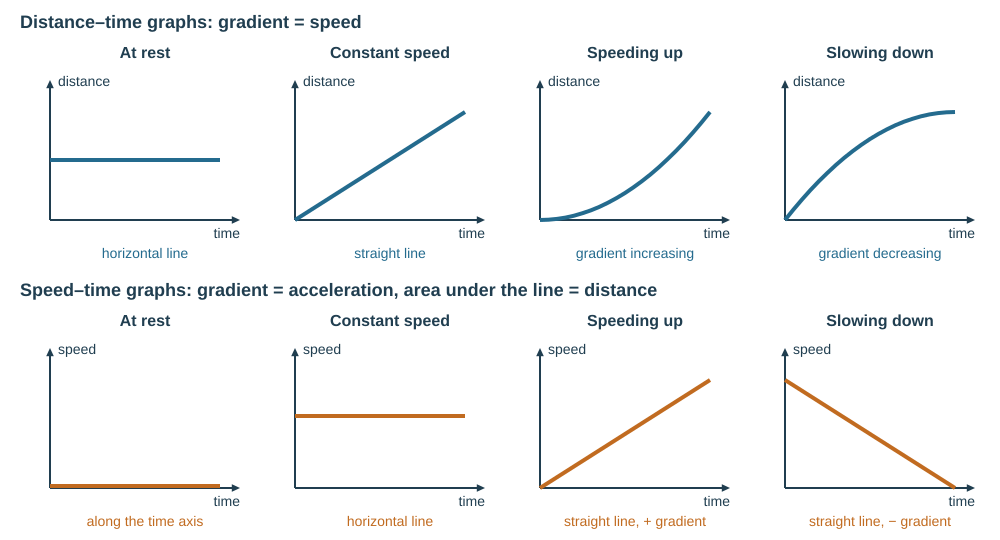
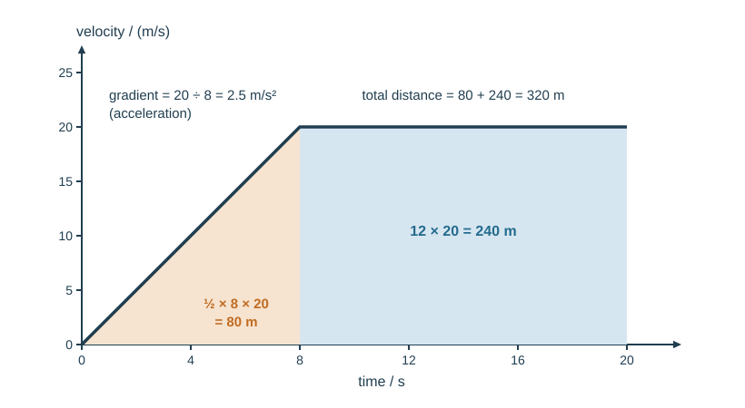
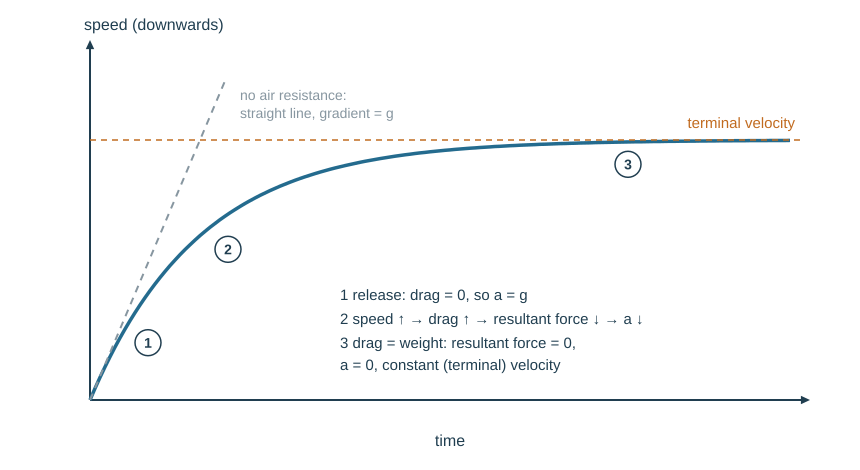

# Motion

## Speed, velocity and acceleration

**Speed** is the distance travelled per unit time (the rate of change of distance) — a scalar.

$$v = \frac{s}{t}$$

with $s$ in m, $t$ in s, $v$ in m/s. For a whole journey with stops and changes of speed:

$$\text{average speed} = \frac{\text{total distance travelled}}{\text{total time taken}}$$

*Example.* A cyclist rides 3.0 km in 10 min, rests for 5 min, then rides 1.5 km in 5 min. Average speed $= 4500/(20\times60) = 3.75$ m/s — the rest counts in the total time.

**Velocity** is speed in a stated direction — a vector. A car going round a roundabout at a steady 30 km/h has constant speed but changing velocity.

**Acceleration** is the change in velocity per unit time (rate of change of velocity), in m/s²:

$$a = \frac{\Delta v}{\Delta t} = \frac{v - u}{t}$$

**Deceleration** is a negative acceleration — the speed decreases. Choose a positive direction before you start, and keep it. *Example.* A car braking from 25 m/s to rest in 5.0 s: $a = (0 - 25)/5.0 = -5.0$ m/s², a deceleration of 5.0 m/s².

**This loses marks:** writing acceleration in m/s; quoting a deceleration as a positive "acceleration" without saying it is a deceleration; using average speed $= (u + v)/2$ when the acceleration is not constant.

## Reading graphs

**Distance–time graph**

- gradient = speed
- horizontal line = at rest
- straight slope = constant speed
- curve = changing speed (getting steeper = speeding up; flattening = slowing down)
- for a curve, find the speed at an instant from the gradient of the **tangent** drawn at that point

**Speed–time graph**

- gradient = acceleration
- area under the line = distance travelled
- horizontal line = constant speed (zero acceleration)
- straight slope = constant acceleration
- curve = changing (non-constant) acceleration
- line sloping down = deceleration (negative gradient)
- line along the time axis = at rest

Find a gradient with a **large** triangle on the line — rise ÷ run. A small triangle magnifies your reading error.

Worked example: a speed–time graph rises from 0 to 20 m/s in 8 s, then stays at 20 m/s for 12 s.

- Acceleration in the first phase: $20/8 = 2.5$ m/s²
- Distance in the first phase (triangle): $\tfrac12 \times 8 \times 20 = 80$ m
- Distance in the second phase (rectangle): $12 \times 20 = 240$ m
- Total distance: 320 m

**This loses marks:** reading the distance from a speed–time graph's *height* instead of its *area*; finding the gradient from a small triangle or from data points off the line; treating the area under a sloping section as a rectangle instead of a triangle (½ × base × height).

## Free fall and terminal velocity

Near the Earth's surface, free-fall acceleration is constant: $g = 9.81$ m/s². Use the value a question supplies if it gives one.

A body falling through air:

1. At release, weight acts down and drag is zero, so acceleration = $g$.
2. As speed rises, drag rises, so the resultant force falls and the acceleration falls.
3. When drag grows equal in magnitude to weight, the resultant force is zero and the speed stops increasing. This steady speed is the **terminal velocity**.

On a speed–time graph, that is a curve of decreasing gradient flattening to a horizontal line. In a vacuum there is no drag, so the line stays straight and all objects — heavy or light — accelerate identically. The same happens falling through a **liquid** (a ball bearing dropped in oil): the drag is larger, so terminal velocity is lower and reached sooner.

**Skydiver.** Opening the parachute suddenly increases the area, so drag becomes **greater** than weight: the resultant force is **upwards**, the skydiver **decelerates**, and drag falls as speed falls, until drag = weight again at a new, **lower** terminal velocity.

**This loses marks:** saying "at terminal velocity there are no forces" (weight and drag are both there, and balanced); saying the parachute makes the skydiver go upwards (it decelerates them while they still move down).

## SUVAT

For **constant** (or zero) acceleration in one dimension:

| Symbol | Quantity | Unit |
|---|---|---|
| $s$ | displacement | m |
| $u$ | initial velocity | m/s |
| $v$ | final velocity | m/s |
| $a$ | constant acceleration | m/s² |
| $t$ | time | s |

$$v = u + at$$
$$s = ut + \tfrac{1}{2}at^2$$
$$s = \tfrac{1}{2}(u+v)t$$
$$v^2 = u^2 + 2as$$

When $a = 0$ these collapse to $s = ut$.

Each equation has a graphical meaning on a velocity–time graph: $v = u + at$ is the straight line itself, $a$ is its gradient, and $s = ut + \tfrac12at^2$ is the area beneath it (a rectangle plus a triangle).

**Worked example.** An object starts at 2.0 m/s and accelerates at 3.0 m/s² for 4.0 s.

- $v = u + at = 2.0 + 3.0\times4.0 = 14$ m/s
- $s = ut + \tfrac12at^2 = 2.0\times4.0 + \tfrac12\times3.0\times16 = 8.0 + 24 = 32$ m
- Check with the mean-velocity form: $s = \tfrac12(2.0+14)\times4.0 = 32$ m ✓

**Worked example (free fall).** A stone is dropped from 45 m. Taking down as positive, $u = 0$, $a = 9.81$ m/s², $s = 45$ m.

$$v^2 = u^2 + 2as = 0 + 2(9.81)(45) = 883 \Rightarrow v = 29.7 \approx 30\ \text{m/s}$$

Time: $v = u + at \Rightarrow t = 29.7/9.81 = 3.0$ s.

Pick the equation that avoids the quantity you were not given — here, $v^2 = u^2 + 2as$ avoids $t$.
