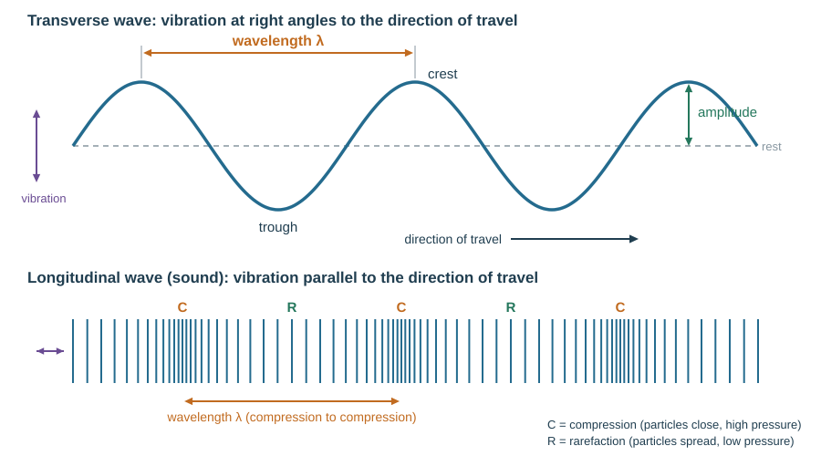
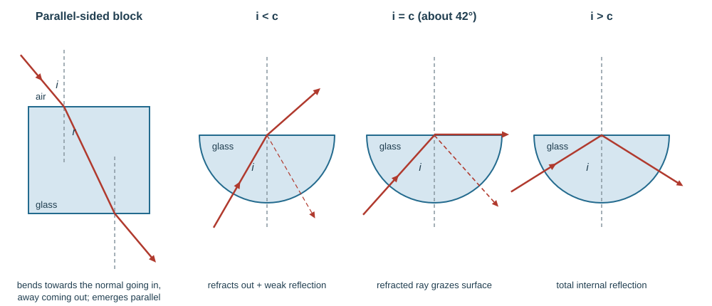
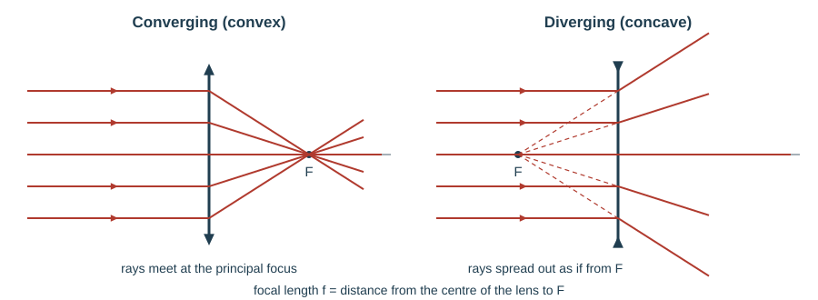
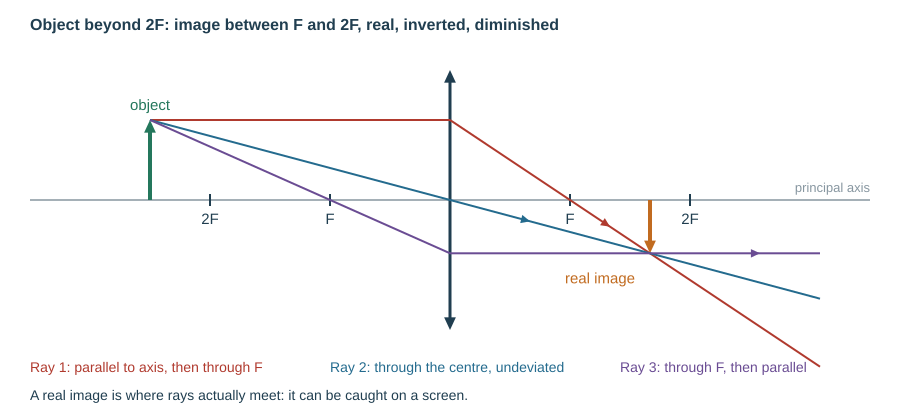
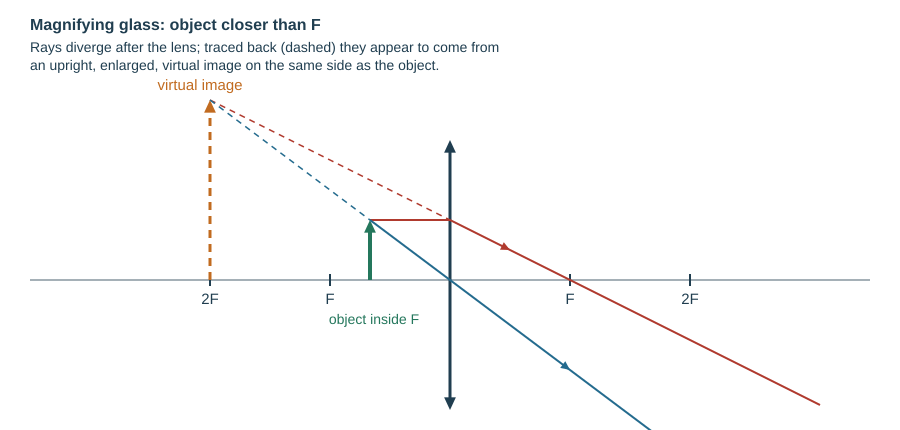
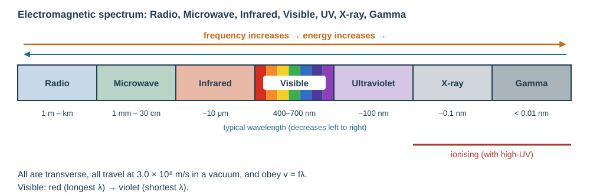

# Waves, light and sound

## General wave properties

A wave transfers **energy** without transferring **matter**. Drop a stone in a pond and the floating leaf bobs up and down — it does not travel outward with the ripple.

| Term | Meaning |
|---|---|
| Wavelength $\lambda$ | distance between matching points on consecutive waves (m) |
| Frequency $f$ | oscillations per second (Hz) |
| Period $T$ | time for one oscillation (s), $T = 1/f$ |
| Amplitude | maximum displacement from the undisturbed position (m) |
| Wave speed $v$ | distance travelled per second by the wave pattern (m/s) |
| Wavefront | a line joining points oscillating in step |
| Crest (peak) / trough | highest / lowest point of a transverse wave |

$$v = f\lambda$$

$v$ in m/s, $f$ in Hz, $\lambda$ in m. A 50 Hz wave of wavelength 0.40 m travels at $50 \times 0.40 = 20$ m/s with period $1/50 = 0.020$ s. Rearranged: a radio station broadcasting at 100 MHz has $\lambda = c/f = 3.0\times10^8/1.0\times10^8 = 3.0$ m.

**Transverse** — vibration at right angles to the direction of propagation. Water waves, all electromagnetic waves, seismic **S-waves**, a wave on a rope.
**Longitudinal** — vibration parallel to the direction of propagation. Sound, seismic **P-waves**, a slinky pushed along its length.

**This loses marks:** measuring the wavelength from crest to trough (that is half a wavelength); measuring amplitude from trough to crest (that is twice the amplitude); forgetting to convert kHz or MHz to Hz.

A ripple tank demonstrates all the behaviours below: a vibrating bar makes straight wavefronts, and you watch them meet barriers, shallow regions and gaps.

| Behaviour | What happens | Cause |
|---|---|---|
| Reflection | wavefronts bounce off a plane barrier, angle in = angle out | barrier |
| Refraction | wavefronts slow down in shallower water, so the wavelength gets **shorter** and the direction changes; frequency unchanged | change of speed caused by a change of depth |
| Diffraction | waves spread out after passing an obstacle or gap | gap or edge |

**Diffraction depends on gap size versus wavelength.** Spreading is greatest when the gap is about equal to the wavelength; a gap much wider than the wavelength barely diffracts. At an **edge**, longer wavelengths spread more — which is why you hear low-pitched sound round a corner more easily than high.

**Interference (superposition).** Where two waves overlap, their displacements add. Crest meeting crest gives a bigger crest (constructive); crest meeting trough cancels (destructive). Two dippers in a ripple tank give a fixed pattern of calm and rough lines.

## Reflection of light

The **law of reflection**: angle of incidence = angle of reflection, both measured from the **normal**.

The image in a plane mirror is:
- the same size as the object
- the same distance behind the mirror as the object is in front
- laterally inverted
- **virtual** — the rays only appear to come from it, so it cannot be caught on a screen

To construct it: drop a perpendicular from the object to the mirror, extend it an equal distance behind, and draw rays from the eye back to that image point. Then draw the real rays from the object to the points where those lines meet the mirror, and on to the eye.

*Example.* A person stands 2.0 m in front of a plane mirror. The image is 2.0 m behind the mirror, so 4.0 m from the person. A ray hitting the mirror at 35° to the **normal** reflects at 35° to the normal (55° to the mirror surface).

## Refraction of light

Light changes speed when it enters a new medium, so it bends — **towards** the normal entering a denser medium (slower), **away** on leaving. A ray travelling **along** the normal does not bend. The frequency never changes; the wavelength does.

Through a **parallel-sided** glass block the ray bends towards the normal on entry and away by the same angle on exit, so it emerges parallel to its original direction, just displaced sideways.

$$n = \frac{\sin i}{\sin r} = \frac{\text{speed in vacuum (air)}}{\text{speed in the medium}}$$

The **refractive index** $n$ of a material is the ratio of the speed of light in a vacuum (air) to its speed in the material. Glass has $n \approx 1.5$, so light travels about 1.5 times slower in glass: $v = 3.0\times10^8/1.5 = 2.0\times10^8$ m/s.

**Worked example.** Light in air hits glass at $i = 40°$ and refracts at $r = 25°$. $n = \sin 40°/\sin 25° = 0.643/0.423 = 1.52$.

*Experiment.* Place a glass block on paper and draw round it. Shine a ray from a ray box at the block; mark the incident and emerging rays with crosses. Remove the block, join the points, draw the normal, and measure $i$ and $r$ with a protractor. Repeat for several $i$; a graph of $\sin i$ against $\sin r$ is a straight line of gradient $n$.

**This loses marks:** measuring angles from the surface instead of the normal; putting the glass angle on top of $n = \sin i/\sin r$ (the angle in **air** goes on top).

**Total internal reflection** needs **both**:
1. light travelling from the denser to the less dense medium, and
2. an angle of incidence **greater than the critical angle** $c$.

$$n = \frac{1}{\sin c}$$

For $n = 1.5$, $\sin c = 1/1.5$, so $c = 42°$.

Demonstrate it with a semicircular glass block: aim the ray at the flat face's centre and rotate. Below $c$ the ray refracts out; at $c$ it grazes along the surface; above $c$ all of it reflects internally.

The **critical angle** is the angle of incidence (in the denser medium) for which the angle of refraction is 90°. Everyday examples of total internal reflection: optical fibres, the prisms in binoculars and periscopes, the sparkle of a cut diamond ($n = 2.4$, so $c = 25°$).

**Optical fibres** keep light inside a thin glass core by repeated total internal reflection. In **medicine**, an endoscope carries light in and an image out of the body without surgery. In **communications**, fibres carry far more data than copper, with less signal loss and no electrical interference.

## Lenses

A thin **converging** (convex) lens bends a parallel beam to meet at the **principal focus** (focal point) F on the **principal axis** (the line through the centre of the lens, at right angles to it). The distance from the centre of the lens to F is the **focal length** $f$. A thin **diverging** (concave) lens spreads a parallel beam out so that it appears to come from a principal focus on the same side as the incoming light.

Ray rules for diagrams:
1. A ray parallel to the axis passes through the principal focus.
2. A ray through the centre of the lens continues straight.
3. A ray through the principal focus emerges parallel to the axis.

Two rays are enough; the image is where they cross. Draw rays with a ruler and add arrows.

| Object distance | Image |
|---|---|
| Beyond $2f$ | real, inverted, diminished |
| At $2f$ | real, inverted, same size |
| Between $f$ and $2f$ | real, inverted, enlarged |
| Inside $f$ | **virtual**, upright, enlarged — a magnifying glass |

A **real** image is formed where rays actually cross and can be caught on a screen (camera, projector, eye's retina). A **virtual** image is formed where **diverging rays, extrapolated backwards**, appear to come from; it does not form a visible image on a screen (plane mirror, magnifying glass).

**Magnifying glass.** Place the object **closer to the lens than F**. The rays leaving the lens diverge; the eye traces them back to an **upright, enlarged, virtual** image on the same side as the object. In the diagram draw the backward extensions **dashed**.

**Correcting sight.**

| Defect | Problem | Image forms | Correcting lens |
|---|---|---|---|
| **Short sight** (myopia) | can't see distant objects clearly | **in front of** the retina (eye too strong) | **diverging** lens spreads rays first |
| **Long sight** (hyperopia) | can't see near objects clearly | **behind** the retina (eye too weak) | **converging** lens adds convergence |

**This loses marks:** drawing a ray through F that does not then go parallel; drawing virtual rays solid; calling the magnifying-glass image real; mixing up which lens corrects which defect.

## Dispersion and colour

A glass prism **disperses** white light into a spectrum because each colour has a slightly different refractive index, so each bends by a different amount. Violet bends most, red least.

The seven colours in order: **red, orange, yellow, green, blue, indigo, violet** — in order of **increasing frequency** and **decreasing wavelength** (red has the longest wavelength, about 700 nm; violet the shortest, about 400 nm).

Light of a single frequency is **monochromatic**. An ideal filter transmits only its own colour and absorbs the rest. An ideal coloured object reflects only its own colour and absorbs the rest.

Primary colours of light: **red, green, blue**. Mixing pairs gives the secondaries:

- red + green = yellow
- green + blue = cyan
- red + blue = magenta
- all three = white

Television and phone screens mix tiny red, green and blue elements to make every colour.

Under coloured light, an object can only reflect what is there. A red book under red light looks red; under blue light it absorbs the blue and looks black. A white object looks the colour of whatever light falls on it.

## Electromagnetic spectrum

In order of **increasing** frequency and **decreasing** wavelength:

**radio → microwave → infrared → visible → ultraviolet → X-ray → gamma**

All electromagnetic waves are transverse and all travel at the same speed in a vacuum:

$$c = 3.0\times10^8\ \text{m/s}$$

approximately the same in air.

| Region | Uses | Harmful effect of excessive exposure |
|---|---|---|
| Radio | radio and television transmissions, astronomy, RFID (contactless tags), Bluetooth | — |
| Microwave | satellite television, mobile phones, wireless internet, microwave ovens | **internal heating** of body cells |
| Infrared | electric grills and heaters, TV remote controls, intruder alarms, thermal imaging, optical fibres | **skin burns** |
| Visible | vision, photography, illumination, optical fibres | very bright light damages the retina |
| Ultraviolet | security marking, detecting fake bank notes, sterilising water | damage to **surface cells and eyes**: skin cancer, eye conditions |
| X-ray | medical scanning, airport security scanners | **mutation** or damage to cells (ionising) → cancer |
| Gamma | sterilising food and medical equipment, detecting and treating cancer | **mutation** or damage to cells (ionising) → cancer |

Higher frequency means more energy per wave: from ultraviolet upwards the radiation can ionise. Exposure to X-rays and gamma is minimised with lead shielding and short doses.

**Communications.**

- Communication with artificial **satellites** is mainly by **microwaves**. Some satellite phones use **low-orbit** satellites; direct-broadcast satellite TV and some satellite phones use **geostationary** satellites (orbit once in 24 h, so they stay above the same point on Earth).
- **Mobile phones and wireless internet** use microwaves: they pass through some walls and need only a short aerial.
- **Bluetooth** uses radio waves: they pass through walls, but the signal is weakened.
- **Optical fibres** (visible light or infrared) carry cable TV and high-speed broadband: glass is transparent to them, and their high frequency carries data at high rates.

**Analogue and digital signals.** An **analogue** signal varies continuously and can take any value; a **digital** signal has only two values (on/off, 1/0). Sound can be sent either way. Benefits of digital: a **higher rate of data transmission**, and **greater range**, because noise picked up along the way can be removed when the signal is regenerated accurately by repeaters (an analogue signal is amplified noise and all).

## Sound

Sound is produced by a **vibrating source** — a loudspeaker cone, a guitar string, vocal cords — and is a **longitudinal** wave. The vibration pushes air into **compressions** (particles closer, higher pressure) separated by **rarefactions** (particles further apart, lower pressure).

Because sound is a mechanical vibration of particles, it needs a **medium**. An electric bell in a bell jar grows silent as the air is pumped out, even though you can still see the hammer moving.

| Medium | Typical speed of sound |
|---|---|
| Air | ~330–350 m/s |
| Water | ~1500 m/s |
| Steel | ~5000 m/s |

In general sound travels faster in solids than in liquids, and faster in liquids than in gases, because the particles are closer and the forces between them stronger.

The healthy human audible range is about **20 Hz to 20 000 Hz**. **Ultrasound** is sound with a frequency **higher than 20 kHz**. Uses:

- **medical scanning** of soft tissue (e.g. a fetus): pulses reflect from boundaries between tissues; the echo times build an image. It is non-ionising, so safe.
- **non-destructive testing** of materials: a crack inside a metal casting reflects a pulse early.
- **sonar** and echo-sounding: measuring the depth of the sea or locating shoals of fish.

All use **distance = speed × time ÷ 2**, because the pulse goes there and back.

**Worked example (sonar).** A ship's ultrasound pulse returns 0.40 s after it was sent. Speed of sound in water 1500 m/s. Depth $= 1500 \times 0.40/2 = 300$ m.

- **Loudness** depends on **amplitude**.
- **Pitch** depends on **frequency**.

An **echo** is a reflection of sound from a hard surface.

**Echo method for the speed of sound.** Stand a measured distance $d$ (at least 50 m) from a large flat wall, clap, and time the interval $t$ until the echo returns. The sound travels $2d$, so $v = 2d/t$. Timing twenty claps in rhythm with the echoes and dividing reduces the reaction-time error. *Example.* $d = 80$ m, 20 echo intervals take 9.6 s, so $t = 0.48$ s and $v = 160/0.48 = 330$ m/s.

**Two-microphone method.** Two microphones a measured distance apart (e.g. 1.00 m) are connected to a fast timer. A sharp sound (hammer on a block) in line with them starts the timer at the first and stops it at the second. $v = d/t$. No reaction time is involved.

**This loses marks:** forgetting to halve (or double) for an echo; standing too close to the wall, so the echo time is too short to measure.

**The ear.** The eardrum is a membrane that vibrates in response to pressure variations in the air. Three small bones amplify and transmit the vibration to the **cochlea**, which converts the mechanical vibration into electrical impulses carried to the brain along the auditory nerve.
